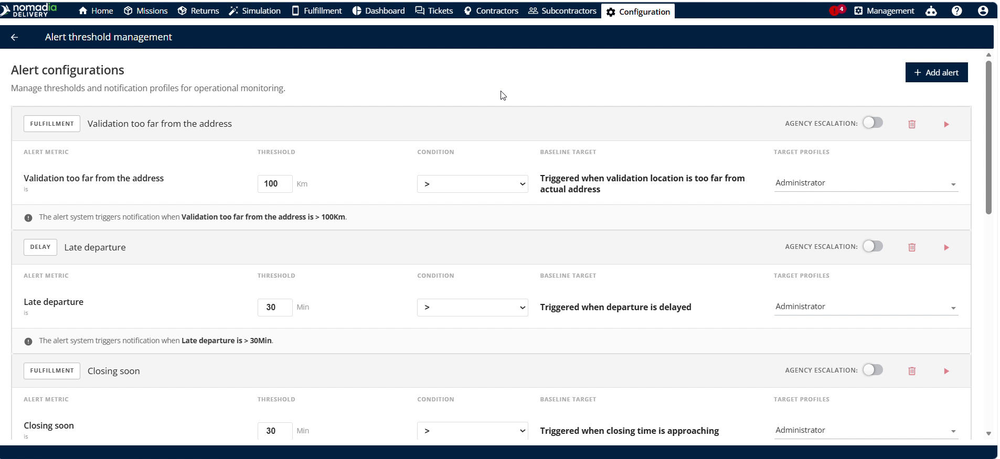
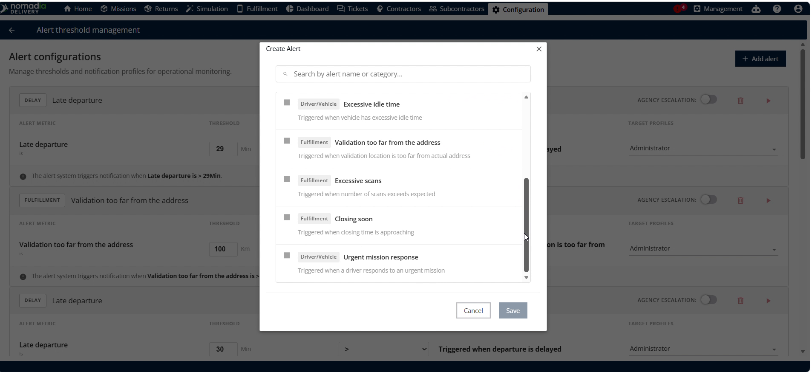
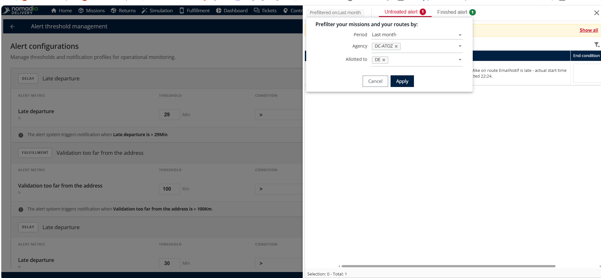
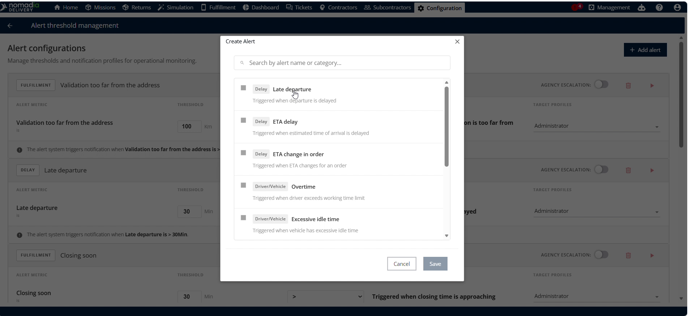
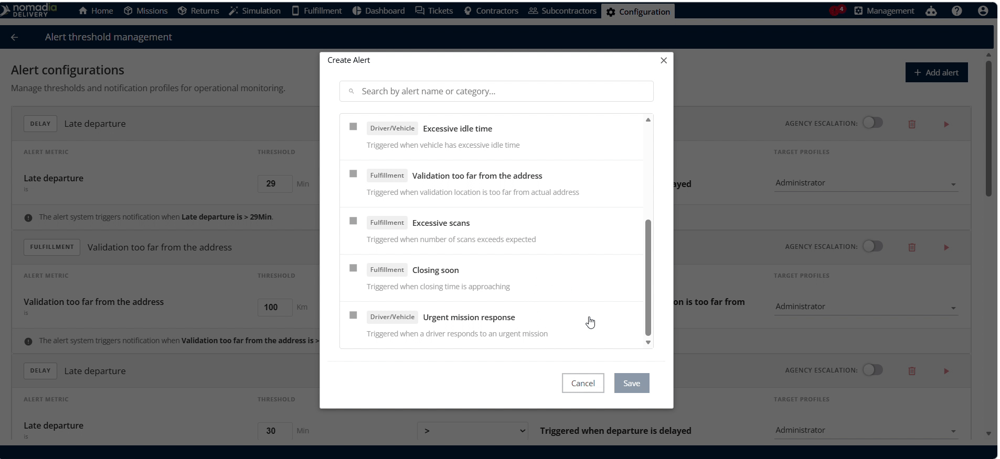

# Gestion des alertes

La gestion des seuils d’alerte dans **Nomadia Delivery** permet aux répartiteurs de définir des limites de déclenchement opérationnelles. Cette fonctionnalité aide les planificateurs à surveiller en temps réel les perturbations telles que les départs tardifs, les retards d’itinéraire et les heures supplémentaires. Configurez des règles d’alerte pour conserver une supervision opérationnelle complète et améliorer la fiabilité des livraisons.

## Avant de commencer

Prérequis :

* Un compte répartiteur actif pour **Nomadia Delivery**.

Étapes de configuration :

1. Ouvrez la page **Configuration**.

2. Cliquez sur **Gestion des seuils d’alerte** dans les options d’itinéraire.

## Présentation de la fonctionnalité

* **Icône rouge** : icône située dans le coin supérieur droit qui ouvre la fenêtre de pré-filtre.
* **Pré-filtre** : fenêtre permettant de sélectionner les critères de recherche précédents et les filtres d’agence.
* **Alerte quantitative** : vue qui liste les seuils d’alerte numériques actifs et les alertes en cours.
* **Alerte terminée** : vue qui archive les alertes terminées et résolues pour le suivi historique.
* **Ajouter une alerte** : bouton d’action qui ouvre le menu de création de nouvelles règles d’alerte.
* **Seuil de temps** : champ de saisie permettant de définir les limites de durée de déclenchement des alertes.
* **Départ tardif** : alerte déclenchée lorsque le départ du véhicule est retardé au-delà de l’heure prévue.
* **Retard d’ETA** : alerte déclenchée lorsque l’ETA (heure d’arrivée estimée) est retardée.
* **Changement d’ETA** : alerte déclenchée lorsque l’heure d’arrivée estimée d’une commande change.
* **Heures supplémentaires** : alerte déclenchée lorsque l’arrivée du véhicule dépasse les limites de temps de travail définies.
* **Temps d’immobilisation excessif** : alerte déclenchée lorsqu’un véhicule reste à l’arrêt trop longtemps.

* **Validation trop éloignée de l’adresse** : alerte déclenchée lorsque le lieu de validation est trop éloigné de l’adresse réelle.
* **Scan excessif** : alerte déclenchée lorsque le nombre de scans de colis dépasse les limites attendues.
* **Fermeture imminente** : alerte déclenchée lorsque l’heure de fermeture de la destination approche.
* **Réponse à une mission urgente** : alerte déclenchée lorsqu’un livreur répond à une invite du terminal RZ (terminal de communication du livreur).

## Pré-filtrer les alertes

1. Cliquez sur l’**icône rouge** dans le coin supérieur droit de la page **Gestion des seuils d’alerte**.
2. Sélectionnez les critères de recherche précédents dans le champ **Précédent**.
3. Sélectionnez l’agence cible dans le menu déroulant **Agence**.
4. Cliquez sur **Appliquer** pour exécuter le pré-filtre.

<figure><figcaption></figcaption></figure>

## Consulter les alertes actives et terminées

1. Passez en revue le détail des alertes filtrées sur la page **Gestion des seuils d’alerte**.

2. Sélectionnez **Alerte non traitée** pour examiner les seuils quantitatifs actifs.

3. Sélectionnez **Alerte terminée** pour examiner les alertes opérationnelles terminées.

<figure><figcaption></figcaption></figure>

## Configurer un nouveau seuil d’alerte

1. Cliquez sur **Ajouter une alerte** sur la page **Gestion des seuils d’alerte**.

2. Sélectionnez le type d’alerte souhaité dans la liste **Alertes multiples**.

3. Saisissez la valeur du seuil dans le champ **Seuil de temps**.

4. Cliquez sur **Enregistrer** pour confirmer et activer le nouveau seuil d’alerte.

5. Cliquez sur **Annuler** pour abandonner les modifications et fermer la fenêtre de configuration.

## Conseils


**Pré-filtrage par agence** : sélectionnez des pré-filtres d’agence pour isoler des unités opérationnelles précises et accélérer la recherche d’alertes.



**Audit des alertes historiques** : consultez l’onglet des alertes terminées pour examiner la résolution des alertes passées et évaluer la performance des livreurs.



**Configurations non enregistrées** : évitez de quitter la page sans cliquer sur **Enregistrer** lorsque vous configurez des seuils, sinon vos modifications seront perdues.


## Rubriques connexes

* [Éditeur d’itinéraire](routes/routeeditor.md)
* [Vue Gantt](routes/ganttview.md)
* [Vue tableau](routes/tableview.md)
