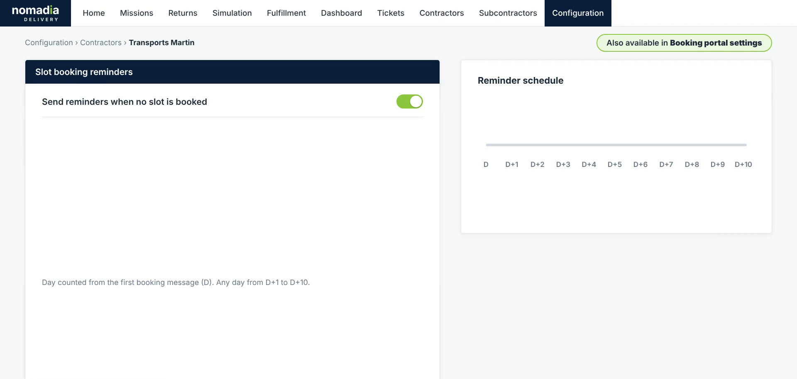
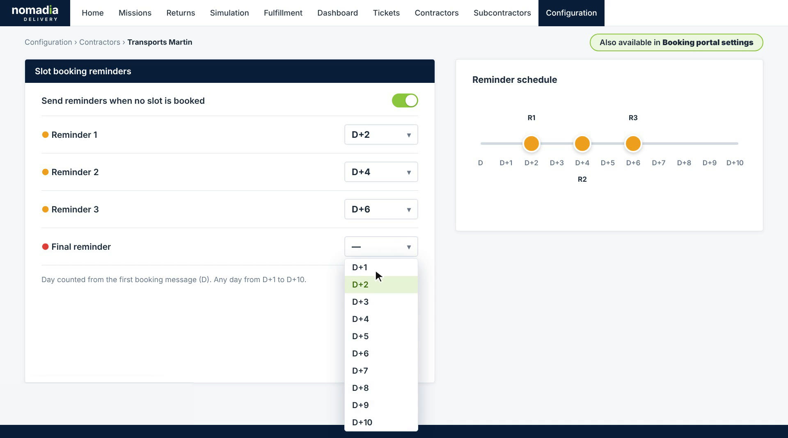
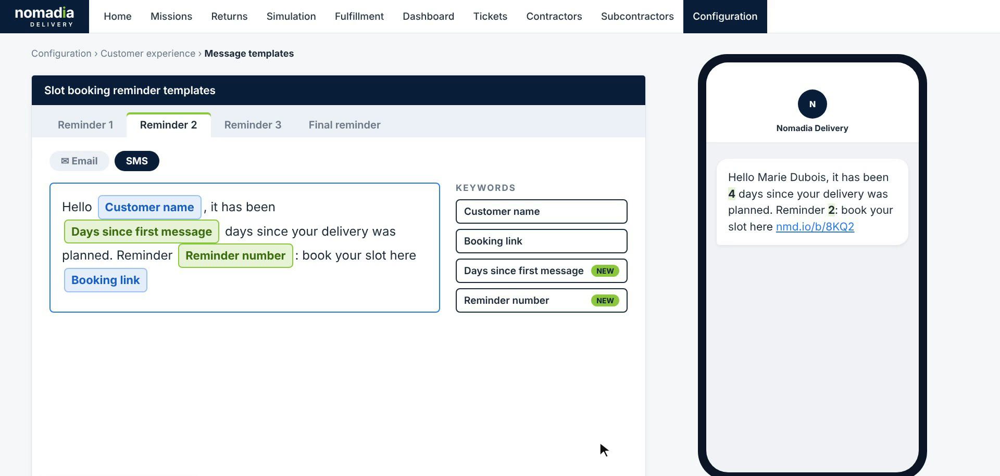
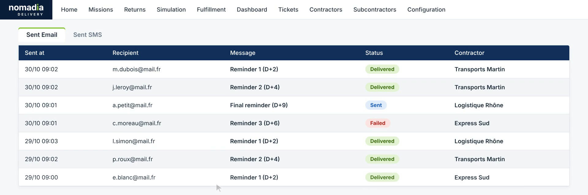

# Relances automatiques de réservation de créneau

Les relances de réservation de créneau relancent automatiquement les clients qui n’ont pas encore réservé de créneau de livraison. Après le premier message de réservation, Nomadia Delivery envoie jusqu’à quatre relances par e-mail et par SMS aux jours que vous choisissez, avec des modèles de messages dédiés. Dès que le client réserve un créneau, les relances restantes s’arrêtent. Vous réduisez le nombre de créneaux non réservés sans aucune relance manuelle.

## Avant de commencer

* Connectez-vous à **Nomadia Delivery** avec un profil utilisateur ayant accès à **Configuration**.
* Assurez-vous que le portail de réservation est configuré pour le donneur d’ordres. Voir [Configurer le portail](booking-slots/configure-the-portal.md).

## Présentation de la fonctionnalité

* **Envoyer des relances si aucun créneau n’est réservé** : option de la section **Relances de réservation de créneau** du donneur d’ordres qui active les relances. Les mêmes réglages sont aussi disponibles dans les **Paramètres du portail de réservation**.
* **Jours de relance** : jusqu’à quatre relances : **Relance 1**, **Relance 2**, **Relance 3** et **Dernière relance**. Chacune est envoyée un jour compté à partir du premier message de réservation (**J**), n’importe quel jour de **J+1** à **J+10**.
* **Calendrier des relances** : frise affichée à côté des réglages, qui indique quand chaque relance est envoyée.
* **Modèles de relance de réservation de créneau** : un modèle d’e-mail et de SMS dédié pour chaque relance, dans **Configuration** > **Expérience client** > **Modèles de messages**.
* **Mots-clés** : champs dynamiques que vous insérez dans un modèle. En plus de **Nom du client** et **Lien de réservation**, deux nouveaux mots-clés sont disponibles : **Jours depuis le premier message** et **Numéro de relance**.
* **Arrêt automatique à la réservation** : lorsque le client réserve un créneau, les relances encore programmées ne sont pas envoyées.
* **Historique complet** : chaque relance envoyée apparaît dans l’historique **E-mails envoyés** et **SMS envoyés**, avec son statut et le donneur d’ordres.

## Définir les jours de relance

1. Allez dans **Configuration** > **Donneurs d’ordres**, puis ouvrez le donneur d’ordres, par exemple **Transports Martin**.
2. Dans la section **Relances de réservation de créneau**, activez **Envoyer des relances si aucun créneau n’est réservé**.

3. Pour chaque relance à envoyer, choisissez un jour de **J+1** à **J+10** dans la liste correspondante. Laissez une relance sur **—** si vous ne souhaitez pas l’envoyer.

4. Vérifiez le **Calendrier des relances**. Chaque relance apparaît sur la frise au jour choisi.

### Résultat

Les relances sont programmées pour les missions du donneur d’ordres. Par exemple, avec la **Relance 1** à **J+2**, la **Relance 2** à **J+4**, la **Relance 3** à **J+6** et la **Dernière relance** à **J+9**, un client qui ne réserve jamais de créneau reçoit quatre relances sur neuf jours.

## Personnaliser les messages de relance

1. Allez dans **Configuration** > **Expérience client** > **Modèles de messages**.
2. Dans **Modèles de relance de réservation de créneau**, sélectionnez l’onglet de la relance à modifier, par exemple **Relance 2**.
3. Sélectionnez **E-mail** ou **SMS**.
4. Rédigez le message. Pour insérer une valeur, cliquez sur un mot-clé sous **Mots-clés** : **Nom du client**, **Lien de réservation**, **Jours depuis le premier message** ou **Numéro de relance**.
5. Vérifiez l’aperçu à côté du modèle. Il affiche le message tel que le client le recevra.

### Résultat

Chaque relance utilise son propre modèle. Par exemple, le message « Bonjour **Nom du client**, votre livraison a été planifiée il y a **Jours depuis le premier message** jours. Relance **Numéro de relance** : réservez votre créneau ici **Lien de réservation** » est reçu sous la forme « Bonjour Marie Dubois, votre livraison a été planifiée il y a 4 jours. Relance 2 : réservez votre créneau ici », suivi du lien de réservation.

## Arrêt des relances dès qu’un créneau est réservé

Vous n’avez rien à faire. Lorsque le client réserve un créneau, les relances qui n’ont pas encore été envoyées sont annulées. Dans l’exemple ci-dessous, le client a réservé à **J+3** après la **Relance 1** : la **Relance 2**, la **Relance 3** et la **Dernière relance** ne sont pas envoyées.

## Consulter les relances envoyées

1. Ouvrez l’historique des messages envoyés, puis sélectionnez l’onglet **E-mails envoyés**. Chaque relance y figure avec sa date d’envoi, le destinataire, la relance et son jour, le statut (**Délivré**, **Envoyé** ou **Échec**) et le donneur d’ordres.

2. Sélectionnez l’onglet **SMS envoyés** pour voir les relances envoyées par SMS.

## Conseils


**Espacez les relances** : laissez au moins un jour entre deux relances et gardez la **Dernière relance** pour les derniers jours avant la livraison. Les clients sont ainsi relancés sans être submergés de messages.



**Utilisez les nouveaux mots-clés** : **Jours depuis le premier message** et **Numéro de relance** distinguent clairement chaque relance de la précédente, ce qui aide les clients à comprendre qu’une action est toujours attendue.


## Rubriques connexes

* [Portail de réservation](README.md)
* [Configurer le portail](booking-slots/configure-the-portal.md)
* [Enregistrement d’un donneur d’ordres](../contractors/register-a-contractor.md)
