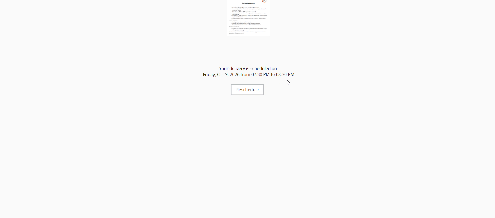
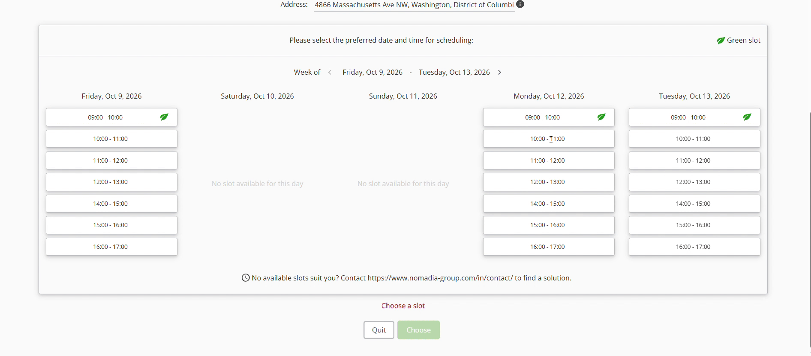

# Reporter plusieurs fois un créneau préréservé

Nomadia Delivery permet aux répartiteurs de préréserver et de reporter des créneaux horaires plusieurs fois à l’aide du lien de réservation d’origine. Cette fonctionnalité simplifie les modifications de planning sans nécessiter la création d’un nouveau lien de réservation. Les utilisateurs peuvent rapidement mettre à jour les horaires de livraison pour garantir une planification opérationnelle fluide.

## Avant de commencer

Prérequis :

* Accès actif à la plateforme Nomadia Delivery.
* Une réservation de créneau existante planifiée pour une livraison.
* Accès au lien de réservation d’origine reçu lors de la première confirmation.

Étapes de configuration initiale :

1. Repérez le message de confirmation initial contenant le **Lien de réservation**.
2. Cliquez sur le **Lien de réservation** pour ouvrir la page de gestion du planning.

## Présentation de la fonctionnalité

* **Lien de réservation** : rouvre la page de planification à l’aide du lien d’origine envoyé lors de la réservation initiale du créneau.
* **Date et horaire planifiés** : affiche la date et le créneau horaire actuellement confirmés pour la livraison.
* **Option de report** : ouvre les autres créneaux horaires disponibles pour une nouvelle réservation.
* **Dates et horaires disponibles** : affiche les options de date et d’horaire sélectionnables pour la préréservation.

## Reporter un créneau préréservé

1. Cliquez sur le **Lien de réservation** d’origine reçu lors de la réservation du premier créneau.

2. Vérifiez les détails de votre créneau actuel sous **Date et horaire planifiés**.

3. Cliquez sur l’**Option de report** située sous les détails du planning actuel.

4. Consultez la liste des **Dates et horaires disponibles**.

5. Sélectionnez l’horaire de votre choix et cliquez sur **Choisir** pour réserver le créneau.

## Conseils


**Réutiliser les liens de réservation d’origine** : rouvrez le lien de réservation reçu lors de la réservation initiale pour modifier rapidement les horaires du créneau sans générer de nouvelles demandes.


## Rubriques connexes

* [Report par le client](rescheduling-by-customer.md)
* [Configuration du report](reschedule-configuration.md)
* [Créneaux de réservation](booking-slots/README.md)
