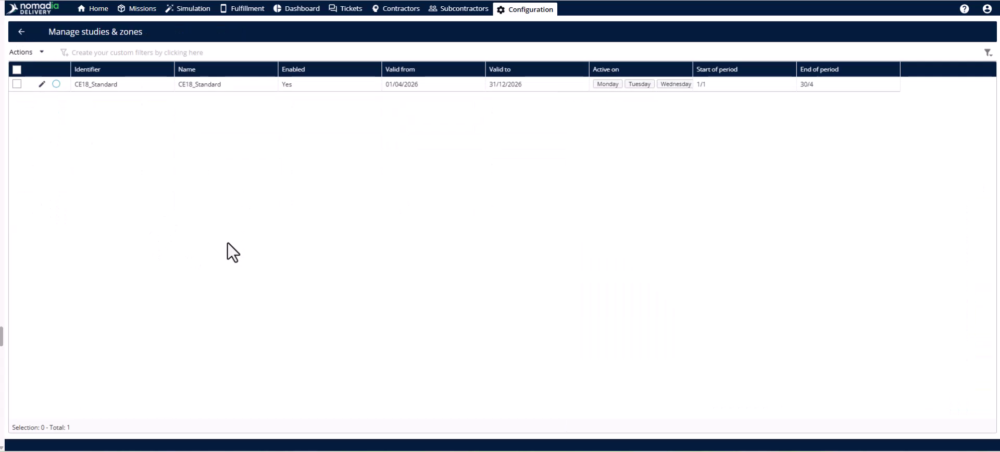
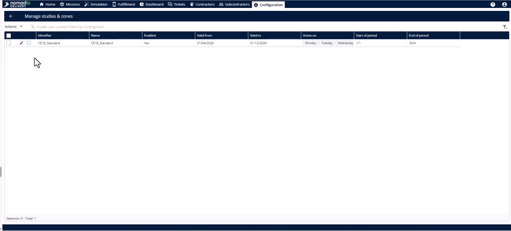
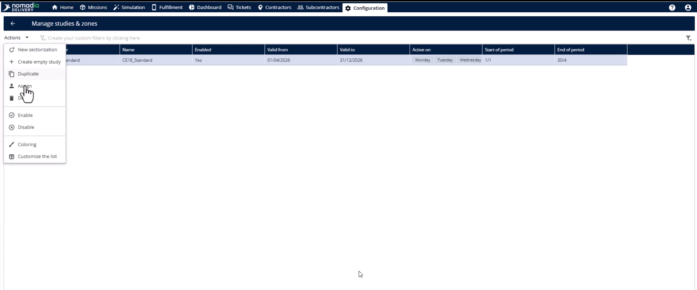
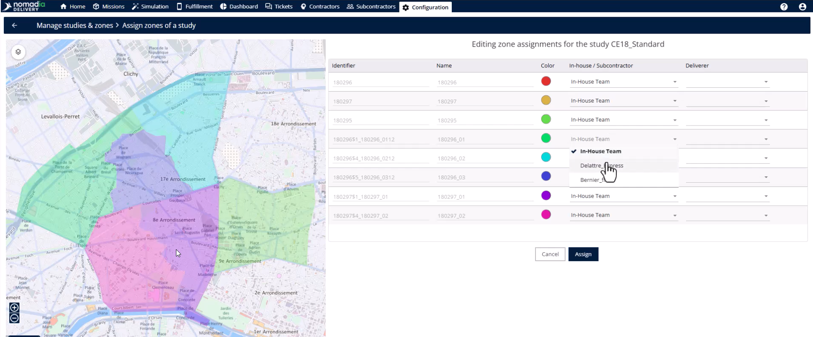
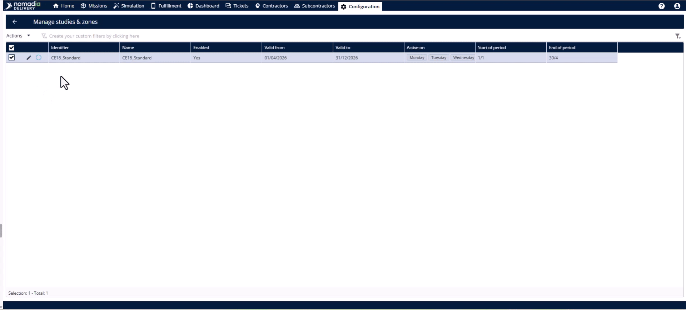
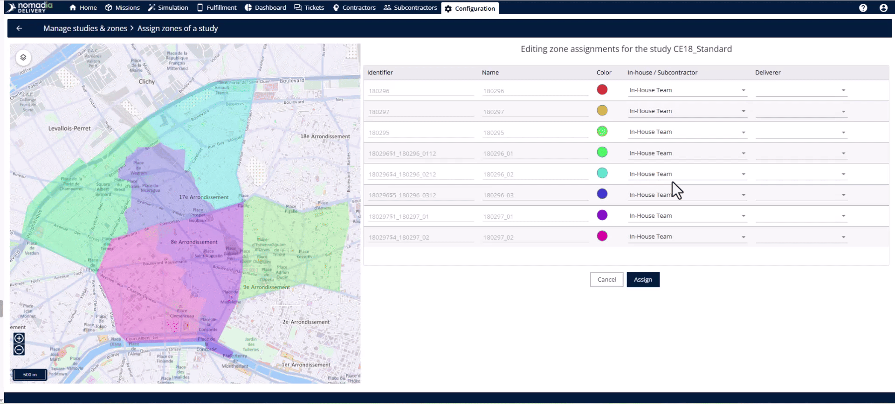
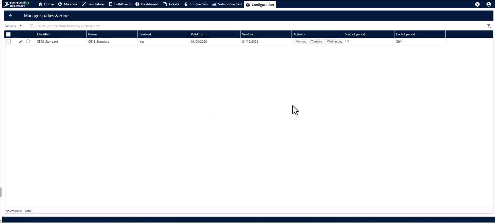
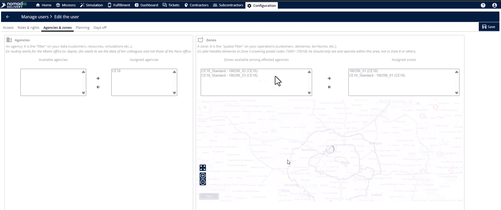
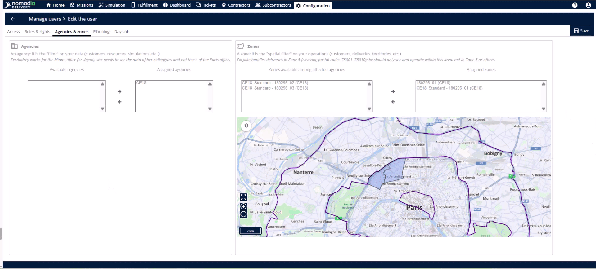

# Attribution des sous-zones

Transformez les formes de la carte en territoires opérationnels en les attribuant à des équipes et livreurs spécifiques. Ce processus garantit que chaque arrêt de livraison a un propriétaire clair et synchronise les données sur l’ensemble de la plateforme. En réalisant ces attributions, vous rendez les zones de livraison actives et prêtes pour les opérations quotidiennes.

## Avant de commencer

* Assurez-vous que les sous-zones sont créées et équilibrées géographiquement.
* Confirmez que tous les livreurs internes et sous-traitants sont enregistrés dans le système.

1. Accédez au tableau d’étude.

2. Sélectionnez l’étude spécifique à attribuer.

## Présentation de la fonctionnalité

* **Menu Actions** : accédez aux outils d’attribution principaux pour l’étude sélectionnée.

<figure><figcaption></figcaption></figure>

* **Page d’attribution** : l’espace de travail où vous définissez la propriété de chaque ligne de sous-zone individuelle.

* **Liste déroulante d’équipe** : choisissez entre une équipe interne ou une équipe sous-traitante pour un territoire spécifique.

<figure><figcaption></figcaption></figure>

* **Liste déroulante du livreur** : reliez une personne spécifique sur le terrain à une frontière géographique.

<figure><figcaption></figcaption></figure>

## Attribuer des sous-zones et vérifier la synchronisation

1. Ouvrez le **menu Actions** et cliquez sur **attribuer**.

2. Identifiez chaque sous-zone par son identifiant unique et son **code couleur**.
3. Sélectionnez l’**équipe interne** ou l’**équipe sous-traitante** pour chaque ligne de sous-zone.

4. Choisissez la bonne personne dans la liste déroulante **Livreur** pour chaque ligne.

5. Cliquez sur le **bouton attribuer** pour finaliser la propriété.

6. Accédez au **module de configuration** et sélectionnez la **page de gestion des utilisateurs** pour vérifier.

7. Cliquez sur **modifier** sur le livreur et consultez l’**onglet agences et zones**.

<figure><figcaption></figcaption></figure>

8. Vérifiez le **module sous-traitant** pour confirmer que l’attribution est reflétée dans leur **profil**.

## Conseils


**Attribution déléguée** : accordez aux sous-traitants le droit d’attribuer des sous-zones afin qu’ils puissent gérer leurs propres livreurs internes.



**Synchronisation instantanée** : les données du système circulent automatiquement sur toute la plateforme sans nécessiter d’actualisation ou de synchronisation manuelle.



**Zones non attribuées** : évitez de laisser des sous-zones non attribuées, car elles restent des formes non opérationnelles sur la carte, sans propriétaire.


## Rubriques connexes

* [Études de cas](README.md)
* [Attribution des zones aux missions](assigning-zones-to-missions.md)
* [Réaffecter les zones manuellement](reassign-zones-manually.md)
