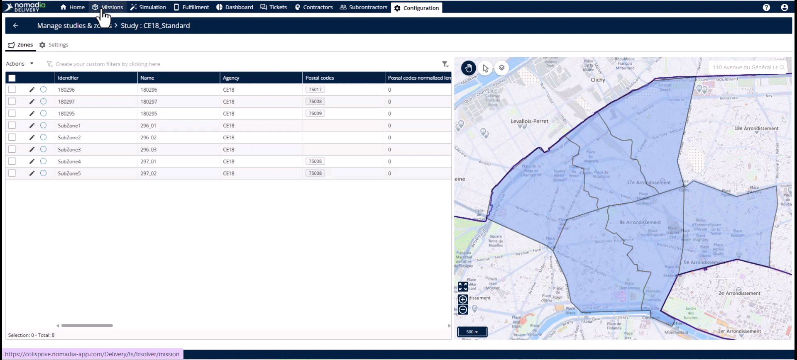
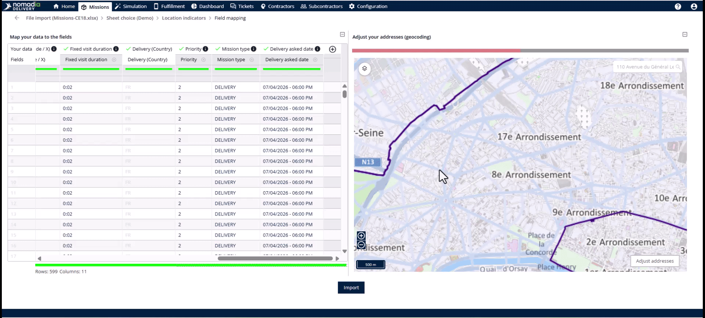
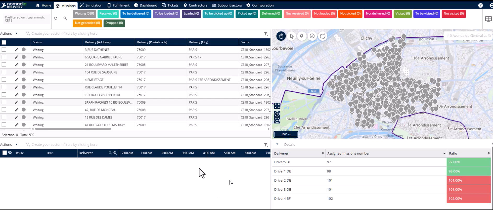
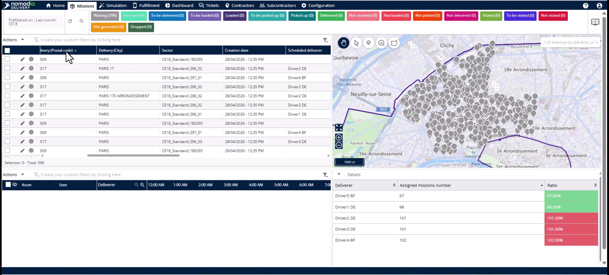
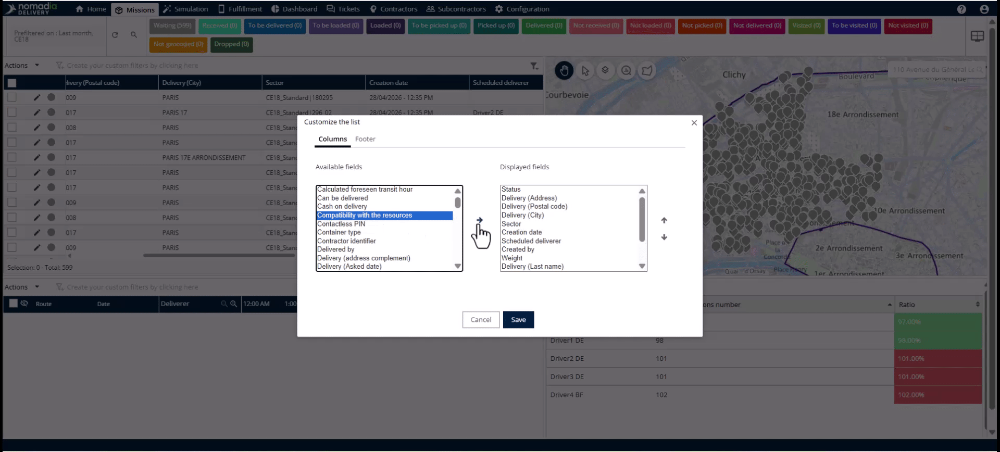

# Attribution des zones aux missions

Cette fonctionnalité associe automatiquement les nouvelles missions à des secteurs de livraison prédéfinis dès leur entrée dans le système. Elle élimine le besoin de recherches manuelles par code postal ou d’intervention du dispatcher. Vous obtiendrez en quelques secondes un flux de travail efficace et entièrement automatisé, de la création de la mission à l’affectation au secteur.

## Avant de commencer

Avant d’utiliser l’affectation automatique des secteurs, assurez-vous que votre infrastructure opérationnelle est configurée :

* Créez vos études.
* Cartographiez les zones principales.
* Créez et équilibrez les sous-zones.
* Affectez les livreurs à leurs territoires spécifiques.

Pour commencer la configuration :

1. Accédez à l’**onglet Missions**.
2. Cliquez sur le **menu Actions**.

## Présentation de la fonctionnalité

* **Géocodage** : ce processus convertit les données d’adresse en coordonnées de latitude et de longitude pour l’affichage sur une carte géographique.
* **Champ Secteur** : cette colonne affiche les affectations de mission au format « Nom de l’étude | Nom de la sous-zone ».
* **Icône de zone** : utilisez cette commande cartographique pour basculer la visibilité des limites des sous-zones.

## Importer des missions et attribuer des secteurs

Suivez ces étapes pour importer des missions via Excel et déclencher l’affectation automatique.

1. Cliquez sur le **bouton Importer** dans le **menu Actions**.

2. Sélectionnez le fichier de mission depuis votre ordinateur et cliquez sur **Ouvrir**.
3. Sélectionnez l’onglet souhaité et cliquez sur le **bouton Valider**.
4. Passez en revue sur la carte les emplacements des missions géocodées.
5. Cliquez sur le **bouton Importer** pour envoyer les données vers **Nomadia Delivery**.

### Résultat

Les champs **Secteur** et **Livreur programmé** sont automatiquement renseignés en fonction des paramètres de zone configurés.

<figure><figcaption></figcaption></figure>

## Afficher la colonne Secteur

Si les informations de secteur sont masquées, suivez ces étapes pour les afficher dans votre tableau.

1. Cliquez sur le **menu Actions**.
2. Sélectionnez **Personnaliser l’élément de liste**.

3. Localisez le champ **Secteur** dans la colonne **Champs disponibles**.
4. Cliquez sur le **bouton flèche** pour le déplacer vers la colonne **Champs affichés**.

5. Cliquez sur **Enregistrer** pour mettre à jour le tableau des missions.

## Conseils


**Revues opérationnelles** : activez les limites de zone sur la carte pour repérer les territoires surchargés ou les répartitions de missions inégales.



**Limites statiques** : évitez d’utiliser des limites obsolètes lorsque la demande évolue ; mettez à jour votre configuration pour garder des opérations dynamiques.


## Rubriques connexes

* [Études de cas](README.md)
* [Attribution des sous-zones](assigning-sub-zones.md)
* [Création d’une étude avec zone principale](study-creation-with-primary-zone.md)
