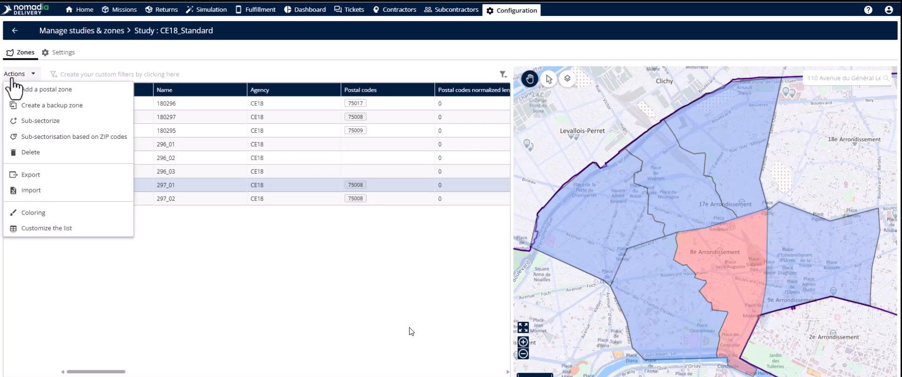
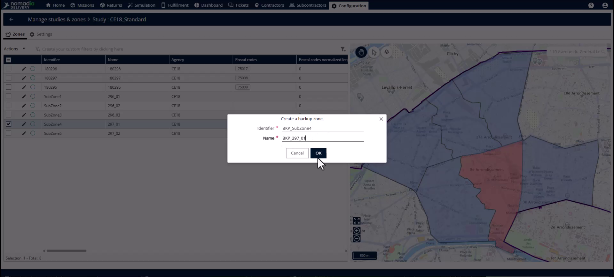
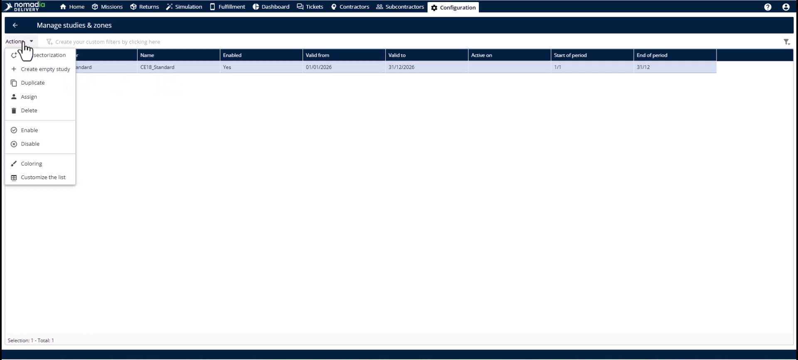
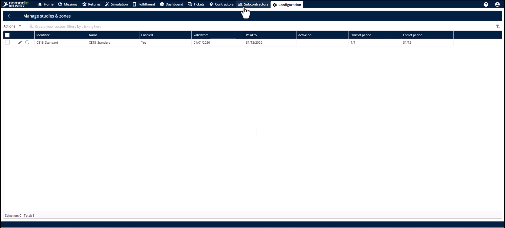
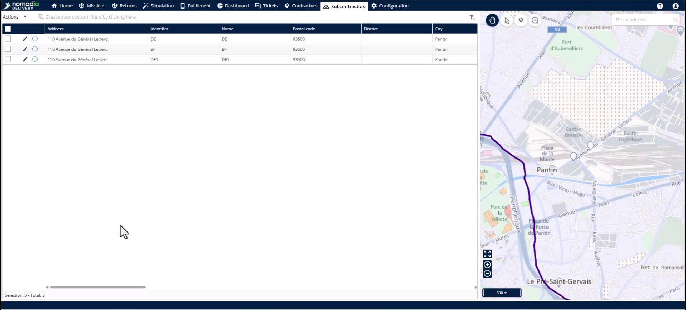

# Création d'une zone de secours

La fonctionnalité Zone de secours vous permet de gérer les absences imprévues de sous-traitants en créant des secteurs secondaires temporaires. Elle permet un transfert rapide des missions existantes vers les équipes disponibles sans modifier votre infrastructure principale. Cela garantit que vos SLA sont respectés et que les livraisons arrivent à l’heure malgré les changements de nuit.

## Avant de commencer

* Accès au **module de configuration**.
* Une sous-zone principale existante nécessitant une sauvegarde.
* Un sous-traitant de remplacement disponible pour l’affectation.

1. Accédez au **module de configuration**.

2. Cliquez sur **gérer les études et les zones**.

3. Sélectionnez l’**icône crayon** à côté de l’étude concernée.

## Présentation de la fonctionnalité

* **Sous-secteur principal** : le territoire de livraison d’origine attribué au premier sous-traitant.

* **Sous-secteur secondaire** : le mode d’affectation de la zone de secours nouvellement créée, qui la distingue de l’original.

* **Identifiant** : un champ de code unique pour la zone de secours.

* **Tableau des zones** : la liste dans l’étude affichant à la fois les zones principales et les zones de secours.

## Créer une zone de secours

1. Cliquez sur la **sous-zone principale** que vous souhaitez sauvegarder.

2. Ouvrez le **menu des actions**.

<figure><figcaption></figcaption></figure>

3. Sélectionnez **créer une zone de secours**.
4. Saisissez un nouvel **identifiant** et un nouveau **nom**.

5. Cliquez sur **OK** pour créer la zone.

## Affecter un sous-traitant de secours

1. Choisissez l’étude concernée.

2. Cliquez sur **actions** et sélectionnez **attribuer** à nouveau.

3. Cliquez sur **attribuer** pour lier le territoire.

## Vérifier l’affectation

1. Accédez au **module des sous-traitants**.

2. Cliquez sur **modifier** sur le sous-traitant de remplacement.

3. Vérifiez le menu déroulant **zones secondaires**.

## Conseils


**Synchronisation automatique** : les mises à jour du système sont effectuées immédiatement, sans actualisation manuelle, après avoir cliqué sur attribuer.



**Mise à jour des missions existantes** : les sous-traitants de remplacement ne peuvent pas voir les missions en cours tant que vous n’avez pas mis à jour les informations du secteur et du livreur.



**Préserver l’infrastructure** : les zones de secours sont temporaires et ne modifient pas la configuration de votre sous-zone principale.


## Rubriques connexes

* [Études de cas](README.md)
* [Permutation du sous-traitant vers la zone de secours](subcontractor-swap-to-backup-zone.md)
* [Permutation du sous-traitant vers la zone principale](subcontractor-swap-to-primary-zone.md)
