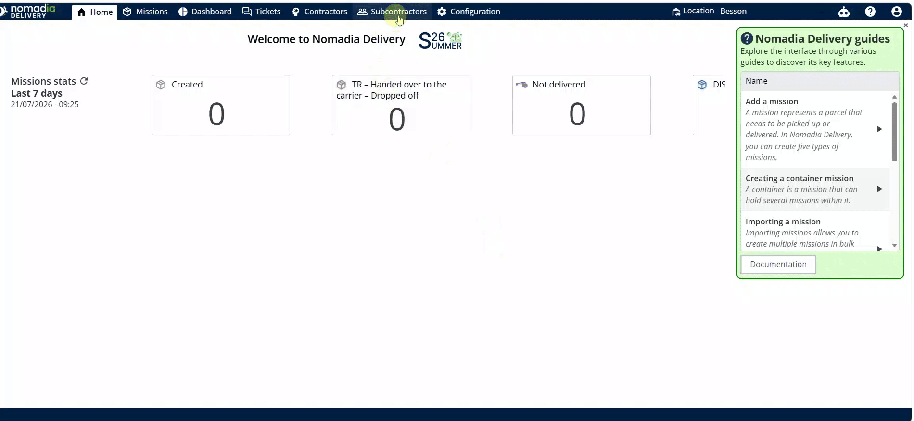

# Configuration de l’iFrame

Configurez les paramètres iFrame pour les sous-traitants dans Nomadia Delivery afin d’intégrer des données de mission externes. Cette fonctionnalité vous permet de personnaliser l’affichage des URL externes pour des utilisateurs spécifiques. Vous obtiendrez une expérience de visualisation personnalisée pour chaque profil de sous-traitant.

## Avant de commencer

* Accès au tableau de bord Nomadia Delivery.
* Une URL ou un ID de mission valide.

1. Accédez au menu **Sous-traitants**.
2. Repérez la liste des utilisateurs à l’écran.

<figure><figcaption></figcaption></figure>

## Présentation de la fonctionnalité

* **Icône crayon** : ouvre l’interface de modification pour un sous-traitant sélectionné.
* **URL iFrame** : champ utilisé pour saisir l’URL ou l’ID de mission.
* **Largeur iFrame** : définit la dimension horizontale du cadre intégré.
* **Hauteur iFrame** : définit la dimension verticale du cadre intégré.

## Configurer l’iFrame d’un sous-traitant

1. Cliquez sur l’**icône crayon** à côté de l’utilisateur.

2. Remplacez l’URL existante par votre URL ou votre ID de mission.

3. Définissez la valeur de la **largeur iFrame**.
4. Définissez la valeur de la **hauteur iFrame**.
5. Cliquez sur **Enregistrer** pour sauvegarder les modifications.

## Conseils


**Confirmation de modification** : vérifiez la configuration en attendant le message contextuel « Le sous-traitant existant a été modifié ».


## Rubriques connexes

* [Affecter aux sous-traitants](README.md)
* [Interaction avec l’iFrame](interaction-avec-liframe.md)
* [Enregistrer un sous-traitant](../../../subcontractor-management/register-a-subcontractor.md)
