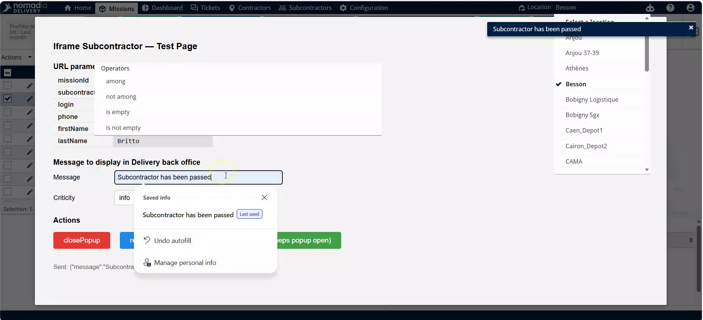
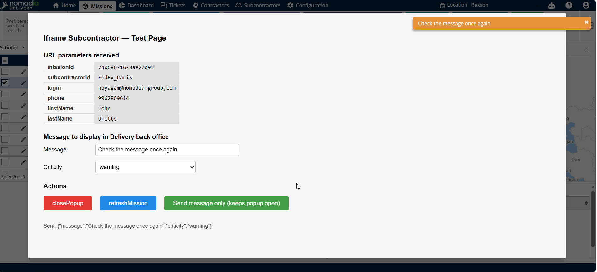
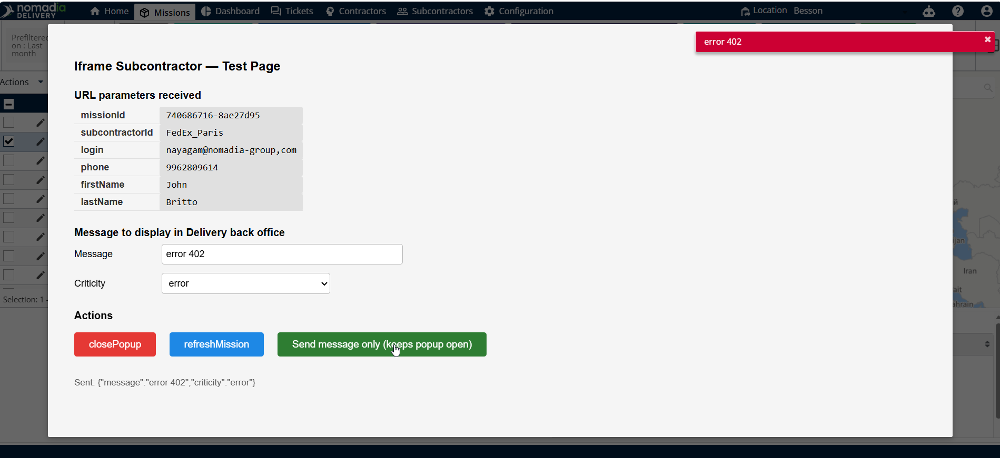
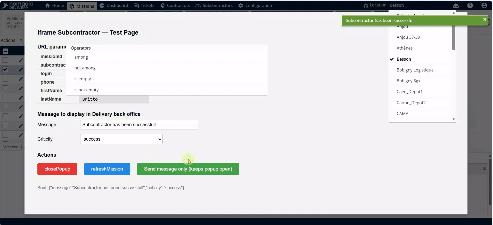

# Interaction avec l’iFrame

Cette fonctionnalité vous permet de communiquer directement avec les sous-traitants via une interface externe intégrée. Vous pouvez envoyer des mises à jour de statut et des messages spécifiques sans quitter l’application principale. Cela garantit un transfert de données fluide entre votre système et le portail externe du sous-traitant.

## Avant de commencer

* Accès à la page **Missions**.
* Une URL de sous-traitant préconfigurée dans les paramètres de votre système.

1. Accédez à la page **Missions**.
2. Sélectionnez la **mission** souhaitée dans la liste.
3. Cliquez sur **Actions**.
4. Cliquez sur **Affecter au sous-traitant**.

## Présentation de la fonctionnalité

* **Champ Message** : utilisez cette zone pour saisir des instructions personnalisées ou des mises à jour de statut.
* **Actions** : catégories de statut sélectionnables telles que **Info**, **Avertissement**, **Erreur** ou **Succès**.
* **Envoyer le message** : soumet vos données et déclenche une fenêtre contextuelle de confirmation dans l’interface.

## Envoyer une mise à jour Info

1. Saisissez votre message dans le **champ Message**.
2. Sélectionnez le statut **Info**.
3. Cliquez sur **Envoyer le message**.
4. Consultez la fenêtre contextuelle « Le sous-traitant a été transmis ».

## Envoyer un avertissement

1. Modifiez le texte existant dans le **champ Message**.
2. Changez le statut en **Avertissement**.
3. Cliquez sur **Envoyer le message uniquement**.
4. Consultez la fenêtre contextuelle « Vérifiez à nouveau l’e-mail ».

<figure><figcaption></figcaption></figure>

## Envoyer une erreur

1. Saisissez les informations requises dans le **champ Message**.
2. Sélectionnez le statut **Erreur**.
3. Cliquez sur **Envoyer le message uniquement**.
4. Consultez la fenêtre contextuelle du message d’erreur.

<figure><figcaption></figcaption></figure>

## Finaliser une affectation réussie

1. Sélectionnez le statut **Succès**.
2. Modifiez le **message** final.
3. Cliquez sur **Envoyer le message uniquement**.
4. Consultez la fenêtre contextuelle « Le sous-traitant a été affecté avec succès ».

## Quitter l’interface

1. Actualisez la page une fois les tâches terminées.
2. Fermez la fenêtre contextuelle.

## Conseils


**Retour aux missions** : la fermeture de la dernière fenêtre contextuelle vous ramène automatiquement à la page **Missions**.



**Confirmer l’action** : cliquez toujours sur **Envoyer le message** pour déclencher la fenêtre contextuelle de statut requise et vous assurer que la mise à jour est traitée.


## Rubriques connexes

* [Affecter aux sous-traitants](README.md)
* [Configuration de l’iFrame](configuration-de-liframe.md)
