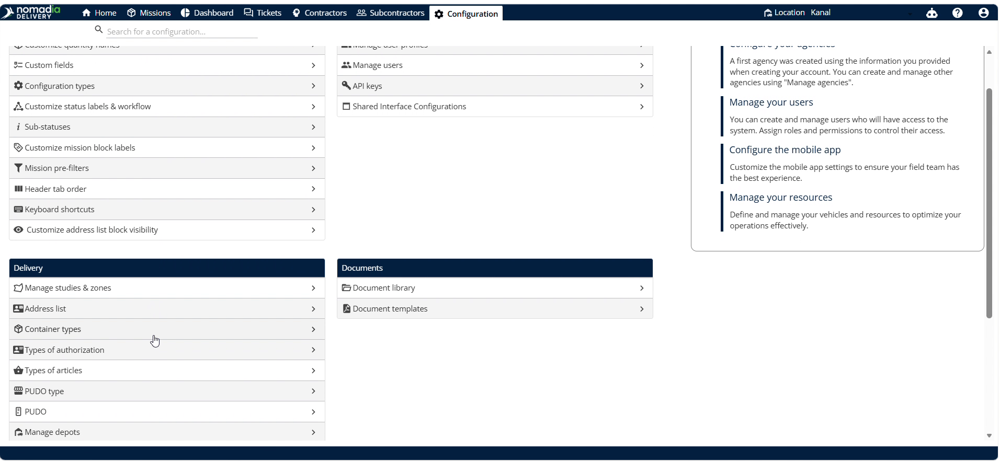
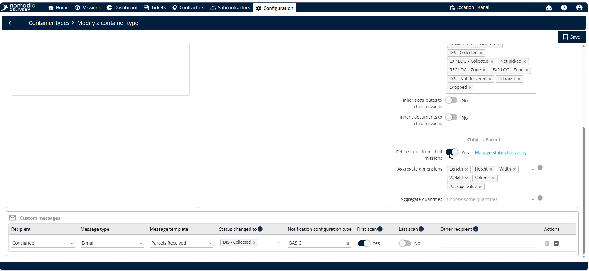
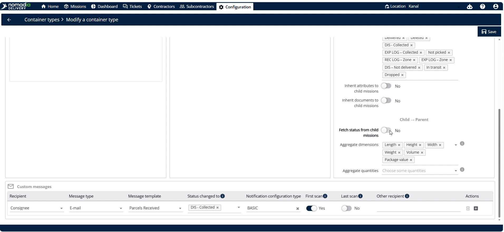
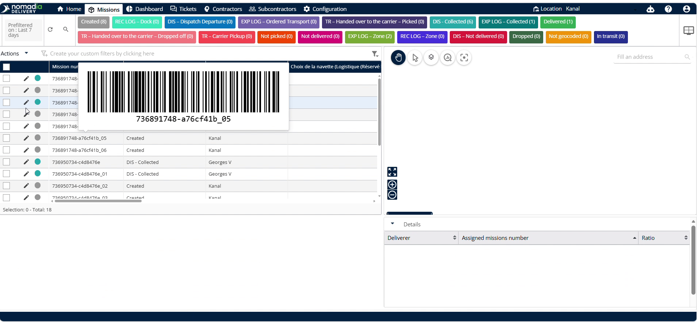
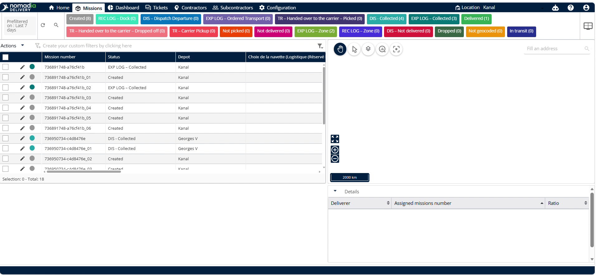

# Personnaliser la hiérarchie des statuts

Cette fonctionnalité permet aux répartiteurs de gérer la manière dont les changements de statut des missions enfants influencent les conteneurs parents. Elle garantit un suivi précis en temps réel dans l’ensemble de vos opérations logistiques. Personnalisez facilement les priorités de statut pour simplifier la synchronisation de l’état des conteneurs.

## Avant de commencer

Assurez-vous de remplir les prérequis suivants :

Cette fonctionnalité est activée exclusivement pour les comptes configurés en mode Sans Itinéraire.

* Créez un conteneur parent dans le système.
* Créez un conteneur enfant.

## Aperçu de la fonctionnalité

* **Types de conteneurs** : Sélectionne la catégorie de conteneur que vous souhaitez configurer.
* **Nom de l’identifiant** : Indique le nom unique permettant d’identifier le type de conteneur.
* **Récupérer le statut des missions enfants** : Active la récupération des mises à jour de statut depuis les missions enfants.
* **Gérer la hiérarchie des statuts** : Ouvre la fenêtre de priorisation des statuts pour organiser les priorités.

Suivez ces étapes de configuration initiale :

1. Ouvrez la page **Configuration**.

2. Sélectionnez **Types de conteneurs**.

3. Faites défiler la page vers le bas pour sélectionner le bon **Nom de l’identifiant**.

<figure><figcaption></figcaption></figure>

4. Repérez l’option **Récupérer le statut des missions enfants** dans le coin inférieur droit.

5. Vérifiez si l’option est activée.

6. Cliquez sur **Gérer la hiérarchie des statuts** une fois l’option activée.

## Personnaliser la hiérarchie des statuts

1. Ouvrez la fenêtre de configuration de la hiérarchie des statuts.

2. Faites glisser le statut souhaité vers la position de priorité la plus élevée.

* Le statut situé en haut est considéré comme le statut prioritaire du conteneur si les enfants ont plusieurs statuts différents.

3. Cliquez sur **Terminé**.

4. Cliquez sur **Enregistrer**.

5. Accédez à **Missions**.

6. Cliquez sur un **conteneur enfant** (missions individuelles rattachées au conteneur parent).

7. Modifiez le statut.

8. Cliquez sur **Enregistrer**.

9. Le statut du conteneur est déterminé par la hiérarchie des statuts définie sur son type de conteneur.

### Résultat

**Exemple** : Seuls les statuts faisant partie de la hiérarchie sont transmis au parent. Si un statut ne figure pas dans la hiérarchie, la mission conserve son statut précédent.

## Conseils


**Priorisation des statuts** : Faites glisser un statut en haut de la liste pour définir facilement sa priorité.



**Activer la récupération du statut** : Activez d’abord **Récupérer le statut des missions enfants**, sinon l’option **Gérer la hiérarchie des statuts** ne sera pas visible.


## Rubriques associées

* [Personnaliser le flux de travail](personnaliser-le-flux-de-travail.md)
* [Mode Sans Itinéraire](README.md)
* [Héritage de l’enfant vers le parent](../../manage-container-types/childtoparentinheritance.md)
