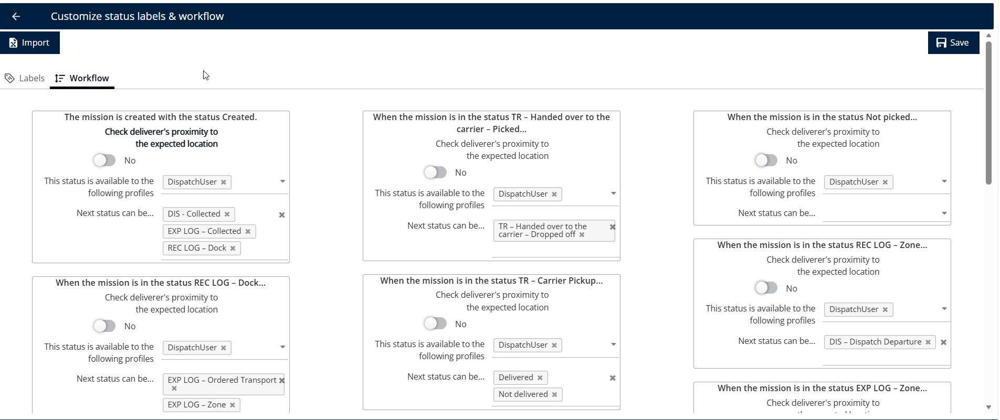
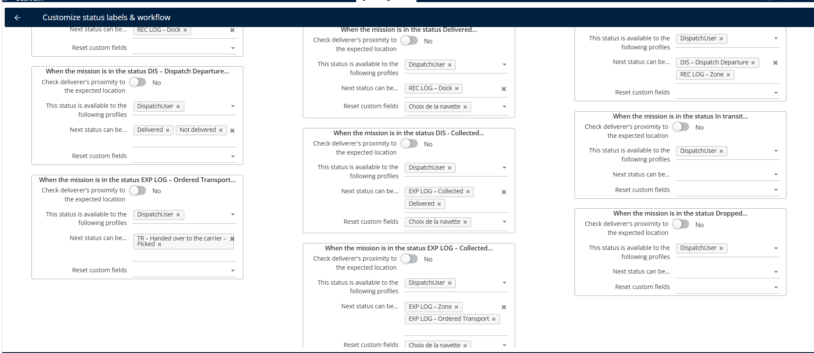
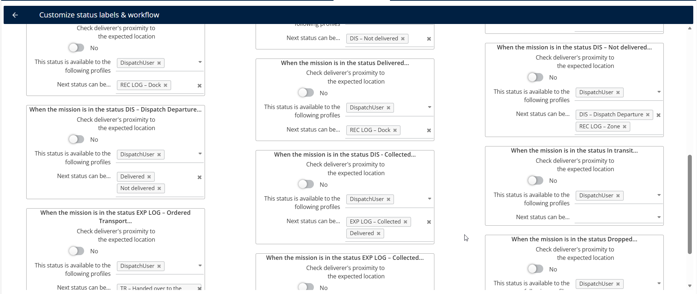

# Personnaliser le flux de travail

La fonctionnalité de flux de travail personnalisé vous permet de définir la progression des statuts de mission et de contrôler qui peut les modifier. Les **profils utilisateurs** configurés définissent qui peut se connecter et effectuer des actions liées à la livraison, notamment la mise à jour des statuts de mission. Cela garantit un processus de livraison structuré, sécurisé et vérifié géographiquement.

## Avant de commencer

Cette fonctionnalité est activée exclusivement pour les comptes configurés en mode Sans Itinéraire.

1. Ouvrez la page **Configuration**.
2. Cliquez sur **Personnaliser les tables de statut et le flux de travail**.
3. Pour en savoir plus sur la personnalisation des libellés, consultez le lien suivant :

[Personnalisation des libellés de statut](../../missions/customizing-status-labels.md)

* Cliquez sur l’onglet **Flux de travail**.

<figure><figcaption></figcaption></figure>

## Aperçu de la fonctionnalité

* **Mappage du flux de travail** : Définissez quel statut peut être modifié vers un statut suivant spécifique.
* **Bouton de proximité** : Activez cette option pour exiger que l’utilisateur se trouve à proximité de l’adresse du client lorsque ce statut est appliqué dans l’application mobile.
* **Définition de profil** : Seuls les utilisateurs disposant des droits appropriés peuvent faire passer une mission d’un statut à un autre.

## Personnaliser un flux de travail de mission

1. Sélectionnez un statut de départ dans la grille du flux de travail, par exemple **En attente**.
2. Attribuez un rôle utilisateur depuis le menu déroulant **Profil** pour contrôler qui peut modifier le statut.
3. Sélectionnez les statuts cibles vers lesquels la mission peut évoluer, par exemple **DIS collecté** ou **EXP log collecté**.
4. Configurez la transition suivante, par exemple en autorisant un **Utilisateur Dispatch** à scanner une mission et à la passer à **Livré**.
5. Sélectionnez les champs personnalisés que vous souhaitez réinitialiser lors de la transition de statut.

<figure><figcaption></figcaption></figure>

6. Cliquez sur **Enregistrer** pour appliquer les modifications.

### Résultat

**Remarque** : La page **Flux de travail** permet aux utilisateurs de configurer le flux des statuts de mission. Ils peuvent définir entre quels statuts une mission peut transitionner et spécifier les **profils utilisateurs** autorisés à effectuer chaque changement de statut. Cela offre un contrôle total sur le flux de travail de livraison en garantissant que seuls les profils désignés peuvent exécuter des transitions de statut spécifiques.

<figure><figcaption></figcaption></figure>

## Conseils


**Modifications non enregistrées** : Cliquez toujours sur **Enregistrer** après avoir effectué des modifications pour vous assurer que celles de votre flux de travail sont sauvegardées.


## Rubriques associées

* [Personnaliser la hiérarchie des statuts](customizethestatushierarchy.md)
* [Personnalisation des libellés de statut](../../missions/customizing-status-labels.md)
* [Mode Sans Itinéraire](README.md)
