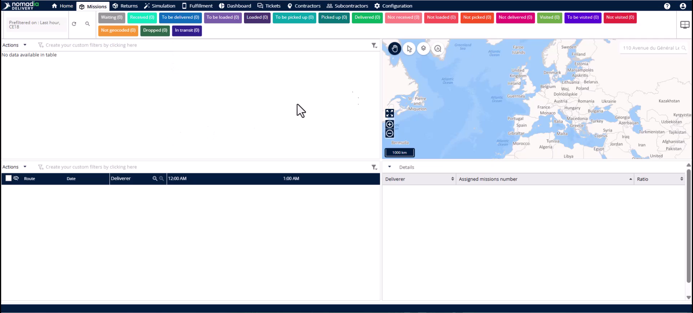
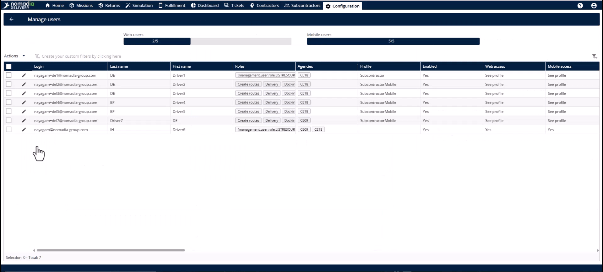
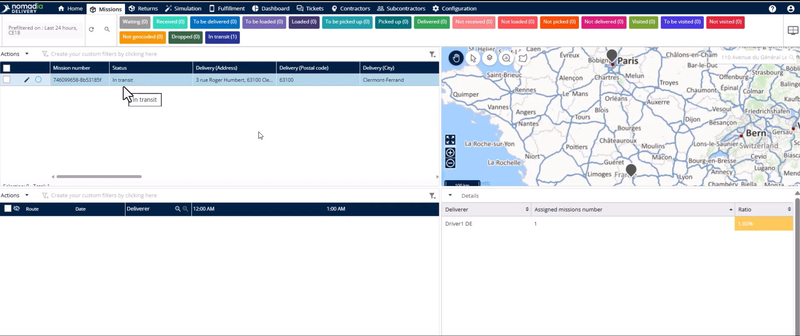
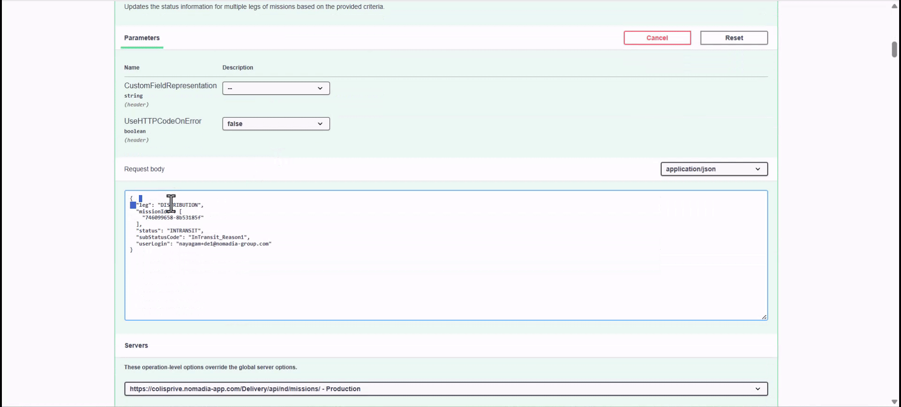

# Missions à étapes multiples

**Nomadia Delivery** utilise des missions à plusieurs étapes pour suivre les colis à travers plusieurs hubs et agences, de l’enlèvement en premier kilomètre à la livraison du dernier kilomètre. Cette fonctionnalité offre une visibilité de bout en bout pour les opérations complexes de la chaîne d’approvisionnement en suivant une mission à chaque point de contact. Vous obtiendrez une chaîne de responsabilité complète et traçable pour chaque colis de votre réseau.

## Avant de commencer

Pour utiliser cette fonctionnalité, assurez-vous de disposer d’un compte utilisateur avec les autorisations correspondant à votre agence spécifique.

* Accès au Backoffice de **Nomadia Delivery**.
* Compte utilisateur affecté à une **Agence d’origine**.
* Infrastructure de routage configurée pour l’affectation automatique des zones.

1. Connectez-vous à **Nomadia Delivery** en tant qu’utilisateur de l’**Agence d’origine**.

## Présentation de la fonctionnalité

* **Agence** : affiche la position actuelle de la mission et détermine la visibilité de l’utilisateur.
* **Agence d’origine** : indique le hub où commence l’enlèvement en premier kilomètre.
* **Agence de destination** : indique le hub final à partir duquel le client reçoit le colis.
* **Étape** : indique la phase actuelle : Collecte, Distribution ou Livraison.

## Créer une mission à plusieurs étapes

1. Cliquez sur l’onglet **Mission**.

2. Sélectionnez **Ajouter** dans le menu **Actions**.
3. Sélectionnez **Cross-Docking** comme type de mission, choisissez l’agence requise, puis cliquez sur **Suivant**.

4. Sélectionnez l’**Agence d’origine** et l’**Agence de destination**.
5. Définissez l’**Étape** sur **Collecte**.
6. Saisissez les détails du lieu d’enlèvement et de livraison.
7. Cliquez sur **Ajouter** pour enregistrer la mission.

## Mettre à jour les étapes de mission et la visibilité (API /updateMultiLegStatusInformation)

1. Utilisez le point de terminaison **Mettre à jour les informations d’état multi-étapes** pour passer d’une étape à l’autre.
2. Définissez l’**Étape** sur **Distribution** lorsque l’article est prêt pour le transit sur le trajet intermédiaire.

3. Accédez au module **Configuration** pour gérer la visibilité des utilisateurs.
4. Sélectionnez **Modifier** pour un utilisateur spécifique sur la page **Gérer les utilisateurs**.
5. Ouvrez l’onglet **Règles et droits**.

6. Activez le droit **Gérer les missions en transit**.
7. Cliquez sur **Enregistrer** pour permettre à l’utilisateur de voir les missions qui ont quitté son hub.

8. Ouvrez l’onglet **Missions** pour afficher les missions en transit.

<figure><figcaption></figcaption></figure>

9. Mettez à jour l’**Étape** sur **Livraison** lorsque la mission arrive au hub final.
10. Définissez le **Statut** sur **Reçu** pour l’utilisateur de l’agence de destination.

## Auditer l’historique de la mission

1. Ouvrez une mission dans l’**Éditeur**.
2. Sélectionnez l’onglet **Journaux** pour afficher chaque changement de statut et chaque transition d’agence.

<figure><figcaption></figcaption></figure>

## Conseils


**Affectation automatique** : l’infrastructure de routage remplit automatiquement les agents et les sous-zones dès que vous créez la mission.



**Saisie flexible** : créez des missions directement dans un statut de distribution ou de livraison si des sous-traitants ont géré la collecte initiale.



**Perte de visibilité** : les missions disparaissent normalement de la vue d’origine une fois qu’elles quittent le hub, sauf si des droits spécifiques sont activés.


## Rubriques connexes

* [Études de cas](README.md)
* [Logistique inverse](reverse-logistics.md)
* [Missions de cross-docking](../missions/cross-docking-missions.md)
