# Optimisation des missions pour l’agence

Nomadia Delivery automatise le processus, de la sélection des missions à la création d’itinéraires optimisés. Cette fonctionnalité réduit les coûts de carburant et les émissions de CO2 en éliminant un séquencement inefficace. Les planificateurs obtiennent des itinéraires réalisables pour les conducteurs avec une intervention manuelle minimale.

## Avant de commencer

* Les zones doivent être créées et les secteurs affectés.
* Les livreurs doivent être cartographiés et configurés dans le système.
* Les missions doivent être géocodées et chargées.

1. Accédez à l’**onglet Missions**.

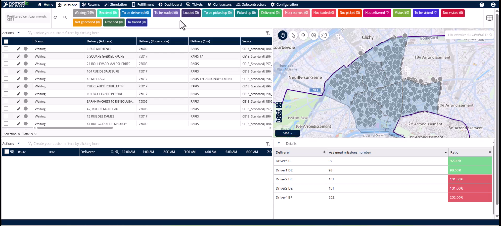

2. Cliquez sur le **menu Actions**.

<figure>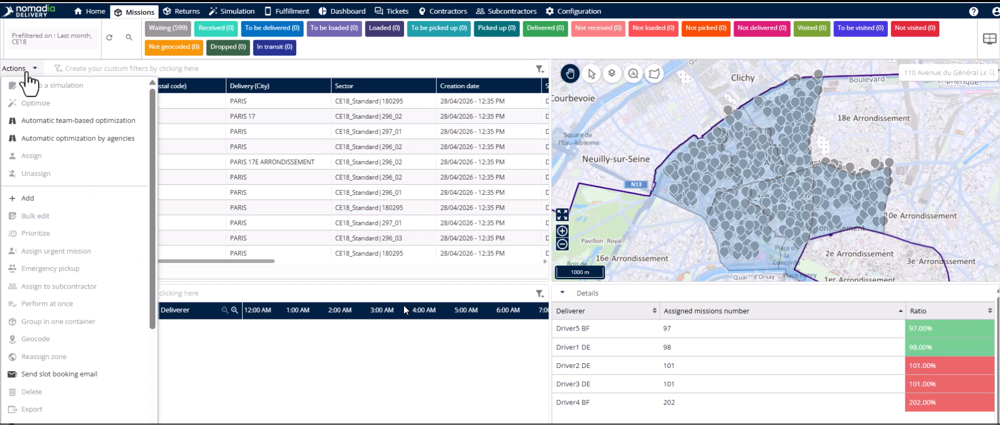<figcaption></figcaption></figure>

3. Sélectionnez **Optimisation automatique par agence**.

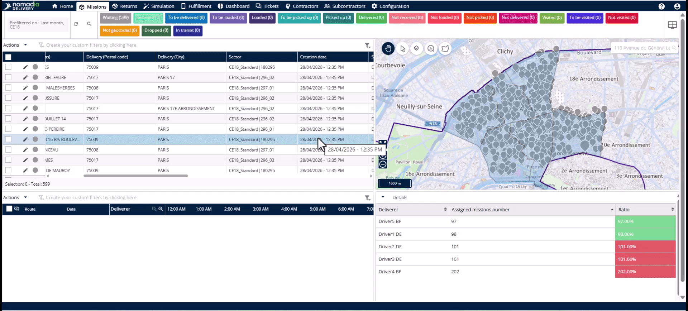

## Présentation de la fonctionnalité

* **Date de début** et **Date de fin** : définissez la plage horaire spécifique pour les missions.

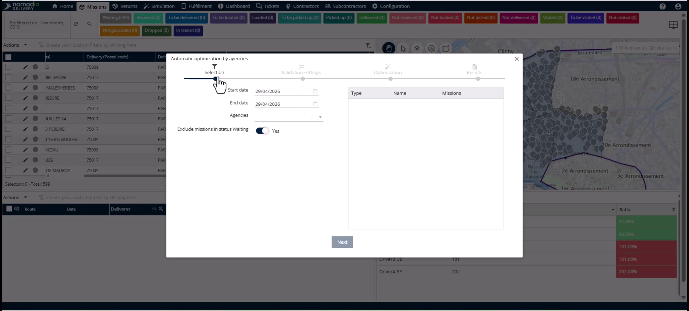

* Sélection de l’**Agence** : choisissez l’agence spécifique à optimiser.

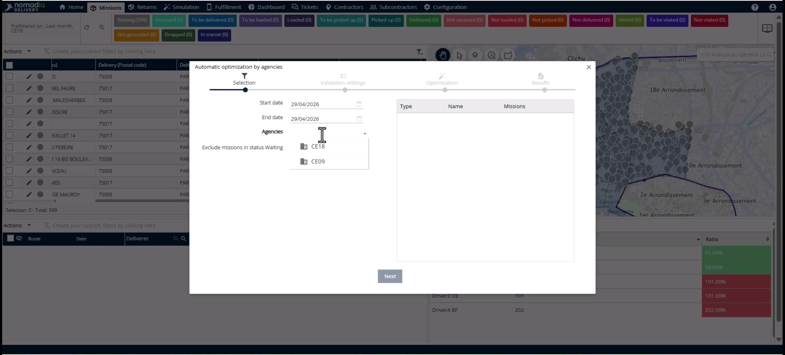

* **Valider automatiquement les itinéraires** : activez cette option pour finaliser les itinéraires sans revue manuelle.

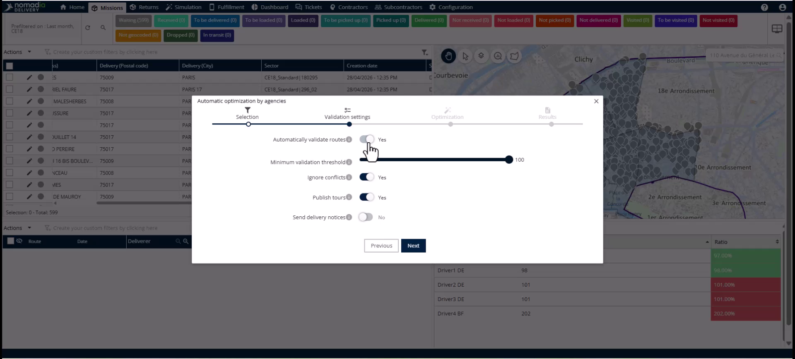

* **Seuil minimum de validation** : définissez un seuil de qualité entre 50 et 100 %.

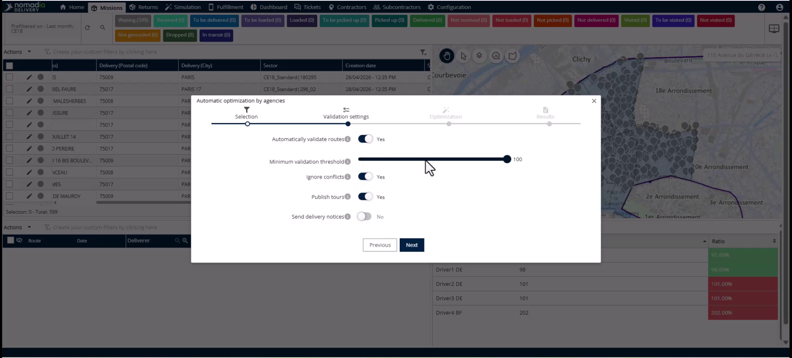

* **Publier les itinéraires** : envoie instantanément les itinéraires validés à l’application mobile du conducteur.

* **Barre de progression** : affiche le statut en temps réel de l’optimisation de chaque équipe.

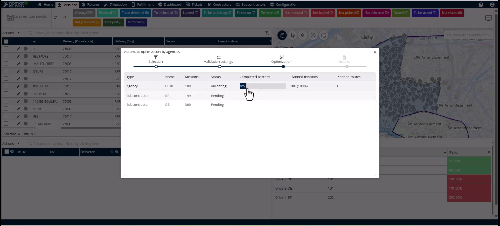

## Lancer l’optimisation

1. Cliquez sur le **menu Actions**.

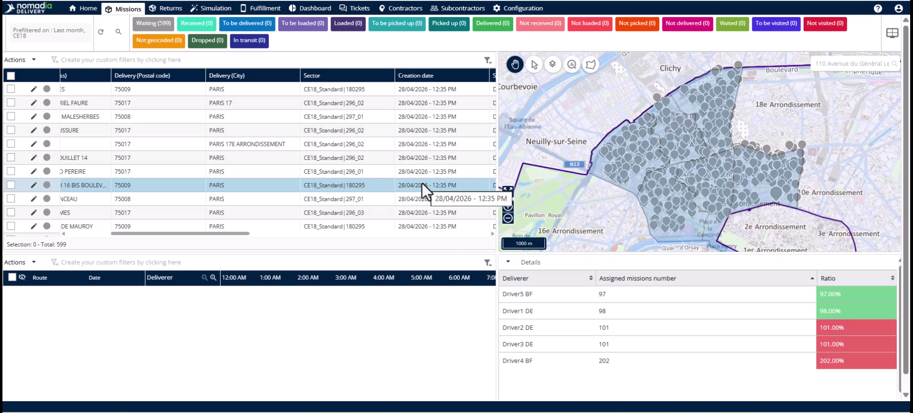

2. Sélectionnez **Optimisation automatique par agence**.

<figure>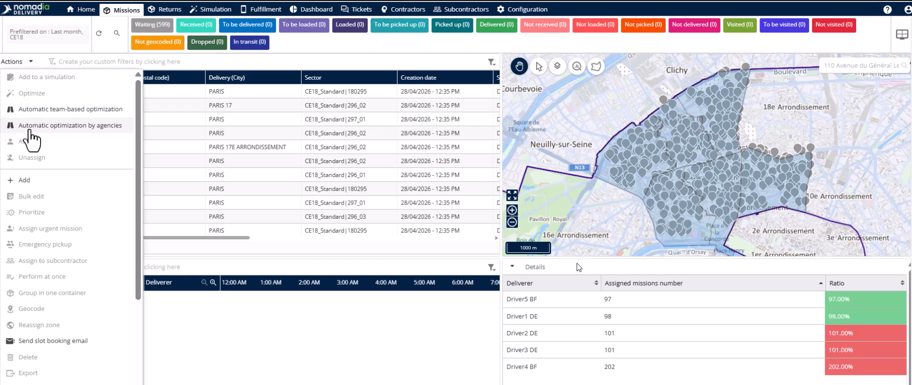<figcaption></figcaption></figure>

3. Définissez la **Date de début** et la **Date de fin** pour vos missions.

4. Sélectionnez votre agence dans la liste **Agence**.

<figure>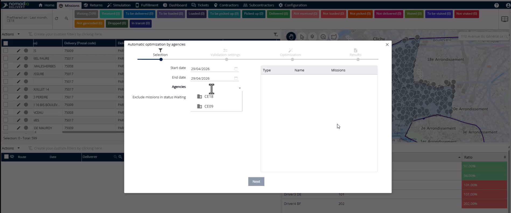<figcaption></figcaption></figure>

5. Choisissez d’inclure ou d’exclure les missions au **statut en attente**.

6. Cliquez sur **Suivant**.

## Configurer la validation et les notifications

1. Activez **Valider automatiquement les itinéraires** pour les opérations à grand volume.

2. Définissez un **Seuil minimum de validation** comme seuil de qualité.

3. Activez **Ignorer les conflits** pour écraser les données existantes avec le nouveau plan.

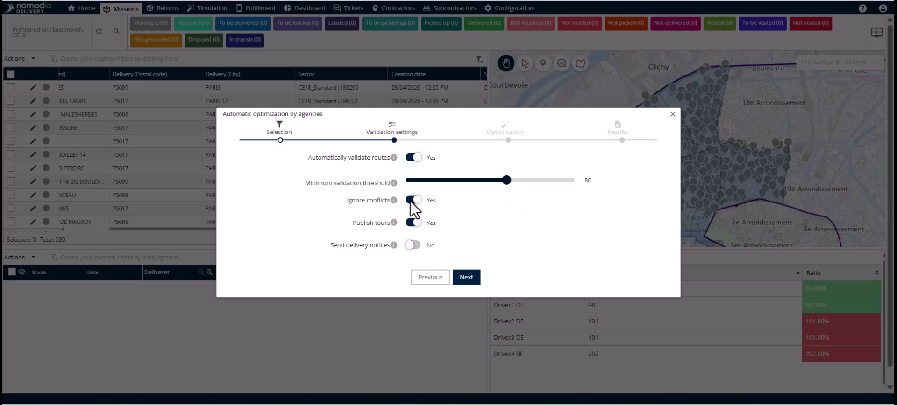

4. Activez **Publier les itinéraires** pour envoyer immédiatement les plans aux conducteurs.

5. Choisissez d’envoyer des notifications automatiques aux clients par e-mail ou SMS.

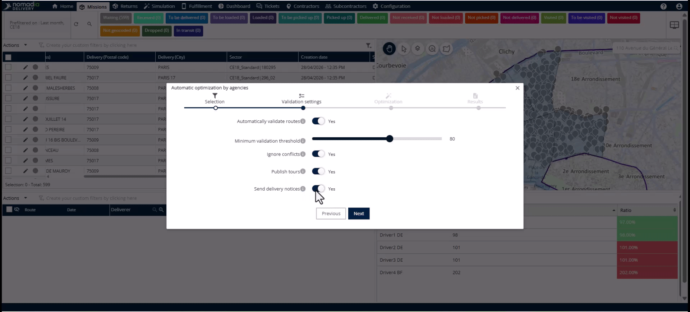

6. Cliquez sur **Suivant** pour lancer l’optimisation.

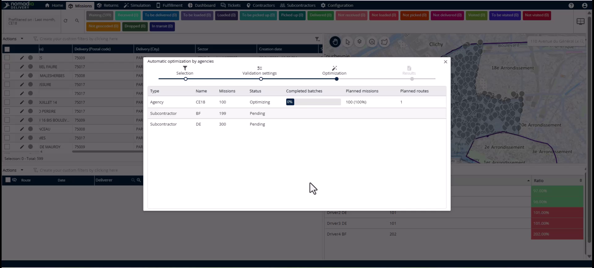

## Surveiller et examiner

1. Observez la **Barre de progression** pour les mises à jour en direct des optimisations de l’équipe.

2. Cliquez sur le **bouton Ouvrir le plan d’itinéraire** pour analyser les simulations.
3. Examinez les itinéraires dans un **état de brouillon** si la publication a été désactivée.

4. Cliquez sur un itinéraire et publiez-le manuellement si nécessaire.

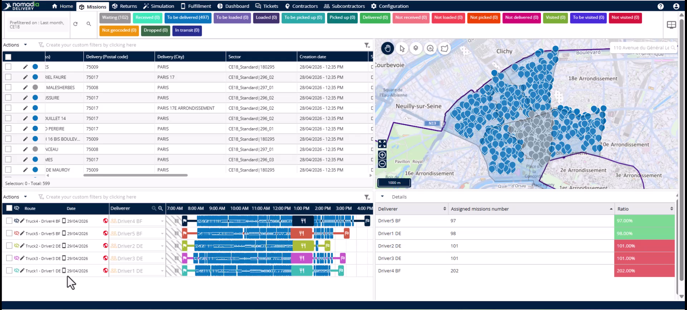

## Dépannage

1. Cliquez sur le **bouton Ouvrir le plan d’itinéraire** si une icône d’erreur apparaît.
2. Cliquez sur le **bouton Avertissement** dans la simulation pour voir la raison de l’erreur.
3. Identifiez les conflits tels que des plages horaires incompatibles ou des incohérences entre les contraintes du véhicule.

## Conseils


**Importation automatique des missions passées** : le système inclut automatiquement les missions dont les dates de livraison sont antérieures à aujourd’hui.



**Communication sans intervention manuelle** : l’activation de la publication des itinéraires peut déclencher des notifications automatiques aux clients par SMS et e-mail.



**Conflits de données** : ne fermez pas les erreurs sans les examiner, car des conflits non résolus peuvent gêner l’exécution sur le terrain.


## Rubriques connexes

* [Études de cas](README.md)
* [Attribution des zones aux missions](assigning-zones-to-missions.md)
* [Durée fixe réduite](reduced-fixed-duration.md)
