# Configuration PUDO

PUDO (points de prise en charge et de dépôt) permet aux chauffeurs de déposer des colis dans des emplacements sécurisés lorsque les clients ne sont pas disponibles. Cette fonctionnalité élimine les coûts élevés de relivraison et réduit les émissions des véhicules. Vous obtiendrez des taux de réussite plus élevés dès la première tentative et un meilleur confort pour les clients.

## Avant de commencer

* Une liste préparée des emplacements PUDO comprenant les noms et les adresses.
* Des catégories définies pour votre réseau, telles que des consignes ou des magasins.
* Accès au module **Configuration** dans Nomadia Delivery.

1. Ouvrez le module **Configuration**.

2. Sélectionnez la page **Type de PUDO** pour définir vos catégories.

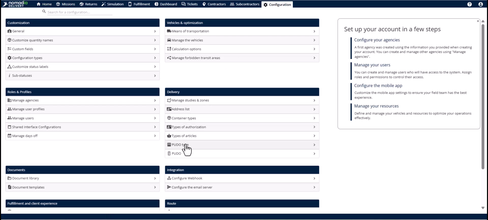

3. Accédez à la page **PUDO** pour importer vos emplacements physiques.

<figure>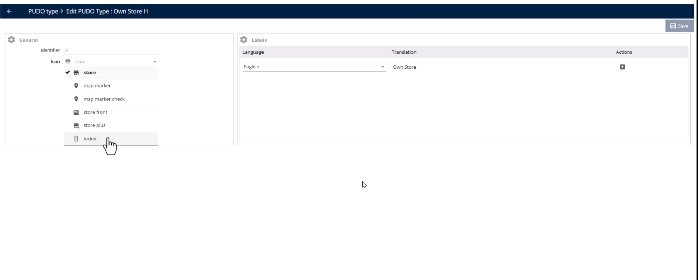<figcaption></figcaption></figure>

## Présentation de la fonctionnalité

* **Types de PUDO** : catégories comme des magasins ou des consignes avec des exigences de traitement spécifiques.

<figure>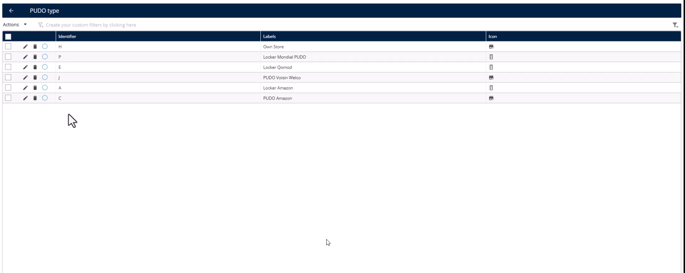<figcaption></figcaption></figure>

* **Liste PUDO** : la base de données des emplacements réels et des adresses utilisés par votre activité.

<figure>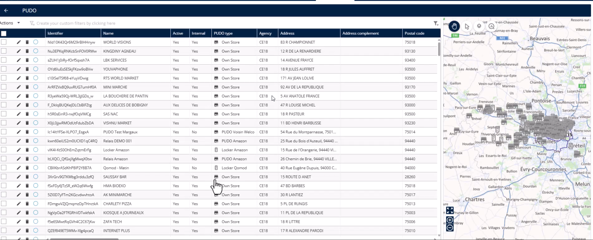<figcaption></figcaption></figure>

* **Sous-statut PUDO** : des libellés personnalisés pour l’application mobile, qui s’appliquent uniquement pendant les interactions PUDO.

<figure>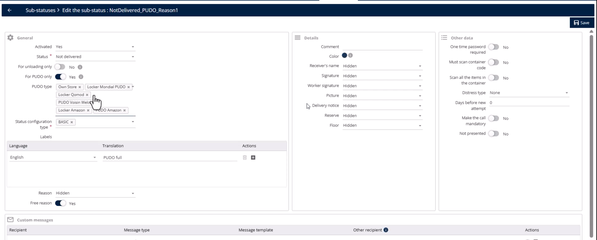<figcaption></figcaption></figure>

* **PUDO de repli** : un champ au niveau de la mission qui détermine si un dépôt PUDO est autorisé.

<figure>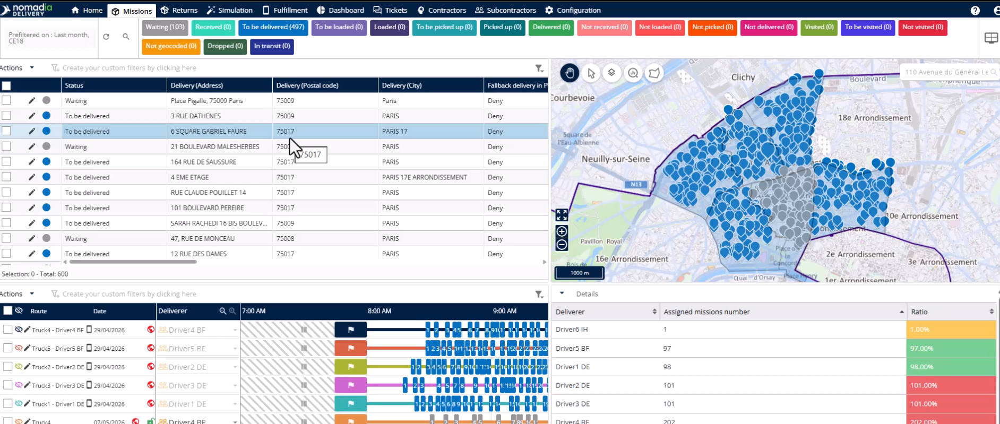<figcaption></figcaption></figure>

## Configurer les types de PUDO

1. Accédez au module **Configuration**.

2. Cliquez sur **Type de PUDO**.
3. Définissez des catégories telles que supermarchés, commerces partenaires ou consignes.

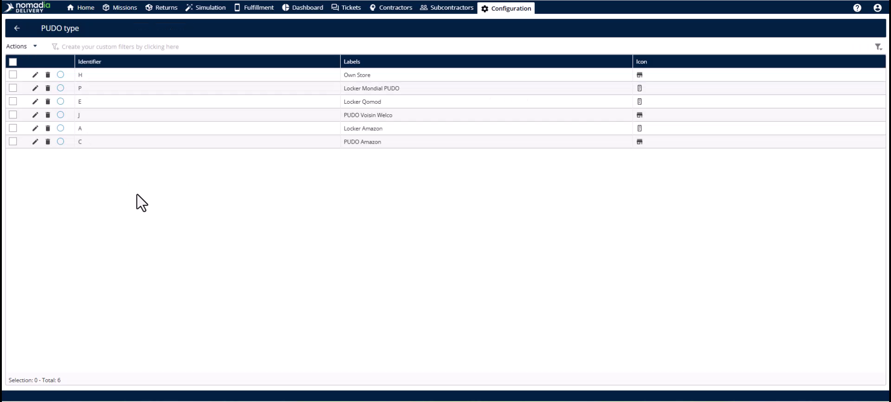

## Importer la liste PUDO

1. Accédez à la page **PUDO** dans le module **Configuration**.

2. Ouvrez le menu **Actions**.
3. Sélectionnez l’action **Importer** pour importer votre liste en masse.

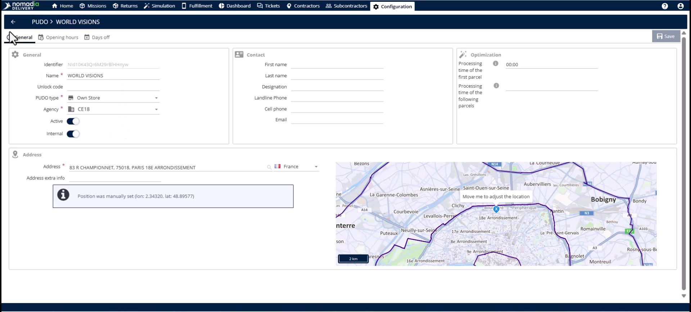

## Configurer les sous-statuts PUDO

1. Cliquez sur la page **Sous-statut** dans le module **Configuration**.

2. Activez l’interrupteur **PUDO uniquement**.

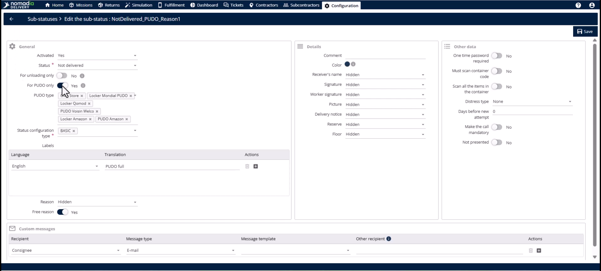

3. Saisissez des libellés opérationnels comme « Déposé en consigne » ou « Point PUDO complet ».
4. Cliquez sur le bouton **Enregistrer**.

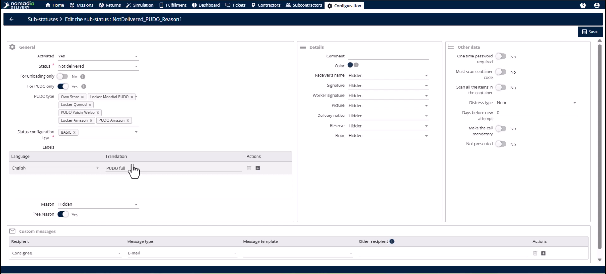

## Activer le PUDO de repli sur une mission

1. Recherchez le champ **Livraison de repli en PUDO** dans le **Tableau des missions**.

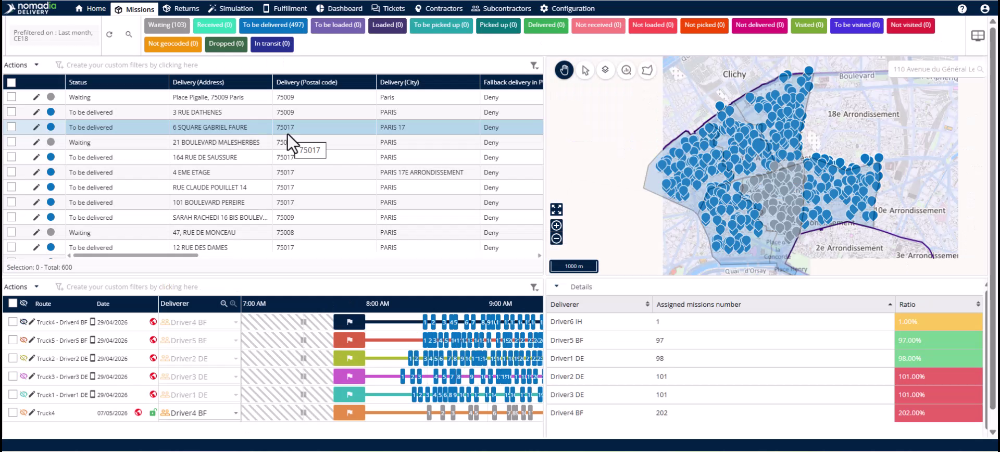

2. Cliquez sur le bouton **Modifier** pour ouvrir l’**Éditeur de mission**.
3. Sélectionnez la **section** **Informations de livraison**.
4. Définissez la caractéristique de repli sur **Autoriser**, **Refuser** ou **Après une nouvelle tentative**.

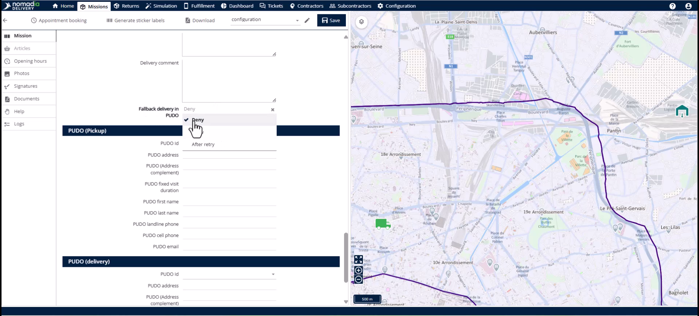

## Conseils


**Prise en charge de missions multiples** : utilisez le PUDO pour les missions de retrait et de livraison afin d’accroître la flexibilité opérationnelle.



**Mises à jour en masse** : gérez les autorisations de repli à grande échelle à l’aide du **modèle d’importation** ou de l’API lors de la création des missions.



**Maintenance des données** : gardez la **liste PUDO** à jour, sinon les chauffeurs ne pourront pas trouver les points de dépôt à proximité.



**Distinctions de type** : faites toujours la différence entre les magasins et les consignes, car ils nécessitent des processus de traitement différents comme les codes **OTP**.


## Rubriques connexes

* [Livraison en PUDO](delivery-at-pudo.md)
* [Études de cas](../README.md)
