# Livraison en PUDO

Le flux de livraison PUDO (Pick-Up Drop-Off) permet aux chauffeurs de rediriger les colis vers des points relais locaux lorsque les clients sont indisponibles. Cette fonctionnalité élimine le besoin de tournées de relivraison coûteuses et maintient votre arriéré d’entrepôt à un niveau gérable. Vous obtiendrez de meilleurs taux de résolution au premier essai et offrirez davantage de flexibilité à vos clients.

## Avant de commencer

Avant d’utiliser cette fonctionnalité, assurez-vous que les exigences suivantes sont remplies :

* Les données du réseau PUDO sont configurées dans le système.
* Le champ **Livraison de repli en PUDO** est activé pour la mission concernée.
* Les sous-statuts pour les dépôts PUDO échoués (par ex. « PUDO complet ») sont définis dans le **menu de configuration**.

1. Créez un itinéraire dans le Backoffice.
2. Cochez la case de l’itinéraire que vous souhaitez partager dans le **tableau des itinéraires**.

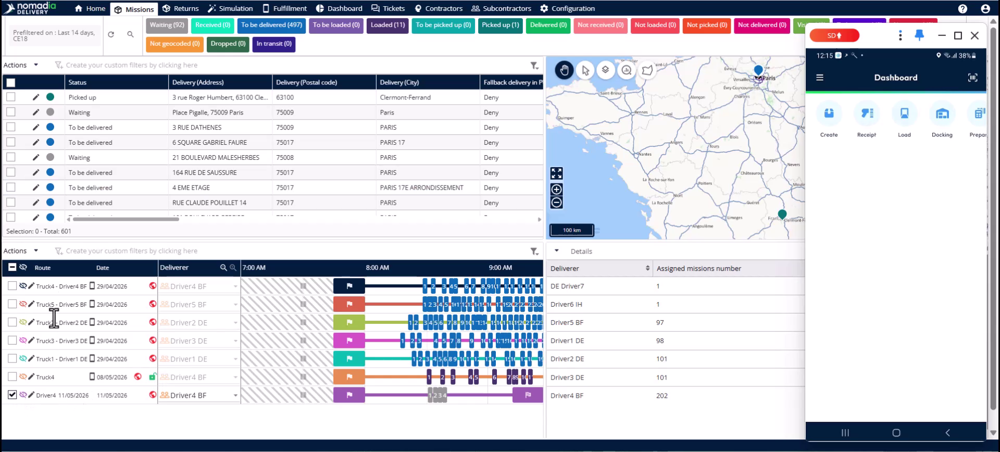

3. Cliquez sur le bouton **Actions**.

<figure>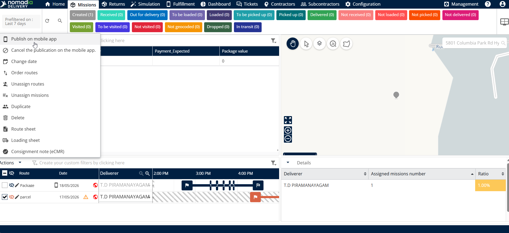<figcaption></figcaption></figure>

4. Sélectionnez **Publier sur l’application mobile**.

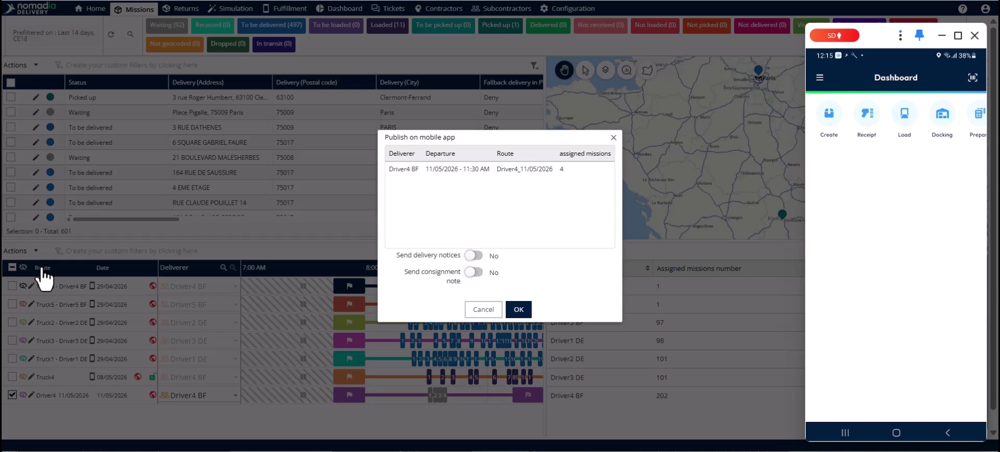

5. Cliquez sur **OK** pour confirmer la publication.

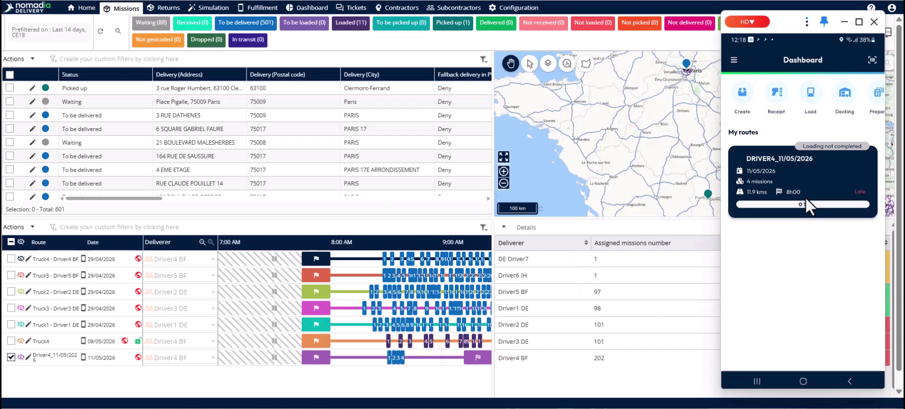

## Présentation de la fonctionnalité

* **Page de sélection du point PUDO** : affiche une liste de lieux relais préchargés près de l’adresse du client.

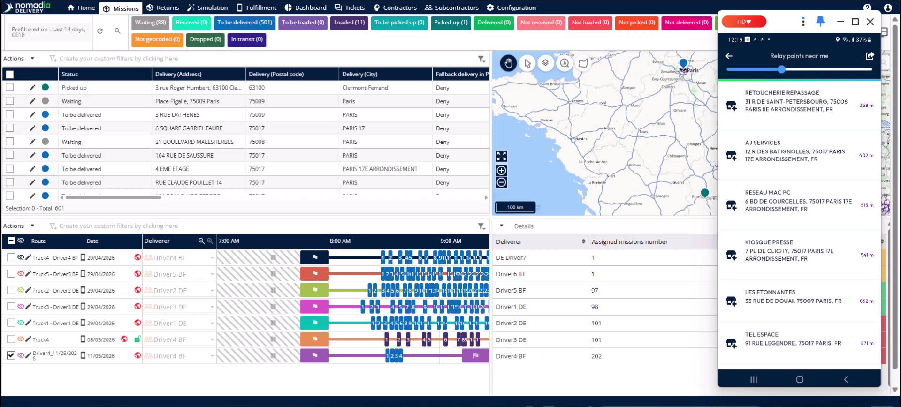

* **Curseur de rayon de recherche** : permet au chauffeur d’augmenter ou de diminuer la distance pour trouver davantage de points relais.

* **ID du lieu de livraison PUDO** : enregistre automatiquement le point précis où le chauffeur a déposé le colis.

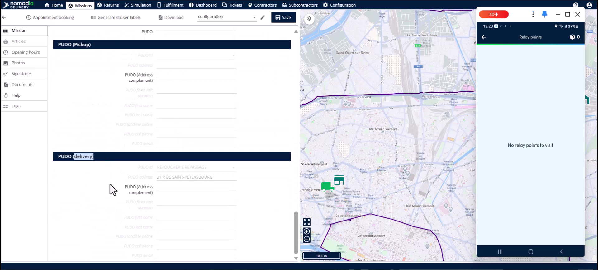

* **Onglet des journaux de mission** : suit chaque action, de la première tentative de livraison au dépôt final en PUDO.

<figure>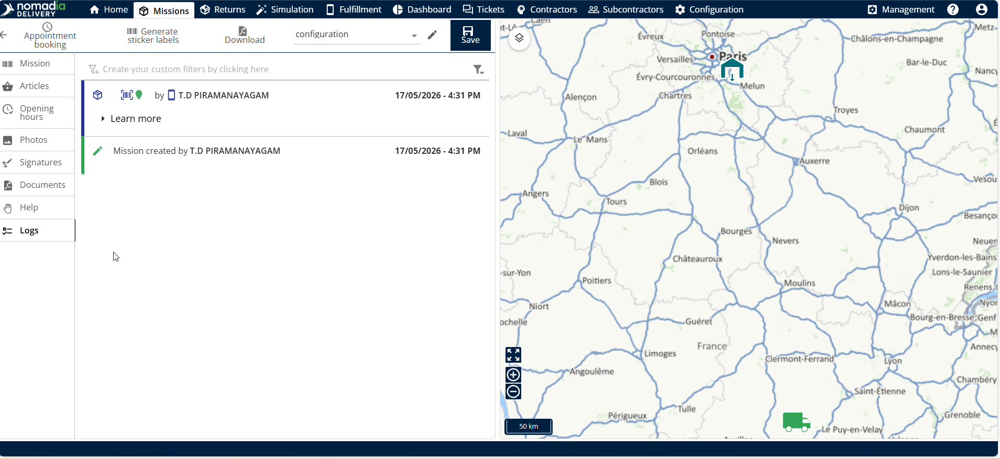<figcaption></figcaption></figure>

## Rediriger un colis (chauffeur)

1. Touchez l’itinéraire partagé dans l’application mobile.
2. Chargez le véhicule et touchez **Valider mon chargement**.

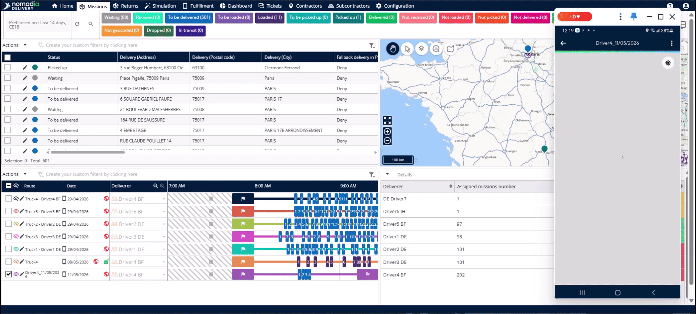

3. Touchez **Démarrer mon itinéraire**.
4. À l’adresse du client, sélectionnez **Ne pas livrer** si le client est absent.

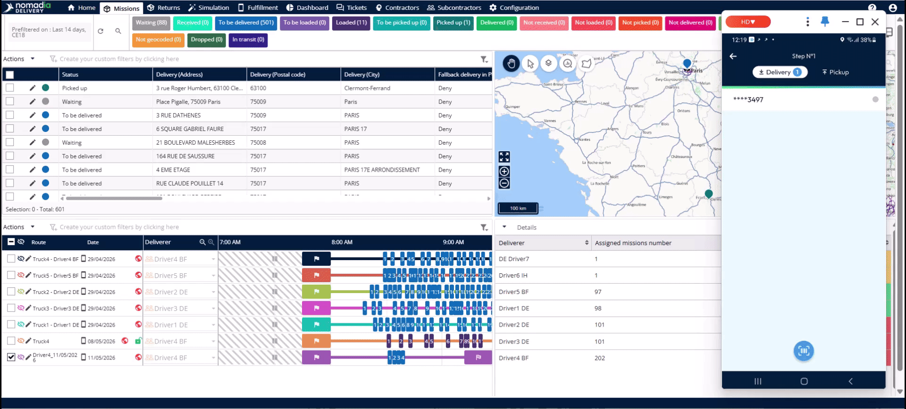

5. Sélectionnez le sous-statut **Client indisponible**.
6. Faites glisser le curseur pour ajuster le rayon de recherche si nécessaire.
7. Sélectionnez un **point PUDO** dans la liste.
8. Confirmez le statut et poursuivez les autres livraisons.
9. Lorsque vous êtes prêt à déposer, touchez la notification du point relais dans les **détails de l’itinéraire**.
10. Sélectionnez la mission et utilisez le **scanner** pour déposer le colis.

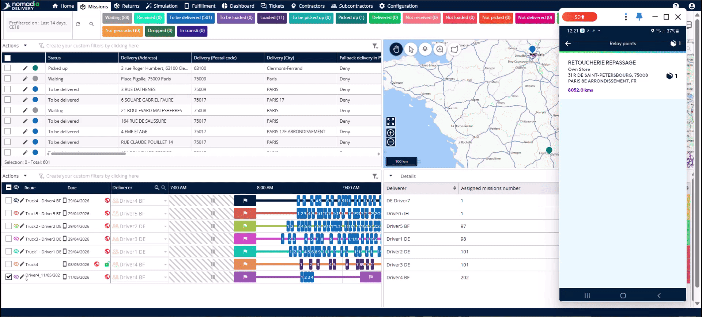

11. Capturez la **signature** et une **photo** pour valider le dépôt.

## Vérifier le dépôt (planificateur)

1. Cliquez sur le **bouton d’actualisation** dans le Backoffice pour voir les mises à jour en temps réel.

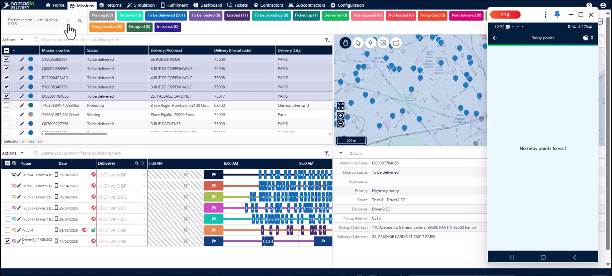

2. Ouvrez la mission dans l’**éditeur** pour vérifier l’**ID du lieu de livraison PUDO**.
3. Consultez l’**onglet des journaux** pour obtenir une séquence complète d’actions horodatées.

## Résoudre les problèmes PUDO

Si un point PUDO est plein ou fermé :

1. Marquez la mission comme **non livrée au point PUDO**.
2. Sélectionnez le sous-statut spécifique, tel que **PUDO complet** ou **PUDO fermé**.
3. La mission apparaîtra comme **non résolue** pour le planificateur.
4. Incluez la mission dans le prochain **cycle de planification** pour une tentative de relivraison.

## Conseils


**Détection automatique** : le système identifie automatiquement les emplacements PUDO dans un rayon de 5 km autour de l’itinéraire.



**Données préchargées** : les chauffeurs n’ont pas besoin de chercher manuellement, car les options les plus proches sont préchargées avant qu’ils n’ouvrent l’application.



**Synchronisation en temps réel** : les informations se synchronisent avec le Backoffice immédiatement après que le chauffeur a confirmé le dépôt.



**Sous-statuts précis** : utilisez toujours le sous-statut correct pour les points PUDO pleins ou fermés afin de garantir que la mission soit suivie pour une relivraison.


## Rubriques connexes

* [Configuration PUDO](README.md)
* [Études de cas](../README.md)
