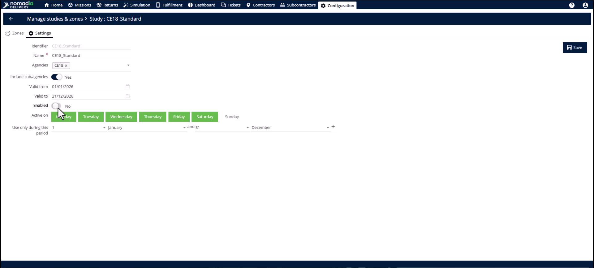
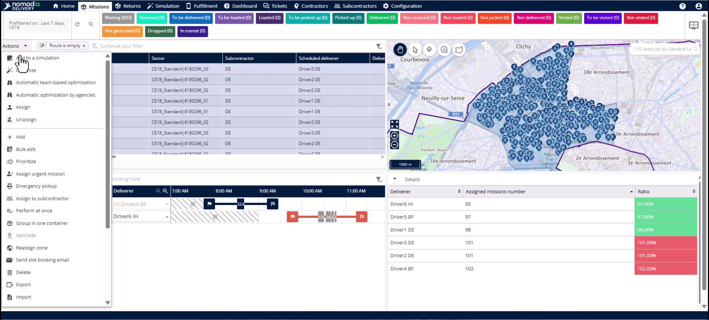
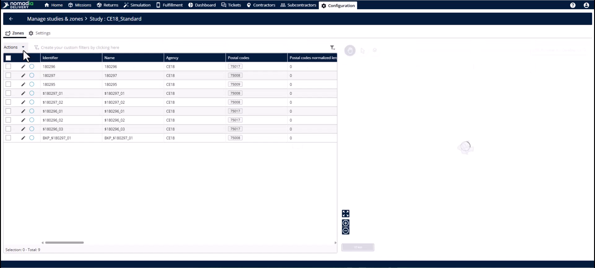
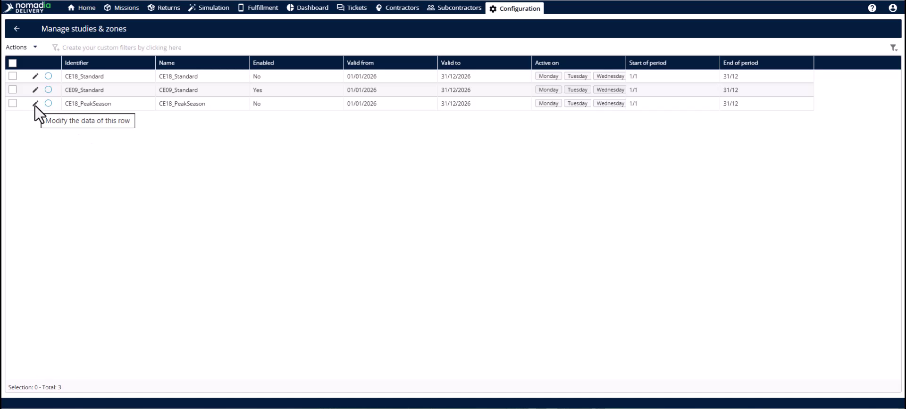
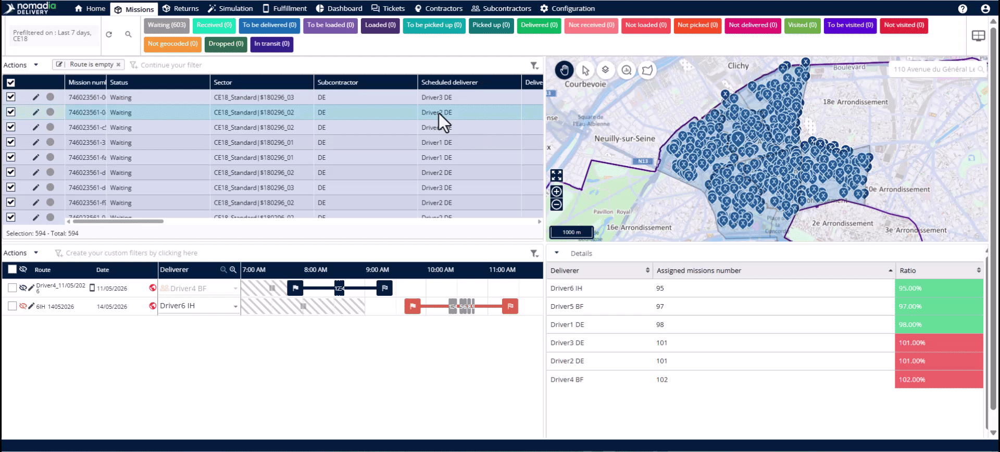
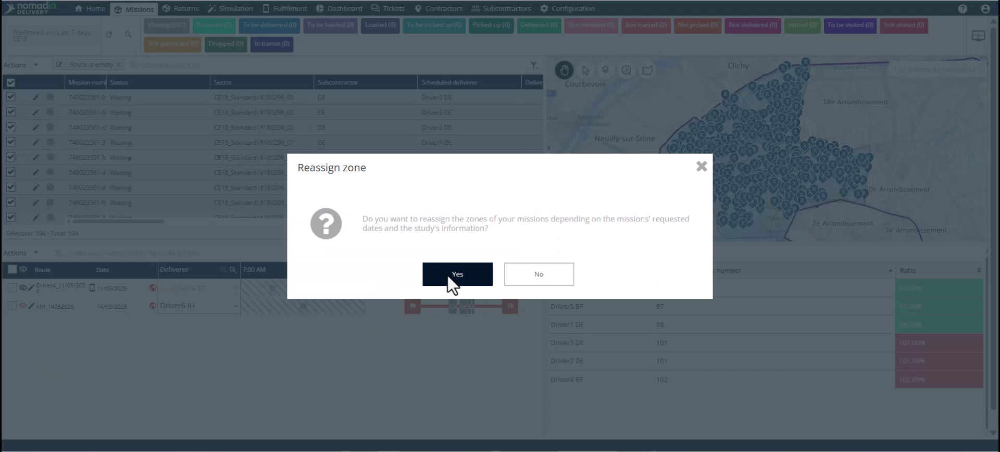
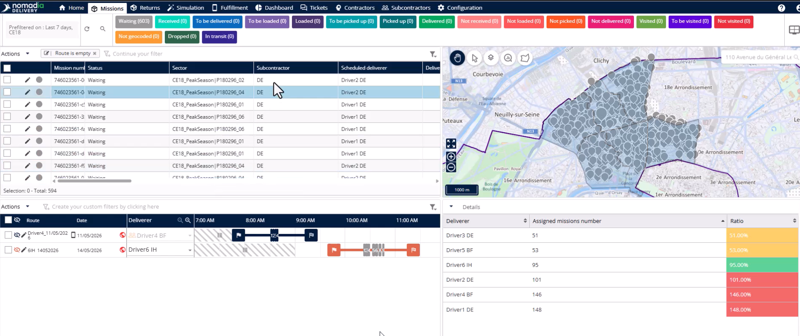

# Réaffecter les zones manuellement

La réaffectation manuelle de zone vous permet de déplacer des missions vers une nouvelle configuration territoriale selon vos propres conditions. Utilisez cette option lors du passage entre différentes études ou configurations saisonnières où les déclencheurs automatiques ne s’appliquent pas. Vous obtiendrez des enregistrements de mission précis et des cycles de planification ininterrompus.

## Avant de commencer

* Au moins deux études configurées pour la même zone.
* Un ensemble de missions actives nécessitant une réaffectation.

1. Accédez au module **Configuration**.
2. Cliquez sur **Gérer les études et les zones**.

## Présentation de la fonctionnalité

* **Bouton bascule Activer** : active ou désactive une configuration d’étude spécifique.

* **Filtre enregistré** : isole des missions spécifiques sur la base de critères prédéfinis comme d’anciennes affectations de zone.

* **Réaffecter la zone** : met instantanément à jour les missions sélectionnées pour refléter la géométrie de l’étude actuellement active.

## Basculer les études de mission

1. Cliquez sur le bouton **Modifier** et sélectionnez l’onglet **Paramètres**.

2. Désactivez le **bouton bascule Activer** et cliquez sur **Enregistrer**.

3. Trouvez la nouvelle étude expérimentale et cliquez sur **Modifier**.

4. Activez le **bouton bascule Activer** et cliquez sur **Enregistrer**.

5. Accédez à l’onglet **Missions**.

<figure><figcaption></figcaption></figure>

6. Appliquez un **Filtre** pour isoler les missions affectées à l’ancienne étude.

7. Sélectionnez toutes les missions pertinentes dans le tableau.

8. Ouvrez le menu **Actions** et cliquez sur **Réaffecter la zone**.

9. Cliquez sur **Oui** pour confirmer la réaffectation.

### Résultat

Les missions sélectionnées sont réaffectées à l’étude choisie.

<figure><figcaption></figcaption></figure>

## Conseils


**Tests en toute sécurité** : testez de nouvelles configurations en réaffectant un échantillon de missions avant d’engager l’ensemble de la flotte.



**Transitions saisonnières** : utilisez la réaffectation manuelle pour basculer instantanément entre les configurations d’été et d’hiver.



**Limites de l’automatisation** : le système ne met à jour automatiquement que les changements de géométrie, pas les nouvelles activations d’étude.



**Supervision humaine** : vérifiez toujours la liste filtrée pour vous assurer que seules les missions prévues sont déplacées.


## Rubriques connexes

* [Études de cas](README.md)
* [Attribution des zones aux missions](assigning-zones-to-missions.md)
* [Création d’une étude avec zone principale](study-creation-with-primary-zone.md)
