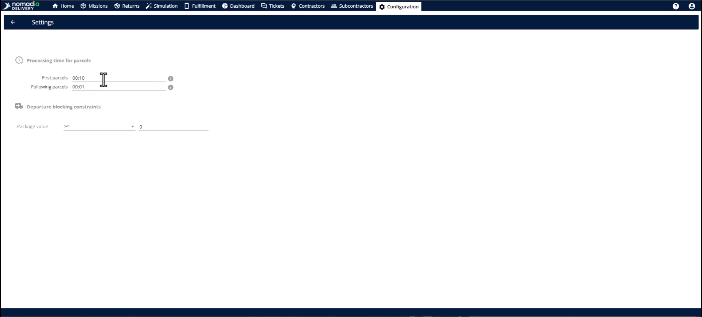
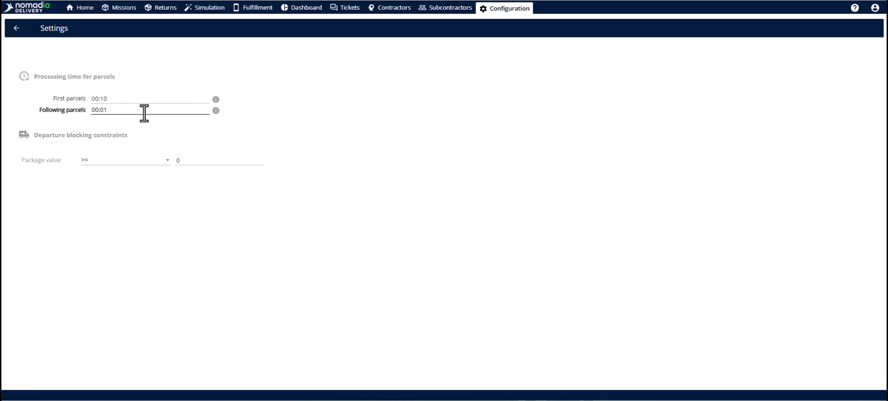
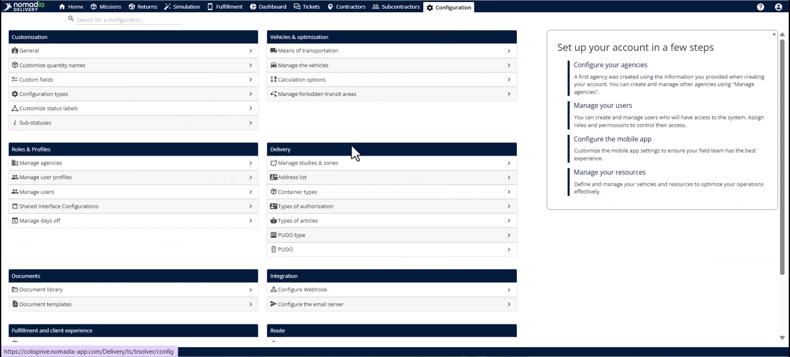
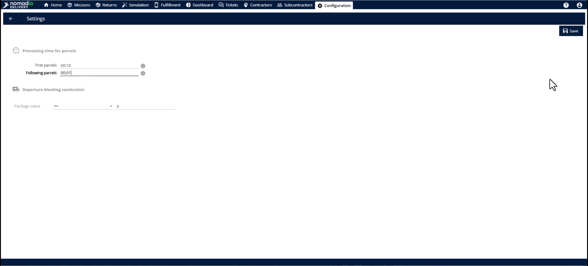
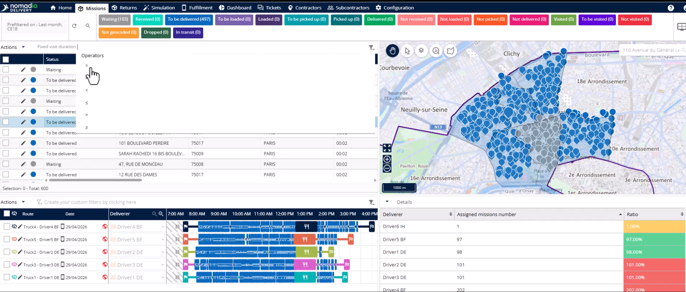
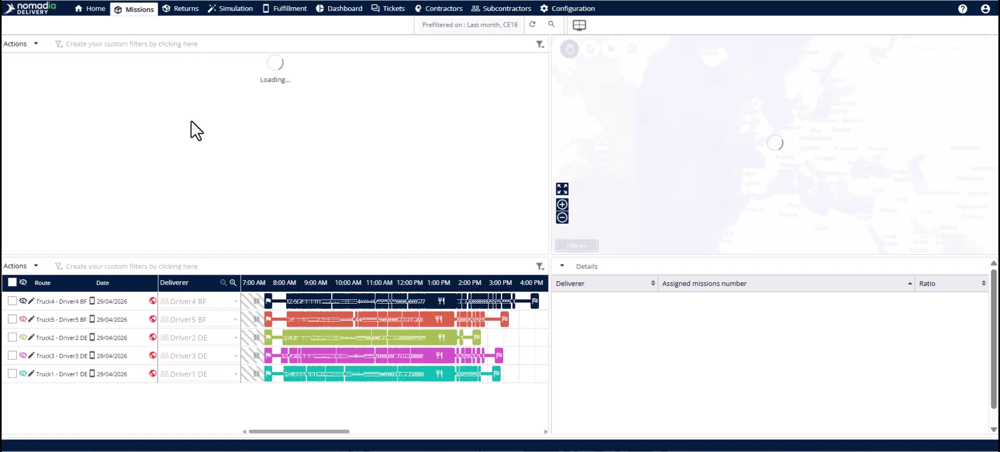
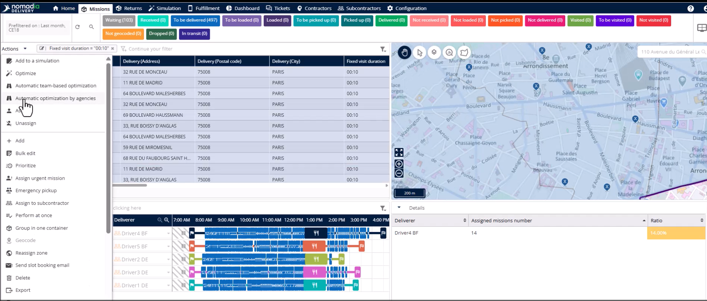
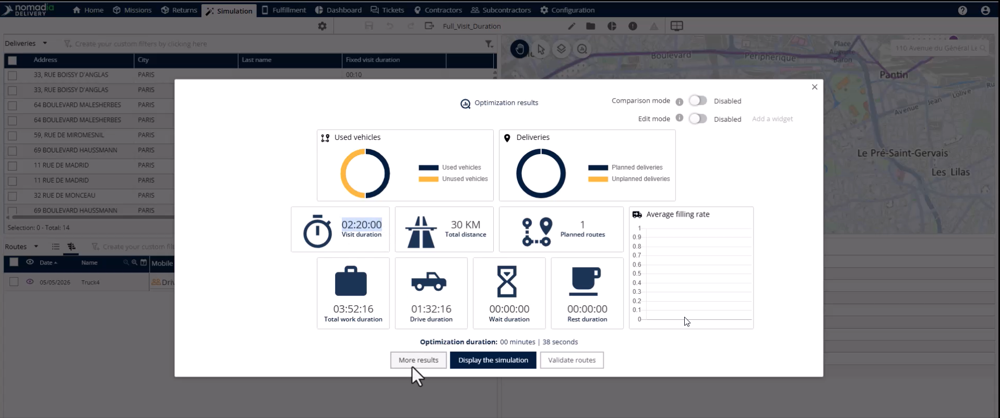

# Durée fixe réduite

La fonctionnalité Durée fixe réduite optimise les livraisons en volume en ajustant les estimations de temps pour plusieurs colis à un même emplacement. Elle élimine les écarts de temps « papier » qui surviennent lorsque le système surestime la durée des déposes suivantes. Cela vous permet de planifier davantage de missions par jour et de maximiser la capacité réelle de votre flotte.

## Avant de commencer

* Missions partageant une **Adresse de livraison**, une **Adresse de collecte** ou un **Identifiant de groupe**.
* Données opérationnelles concernant les temps de livraison réalistes pour le premier colis et les suivants.

1. Ouvrez le module **Configuration**.

2. Recherchez la section **Itinéraire** dans le panneau de gauche.

3. Cliquez sur **Paramètres**.

## Présentation de la fonctionnalité

* **Temps de traitement des colis** : cette section définit la manière dont le moteur d’optimisation calcule le temps pour les arrêts groupés.

* **Première mission du groupe** : ce champ définit la durée totale de la livraison initiale à un emplacement.

* **Colis suivants dans le groupe** : ce champ définit le temps réduit pour chaque colis supplémentaire dans le même groupe.

## Configurer une durée fixe réduite

1. Accédez à **Configuration** > **Itinéraire** > **Paramètres**.

2. Localisez la section **Temps de traitement des colis**.
3. Saisissez le temps de livraison complet dans le premier champ.
4. Saisissez le temps réduit pour les colis supplémentaires dans le deuxième champ.
5. Cliquez sur le bouton **Enregistrer** pour appliquer les modifications.

## Appliquer des durées optimisées

1. Ouvrez l’onglet **Mission**.

<figure><figcaption></figcaption></figure>

2. Sélectionnez les missions que vous souhaitez optimiser.

3. Cliquez sur le menu **Actions**.

4. Sélectionnez votre algorithme d’optimisation préféré.

<figure><figcaption></figcaption></figure>

5. Consultez les durées mises à jour dans le module **Simulation**.

<figure><figcaption></figcaption></figure>

## Conseils


**Gains de capacité** : faire correspondre les données du système à la réalité de la route libère de la capacité pour des missions qui resteraient autrement non affectées.



**Regroupement automatique** : le système identifie automatiquement les arrêts à la même adresse, même sans identifiant de groupe spécifique.



**Perte de productivité** : l’utilisation des paramètres par défaut pour les commandes en volume surestime les temps de trajet et réduit votre volume de livraison quotidien.


## Rubriques connexes

* [Études de cas](README.md)
* [Optimisation des missions pour l’agence](optimizing-missions-for-agency.md)
* [Paramètres de blocage d’itinéraire](route-blocking-settings.md)
