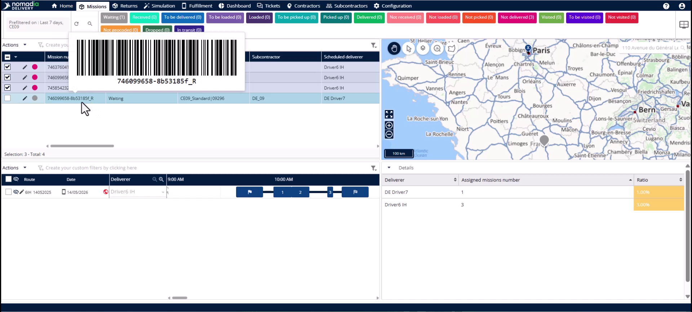
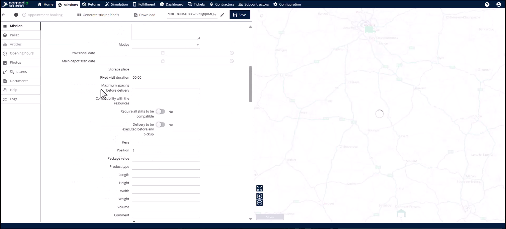
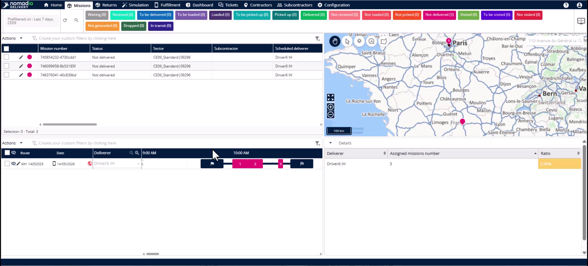
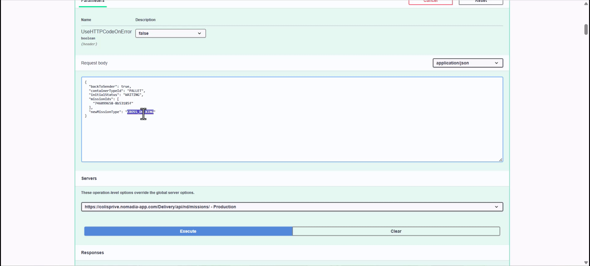

# Logistique inverse

Nomadia Delivery intègre la logistique inverse directement dans le cycle de vie standard de vos missions. Cette fonctionnalité vous permet de déclencher, planifier et exécuter les retours sans quitter la plateforme. Vous obtiendrez une visibilité complète et un routage optimisé pour chaque trajet de retour.

## Avant de commencer

* Accès au **Backoffice Nomadia Delivery**.
* L’**Identifiant de mission** de la livraison échouée ou non collectée.
* Accès API au point de terminaison **Logistique inverse**.

1. Ouvrez le **Backoffice** et localisez l’itinéraire spécifique contenant la mission à retourner.
2. Identifiez si l’article doit retourner à l’expéditeur initial ou simplement à l’agence.

## Présentation de la fonctionnalité

* **Identifiant de mission** : un code unique avec un suffixe **\_r** utilisé pour suivre les retours jusqu’à leur origine.

* **Retour à l’expéditeur** : un paramètre déterminant si un article est acheminé vers l’expéditeur ou reste à l’agence.
* **Nouveau type de mission** : utilisez le paramètre **Type de mission** pour classer le retour comme une mission **Cross Docking**, **Livraison** ou **Retrait**.
* **Bouton Modifier** : il ouvre les détails de la mission pour vérifier que les adresses de collecte et de livraison ont bien été inversées.

## Créer un retour en cross-docking

Utilisez cette tâche lorsque l’article doit retourner à l’expéditeur initial via l’agence.

1. Copiez l’**Identifiant de mission** de la mission d’origine dans le **Backoffice** ou récupérez, via l’API, la liste des missions qui doivent être renvoyées à l’expéditeur.

2. Incluez la liste des identifiants de mission dans le tableau Mission Ids.&#x20;
3. Définissez le paramètre **Retour à l’expéditeur** sur **Vrai**.
4. Définissez le **Nouveau type de mission** sur **Cross Docking**.
5. Sélectionnez **Exécuter** pour générer **en une seule fois** la ou les missions de retour.

6. **Actualisez** l’interface du **Backoffice** pour voir la nouvelle mission avec le suffixe **\_r**.
7. Incluez la nouvelle mission **Cross-docking** dans le prochain cycle de planification pour l’optimisation.

## Créer un retour de livraison

Utilisez cette tâche lorsque l’article doit seulement parvenir à l’agence pour être récupéré par l’expéditeur.

1. Copiez l’**Identifiant de mission** de la mission de livraison échouée ou récupérez, via l’API, la liste des missions qui doivent être renvoyées à l’agence.
2. Ajoutez la liste des identifiants de mission au tableau **Mission IDs**.
3. Définissez le paramètre **Retour à l’expéditeur** sur **Faux**.
4. Définissez le **Nouveau type de mission** sur **Retrait**.
5. Sélectionnez **Exécuter** pour créer la mission.
6. Actualisez l’interface du **Backoffice** pour voir la nouvelle mission avec le suffixe `_r`.

## Conseils


**Suivi unifié** : utilisez le suffixe **\_r** pour relier instantanément tout retour à sa livraison aller d’origine.



**Planification fluide** : traitez les missions de retour comme des missions standard afin de les inclure dans l’optimisation automatisée des itinéraires.



**Contournements manuels** : évitez d’utiliser des tableurs pour suivre les retours en dehors du système afin de prévenir le chaos des données.


## Rubriques connexes

* [Études de cas](README.md)
* [Missions à étapes multiples](multi-leg-missions.md)
* [Missions de cross-docking](../missions/cross-docking-missions.md)
