# Paramètres de blocage d’itinéraire

Le blocage des itinéraires empêche systématiquement les conducteurs de démarrer des itinéraires contenant des articles de grande valeur jusqu’à ce qu’un planificateur les examine. Cette fonctionnalité réduit les risques financiers tels que le vol de cargaison et garantit que les protocoles de sécurité sont suivis chaque jour. Les utilisateurs obtiennent un processus de conformité proactif et documenté pour chaque livraison.

## Avant de commencer

* Les missions doivent inclure un champ **Valeur du colis**.
* L’accès au **module Configuration** est requis.

1. Ouvrez le **module Configuration**.

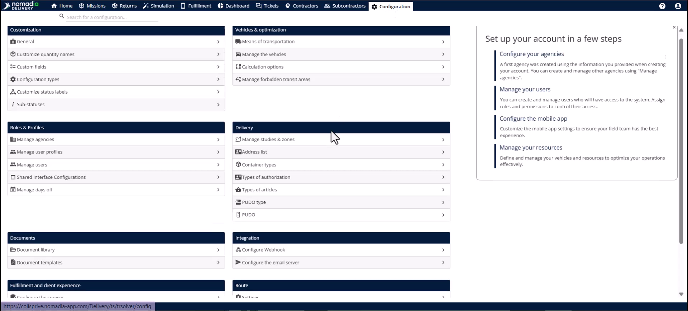

2. Sélectionnez **Paramètres** dans la section **Itinéraire**.

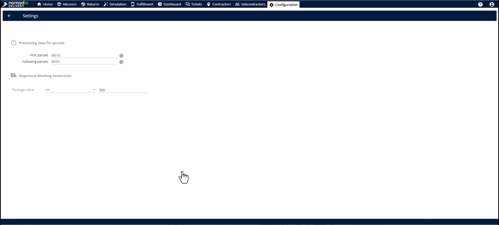

3. Saisissez un seuil numérique dans le champ **Condition de valeur du colis**.

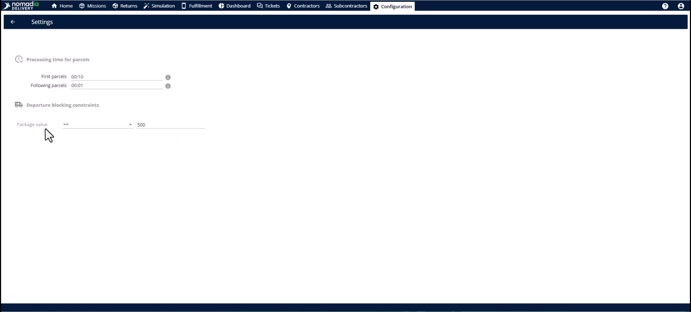

4. Cliquez sur **Enregistrer** pour appliquer la configuration.

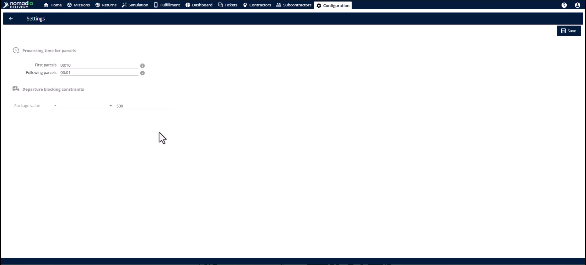

## Présentation de la fonctionnalité

* **Condition de valeur du colis** : définissez le seuil monétaire qui déclenche un verrouillage automatique de l’itinéraire.

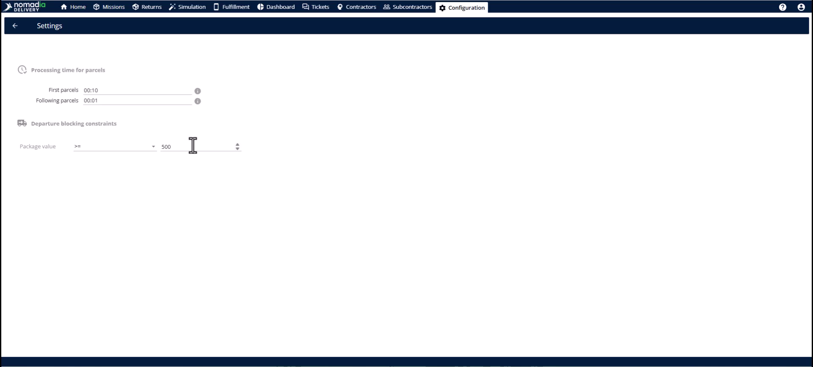

* **Symbole de verrouillage** : cette icône apparaissant sur un itinéraire indique qu’il contient une mission de grande valeur et qu’il est bloqué.

* **Infobulle** : survolez le cadenas pour voir la raison précise du blocage.

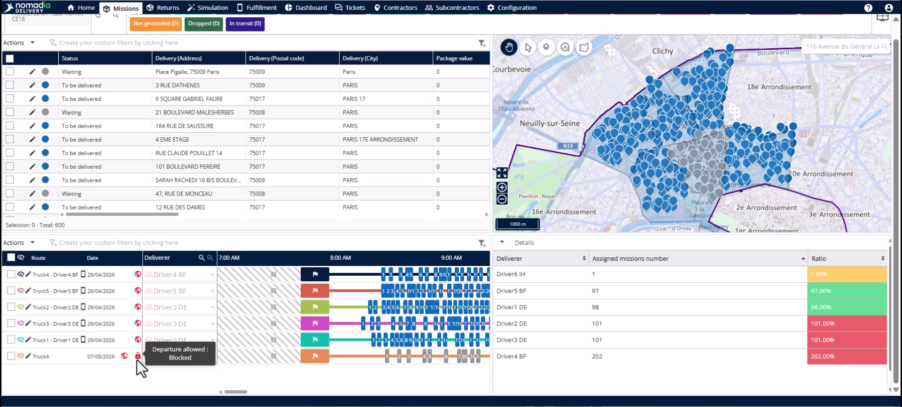

* **Liste déroulante d’autorisation de départ** : sélectionnez entre **Aucun blocage**, **Bloqué** ou **Autorisé** pour gérer l’accès à l’itinéraire.

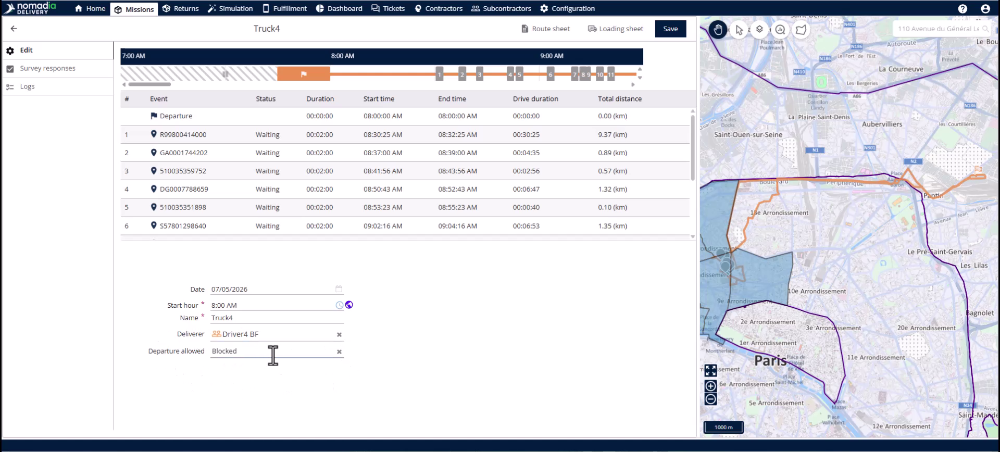

* **Section du journal** : consultez l’historique de qui a approuvé un itinéraire et à quel moment pour la conformité.

<figure>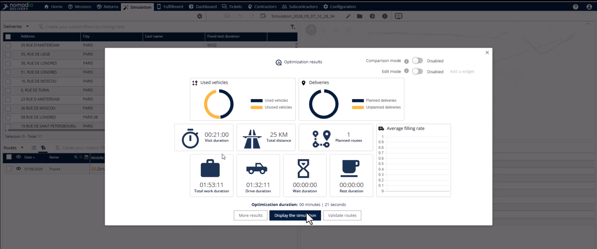<figcaption></figcaption></figure>

## Optimiser et identifier les itinéraires bloqués

1. Accédez à l’**onglet Missions**.

2. Sélectionnez les missions qui dépassent la **valeur du colis** que vous avez configurée.

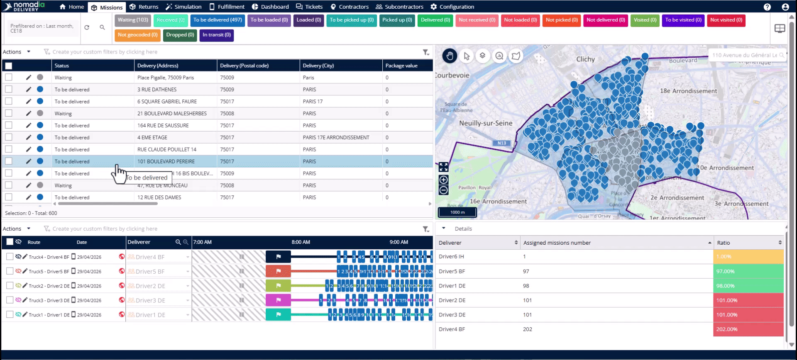

3. Cliquez sur **Actions** et sélectionnez **Optimiser** (ou tout autre flux de travail d’optimisation).

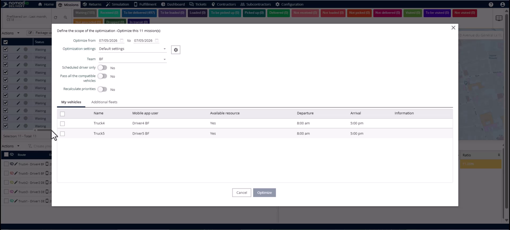

4. Une fois le processus d’optimisation terminé, sélectionnez le nouvel itinéraire et cliquez sur Valider.

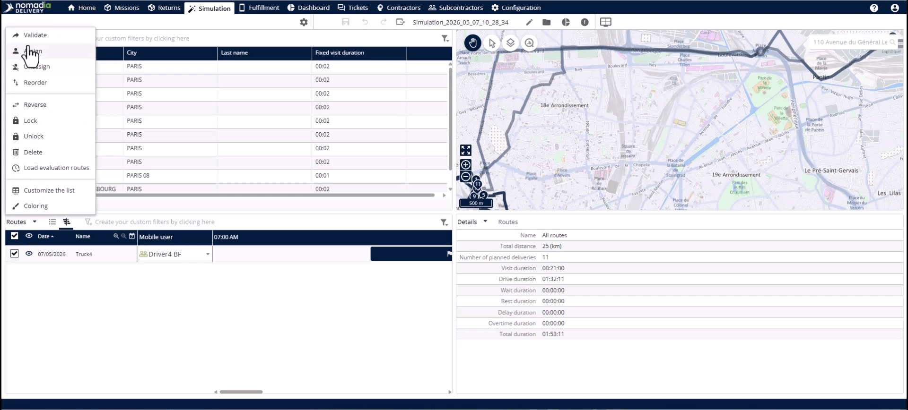

5. Vérifiez la présence de l’icône de **cadenas** sur l’itinéraire pour confirmer que le blocage est actif.

## Autoriser l’accès à un itinéraire bloqué

1. Cliquez sur l’**icône crayon** à côté de l’itinéraire bloqué.

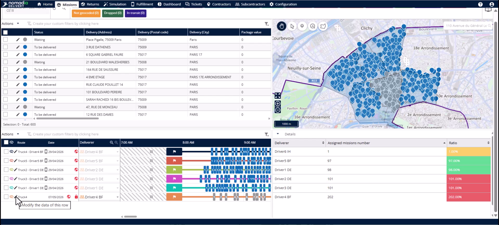

2. Ouvrez la **liste déroulante d’autorisation de départ**.

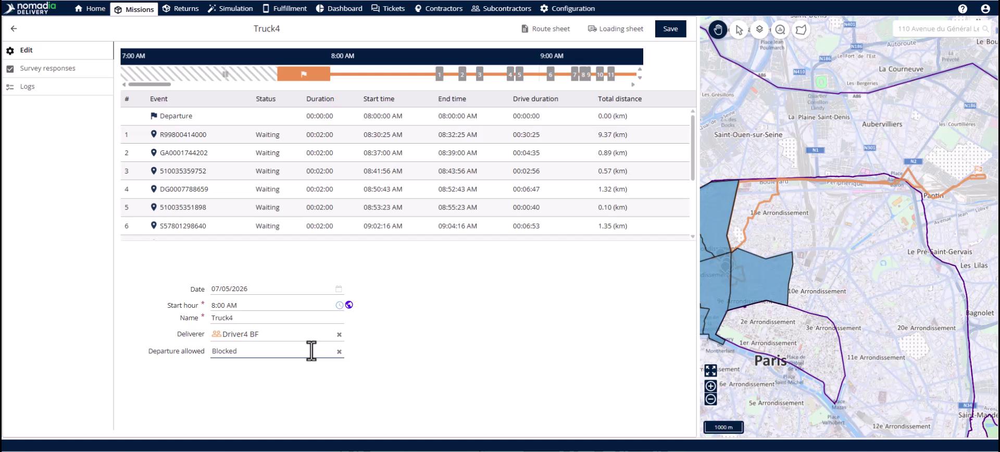

3. Sélectionnez **Autorisé**.

4. Cliquez sur le **bouton Enregistrer**.

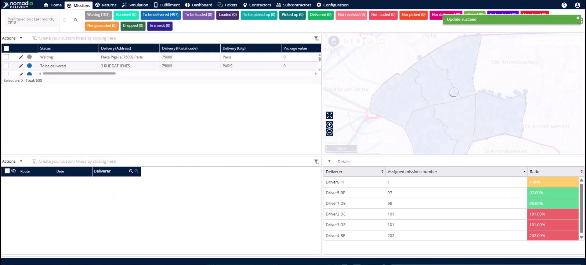

5. Vérifiez que l’**icône verte de cadenas déverrouillé** est maintenant affichée.

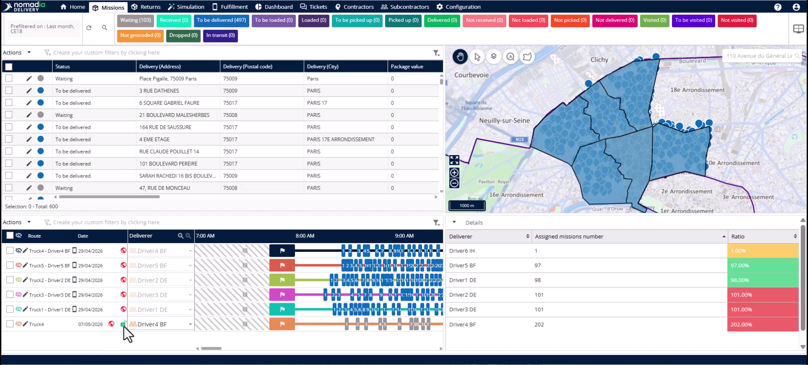

## Conseils


**Filtrage rapide** : filtrez par **Autorisation de départ** dans l’onglet Missions pour voir instantanément tous les itinéraires bloqués.



**Dossiers de conformité** : utilisez la **section du journal** pour documenter qui a examiné les missions de grande valeur en cas de litige futur.



**Verrouillage automatique** : les conducteurs ne peuvent pas démarrer d’itinéraires dans l’application mobile si le statut est **Bloqué**.


## Rubriques connexes

* [Études de cas](README.md)
* [Durée fixe réduite](reduced-fixed-duration.md)
* [Optimisation des missions pour l’agence](optimizing-missions-for-agency.md)
