# Création d’une étude avec zone principale

Gérez efficacement les territoires de livraison pendant les périodes de pointe et les volumes fluctuants. Organisez la couverture en créant des plans saisonniers qui s’activent automatiquement au bon moment. Obtenez des opérations logistiques précises qui reflètent la couverture réelle pour vos équipes terrain.

## Avant de commencer

Pour créer et gérer des études, assurez-vous d’avoir les autorisations administratives correctes :

* Accès au module Configuration
* Autorisation de créer et de mettre à jour des zones
* Autorisation de créer et de mettre à jour des études

1. Cliquez sur le module Configuration dans la bannière supérieure.

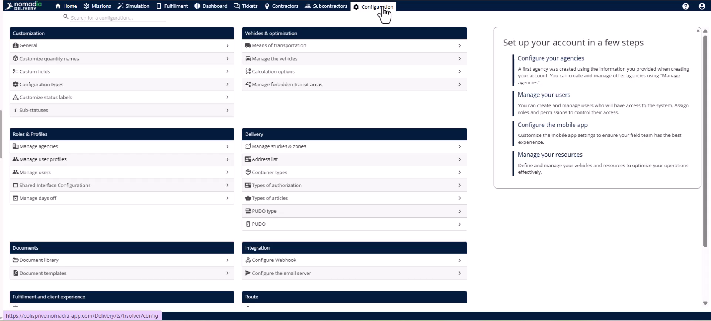

2. Sélectionnez la page **Gérer les utilisateurs**.

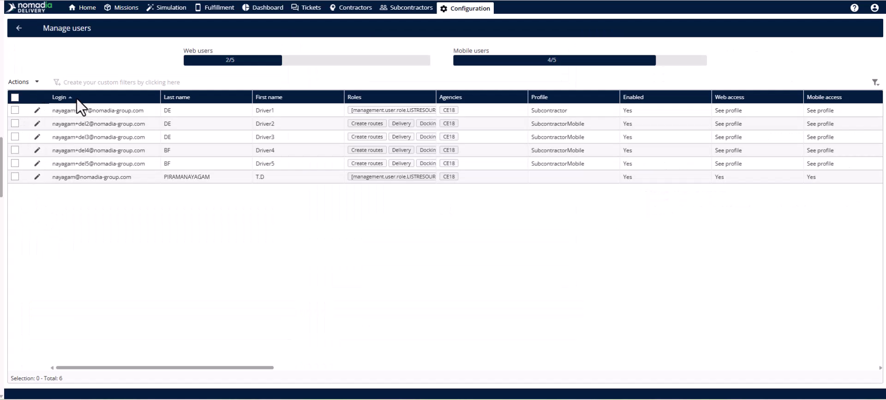

3. Modifiez l’utilisateur concerné et cliquez sur l’onglet **Rôles et droits**.

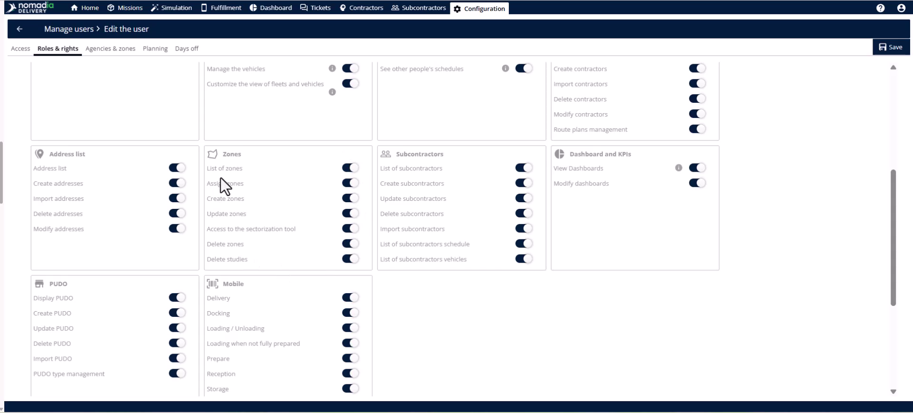

4. Activez les droits **Créer et mettre à jour des zones** et **Liste des zones**.
5. Cliquez sur le bouton **Enregistrer** pour appliquer les autorisations.

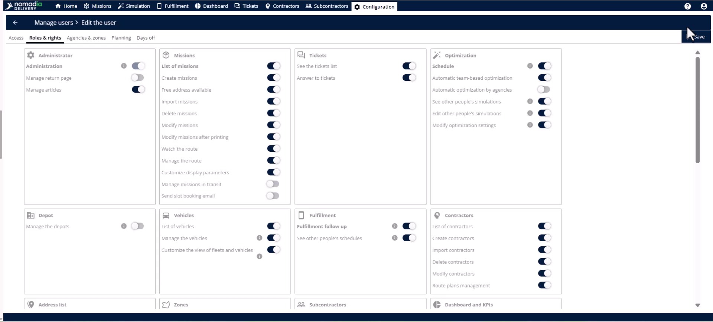

## Présentation de la fonctionnalité

* **Étude** : objet structuré définissant comment les territoires de livraison sont organisés.
* **Zone principale** : zone géographique de niveau supérieur affectée à une équipe et liée à des codes postaux.
* **Page de gestion des études** : votre hub central pour créer et modifier des études et des zones.

## Créer une étude

1. Accédez à la page **Études et zones** sous la section **Livraison** dans **Configuration**.

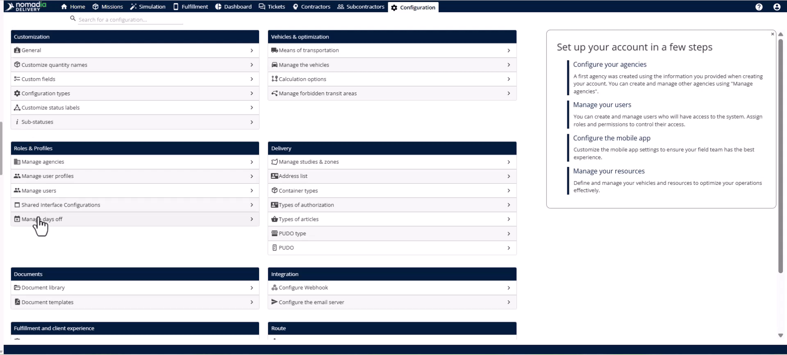

2. Cliquez sur le menu **Actions** en haut à droite.

<figure>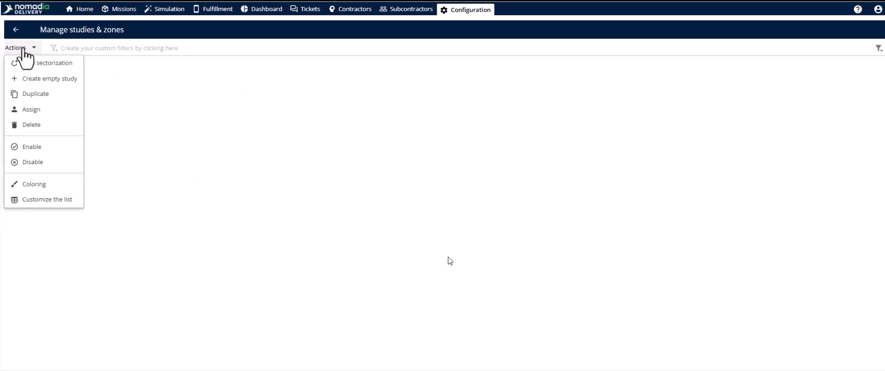<figcaption></figcaption></figure>

3. Sélectionnez **Créer une étude vide**.
4. Saisissez l’**Identifiant**, le **Nom** et l’**Agence**.
5. Définissez la **Date de début de validité** et la **Date de fin de validité**.
6. Basculez l’étude sur **Activer**.
7. Sélectionnez les jours actifs de la semaine pour ce plan.
8. Définissez la période d’activation saisonnière spécifique.
9. Cliquez sur le bouton **Enregistrer**.

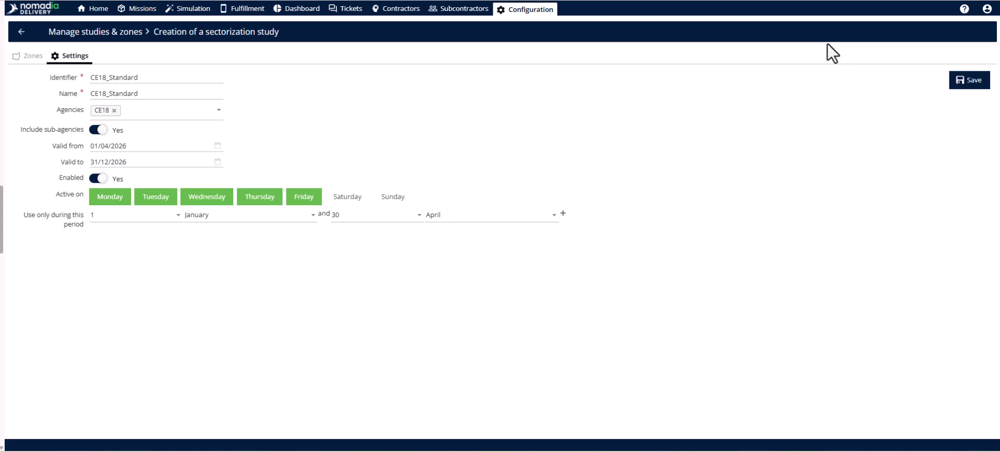

## Créer une zone principale

1. Ouvrez l’onglet **Zone** dans votre nouvelle étude.

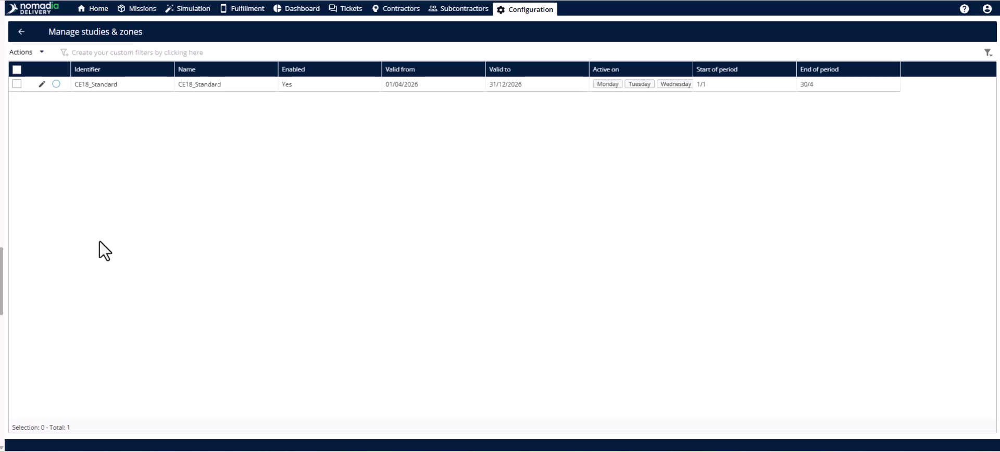

2. Ouvrez le menu **Actions**.
3. Sélectionnez **Ajouter une zone de code postal**.

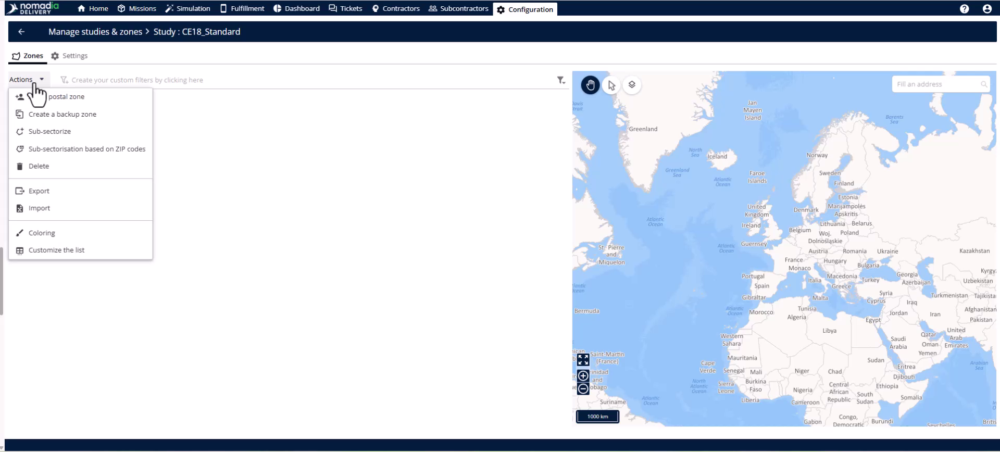

4. Renseignez l’**Identifiant**, le **Nom** et l’**Agence**.
5. Sélectionnez le **Pays** et définissez la **Longueur normalisée du code postal**.
6. Sélectionnez **Zone principale** dans le champ **Mode d’affectation**.

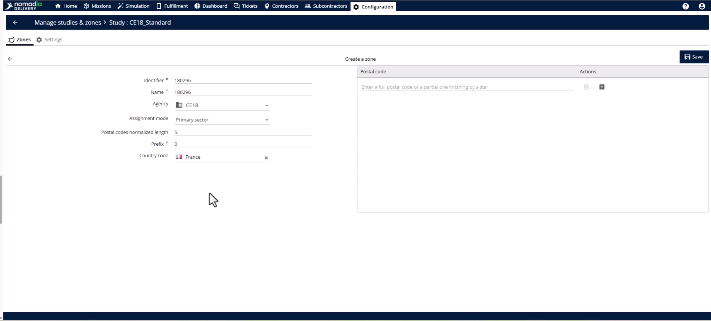

7. Saisissez les codes postaux manuellement à l’aide du bouton **Plus**.

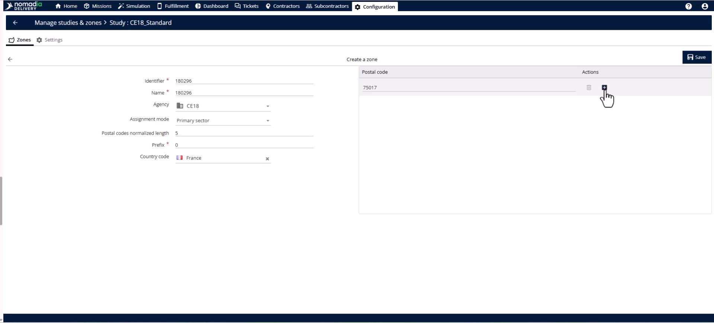

8. Cliquez sur le bouton **Enregistrer**.

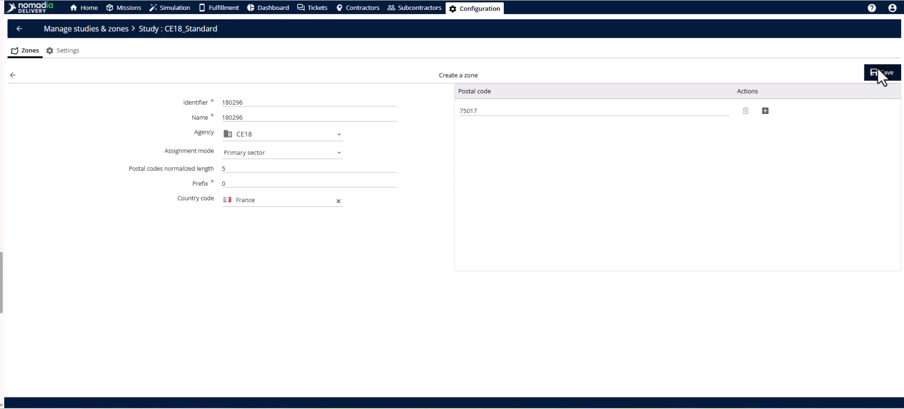

## Conseils


**Importation en masse** : utilisez l’option **Importer** dans le menu **Actions** pour téléverser de grandes listes de codes postaux.



**Visualisation instantanée** : regardez la carte à droite pour voir les polygones des codes postaux rendus automatiquement.



**Automatisation via API** : utilisez le point de terminaison **créer une étude** pour déclencher la création d’une étude par programmation pour les flux de travail de grande taille.



**Mode d’affectation** : sélectionnez toujours **Zone principale** pour les zones de niveau supérieur afin d’éviter de créer des sous-zones par erreur.


## Rubriques connexes

* [Études de cas](README.md)
* [Sous-sectorisation par code postal](subsector-using-postal-code.md)
* [Sous-sectoriser la zone principale](sub-sectorize-primary-zone/README.md)
* [Gérer les études et les zones](../manage-studies-and-zones/README.md)
