# Sous-sectoriser la zone principale

Cette fonctionnalité vous permet de diviser automatiquement une zone principale en territoires plus petits et équilibrés à l’aide du module de gestion des territoires. Les répartiteurs en ont besoin pour créer des zones justes et logiques pour des livreurs ou des équipes spécifiques. En suivant ce guide, vous obtiendrez trois sous-zones divisées géographiquement, prêtes à être affectées immédiatement.

## Avant de commencer

Avant de commencer la sous-sectorisation, assurez-vous que votre système répond à ces exigences :

* Une zone principale doit être construite avec des codes postaux cartographiés et une géographie définie.
* Les données historiques des missions, y compris les points de livraison et les coordonnées, doivent être chargées dans la page des missions.

1. Ouvrez votre **étude** et accédez à l’**onglet Zone**.

2. Sélectionnez votre **zone principale** dans la liste.

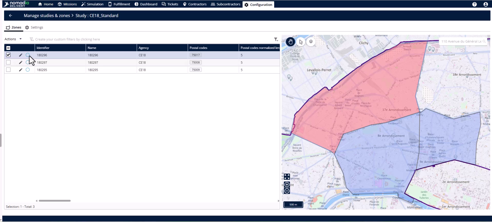

## Présentation de la fonctionnalité

* **Menu Actions** : permet d’accéder à l’outil de sous-sectorisation pour la zone sélectionnée.

<figure>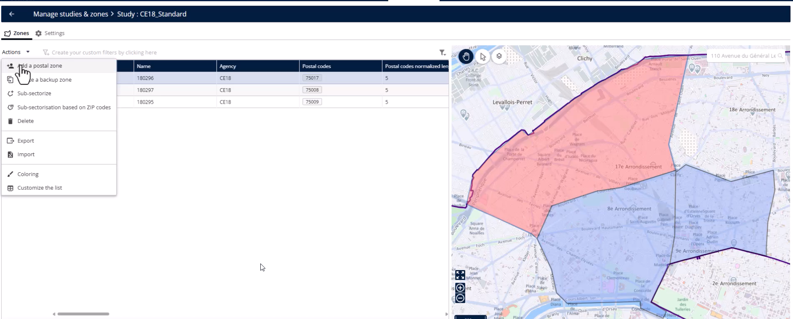<figcaption></figcaption></figure>

* **Fenêtre contextuelle des paramètres de sectorisation** : vous permet de filtrer les missions que le système utilise pour l’équilibrage.

* **Bascule du modèle de nommage** : nomme automatiquement les nouvelles sous-zones à partir du nom de la zone principale afin de maintenir la cohérence.

* **Bouton d’affectation des territoires** : lance le module de gestion des territoires avec vos données de mission filtrées.

* **Bouton Automatisation** : ouvre l’assistant d’affectation des territoires pour démarrer le processus d’équilibrage automatisé.

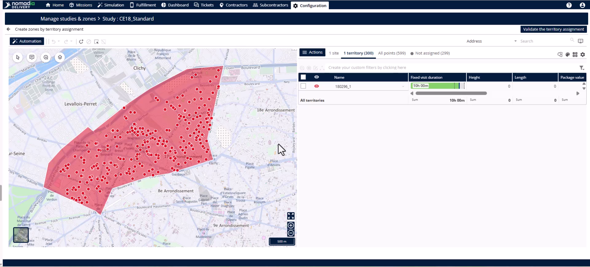

* **Points d’équilibrage** : une méthode d’équilibrage qui répartit les missions uniformément en fonction du nombre de points de livraison.

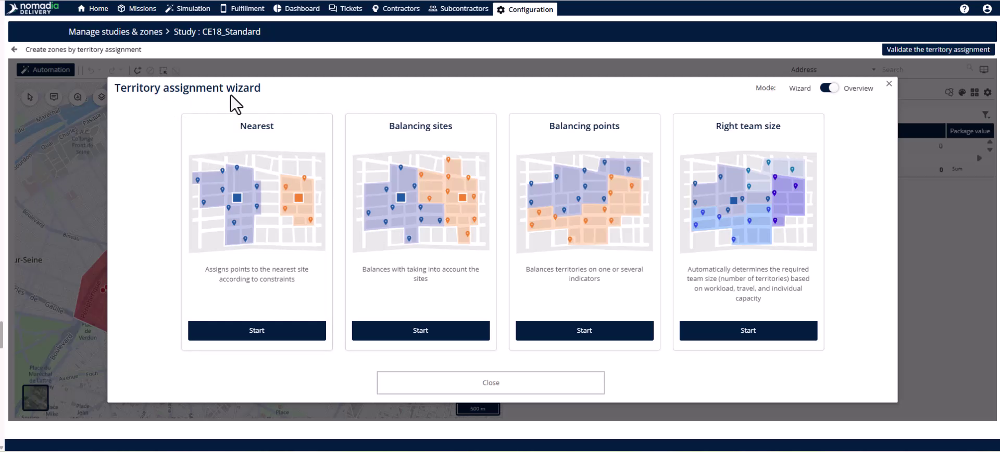

* **Bouton de validation de la gestion des territoires** : finalise la division automatisée et vous fait passer à l’étape d’affectation.

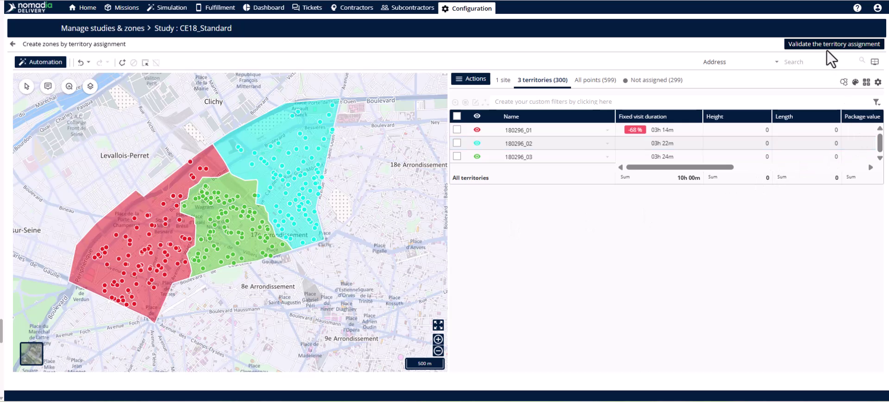

## Créer des sous-zones équilibrées

1. Ouvrez le **menu Actions** et sélectionnez **Sous-sectoriser**.

2. Utilisez les filtres pour réduire les données des missions par **agence**, **sous-traitant**, **période** ou **jour de la semaine**.

3. Activez le **modèle de nommage** pour automatiser le nommage des sous-zones.

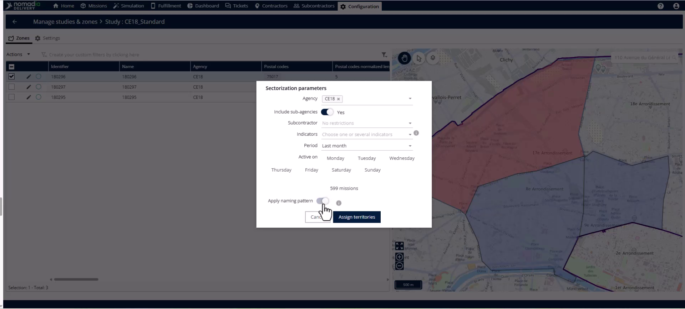

4. Cliquez sur **Affecter des territoires** pour charger les missions filtrées sur la carte.

5. Sélectionnez le **bouton Automatisation** situé en haut à gauche de la carte.

6. Sélectionnez **Points d’équilibrage** comme méthode d’équilibrage et cliquez sur **Démarrer**.

7. Accédez à l’**onglet Nombre de territoires** et saisissez votre nombre cible (par exemple, 3).

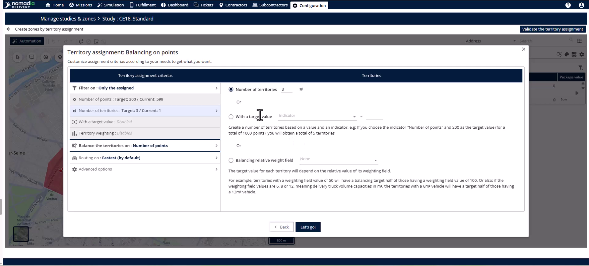

8. Passez à l’onglet **Équilibrer les territoires sur** et sélectionnez votre indicateur, par exemple **Nombre de points**.

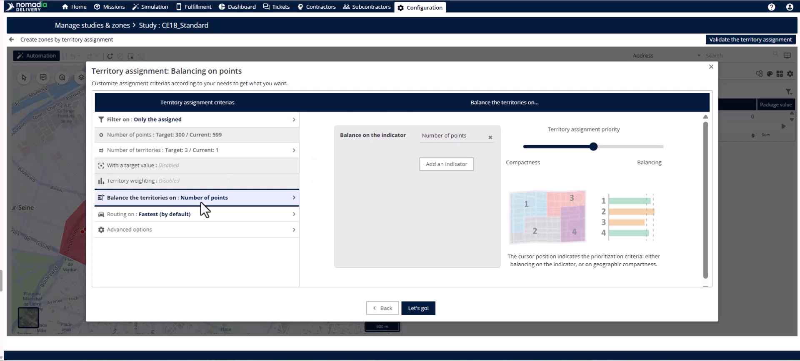

9. Cliquez sur **C’est parti** pour lancer l’équilibrage automatisé.

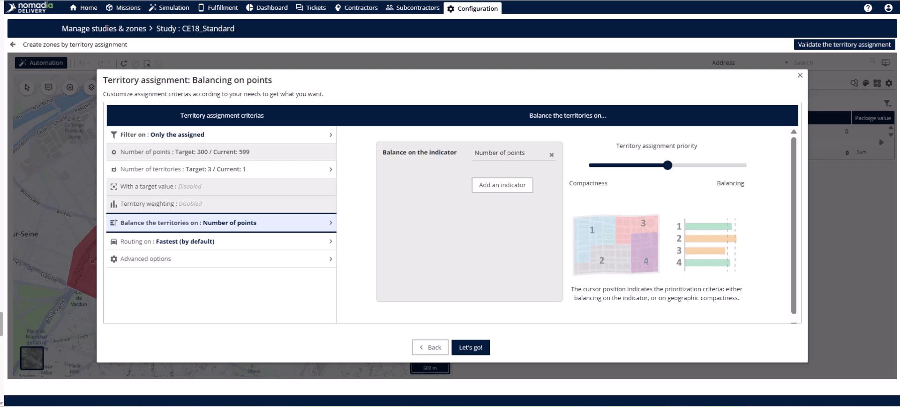

10. Vérifiez la division de la carte et cliquez sur **Valider la gestion des territoires**.

11. Associez chaque sous-zone à une **agence** ou **sous-agence** à l’aide du menu déroulant.

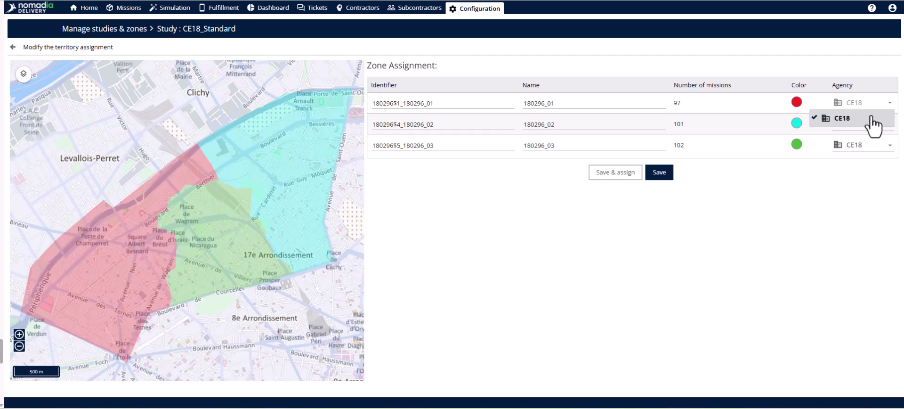

12. Cliquez sur **Enregistrer et affecter** pour mettre en service immédiatement, ou cliquez sur **Enregistrer** pour finaliser plus tard.

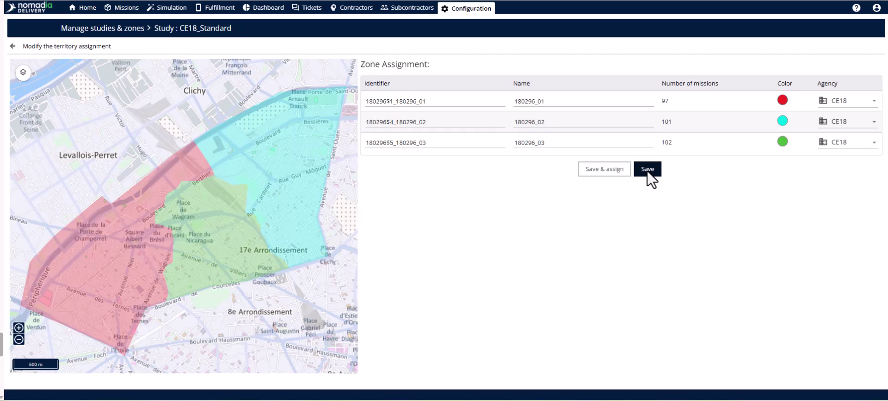

## Conseils


**Équilibrage intelligent** : utilisez les données historiques des missions, comme le nombre d’arrêts et les coordonnées, pour garantir que vos zones soient divisées avec précision en fonction de l’activité réelle.



**Indicateurs flexibles** : vous pouvez équilibrer les territoires à l’aide de n’importe quelle donnée numérique, comme la durée de livraison ou le temps de service, pour répondre à vos besoins opérationnels spécifiques.



**Vérification visuelle** : utilisez les couleurs distinctes sur la carte pour identifier et vérifier immédiatement la logique géographique de vos nouvelles sous-zones.



**Avertissement sur les données manquantes** : vous ne pouvez pas effectuer de sous-sectorisation si les missions ne sont pas chargées, car le système n’aura aucune donnée sur laquelle s’appuyer pour l’équilibrage.


## Rubriques connexes

* [Division des sous-zones](dividing-sub-zones.md)
* [Fusion des sous-zones](merging-sub-zones.md)
* [Études de cas](../README.md)
