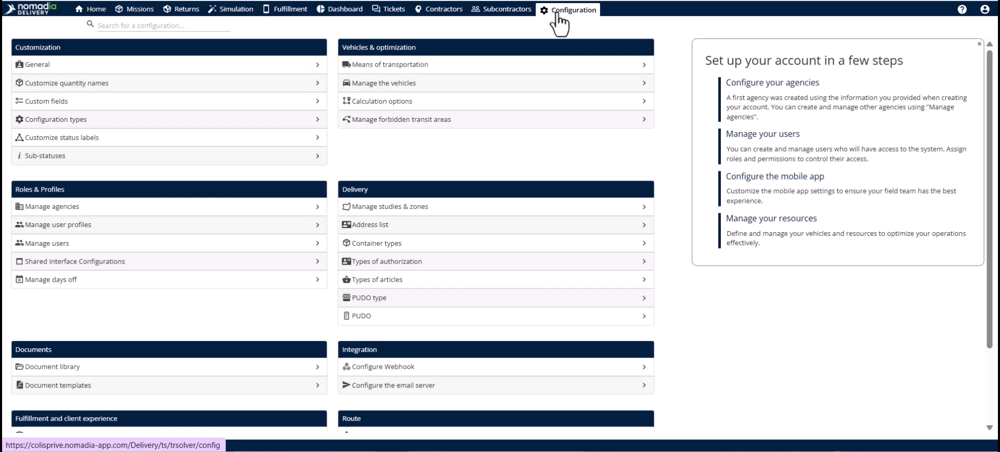
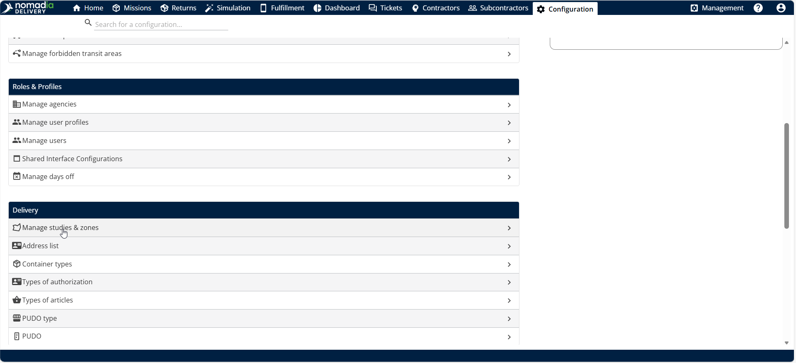
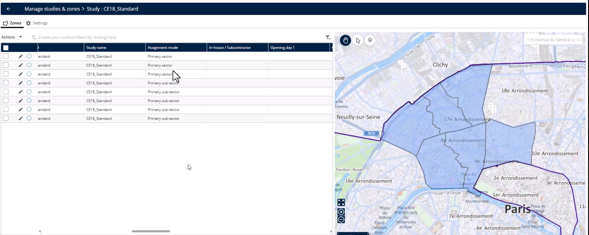
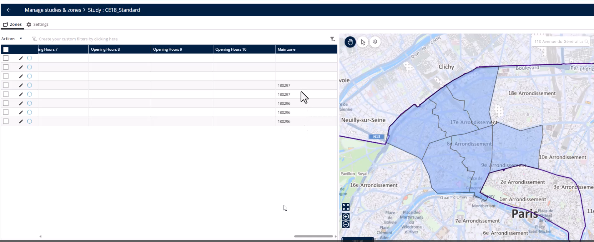
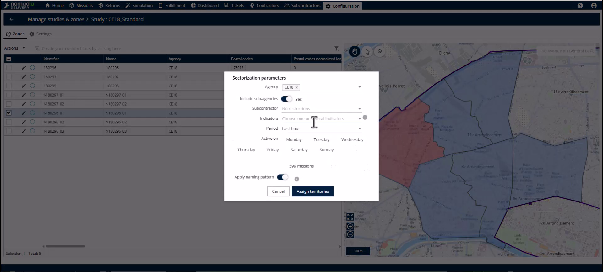
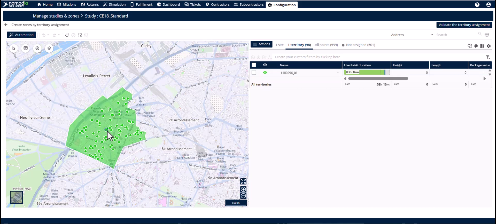
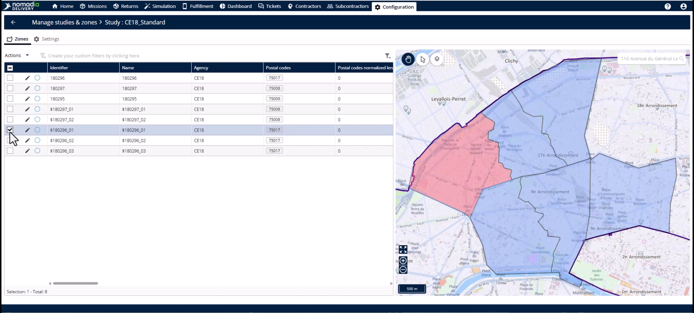
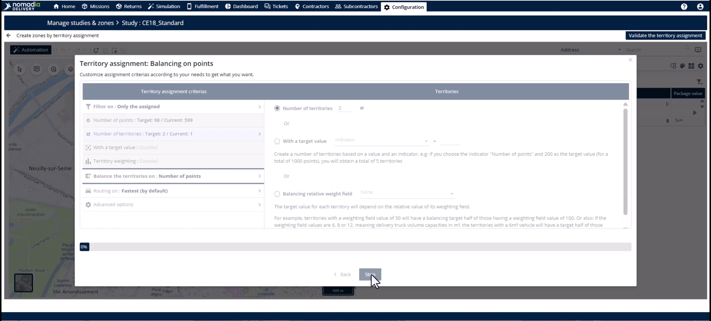
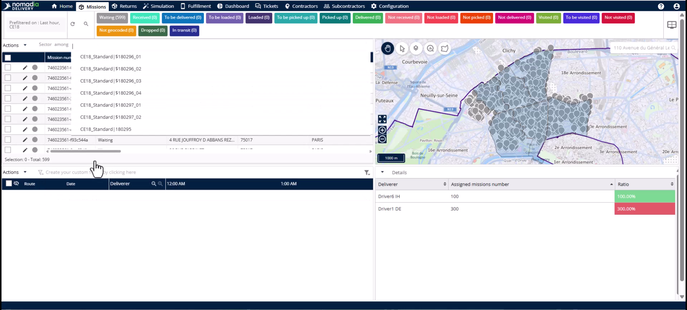

# Division des sous-zones

La division des sous-zones vous permet de scinder instantanément un territoire surchargé en deux zones équilibrées. Utilisez cette fonctionnalité pour gérer les pics de demande, les commandes en gros ou les hausses saisonnières sans surcharger les livreurs. Vous obtiendrez des volumes de missions équilibrés et des réaffectations automatisées des livreurs afin de maintenir vos niveaux de service.

## Avant de commencer

Avant de diviser un territoire, assurez-vous que votre configuration répond à ces exigences :

* Une zone principale doit déjà être sous-sectorisée via le gestionnaire de territoires.
* Les sous-zones cibles doivent avoir un lien établi avec une zone principale.

1. Ouvrez le **module Configuration**.

2. Cliquez sur **Gérer les études et les zones**.

<figure><figcaption></figcaption></figure>

3. Sélectionnez l’icône **Modifier** de l’étude contenant la zone surchargée.

## Présentation de la fonctionnalité

* **Mode d’affectation** : ce champ affiche « sous-zone principale » pour confirmer que le territoire fait partie d’une hiérarchie plus vaste.

<figure><figcaption></figcaption></figure>

* **Champ Zone principale** : ce champ stocke l’identifiant unique de la zone principale parente afin de conserver la structure intacte.

<figure><figcaption></figcaption></figure>

* **Menu Actions** : ce menu fournit la commande **Sous-sectoriser** pour lancer le processus de division.
* **Paramètres de sectorisation** : cette fenêtre contextuelle vous permet de filtrer les missions par agence, période ou jours spécifiques.

* **Bouton Automatisation** : ce bouton lance l’assistant de territoires pour calculer automatiquement de nouvelles limites.

## Diviser une sous-zone surchargée

1. Identifiez la sous-zone surchargée dans l’**onglet Zone**.
2. Ouvrez le **menu Actions** et cliquez sur **Sous-sectoriser**.

3. Définissez vos filtres dans **Paramètres de sectorisation** et cliquez sur **Affecter des territoires**.
4. Cliquez sur le **bouton Automatisation** situé au-dessus de la carte dans le **Gestionnaire de territoires**.

5. Sélectionnez **Point d’équilibre** comme méthodologie dans l’**assistant d’affectation de territoires**.
6. Cliquez sur **Démarrer**.
7. Saisissez le nombre « 2 » dans la section **Nombre de territoires**.
8. Cliquez sur **C’est parti** pour lancer le calcul.

9. Examinez la répartition sur la carte et cliquez sur **Valider l’affectation du territoire**.
10. Cliquez sur **Enregistrer** dans la page **Modifier l’affectation du territoire**.

## Vérifier la réaffectation automatisée des missions

1. Accédez à l’**onglet Missions**.
2. Cliquez sur le champ **Secteur** pour consulter les affectations des missions.
3. Vérifiez que les missions affichent les noms des nouvelles sous-zones.

## Conseils


**Préservation de la hiérarchie** : le système utilise le **champ Zone principale** pour garantir que la hiérarchie de votre zone reste cohérente pendant les modifications.



**Mises à jour automatisées** : les missions se réaffectent automatiquement en fonction des adresses de livraison géographiques, ce qui élimine la saisie manuelle des données.



**Optimisation immédiate** : les planificateurs peuvent passer directement à l’optimisation des itinéraires, car le système gère automatiquement tout le re-marquage.



**Goulots d’étranglement statiques** : évitez les réaffectations manuelles lors des pics afin de prévenir les goulots d’étranglement de données et les missions non livrées.


## Rubriques connexes

* [Sous-sectoriser la zone principale](README.md)
* [Fusion des sous-zones](merging-sub-zones.md)
* [Études de cas](../README.md)
