# Fusion des sous-zones

La fusion des sous-zones recombine des territoires divisés une fois le pic de demande passé. Cette fonctionnalité vous aide à maintenir une structure de zones allégée et garantit des itinéraires de livreurs efficaces. En fusionnant, vous réduisez la charge de planification et revenez à une configuration simplifiée d’un livreur, un territoire.

## Avant de commencer

* Assurez-vous d’avoir accès au module **Configuration**.
* Identifiez la **Zone primaire** contenant les sous-zones que vous souhaitez fusionner.
* La **Zone primaire** doit avoir le mode d’affectation réglé sur **secteur principal**.

1. Cliquez sur le module **Configuration** dans le menu de navigation principal.

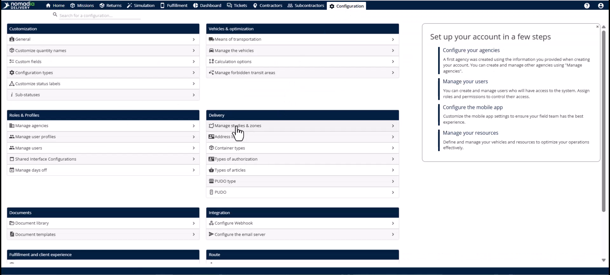

2. Sélectionnez **Gérer les études et les zones** dans le menu.

<figure>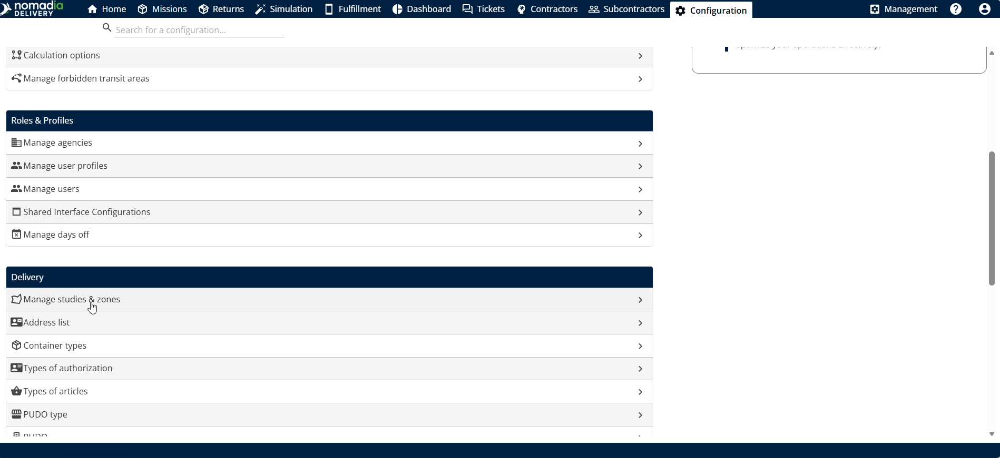<figcaption></figcaption></figure>

3. Cliquez sur **Modifier** sur l’étude spécifique contenant vos sous-zones.

<figure>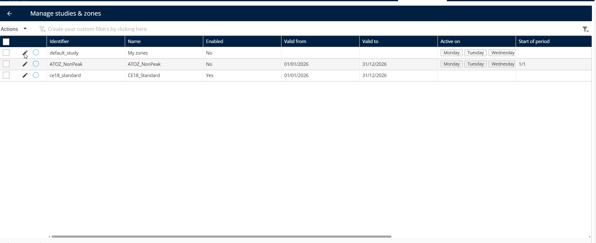<figcaption></figcaption></figure>

## Présentation de la fonctionnalité

* **Zone primaire** : le territoire de niveau supérieur requis pour afficher et gérer simultanément toutes les sous-zones qu’il contient.

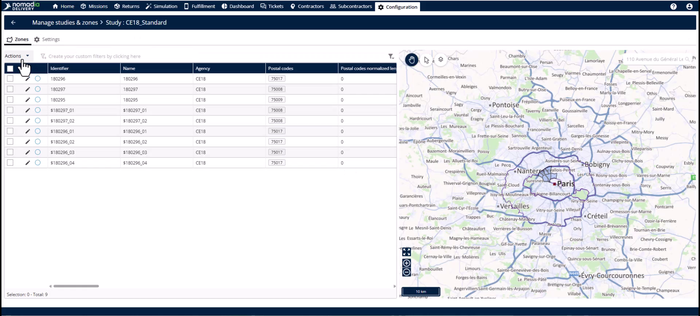

* **Sous-sectoriser** : le bouton d’action utilisé pour lancer le **Gestionnaire de territoires** pour la zone sélectionnée.

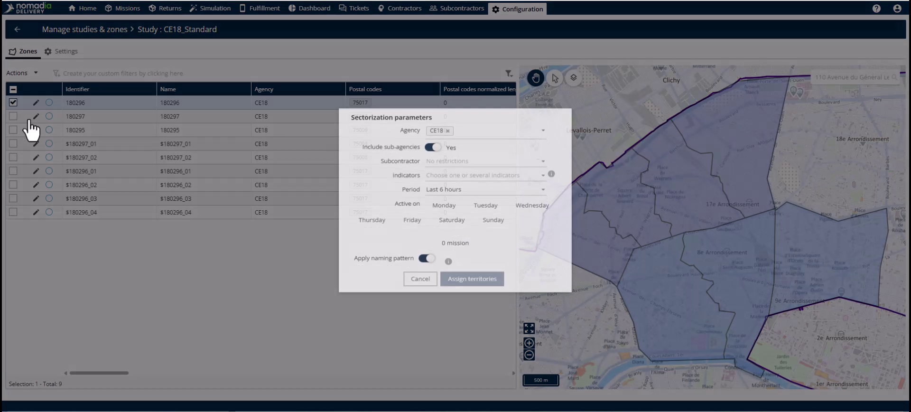

* **Gestionnaire de territoires** : un espace de travail affichant la carte et le tableau des zones pour les modifications actives.

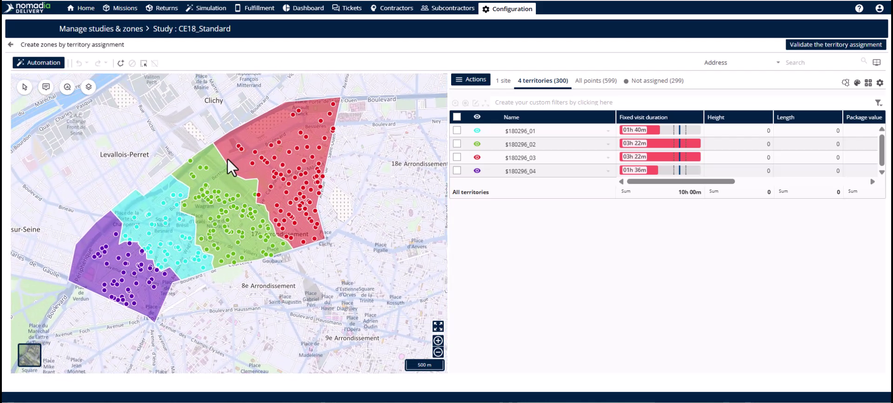

* **Fusionner des territoires** : la commande qui combine deux sous-zones sélectionnées en une seule zone géographique contiguë.

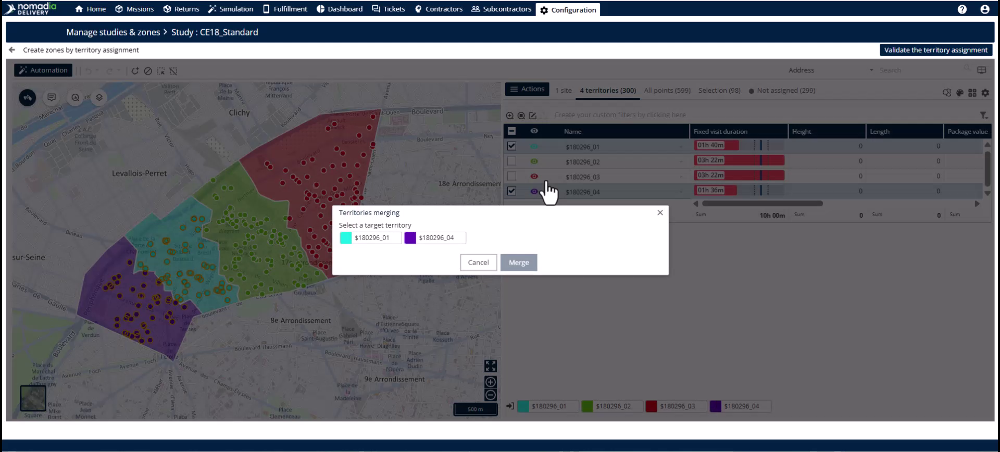

* **Identifiant** : le nom ou libellé unique attribué à la nouvelle sous-zone fusionnée.

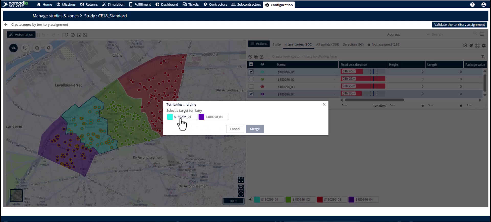

## Fusionner des sous-zones

1. Accédez à l’onglet **Zones**.
2. Sélectionnez la **Zone primaire**.

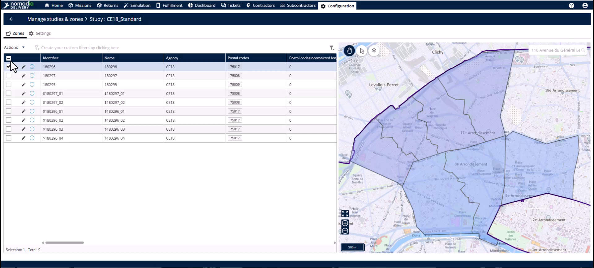

3. Cliquez sur le bouton **Action** et sélectionnez **Sous-sectoriser**.

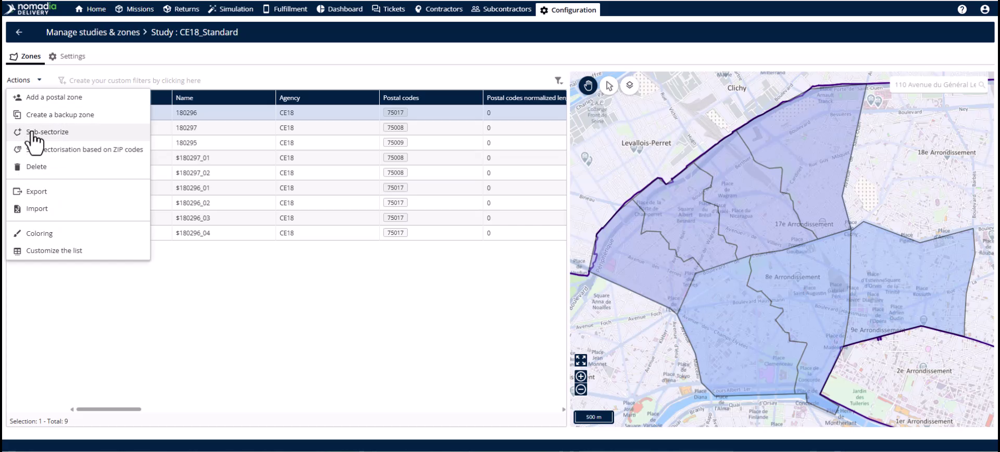

4. Saisissez vos valeurs de **Pré-filtre** pour l’agence, la période et les jours pertinents.

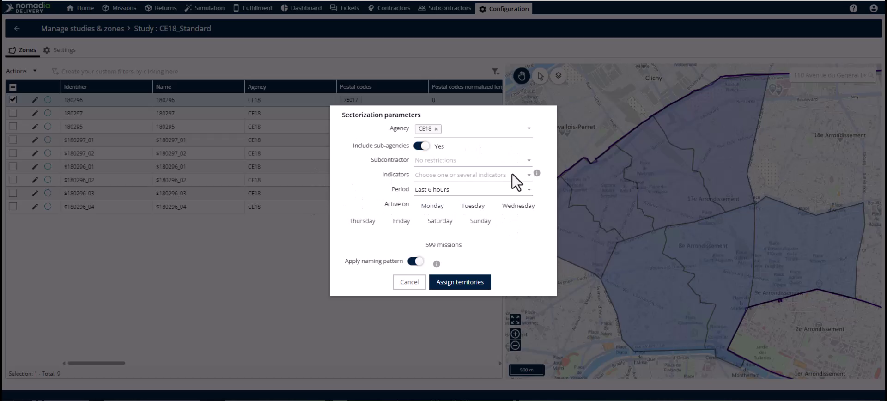

5. Cliquez sur **Affecter** **des territoires** pour ouvrir l’affichage de la carte.

<figure>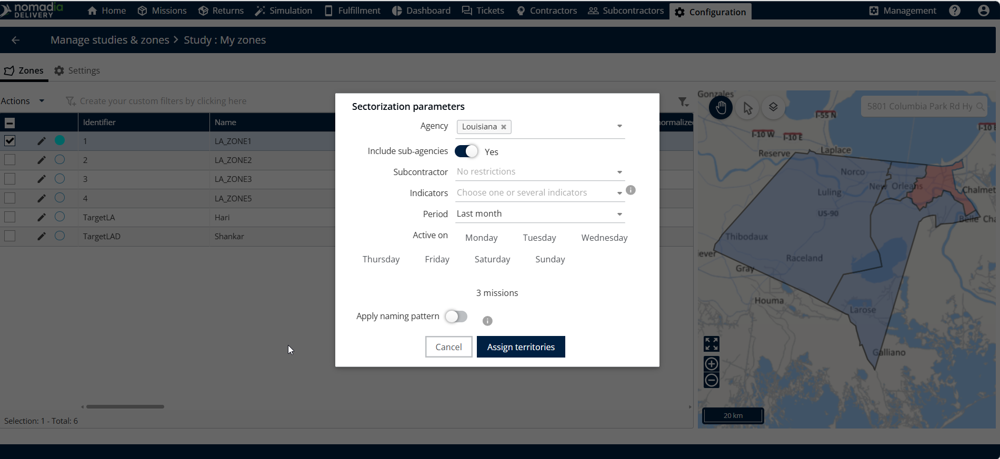<figcaption></figcaption></figure>

6. Dans le tableau à côté de la carte, sélectionnez les deux sous-zones que vous souhaitez fusionner.

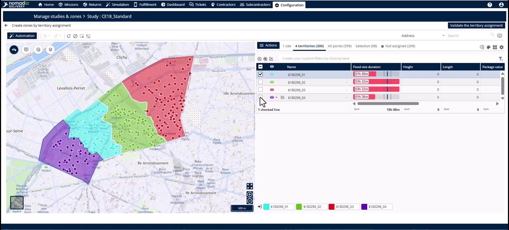

7. Cliquez sur **Actions** et sélectionnez **Fusionner les territoires**.

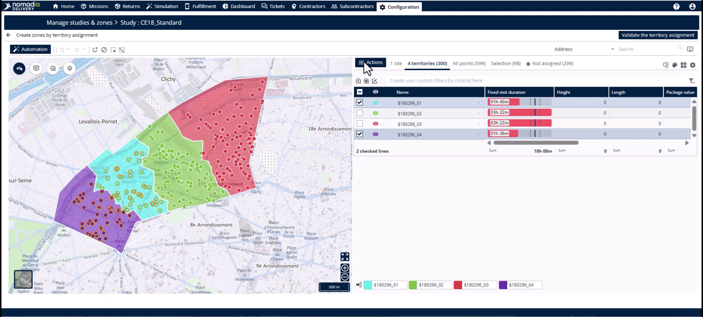

8. Sélectionnez l’**Identifiant** que vous souhaitez conserver pour la nouvelle zone.

9. Cliquez sur **Fusionner**.

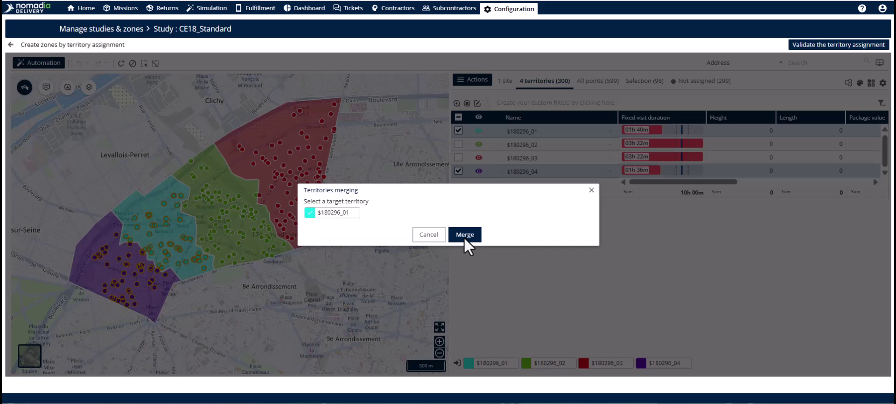

10. Examinez la nouvelle zone géographique unifiée sur la carte.

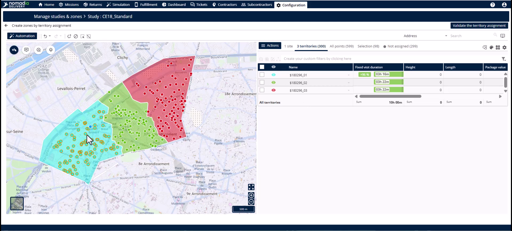

11. Cliquez sur **Valider la sectorisation** dans le coin supérieur droit.

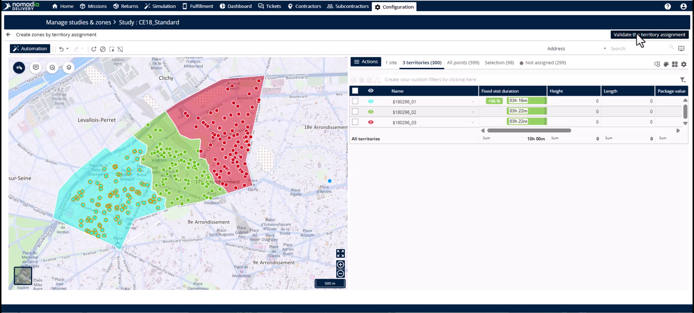

12. Cliquez sur **Enregistrer** sur la page de révision pour mettre à jour le tableau des zones.

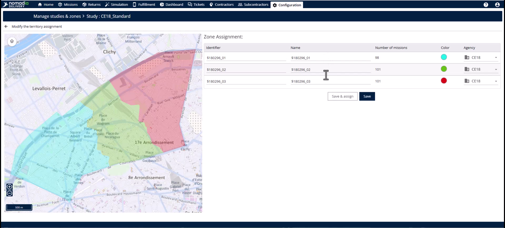

## Conseils


**Efficacité opérationnelle** : recombinez les zones dès que la demande se normalise afin d’éviter les itinéraires à moitié vides.



**Nommage cohérent** : choisissez l’identifiant que votre équipe connaît le mieux lorsqu’il vous est demandé pendant une fusion.



**Niveau de sélection** : ne sélectionnez jamais un niveau de sous-zone pour commencer une fusion ; l’option de fusion n’apparaîtra pas.


## Rubriques connexes

* [Sous-sectoriser la zone principale](README.md)
* [Division des sous-zones](dividing-sub-zones.md)
* [Études de cas](../README.md)
