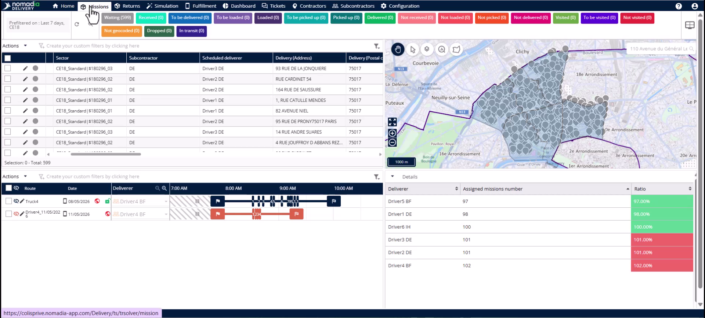
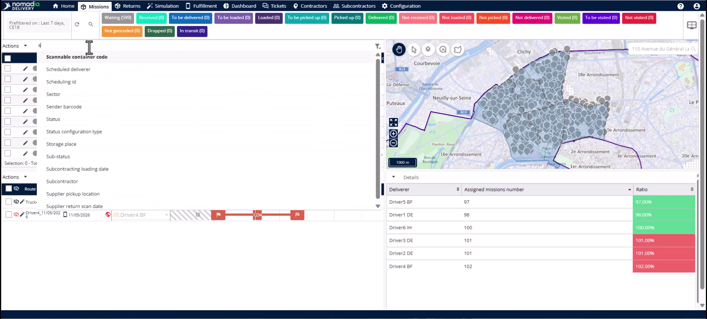
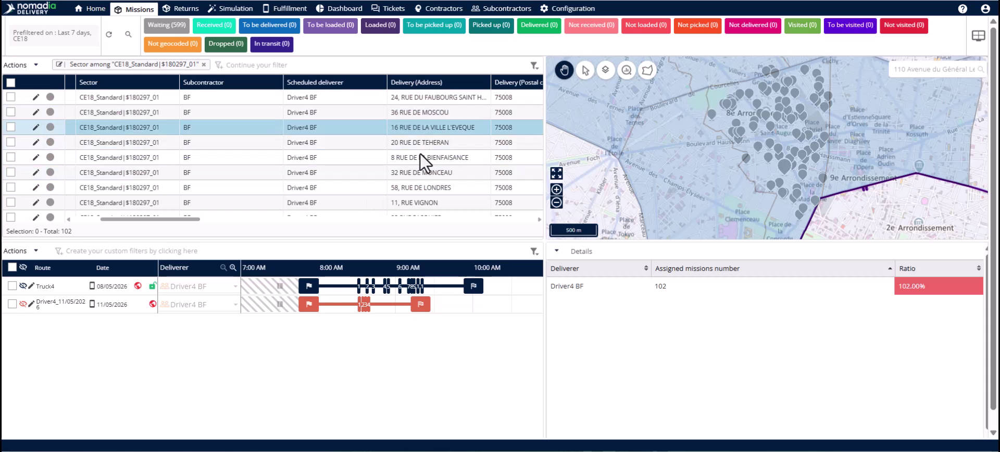
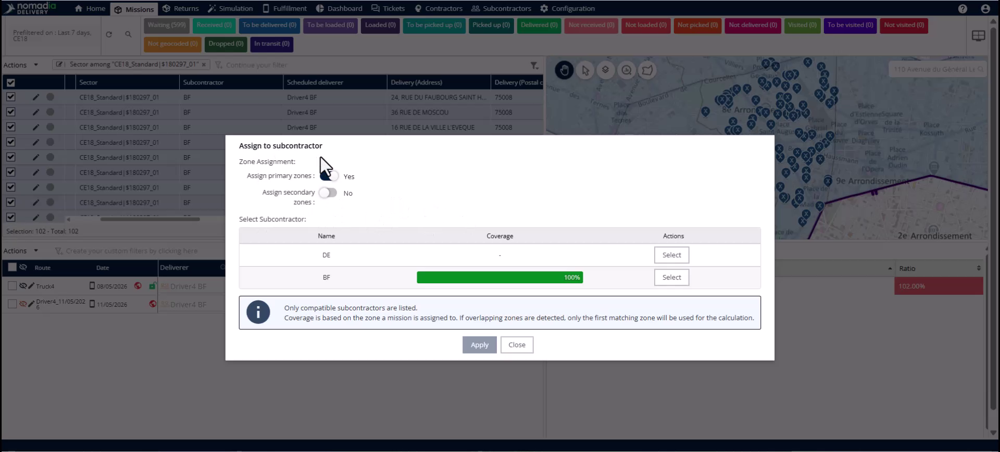
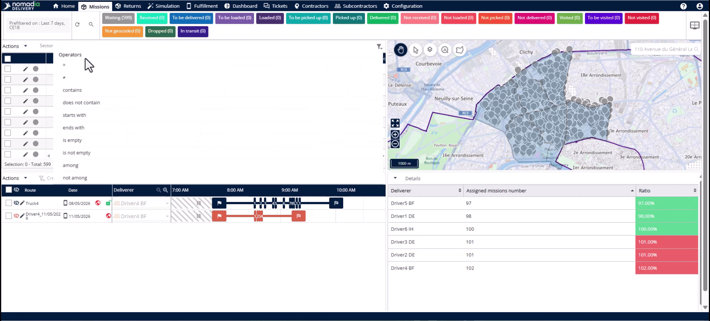
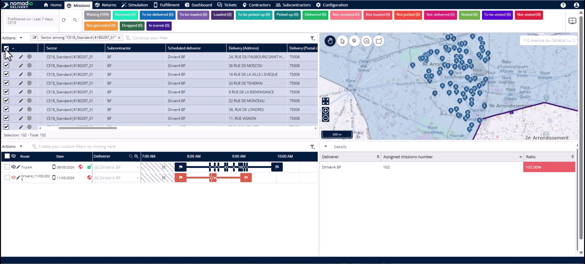
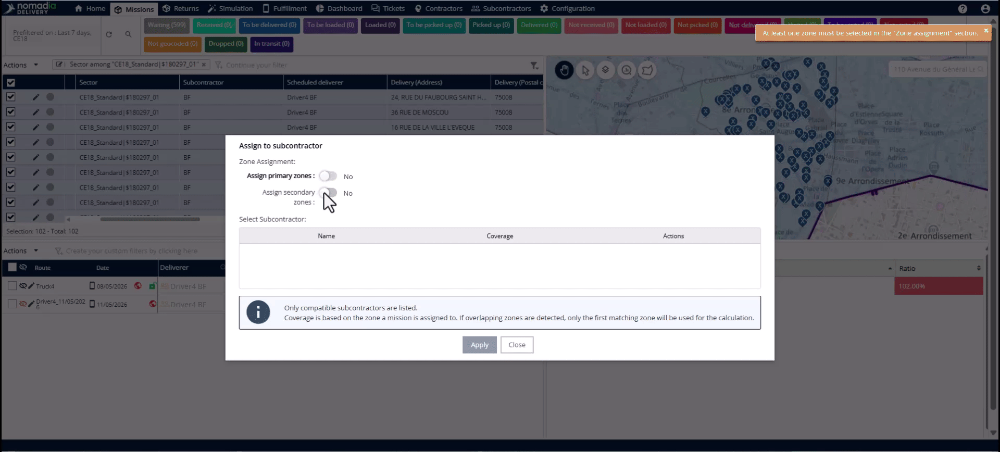
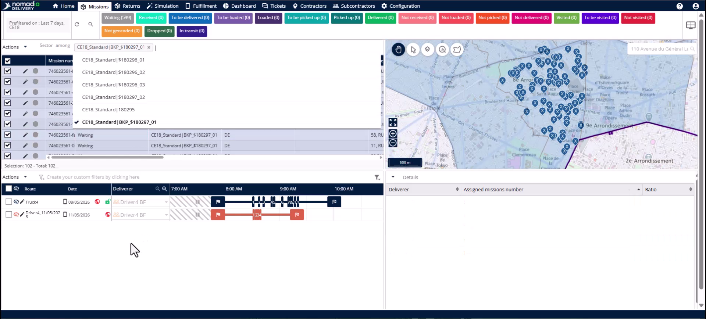

# Permutation du sous-traitant vers la zone de secours

Cette fonctionnalité vous permet de réaffecter rapidement des missions lorsqu’un sous-traitant principal n’est pas disponible. Vous réaffecterez les missions concernées à une zone de secours et à un sous-traitant de remplacement en une seule action. Cela garantit que votre charge de travail reste visible pour l’équipe de remplacement et évite les retards de livraison.

## Avant de commencer

Avant de commencer, assurez-vous que les conditions suivantes sont remplies :

* Une zone de secours est déjà créée.
* Un sous-traitant de remplacement est affecté à cette zone de secours.
* Vous avez identifié la sous-zone principale qui nécessite une couverture.

1. Ouvrez l’onglet **Missions** pour commencer la permutation.

## Présentation de la fonctionnalité

* **Panneau de filtrage** : utilisez-le pour isoler les missions appartenant à une sous-zone spécifique.

* **Tableau des missions** : affiche la liste filtrée des missions nécessitant une réaffectation.

* **Menu Actions** : contient l’outil permettant de réaffecter plusieurs missions à la fois.
* **Affecter au sous-traitant** : ouvre la fenêtre contextuelle pour modifier le propriétaire de la mission et les zones.

* **Affecter les zones principales** : un interrupteur permettant d’affecter les missions au territoire principal du sous-traitant.
* **Affecter la zone secondaire** : un interrupteur permettant d’affecter les missions spécifiquement à la zone de secours.
* **Tableau de sélection du sous-traitant** : répertorie les sous-traitants disponibles et leur couverture géographique pour les missions sélectionnées.
* **Appliquer** : exécute la modification sur tous les enregistrements de mission sélectionnés.

## Isoler les missions concernées

1. Accédez au **Panneau de filtrage** et saisissez « sector ».
2. Choisissez l’option de filtrage **Parmi**.
3. Sélectionnez la sous-zone principale qui nécessite une permutation vers la zone de secours.

## Permuter les sous-traitants

1. Sélectionnez toutes les missions dans le **Tableau des missions**.
2. Ouvrez le **menu Actions** et cliquez sur **Affecter au sous-traitant**.

3. Assurez-vous que l’interrupteur **Affecter les zones principales** est désactivé.
4. Activez l’interrupteur **Affecter la zone secondaire**.
5. Sélectionnez le sous-traitant de remplacement affichant une couverture à 100 % dans le **Tableau de sélection du sous-traitant**.
6. Cliquez sur **Appliquer** pour finaliser la permutation.

## Vérifier la permutation

1. Retournez au **Panneau de filtrage** et recherchez « sector ».
2. Sélectionnez l’opérateur **Parmi**.
3. Choisissez la zone de secours que vous venez d’affecter.
4. Confirmez que les missions apparaissent maintenant sous le bon secteur de secours et le bon sous-traitant.

## Conseils


**Efficacité** : une seule action met simultanément à jour le secteur, le sous-traitant et le livreur pour toutes les missions.



**Itinéraire du conducteur** : si aucun livreur n’est affecté à la zone de secours, le système efface le conducteur existant. Cela évite que des missions soient routées vers des conducteurs qui ne sont plus responsables du territoire.



**Validation de la couverture** : recherchez une couverture à 100 % dans le tableau des sous-traitants afin de vous assurer que leur zone de secours correspond aux missions sélectionnées.


## Rubriques connexes

* [Études de cas](README.md)
* [Création d’une zone de secours](creating-backup-zone.md)
* [Permutation du sous-traitant vers la zone principale](subcontractor-swap-to-primary-zone.md)
