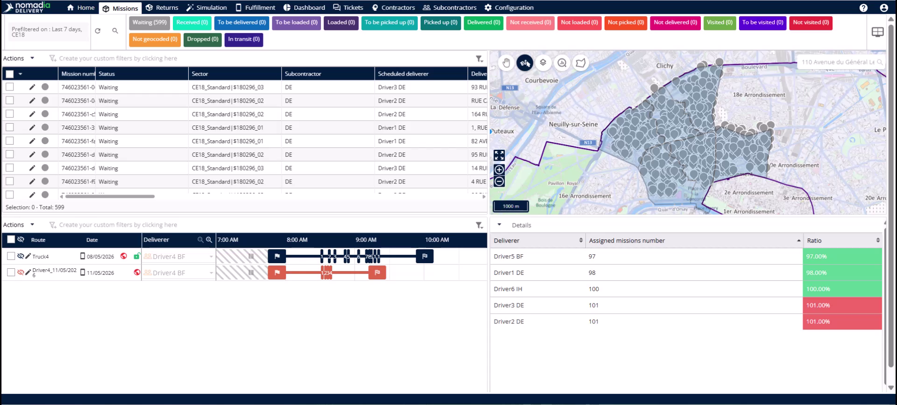
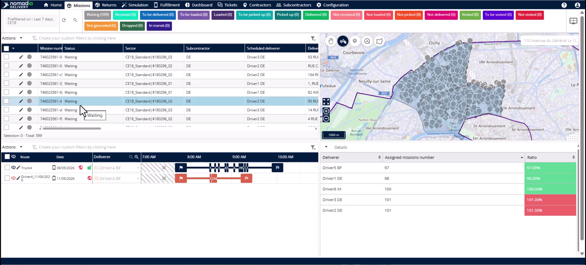
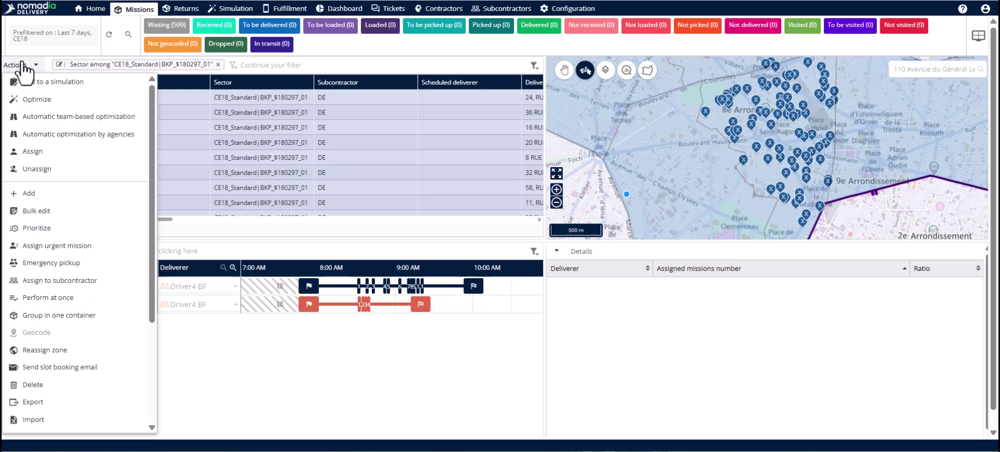
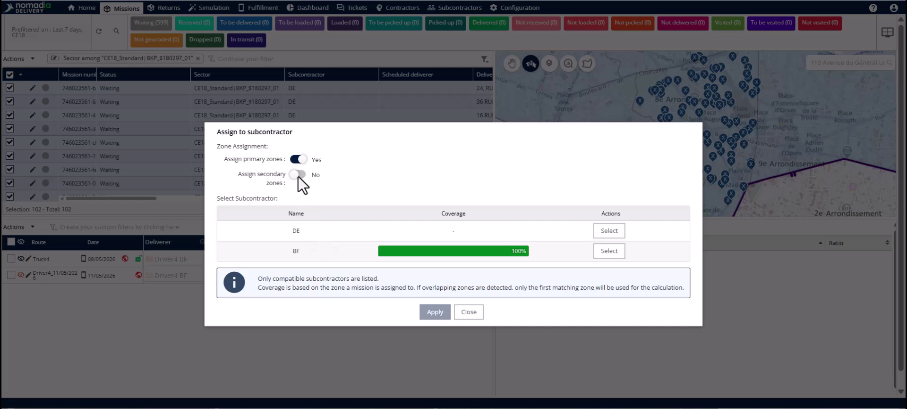
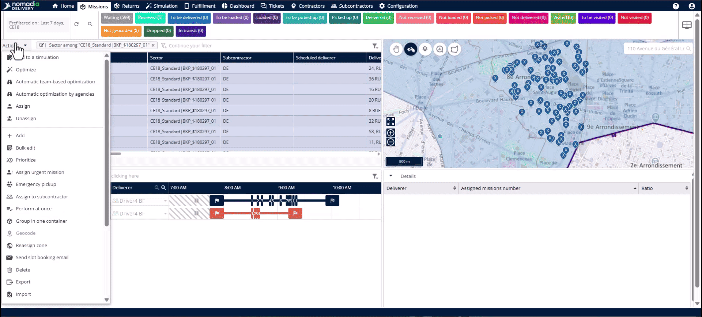
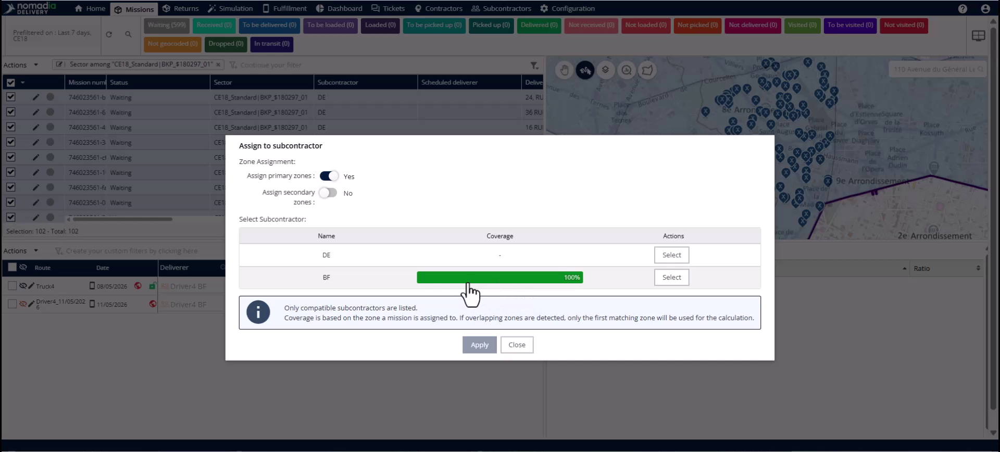

# Permutation du sous-traitant vers la zone principale

Annuler une permutation de sous-traitant vous permet de restaurer rapidement les missions dans leur configuration d’origine de zone principale. Ce processus est essentiel si une permutation a été effectuée par erreur ou si un sous-traitant retardé arrive enfin au dépôt. Vous obtiendrez une restauration complète des secteurs, des sous-traitants et des chauffeurs sur l’ensemble des missions en une seule action.

## Avant de commencer

* Accès à l’onglet **Mission**.
* Les missions doivent être actuellement affectées à une zone secondaire (de secours).

1. Accédez à l’onglet **Mission**.

## Présentation de la fonctionnalité

* **Panneau de filtrage** : utilisez ce panneau pour isoler les missions affectées à des secteurs ou des sous-traitants spécifiques.

* **Menu Actions** : ouvrez ce menu pour accéder aux opérations groupées pour les missions sélectionnées.

* **Fenêtre contextuelle Affecter au sous-traitant** : utilisez cette fenêtre pour modifier les affectations de zone et sélectionner des sous-traitants.

* **Interrupteur Zone principale** : activez cet interrupteur pour restaurer les missions dans leur configuration principale d’origine.

## Restaurer les missions vers la zone principale

1. Accédez au **Panneau de filtrage**.

2. Filtrez par la colonne **Secteur** à l’aide de l’opérateur **Parmi**.

3. Sélectionnez toutes les missions actuellement affectées à la zone de secours.

4. Cliquez sur le **Menu Actions** et sélectionnez **Affecter au sous-traitant**.

5. Activez l’interrupteur **Zone principale** dans la fenêtre contextuelle.

6. Sélectionnez le sous-traitant d’origine affichant une couverture de 100 %.

7. Cliquez sur **Appliquer** pour terminer la restauration.

## Vérifier la restauration

1. Effacez le filtre de la zone de secours du tableau des missions.

2. Appliquez un nouveau filtre à l’aide du champ **Secteur** pour sélectionner la sous-zone principale.

3. Confirmez que **Secteur**, **Sous-traitant** et **Livreur programmé** ont été restaurés.

## Conseils


**Restauration en un seul clic** : annuler une permutation est aussi rapide que d’en effectuer une, en basculant un seul interrupteur.



**Rattachement automatique du chauffeur** : le chauffeur d’origine est automatiquement rattaché à nouveau aux missions lorsque vous restaurez la zone principale.



**Efficacité en lot** : annulez des centaines d’affectations de missions en quelques secondes, sans modification manuelle ni réimportation des données.



**Vérification via un tableau vide** : si le tableau des missions apparaît vide après avoir cliqué sur Appliquer, cela confirme que le filtre de secours ne s’applique plus à ces missions.


## Rubriques connexes

* [Études de cas](README.md)
* [Permutation du sous-traitant vers la zone de secours](subcontractor-swap-to-backup-zone.md)
* [Création d’une zone de secours](creating-backup-zone.md)
