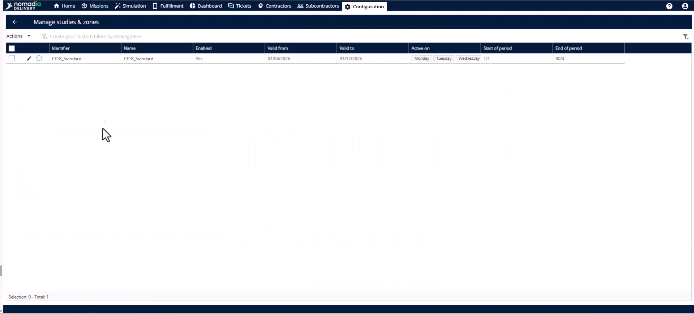
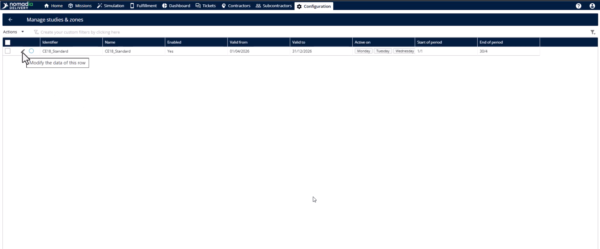
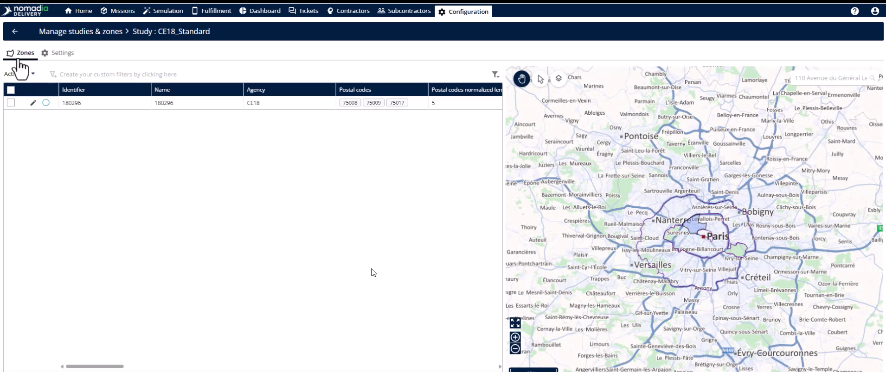
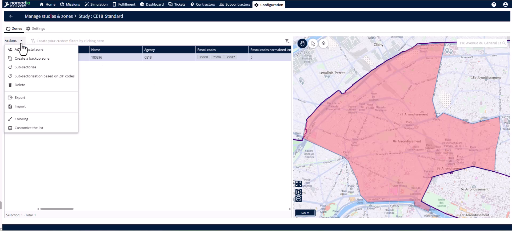
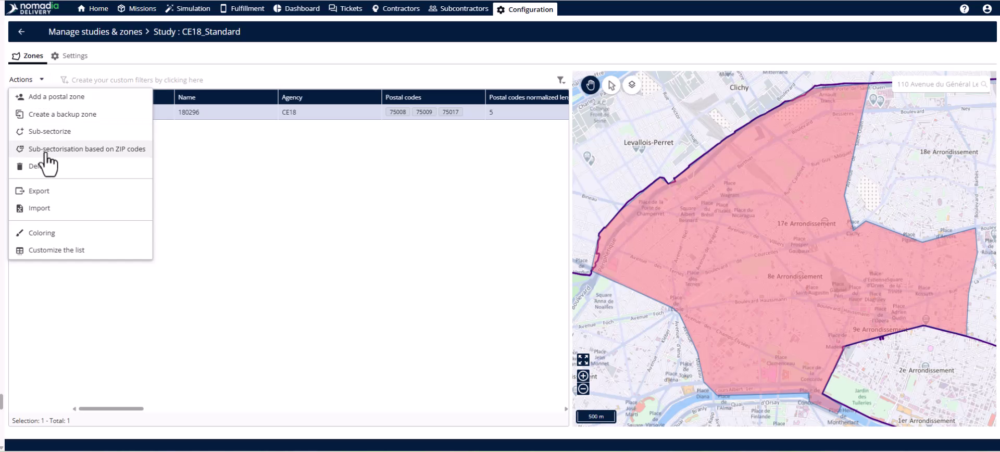
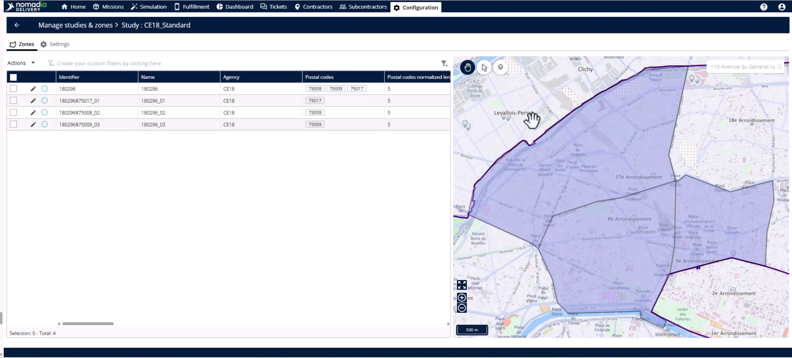
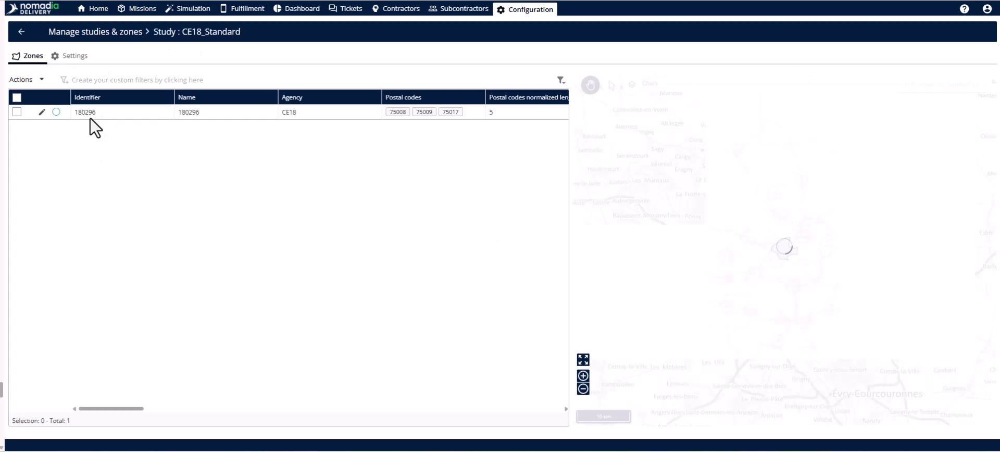
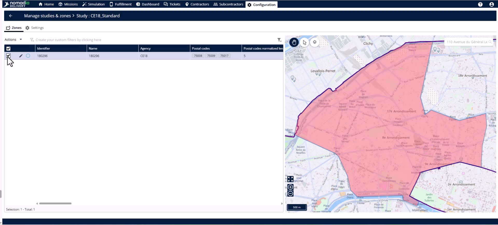
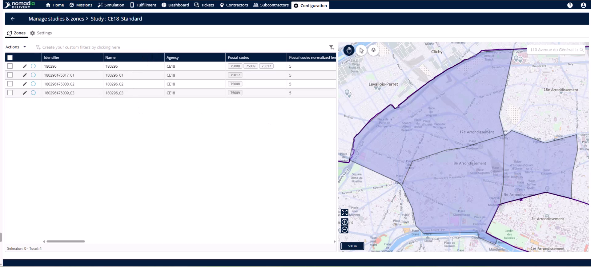

# Sous-sectorisation par code postal

La sous-sectorisation divise automatiquement une zone principale en sous-zones individuelles en fonction de ses codes postaux associés. Utilisez cette fonctionnalité pour créer instantanément des territoires précis sans avoir besoin de données de mission ni d’équilibrage manuel. C’est la voie la plus rapide vers une zone de livraison entièrement structurée.

## Avant de commencer

* Une zone principale existante avec plusieurs codes postaux associés
* Accès au module Configuration

1. Rendez-vous dans le module Configuration et ouvrez Gérer les études et les zones.

2. Recherchez l’étude avec laquelle vous travaillez et cliquez sur le bouton **Modifier**.

<figure><figcaption></figcaption></figure>

## Présentation de la fonctionnalité

* **Onglet Zone** : la zone au sein d’une étude où vous gérez les zones principales et les sous-zones.

<figure><figcaption></figcaption></figure>

* **Menu Actions** : ce menu contient des outils pour modifier la zone principale sélectionnée.

* **Sous-sectoriser en fonction des codes postaux** : cet outil génère instantanément une sous-zone pour chaque code postal de votre zone.

* **Tableau des zones** : cette liste affiche immédiatement les sous-zones générées et leurs propriétés.

## Sous-sectoriser une zone principale

1. Accédez à l’**onglet Zone** dans votre étude.

2. Sélectionnez la **zone principale** que vous souhaitez sous-sectoriser.

3. Ouvrez le **menu Actions**.

4. Cliquez sur **Sous-sectoriser en fonction des codes postaux**.

5. Passez en revue les nouvelles sous-zones répertoriées dans le **tableau des zones**.

6. Vérifiez les limites géographiques sur la **carte**.

## Conseils


**Configuration instantanée** : créez des dizaines de sous-zones en un clic, sans charger les données de mission ni attendre le traitement.



**Précision maximale** : utilisez cette méthode lorsque les limites des codes postaux constituent les repères territoriaux les plus précis sur votre marché.



**Équilibrage de la charge de travail** : évitez cette fonctionnalité si vous devez équilibrer les charges de travail entre les missions ; utilisez plutôt le gestionnaire de territoires.


## Rubriques connexes

* [Études de cas](README.md)
* [Création d’une étude avec zone principale](study-creation-with-primary-zone.md)
* [Sous-sectoriser la zone principale](sub-sectorize-primary-zone/README.md)
* [Attribution des sous-zones](assigning-sub-zones.md)
