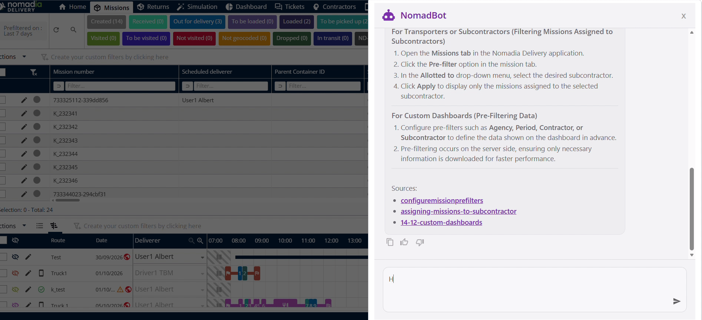
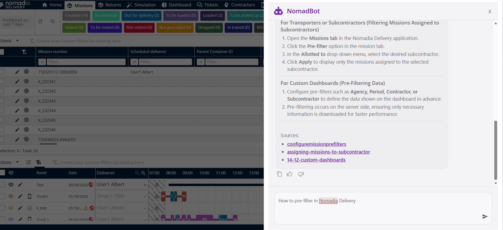
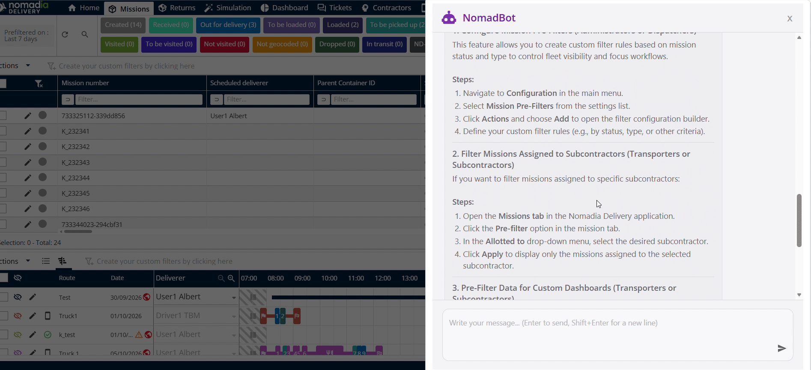

# Nomadbot

La fonctionnalité **Nomadbot** de **Nomadia Delivery** fournit un assistant virtuel automatisé aux répartiteurs et aux planificateurs. Vous pouvez sélectionner des questions prédéfinies ou saisir vos propres questions directement dans la fenêtre de saisie. Cela vous aide à résoudre rapidement vos questions opérationnelles sans quitter la plateforme.

## Avant de commencer

Assurez-vous de remplir toutes les exigences système avant d’accéder à la fonctionnalité.

* Compte **Nomadia Delivery** actif avec des droits de répartiteur ou de planificateur.
* Navigateur Web pris en charge avec une connexion Internet active.

1. Connectez-vous à **Nomadia Delivery**.
2. Repérez la barre de navigation en haut à droite.

3. Cliquez sur l’**icône Chatbot**.

## Présentation de la fonctionnalité

* **Icône Chatbot** : ouvre l’interface de l’assistant virtuel depuis la barre de navigation supérieure.
* **Questions prédéfinies** : liste de questions et réponses prêtes à l’emploi pour un accès rapide en libre-service.
* **Fenêtre de saisie** : champ de saisie dans lequel vous entrez vos propres questions.
* **Bouton Envoyer** : envoie votre question saisie à l’assistant virtuel.

## Accéder aux questions prédéfinies

1. Cliquez sur l’**icône Chatbot** dans l’en-tête en haut à droite.

2. Consultez les **Questions et réponses prédéfinies** listées.

## Poser une question personnalisée

1. Cliquez dans la **Fenêtre de saisie**.

2. Saisissez votre question dans la **Fenêtre de saisie**.

3. Cliquez sur **Envoyer**.

4. Observez l’**indicateur de saisie** pendant que la réponse est générée.

5. Lisez la réponse qui s’affiche.

## Conseils


**Questions prédéfinies** : consultez les questions intégrées pour obtenir des réponses instantanées sur les sujets courants.



**Requêtes précises** : saisissez des questions claires dans la fenêtre de saisie pour recevoir des réponses ciblées.


## Rubriques connexes

* [Comprendre l’écran d’accueil](page-daccueil/comprendre-lecran-daccueil.md)
* [Introduction](README.md)
