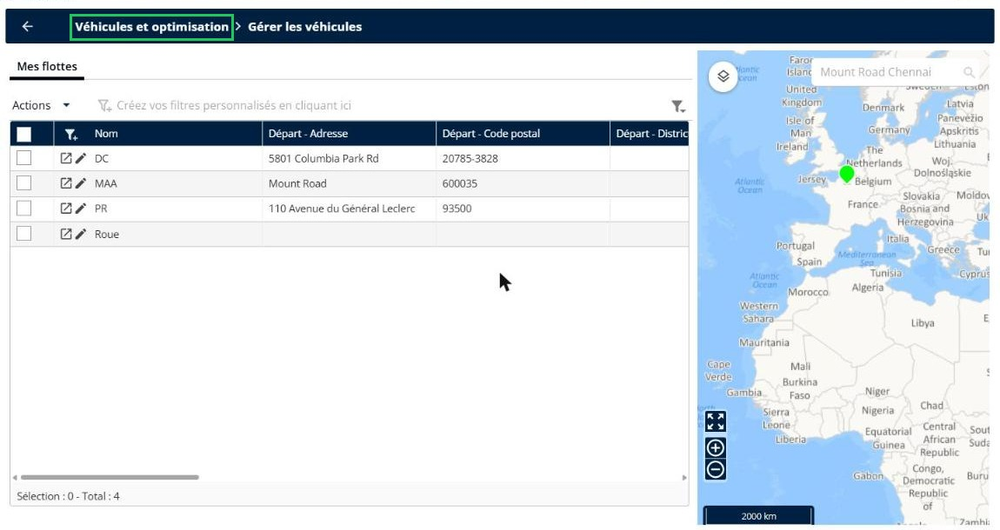
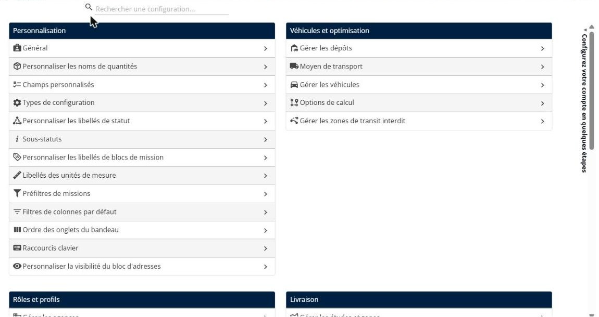
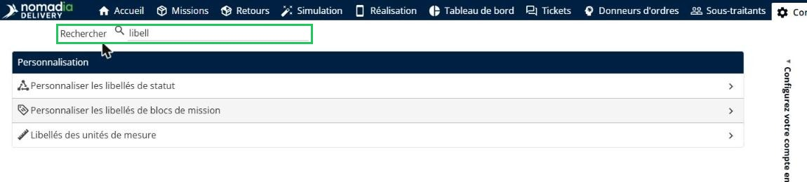

# Navigation par fil d’Ariane dans la configuration

**La navigation par fil d’Ariane dans la configuration** permet aux planificateurs et aux répartiteurs de se déplacer dans l’onglet **Configuration** en moins de clics. Chaque niveau situé au-dessus de la page actuelle dans le fil d’Ariane est un lien : vous pouvez donc accéder à n’importe quel niveau en un clic, au lieu de revenir en arrière étape par étape. Le menu de configuration mémorise aussi votre recherche et votre position de défilement, et vos modifications non enregistrées sont protégées lorsque vous quittez une page.

## Avant de commencer

* Connectez-vous à **Nomadia Delivery** avec un profil utilisateur ayant accès à l’onglet **Configuration**.

## Présentation de la fonctionnalité

* **Fil d’Ariane cliquable** : la barre en haut de chaque page de configuration affiche le chemin vers la page, par exemple **Véhicules et optimisation** > **Gérer les véhicules**. Chaque niveau situé au-dessus de la page actuelle est un lien. La page actuelle est affichée en gras.
* **Menu mémorisé** : lorsque vous revenez au menu de configuration par le fil d’Ariane ou par la flèche **Retour**, le menu conserve le texte saisi dans le champ de recherche et la position de défilement.
* **Réinitialisation par l’onglet Configuration** : un clic sur l’onglet **Configuration** du bandeau, depuis n’importe quel niveau, ouvre le menu dans un état vierge, avec un champ de recherche vide et la liste remontée en haut.
* **Historique du navigateur** : les boutons **Précédent** et **Suivant** du navigateur parcourent les niveaux de configuration dans l’ordre. Par exemple, **Précédent** depuis l’éditeur de véhicules revient à la liste des flottes, puis au menu.
* **Confirmation des modifications non enregistrées** : si vous modifiez une valeur puis cliquez sur un lien du fil d’Ariane, sur un onglet du bandeau ou sur le bouton **Précédent** du navigateur, une boîte de dialogue de confirmation vous interroge avant de quitter la page. Si vous annulez, votre saisie reste exactement telle que vous l’avez tapée.

## Accéder à un niveau de configuration supérieur

1. Accédez à l’onglet **Configuration** et ouvrez une page de configuration, par exemple **Véhicules et optimisation** > **Gérer les véhicules**.
2. Dans le fil d’Ariane, cliquez sur le niveau souhaité, par exemple **Véhicules et optimisation**.

### Résultat

Le menu de configuration s’ouvre directement, sans revenir en arrière page par page.

## Retrouver votre recherche

1. Dans le menu de configuration, saisissez un mot dans le champ **Rechercher une configuration**, par exemple **libellé**.
2. Ouvrez l’un des résultats, par exemple **Personnaliser les libellés de statut**.
3. Cliquez sur **Personnalisation** dans le fil d’Ariane, ou cliquez sur la flèche **Retour**.

### Résultat

Le menu affiche toujours votre texte de recherche et les résultats filtrés, à la même position de défilement : vous pouvez continuer sans filtrer à nouveau.

## Repartir d’un menu vierge

1. Depuis n’importe quelle page de configuration, cliquez sur l’onglet **Configuration** du bandeau.

### Résultat

Le menu s’ouvre avec un champ de recherche vide, remonté en haut de la liste.

## Conseils


**Utilisez les boutons du navigateur** : les boutons **Précédent** et **Suivant** du navigateur parcourent les niveaux de configuration dans l’ordre, pour ne pas quitter la section **Configuration** par erreur.



**Enregistrez avant de quitter** : si vous modifiez une valeur, enregistrez-la avant de quitter la page. Lorsque la boîte de dialogue de confirmation apparaît, cliquez sur **Annuler** pour rester sur la page et conserver votre saisie.


## Rubriques connexes

* [Personnaliser les onglets de navigation](customize-navigation-tabs.md)
* [Configuration des raccourcis clavier](keyboard-shortcuts-configuration.md)
* [Gérer les flottes de véhicules](manage-vehicle-fleets/README.md)
* [Personnalisation des libellés de statut](missions/customizing-status-labels.md)
