# Configuration de sondages personnalisés

En tant que transporteur, vous pouvez utiliser des enquêtes personnalisées pour recueillir des retours précieux de la part des livreurs et des sous-traitants à différentes étapes de leurs opérations. Les enquêtes centralisent toutes les données sur une seule plateforme, ce qui élimine la complexité liée à la gestion d’informations dispersées et favorise une prise de décision fondée sur les données.

## Étapes

Suivez ces étapes pour configurer des enquêtes personnalisables dans Nomadia Delivery :

1. Ouvrez la page **Configuration**.
2. Dans la liste déroulante, sélectionnez **Configurer les enquêtes**.
3. Cliquez sur le bouton **Actions** et choisissez **Créer** pour configurer une nouvelle enquête.

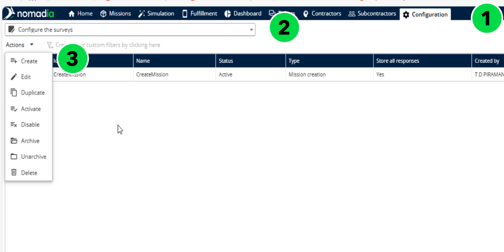

Survey Creator / Form Builder est un outil de conception visuelle qui vous permet de créer des enquêtes et des formulaires. Les enquêtes peuvent être réalisées pour quatre cas d’utilisation spécifiques :

* Création de mission – Remplie par le sous-traitant avant de créer une mission dans Nomadia Delivery (uniquement pour une création manuelle via l’assistant). Cela permet de recueillir à l’avance toutes les informations nécessaires pour assurer la réussite des livraisons.
* Début d’itinéraire – Remplie par le livreur avant de quitter l’agence pour une livraison/un retrait. Recueille des données sur l’état du véhicule afin de s’assurer qu’il est prêt avant le début de l’itinéraire.
* Exécution de mission – Remplie par le livreur pendant la livraison ou le retrait. Suit les étapes de livraison et surveille l’avancement en temps réel.
* Fin d’itinéraire – Remplie par le livreur après son retour à l’agence à la fin de la journée. Fournit des informations sur l’état du véhicule après l’itinéraire, utiles pour la maintenance et la planification opérationnelle.

4. Saisissez l’identifiant et le nom de l’enquête, sélectionnez le type d’enquête dans la liste déroulante, définissez le statut sur Actif et activez l’option Stocker toutes les réponses pour enregistrer les résultats de l’enquête.

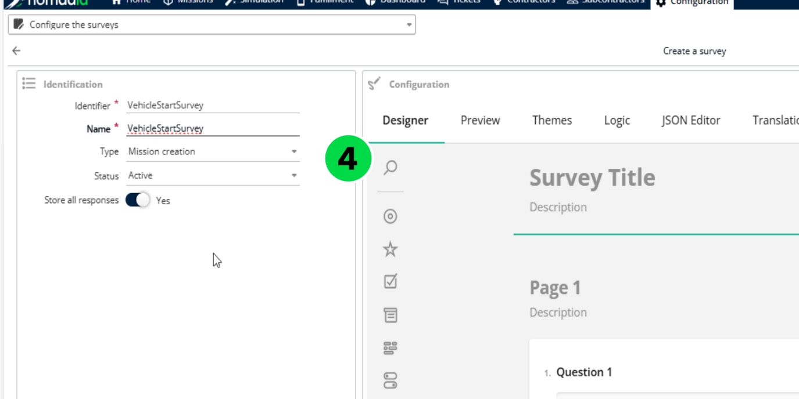

5. Les enquêtes peuvent contenir une ou plusieurs pages. Chaque page peut inclure des panneaux et des questions. Les panneaux regroupent les questions et peuvent également contenir des panneaux imbriqués pour une organisation structurée.

6. Pour obtenir des indications détaillées sur la création d’une enquête, consultez la documentation : [Créer une enquête simple](https://surveyjs.io/form-library/documentation/design-survey/create-a-simple-survey)
7. Une fois l’enquête terminée, cliquez sur Enregistrer pour la créer.

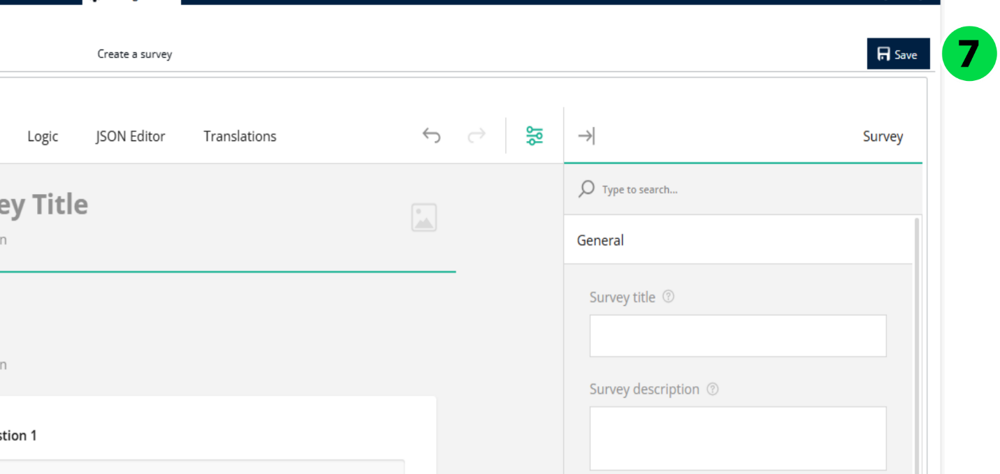

8. La page **Configurer les enquêtes** affiche toutes les enquêtes créées dans le système.

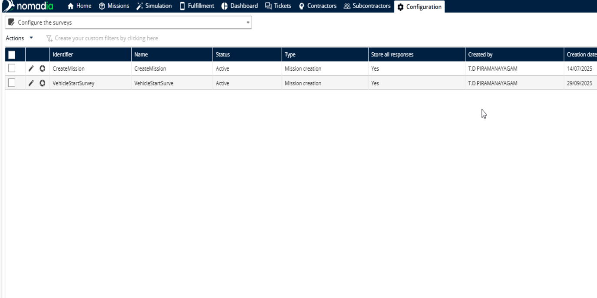

## Configurations supplémentaires des enquêtes

### Affecter une enquête aux sous-traitants

1. Ouvrez l’onglet Sous-traitants dans Nomadia Delivery.
2. Modifiez un sous-traitant en cliquant sur l’icône Crayon.

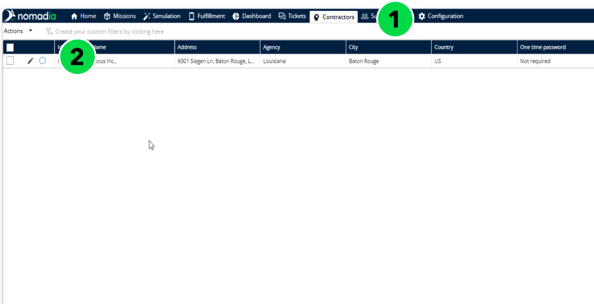

3. Dans la section Mission, affectez une enquête de création de mission spécifique à ce sous-traitant, puis cliquez sur Enregistrer.

4. Lorsque vous êtes connecté en tant que sous-traitant, la création d’une mission via l’assistant affiche l’enquête de création de mission, qui doit être remplie avant de continuer.

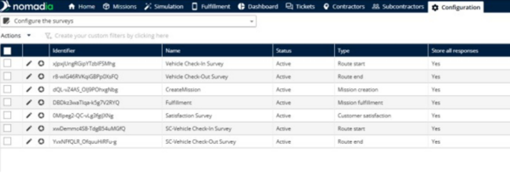

### Affecter des enquêtes aux sous-traitants de second rang

1. Ouvrez l’onglet Sous-traitants.
2. Modifiez un sous-traitant de second rang en cliquant sur l’icône Crayon.

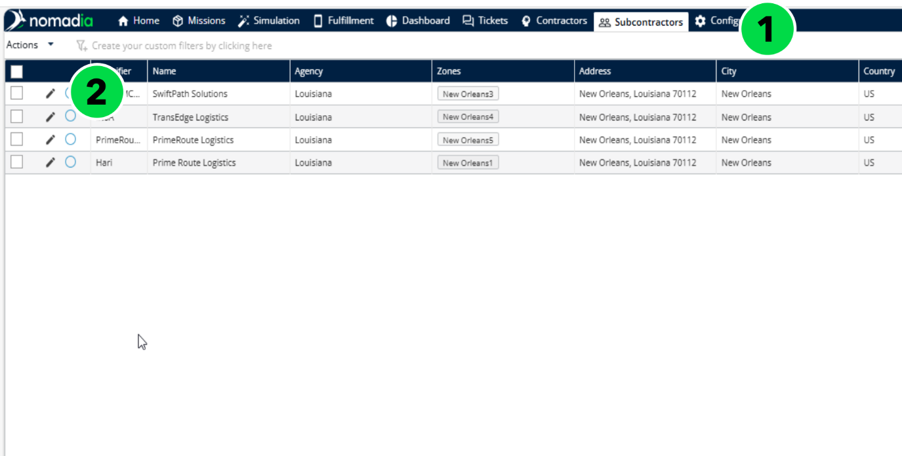

3. Dans la section Mission, affectez des enquêtes de début et de fin d’itinéraire spécifiques à ce sous-traitant de second rang, puis cliquez sur Enregistrer.

<figure>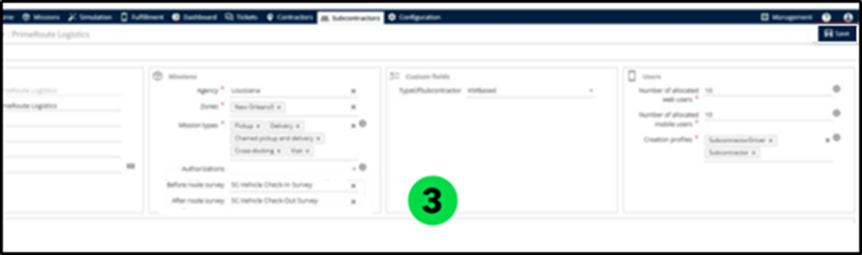<figcaption></figcaption></figure>

4. Lorsque vous êtes connecté en tant que livreur d’un sous-traitant de second rang, la fin du processus de chargement déclenche l’enquête de début d’itinéraire, qui doit être remplie avant de démarrer les missions.

<figure><figcaption></figcaption></figure>

### Affecter une enquête à un sous-statut

1. Ouvrez la page **Configuration**.
2. Sélectionnez Sous-statut dans la liste déroulante.
3. Modifiez un sous-statut en cliquant sur l’icône Crayon.

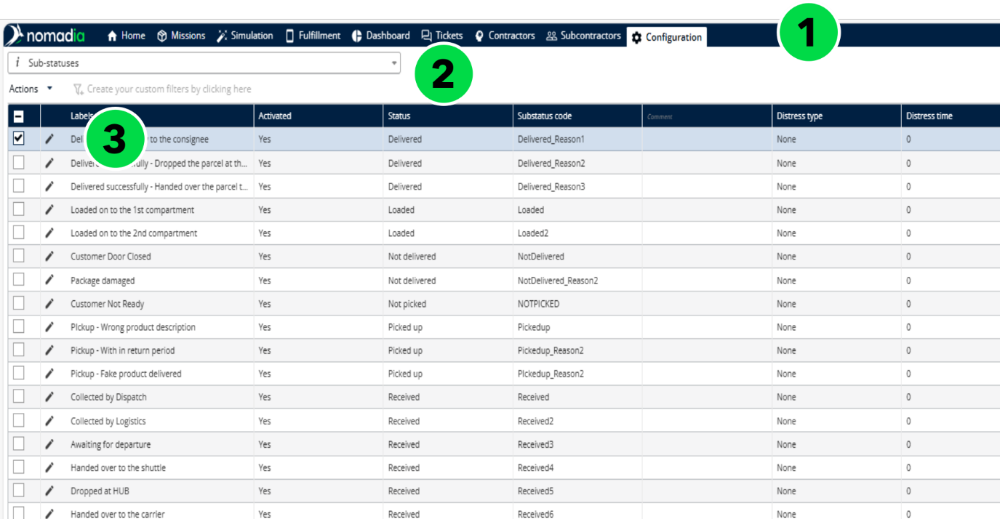

4. Affectez l’enquête d’exécution appropriée dans la liste déroulante et cliquez sur Enregistrer.

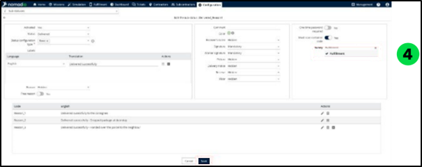

5. Lorsque vous êtes connecté en tant que transporteur ou livreur d’un sous-traitant de second rang, la tentative d’exécution d’une livraison/d’un retrait affiche l’enquête, qui doit être remplie avant de continuer.

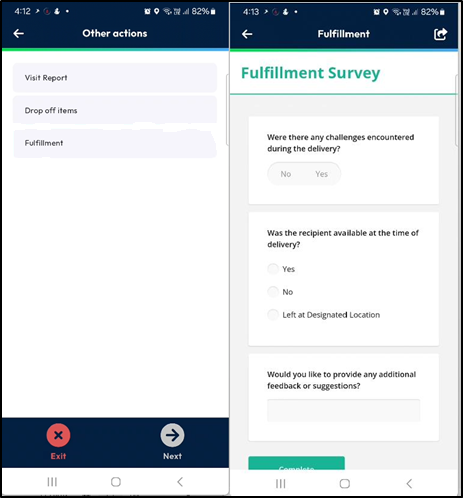

## Analyse des réponses aux enquêtes

1. Ouvrez la page **Configuration**.
2. Sélectionnez **Configurer les enquêtes** dans la liste déroulante.
3. Cliquez sur l’icône Cercle à côté de l’enquête que vous souhaitez analyser.

4. Choisissez la période d’analyse et cliquez sur Appliquer.
5. Cliquez sur Charger pour afficher les résultats de la période sélectionnée.

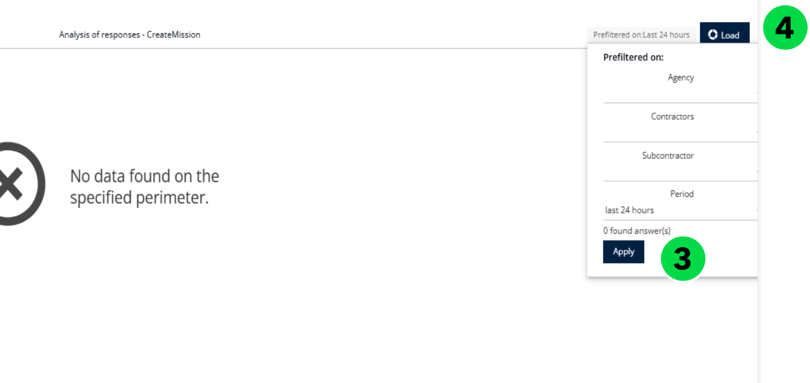

6. Consultez et analysez les réponses aux enquêtes en temps réel.

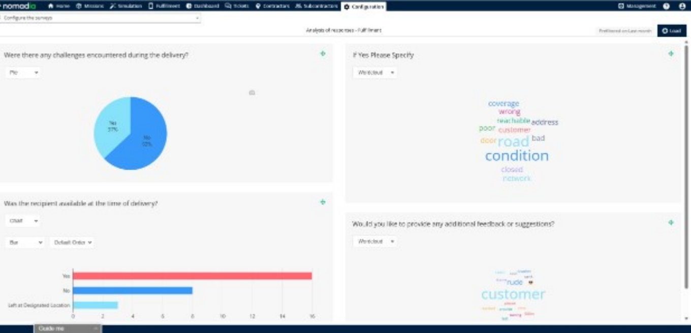

## Configurer les photos de véhicule

1. Ouvrez la page **Configuration** et sélectionnez **Configurer les enquêtes**.
2. Cliquez sur l’**icône en forme de crayon** pour modifier l’enquête souhaitée.
3. Activez l’option **Capturer les photos du véhicule**.
4. Indiquez le **nombre de photos** à afficher.

<figure><figcaption></figcaption></figure>

### Résultat

Les champs de photos configurés s’affichent sur la page **Enquête** de l’itinéraire.

## Rubriques connexes

* [Éditeur d’itinéraire](routes/routeeditor.md)
* [Gérer les sous-statuts](manage-substatus/README.md)
