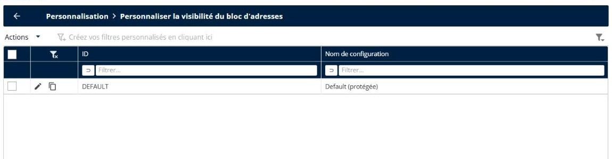
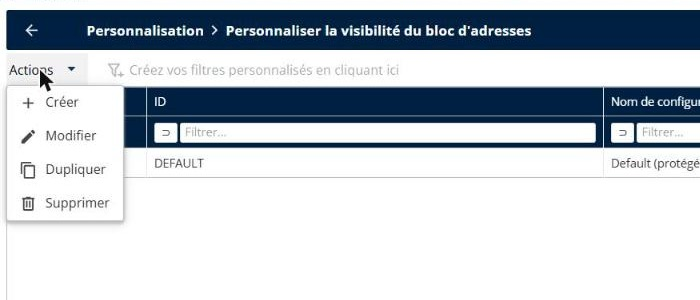
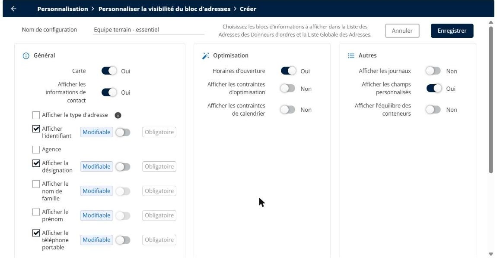
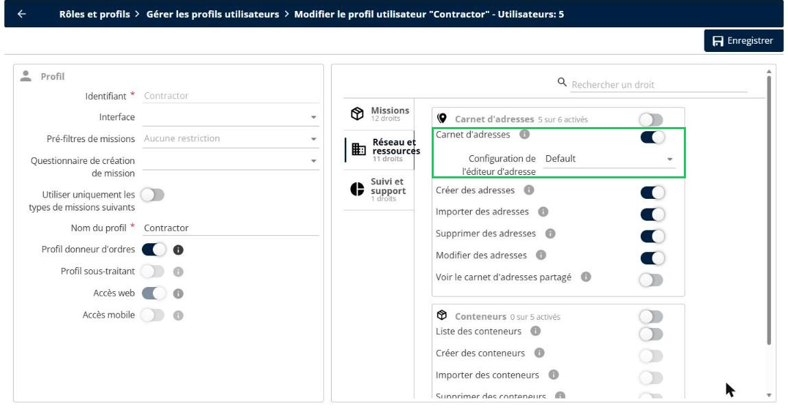

# Visibilité des blocs du carnet d’adresses par profil utilisateur

**La visibilité des blocs du carnet d’adresses par profil utilisateur** permet aux administrateurs de décider quels blocs du carnet d’adresses chaque rôle voit. Tous les utilisateurs n’ont pas besoin de toutes les informations d’une adresse. Vous créez des configurations de visibilité nommées, choisissez les blocs affichés par chacune, comme la carte, les informations de contact ou les contraintes d’optimisation, puis affectez une configuration à un profil utilisateur.

## Avant de commencer

* Connectez-vous à **Nomadia Delivery** avec un profil utilisateur ayant accès à l’onglet **Configuration** et à **Gérer les profils utilisateurs**.
* Sachez quels blocs du carnet d’adresses chaque rôle doit voir.

## Présentation de la fonctionnalité

* **Personnaliser la visibilité du bloc d’adresses** : le tableau situé dans **Configuration** > **Personnalisation** qui liste toutes les configurations de visibilité du compte, avec leur **ID** et leur **Nom de configuration**.
* **Default (protégée)** : la configuration par défaut, toujours listée en premier. Elle ne peut pas être supprimée.
* **Créer**, **Modifier**, **Dupliquer** et **Supprimer** : les actions de gestion des configurations. **Dupliquer** crée une copie non affectée avec les mêmes paramètres et un nom proposé, pour ne pas repartir de zéro.
* **Blocs** : les parties du carnet d’adresses qu’une configuration affiche ou masque :
  * **Général** : **Carte** et **Afficher les informations de contact**. Lorsque les informations de contact sont affichées, vous choisissez chaque champ, comme l’identifiant, la désignation ou le téléphone portable, et s’il est **Modifiable** ou **Obligatoire**.
  * **Optimisation** : **Horaires d’ouverture**, **Afficher les contraintes d’optimisation** et **Afficher les contraintes de calendrier**.
  * **Autres** : **Afficher les journaux**, **Afficher les champs personnalisés** et **Afficher l’équilibre des conteneurs**.
* **Configuration de l’éditeur d’adresse** : la liste déroulante d’un profil utilisateur, dans **Réseau et ressources** > **Carnet d’adresses**, où vous choisissez la configuration du profil. Elle n’apparaît que si le droit **Carnet d’adresses** est activé.
* **Portée** : la configuration s’applique au carnet d’adresses global et aux carnets d’adresses des donneurs d’ordres ouverts depuis le back-office.
* **Aucune régression** : les utilisateurs dont le profil n’a pas de configuration affectée continuent de voir tous les blocs, comme auparavant.

## Créer une configuration de visibilité

1. Accédez à l’onglet **Configuration**. Sous **Personnalisation**, cliquez sur **Personnaliser la visibilité du bloc d’adresses**.

2. Cliquez sur **Actions** > **Créer**.

3. Saisissez un **Nom de configuration**, par exemple **Équipe terrain – essentiel**.
4. Activez les blocs que les utilisateurs doivent voir et désactivez les autres. Sous **Afficher les informations de contact**, sélectionnez les champs à afficher et définissez-les comme **Modifiable** ou **Obligatoire** si nécessaire.

5. Cliquez sur **Enregistrer**.

### Résultat

La configuration apparaît dans le tableau, prête à être modifiée, dupliquée ou supprimée à tout moment.

## Affecter une configuration à un profil utilisateur

1. Accédez à l’onglet **Configuration**, puis cliquez sur **Gérer les profils utilisateurs**.
2. Cliquez sur l’icône **Crayon** du profil, par exemple **Contractor**.
3. Cliquez sur **Réseau et ressources**.
4. Sous **Carnet d’adresses**, vérifiez que **Carnet d’adresses** est activé.
5. Dans **Configuration de l’éditeur d’adresse**, sélectionnez la configuration.

6. Cliquez sur **Enregistrer**.

### Résultat

Les utilisateurs de ce profil ne voient que les blocs autorisés par la configuration chaque fois qu’ils ouvrent un carnet d’adresses, y compris les carnets d’adresses des donneurs d’ordres ouverts depuis le back-office. Si vous désactivez **Carnet d’adresses**, la liste déroulante est masquée.

## Conseils


**Partez d’une copie** : utilisez **Dupliquer** pour créer une variante d’une configuration existante, puis modifiez uniquement les blocs qui diffèrent.



**Nommez les configurations d’après les rôles** : utilisez des noms comme **Planificateurs – détail complet** ou **Équipe terrain – essentiel**, pour choisir facilement la bonne configuration dans chaque profil.



**Rien ne change tant que vous n’affectez pas** : les profils sans configuration affectée continuent de voir tous les blocs du carnet d’adresses.


## Rubriques connexes

* [Personnaliser la visibilité des adresses](customizetheaddresslistvisibility.md)
* [Gérer la liste d’adresses](manage-address-list.md)
* [Gérer le profil utilisateur](../manage-users/manage-user-profile.md)
