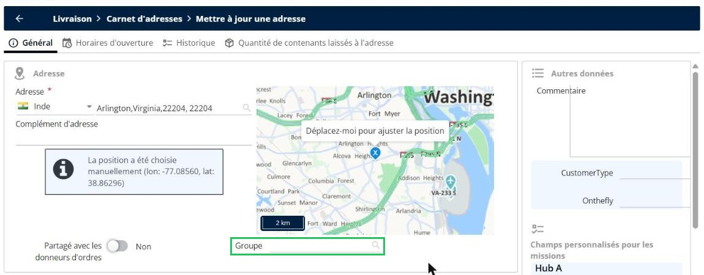
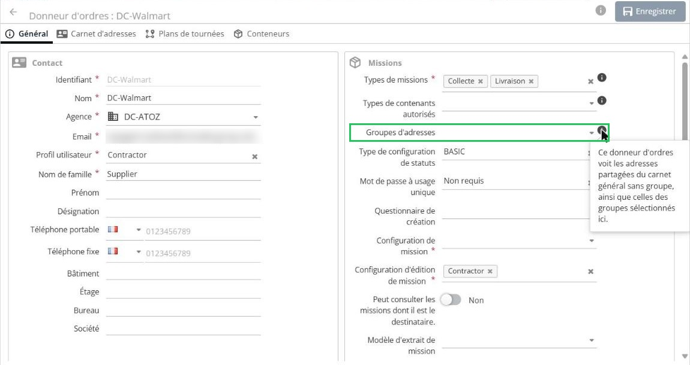

# Groupes d’adresses pour les donneurs d’ordres

**Les groupes d’adresses pour les donneurs d’ordres** donnent à chaque donneur d’ordres un accès immédiat aux adresses dont il a besoin, sans configurer les adresses une par une. Vous rangez les adresses du carnet d’adresses dans des groupes nommés, comme **Lyon Retail**, puis vous affectez un ou plusieurs groupes à un donneur d’ordres. Le donneur d’ordres retrouve les adresses de ses groupes lorsqu’il crée une mission.

## Avant de commencer

* Connectez-vous à **Nomadia Delivery** avec un profil utilisateur ayant accès à l’onglet **Configuration** et à l’onglet **Donneurs d’ordres**.
* Décidez comment regrouper vos adresses, par exemple par ville, par client ou par type de site.

## Présentation de la fonctionnalité

* **Groupe** : le champ de l’éditeur d’adresse où vous saisissez le nom du groupe auquel l’adresse appartient. Une adresse appartient à un groupe.
* **Colonne de groupe dans les imports** : lorsque vous importez des adresses, ajoutez une colonne de groupe à votre fichier pour regrouper des centaines d’adresses en une seule fois.
* **Groupes d’adresses** : le champ de l’onglet **Général** d’un donneur d’ordres, sous **Missions**, où vous sélectionnez un ou plusieurs groupes pour le donneur d’ordres. Vous pouvez ajouter ou retirer des groupes à tout moment.
* **Colonne de groupes d’adresses dans les imports de donneurs d’ordres** : lorsque vous importez des donneurs d’ordres, ajoutez une colonne de groupes d’adresses à votre fichier pour que chaque donneur d’ordres soit créé avec ses groupes déjà affectés.
* **Ce que voit le donneur d’ordres** : les adresses partagées du carnet général qui n’ont pas de groupe, ainsi que les adresses des groupes sélectionnés pour le donneur d’ordres.
* **Sélecteur d’adresse des missions** : lorsque le donneur d’ordres crée une mission, ses groupes affectés apparaissent dans le sélecteur d’adresse. Il ouvre un groupe et choisit une adresse.
* **Carnet d’adresses en lecture seule** : les donneurs d’ordres disposent d’une liste en lecture seule de toutes les adresses de leurs groupes affectés, qu’ils peuvent filtrer par groupe ou rechercher par nom.

## Ranger une adresse dans un groupe

1. Accédez à l’onglet **Configuration**. Sous **Livraison**, cliquez sur **Carnet d’adresses**.
2. Cliquez sur l’icône **Crayon** de l’adresse.
3. Dans le champ **Groupe**, saisissez le nom du groupe, par exemple **Lyon Retail**.

4. Cliquez sur **Enregistrer**.

### Résultat

L’adresse appartient au groupe. Tous les donneurs d’ordres auxquels vous affectez ce groupe peuvent utiliser l’adresse.

## Affecter des groupes à un donneur d’ordres

1. Accédez à l’onglet **Donneurs d’ordres**.
2. Cliquez sur l’icône **Crayon** du donneur d’ordres, ou créez un nouveau donneur d’ordres.
3. Dans l’onglet **Général**, sous **Missions**, cliquez sur le champ **Groupes d’adresses** et sélectionnez un ou plusieurs groupes.

4. Cliquez sur **Enregistrer**.

### Résultat

Le donneur d’ordres voit les adresses partagées sans groupe, ainsi que les adresses des groupes sélectionnés. Lorsqu’il crée une mission, les groupes apparaissent dans le sélecteur d’adresse, prêts à l’emploi sans aucune configuration.

## Conseils


**Regroupez en masse** : pour regrouper de nombreuses adresses ou configurer de nombreux donneurs d’ordres, ajoutez une colonne de groupe à votre fichier d’import d’adresses et une colonne de groupes d’adresses à votre fichier d’import de donneurs d’ordres.



**Nommez clairement les groupes** : utilisez des noms que les donneurs d’ordres reconnaissent, comme une ville et un type de site, par exemple **Marseille Port** ou **Paris Hypermarchés**.



**Les adresses sans groupe restent visibles** : un donneur d’ordres voit toujours les adresses partagées qui n’ont pas de groupe. Pour limiter ce qu’il voit, rangez les adresses dans des groupes.


## Rubriques connexes

* [Gérer la liste globale d’adresses](../manage-global-address-list.md)
* [Contrôler le partage des adresses avec les donneurs d’ordres](../control-address-sharing-with-contractors.md)
* [Gérer la liste d’adresses](manage-address-list.md)
* [Enregistrement](register-a-contractor.md)
