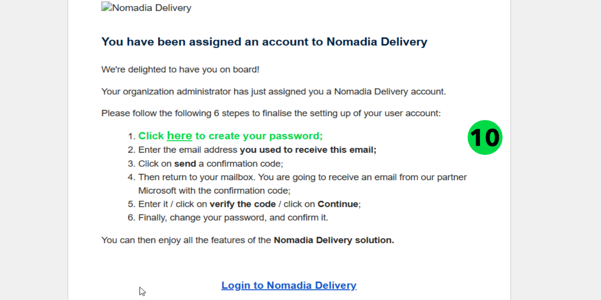

# Créer un utilisateur sous-traitant

Nomadia Delivery introduit un nouveau type d’utilisateur appelé sous-traitant. Ce type d’utilisateur peut importer des missions, gérer des listes d’adresses et suivre l’avancement des missions, offrant ainsi aux sous-traitants un meilleur contrôle sur leur travail et améliorant l’efficacité globale.

## Avant de commencer

* Connectez-vous à **Nomadia Delivery** avec un profil utilisateur ayant accès à **Configuration** > **Gérer les utilisateurs**.
* Assurez-vous que le sous-traitant à associer à l’utilisateur est déjà créé dans le module **Sous-traitants**.
* Munissez-vous du login et du nom de famille du nouvel utilisateur.

## Présentation de la fonctionnalité

* **Généralités** : onglet dans lequel vous saisissez le login et le nom de famille de l’utilisateur et activez le statut de l’utilisateur.
* **Accès** : onglet dans lequel vous activez l’accès web, sélectionnez le site du sous-traitant et sélectionnez le sous-traitant à associer à l’utilisateur.
* **Rôles et droits** : onglet dans lequel vous attribuez les droits nécessaires au nouvel utilisateur sous-traitant.
* **Agences** : onglet que vous ouvrez avant de cliquer sur **Enregistrer**.
* **Créer un utilisateur à partir d’un utilisateur existant** : copie tous les paramètres de l’utilisateur existant vers le nouveau profil, ce qui accélère le processus.

## Créer un utilisateur sous-traitant

1. Ouvrez l’application Nomadia Delivery et accédez à **Configuration** > **Gérer les utilisateurs**.

.png>)

2. Cliquez sur le bouton **Action** et sélectionnez **Ajouter**.

.png>)

3. Cliquez sur **OK** pour créer un nouvel utilisateur. Vous pouvez également créer un utilisateur à partir d’un utilisateur existant, ce qui accélère le processus en copiant tous les paramètres de l’utilisateur existant vers le nouveau profil.

.png>)

4. Dans l’onglet **Généralités**, saisissez le login et le nom de famille de l’utilisateur, puis activez le statut de l’utilisateur.
5. Accédez à l’onglet **Accès**.

.png>)

6. Activez l’accès web pour l’utilisateur et sélectionnez le site du sous-traitant dans le menu déroulant.

.png>)

7. Sélectionnez le sous-traitant approprié (créé dans la section précédente de ce document) à associer à l’utilisateur.
8. Accédez à l’onglet **Rôles et droits**.

.png>)

9. Attribuez les droits nécessaires au nouvel utilisateur sous-traitant.
10. Accédez à l’onglet **Agences**.

.png>)

11. Cliquez sur **Enregistrer**.

.png>)

## Activer le compte du sous-traitant

Le sous-traitant reçoit un e-mail contenant les instructions pour définir un mot de passe et activer le compte.

1. Cliquez sur le lien dans l’e-mail pour vérifier le compte.

2. Saisissez le code de vérification reçu par e-mail et cliquez sur **Vérifier le code**.

.png>)

3. Cliquez sur **Continuer**.

.png>)

4. Saisissez et confirmez le nouveau mot de passe, puis cliquez sur **Continuer**.

.png>)

5. Relisez et acceptez le Contrat de licence utilisateur final (EULA), puis cliquez sur **Continuer**.

.png>)

### Résultat

Le nouvel utilisateur sous-traitant peut maintenant accéder à l’application et commencer à effectuer des tâches.

.png>)

## Conseils


**Sous-traitant absent** : si aucun sous-traitant n’apparaît dans la liste, assurez-vous qu’un sous-traitant a bien été créé dans le module Sous-traitants.


## Rubriques connexes

* [Sous-traitants](README.md)
* [Enregistrer un sous-traitant](register-a-contractor.md)
* [Gérer les utilisateurs](../manage-users/README.md)
* [Créer un utilisateur à partir d’un utilisateur existant](../manage-users/creating-a-user-from-an-existing-user.md)
