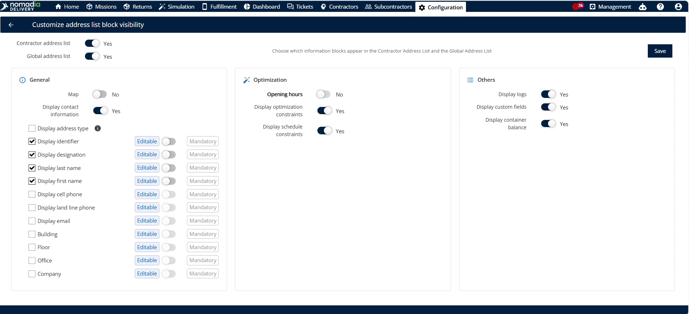
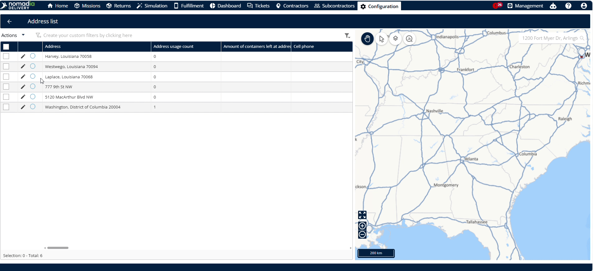
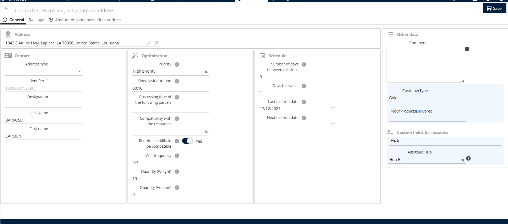

# Personnaliser la visibilité des adresses

**Configurez la visibilité des champs dans vos listes d’adresses** pour différents groupes d’utilisateurs. **Contrôlez quelles informations sont visibles ou modifiables** dans les listes d’adresses globales et de sous-traitants. **Simplifiez votre espace de travail** et assurez-vous que les équipes ne voient que les données pertinentes.

## Avant de commencer

Prérequis :

* Autorisations d’administration pour appliquer des paramètres à l’échelle de la plateforme.

Étapes :

1. Ouvrez la page **Configuration**.
2. Cliquez sur l’option **Visibilité du bloc des adresses clients**.

## Présentation de la fonctionnalité

* **Liste d’adresses des sous-traitants** : gérez les paramètres de visibilité spécifiquement pour les listes d’adresses des sous-traitants.
* **Liste d’adresses globale** : gérez les paramètres de visibilité de la liste d’adresses globale à l’échelle de la plateforme.
* **Informations de contact** : configurez les champs de contact pour qu’ils soient modifiables ou obligatoires.
* **Général** : activez ou désactivez des champs tels que la **Carte** et les **Horaires d’ouverture**.
* **Modifiable** : permet aux utilisateurs de modifier le contenu des champs en cochant cette option.
* **Obligatoire** : oblige les utilisateurs à renseigner un champ avant d’enregistrer les modifications.

## Personnaliser la visibilité du bloc des adresses

1. Ouvrez la page **Configuration** et cliquez sur **Visibilité du bloc des adresses clients**.

2. Modifiez les paramètres de la **Liste d’adresses des sous-traitants**, de la **Liste d’adresses globale**, ou des deux.

3. Repérez les champs **Informations de contact**.
4. Cochez la case pour définir les champs comme **Modifiable** par défaut.
5. Activez la case à cocher pour rendre les champs **Obligatoire**.

6. Repérez la section **Général**.
7. Désactivez les options **Carte** et **Horaires d’ouverture**.

8. Cliquez sur **Enregistrer** pour appliquer les modifications à l’échelle de la plateforme.

## Vérifier la visibilité de la liste d’adresses globale

1. Accédez au menu **Liste d’adresses**.

2. Cliquez sur l’**icône crayon** à côté de l’adresse.

3. Confirmez que les champs **Carte** et **Horaires d’ouverture** sont masqués.

## Vérifier la visibilité de la liste d’adresses des sous-traitants

1. Accédez au menu **Sous-traitant**.

2. Cliquez sur l’**icône crayon** à côté du sous-traitant souhaité.

3. Cliquez sur l’onglet **Liste d’adresses**.

4. Cliquez sur l’**icône crayon** à côté de l’adresse du sous-traitant.

5. Confirmez que les champs **Carte** et **Horaires d’ouverture** sont masqués.

<figure><figcaption></figcaption></figure>

## Conseils


**Modification par défaut** : cocher l’option d’un champ le rend modifiable par défaut, ce qui fait gagner du temps lors de la configuration.



**Contrôle flexible** : personnalisez la liste globale, la liste des sous-traitants, ou les deux simultanément selon vos flux de travail.



**Impact à l’échelle de la plateforme** : l’enregistrement des modifications les applique immédiatement à tous les utilisateurs de la plateforme.


## Rubriques connexes

* Gérer la liste d’adresses globale
* [Gérer la liste d’adresses](manage-address-list.md)
