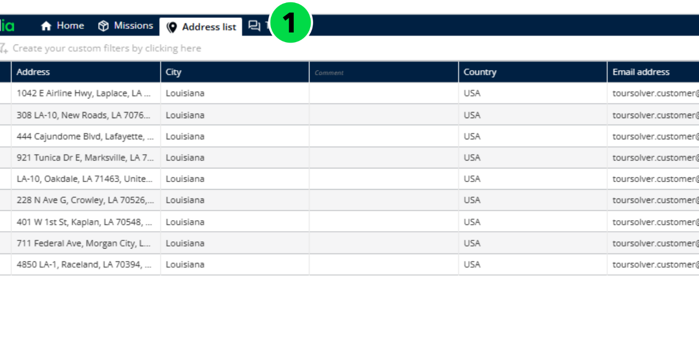
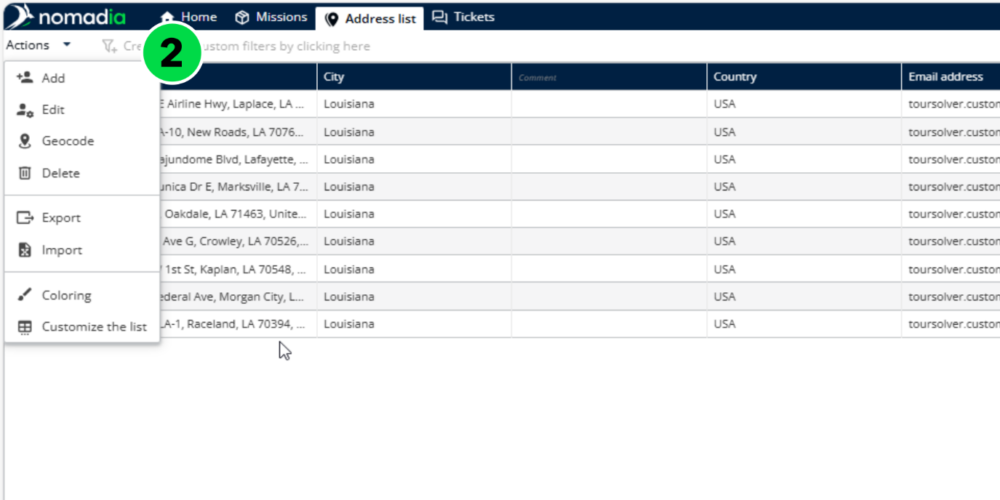
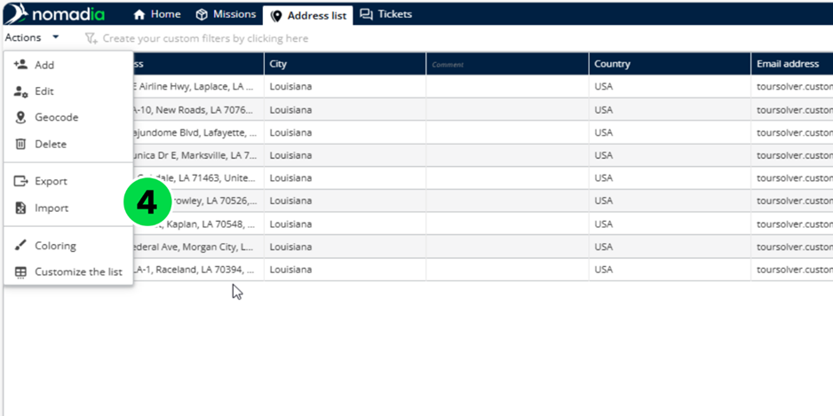
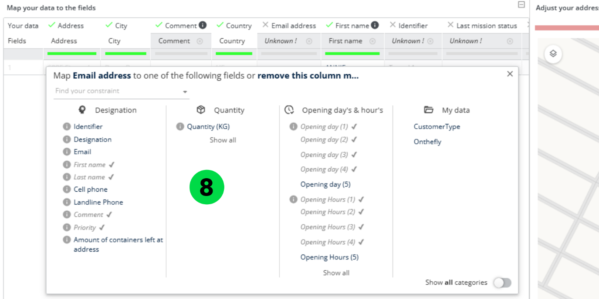
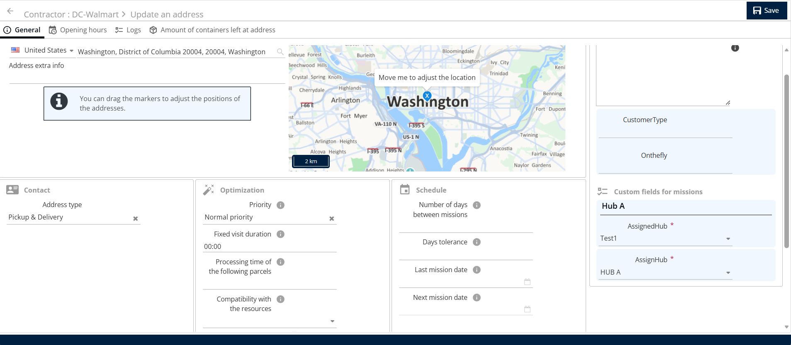
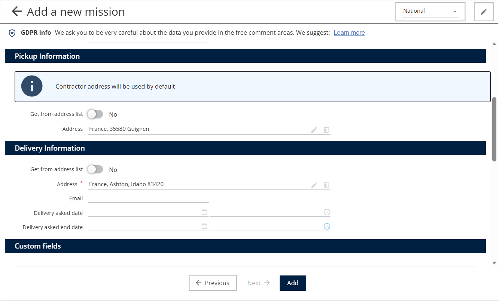

# Gérer la liste d’adresses

Nomadia Delivery vous permet de gérer une liste d’adresses qui sert de référentiel principal des informations clients. Cela contribue à améliorer à la fois la rapidité et la précision de la création des missions. Pour créer une liste d’adresses, suivez ces étapes :

## Avant de commencer

* Accès à la section **Liste d’adresses** en tant que sous-traitant, ou au menu **Sous-traitants** en tant qu’administrateur.
* Pour un import, un fichier Excel contenant les adresses.

## Étapes

1. Connectez-vous à l’application Nomadia Delivery en tant que sous-traitant et accédez à la section **Liste d’adresses**.

2. Pour créer une nouvelle liste d’adresses, cliquez sur le bouton **Actions**, puis sélectionnez **Ajouter**.

3. Saisissez les informations du client une par une. Pour ajouter un client, vous devez fournir au moins deux champs obligatoires : une adresse et un identifiant.

4. Vous pouvez également importer une liste d’adresses depuis un fichier Excel en cliquant sur le bouton **Importer** et en sélectionnant le fichier souhaité.

<figure><figcaption></figcaption></figure>

5. Lors de l’importation, assurez-vous de faire correspondre les champs d’adresse ou les coordonnées X et Y.
6. Cliquez sur **Valider** pour faire correspondre les données restantes dans la liste d’adresses.

7. Un aperçu de tous les emplacements à importer sera affiché pendant le processus d’importation.

8. Faites correspondre les champs de données supplémentaires dans la liste d’adresses, tels que Prénom, Nom, Fonction, E-mail, etc.

9. Après avoir fait correspondre tous les champs requis, cliquez sur **Importer** pour téléverser la liste d’adresses dans Nomadia Delivery.

### Résultat

La liste d’adresses affiche tous les clients sur une carte en fonction de leur localisation géographique.

## Définir le type d’adresse pour un sous-traitant

1. Accédez à **Sous-traitants**.
2. Cliquez sur l’**icône en forme de crayon** en regard de l’**Identifiant du sous-traitant**.
3. Cliquez sur **Liste d’adresses**.
4. Cliquez sur l’**icône en forme de crayon** en regard de l’adresse que vous souhaitez modifier.
5. Sous **Contact**, sélectionnez le **Type d’adresse**.

<figure><figcaption></figcaption></figure>

**Remarque :** si vous sélectionnez **Retrait et livraison**, l’adresse apparaît à la fois dans les listes d’adresses de retrait et de livraison. Si vous sélectionnez uniquement **Retrait** ou uniquement **Livraison**, l’adresse apparaît seulement dans la liste correspondante lorsque vous saisissez une adresse.

<figure><figcaption></figcaption></figure>

## Rubriques connexes

* [Gérer la liste globale d’adresses](../manage-global-address-list.md)
* [Personnaliser la visibilité des adresses](customizetheaddresslistvisibility.md)
