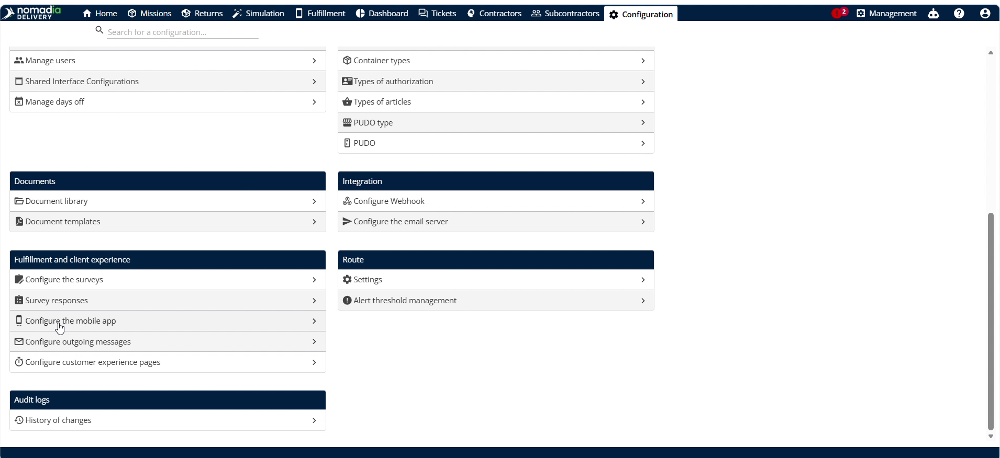
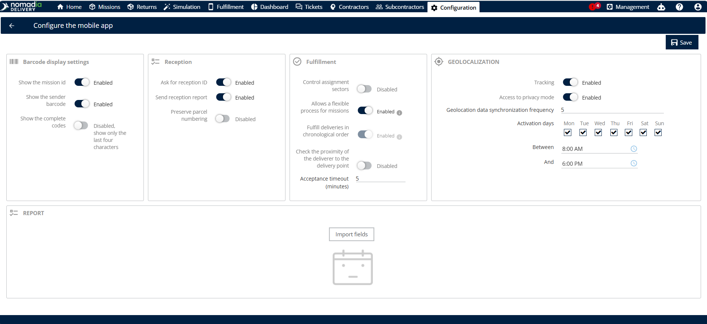
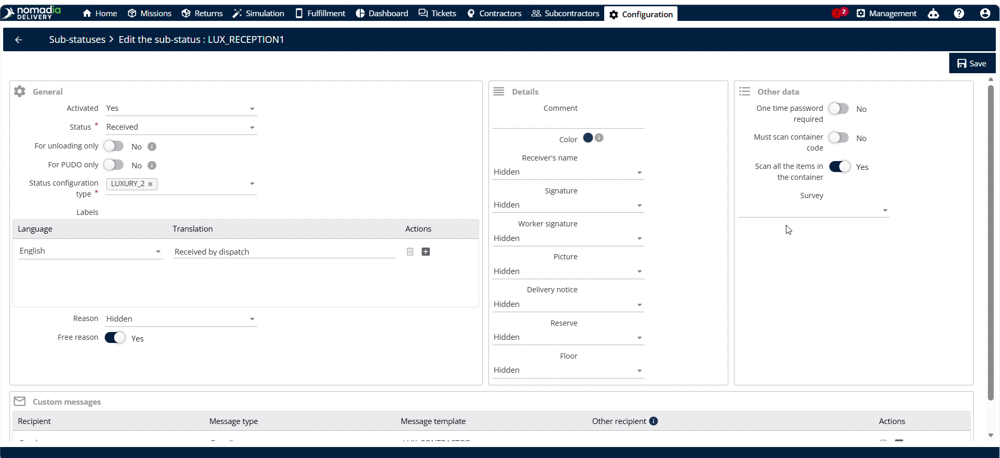
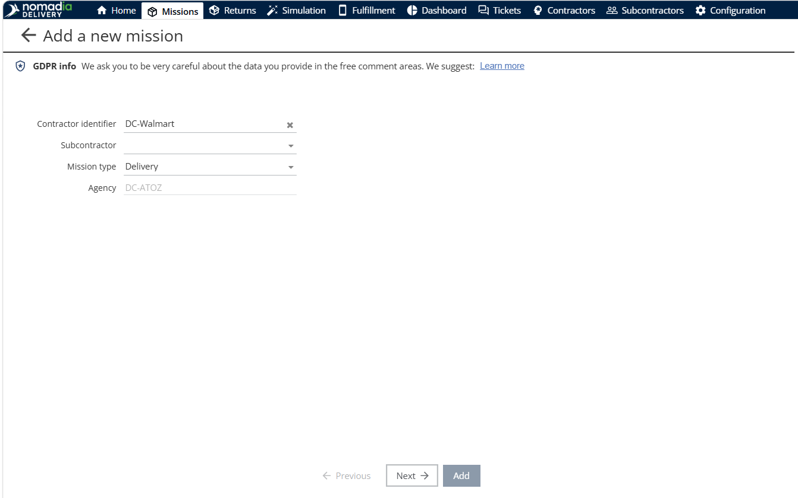
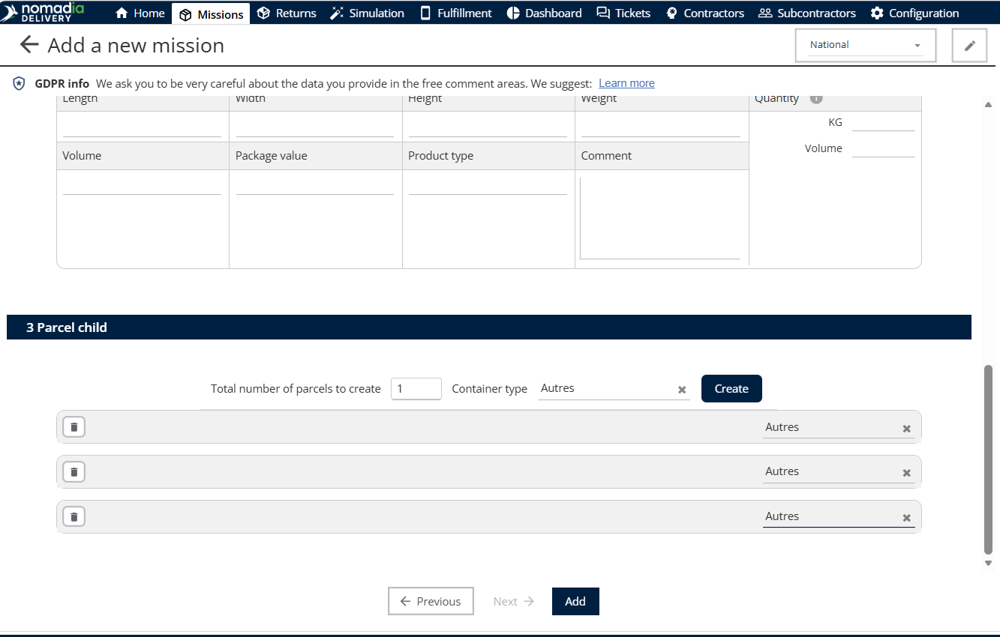
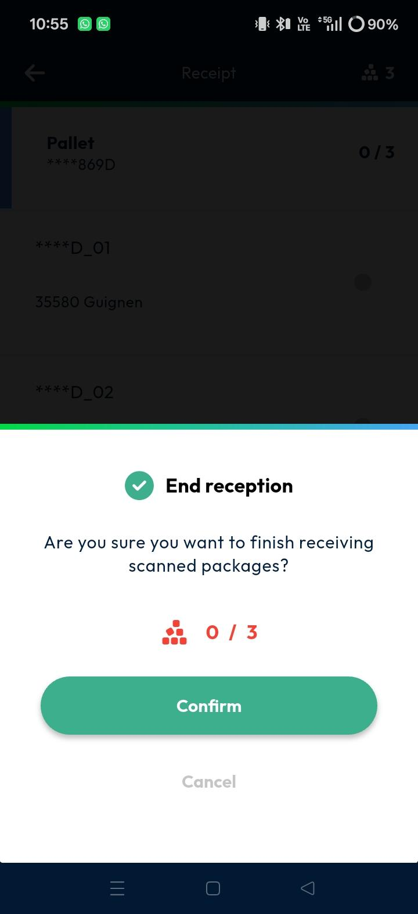
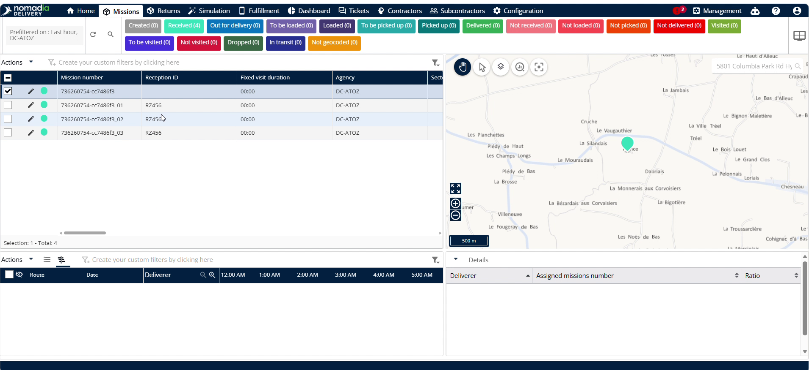

# Gestion des réceptions

La fonctionnalité de **gestion des réceptions** permet aux répartiteurs de gérer, vérifier et suivre les livraisons de conteneurs depuis le terrain. Lorsqu’un livreur réceptionne un conteneur dans l’application mobile, les scans sont consignés dans une réception, ce qui vous permet de suivre l’avancement en temps réel et de conserver un enregistrement précis de ce qui a été reçu.

Elle est utilisée par les répartiteurs et les administrateurs du Backoffice, qui configurent la fonctionnalité et suivent les réceptions dans le portail, ainsi que par les livreurs sur le terrain, qui scannent et réceptionnent les conteneurs dans l’application mobile. Une fois activée, des rapports complets sont envoyés automatiquement à vos sous-traitants, ce qui garantit un inventaire exact et une communication claire.

## Avant de commencer

Assurez-vous que la configuration et les prérequis système suivants sont en place :

* Un accès au portail Backoffice de **Nomadia Delivery**.
* Une adresse e-mail de sous-traitant enregistrée pour recevoir les rapports automatiques.
* L’application mobile installée sur les appareils de terrain.

Effectuez ensuite la configuration dans cet ordre :

1. Configurez l’application mobile pour la réception.
2. Configurez un sous-statut pour scanner tous les articles du conteneur.
3. Configurez le rapport de réception.

## Présentation de la fonctionnalité

Les éléments d’interface suivants contrôlent votre flux de suivi des réceptions :

* **Configurer l’application mobile** : ouvre le panneau des paramètres mobiles pour personnaliser les flux de travail des agents de terrain.
* **Demander l’ID de réception** : invite les livreurs à saisir un identifiant de réception afin que toutes les expéditions reçues soient suivies de manière unique.
* **Scanner tous les articles du conteneur** : oblige les livreurs à scanner chaque colis afin d’éviter les livraisons manquées ou incorrectes.
* **Personnaliser la liste** : ajuste les colonnes affichées dans la vue du Backoffice.

## Configurer l’application mobile pour la réception

1. Ouvrez la page **Configuration**.
2. Cliquez sur **Configurer l’application mobile**.

3. Activez les boutons bascules **Demander l’ID de réception** et **Envoyer le rapport de réception** dans la colonne **Réception**.
4. Cliquez sur **Enregistrer** pour appliquer la configuration.

<figure><figcaption></figcaption></figure>

### Résultat

La prochaine fois que les livreurs ouvrent l’application mobile, l’option de réception est disponible et un ID de réception leur est demandé.

## Configurer un sous-statut pour scanner tous les articles du conteneur

1. Accédez au menu **Sous-statut** dans le portail.
2. Repérez le sous-statut **Reçu** dans la liste.
3. Cliquez sur l’**icône crayon** à côté du sous-statut **Reçu**.
4. Activez le bouton bascule **Scanner tous les articles du conteneur**.
5. Cliquez sur **Enregistrer** pour mettre à jour les règles du sous-statut.

### Résultat

Les livreurs doivent désormais scanner chaque article du conteneur avant que le sous-statut **Reçu** puisse être appliqué.

## Associer un sous-traitant à une mission

1. Accédez au menu **Missions**.
2. Cliquez sur **Ajouter** ou modifiez une mission existante.

<figure><figcaption></figcaption></figure>

3. Sélectionnez le **Sous-traitant** associé à la mission.

<figure><figcaption></figcaption></figure>

4. Cliquez sur **Ajouter** pour enregistrer la mission.

<figure><figcaption></figcaption></figure>

## Configurer le rapport de réception

1. Accédez à **Configurer les messages sortants**.
2. Créez un modèle d’e-mail pour le rapport de réception.
3. Dès que l’utilisateur mobile termine la réception, l’e-mail est automatiquement envoyé à l’adresse e-mail du sous-traitant.

## Scanner et réceptionner des conteneurs dans l’application mobile

1. Ouvrez l’application mobile sur votre appareil de terrain.
2. Cliquez sur l’icône **+** en bas de l’écran.
3. Saisissez le **Nom de la réception** et l’**ID de réception** lorsque vous y êtes invité, puis cliquez sur **Valider**.

<figure><figcaption></figcaption></figure>

4. Scannez le **formulaire du conteneur parent**.

5. Appuyez sur la coche en bas de l’écran.
6. Une fenêtre contextuelle demande « Voulez-vous vraiment terminer la réception des colis scannés ? »
7. Cliquez sur **Confirmer**.

<figure><figcaption></figcaption></figure>

## Afficher les ID de réception dans la liste du Backoffice

1. Accédez à la vue de liste principale dans le portail.
2. Cliquez sur **Personnaliser la liste**.
3. Repérez le champ **ID de réception** et assurez-vous qu’il est sélectionné pour l’affichage.
4. Cliquez sur **Enregistrer** pour mettre à jour les colonnes de la liste.

<figure><figcaption></figcaption></figure>

5. Vérifiez que l’**ID de réception** saisi est visible dans la liste.

## Conseils


**Vérification forcée** : activez **Scanner tous les articles du conteneur** sous le sous-statut **Reçu** pour empêcher les livreurs d’ignorer la vérification.


## Rubriques connexes

* [Modèles personnalisés](../manage-notifications/customtemplates.md)
* [Gérer les sous-statuts](../manage-substatus/README.md)
* [Héritage de l’enfant vers le parent](../manage-container-types/childtoparentinheritance.md)
