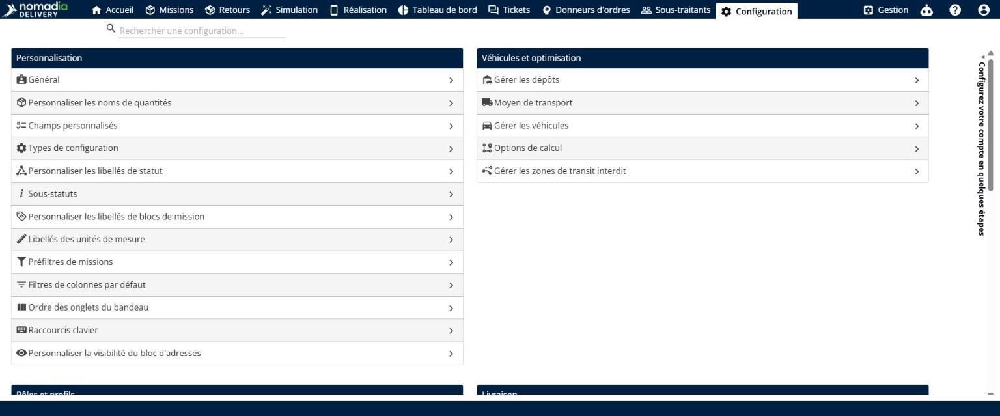
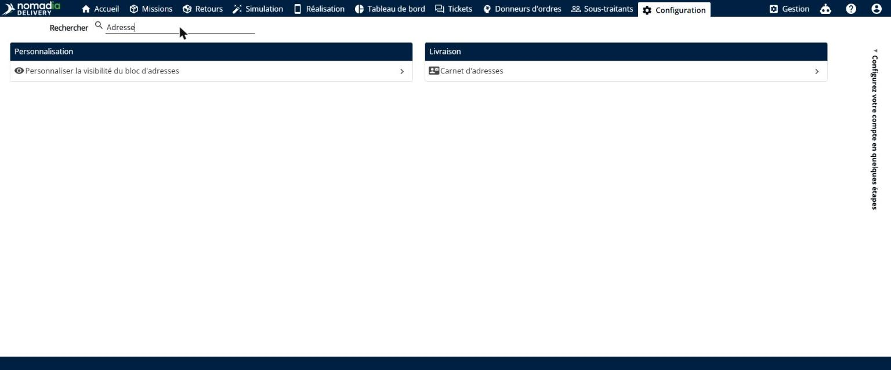
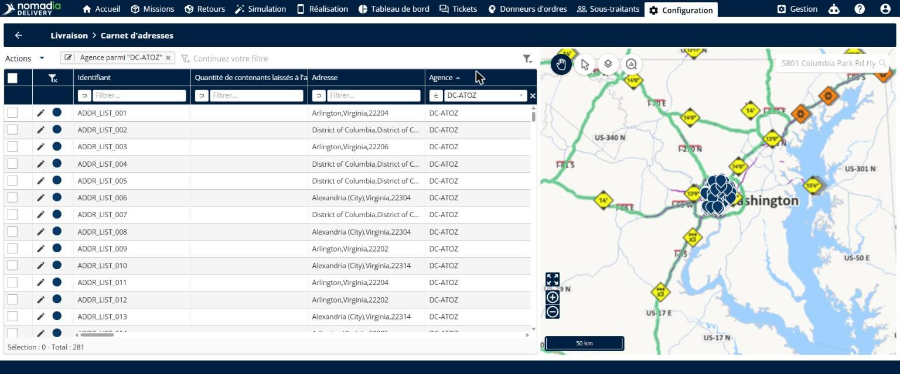
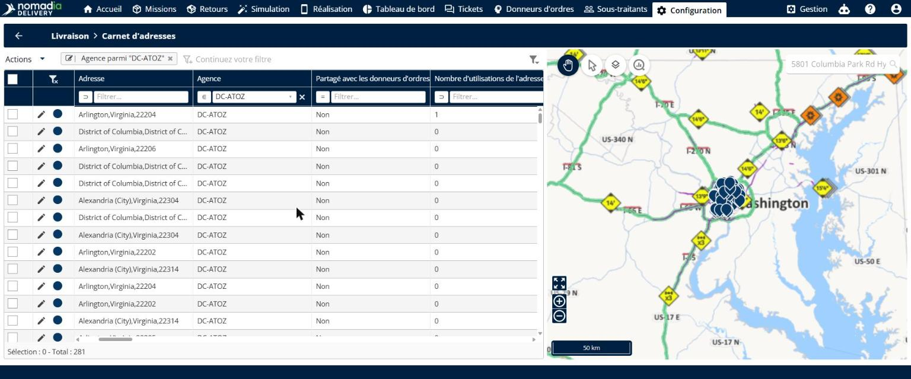
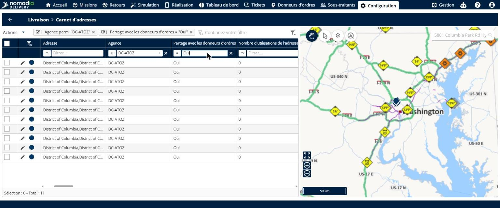
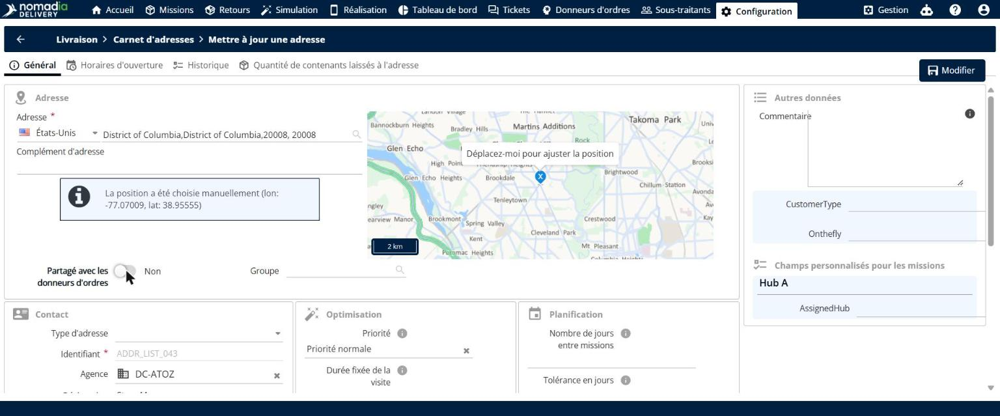
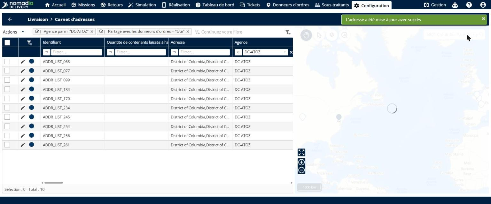
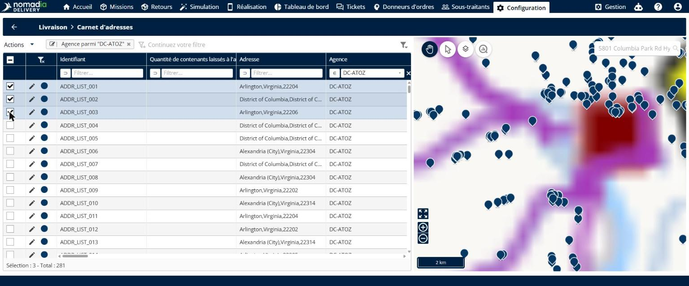
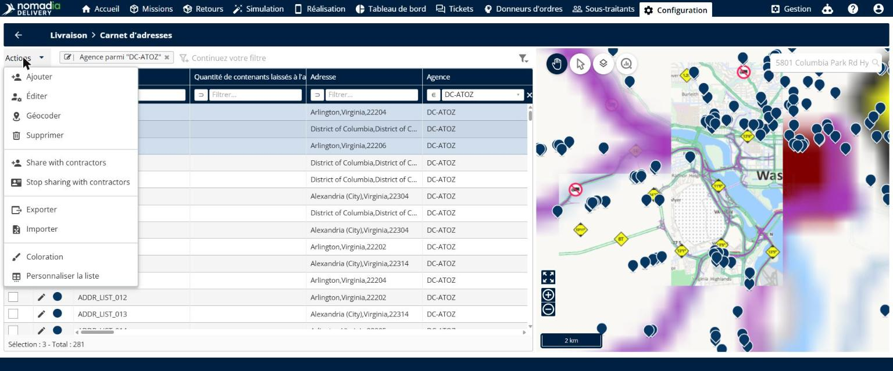
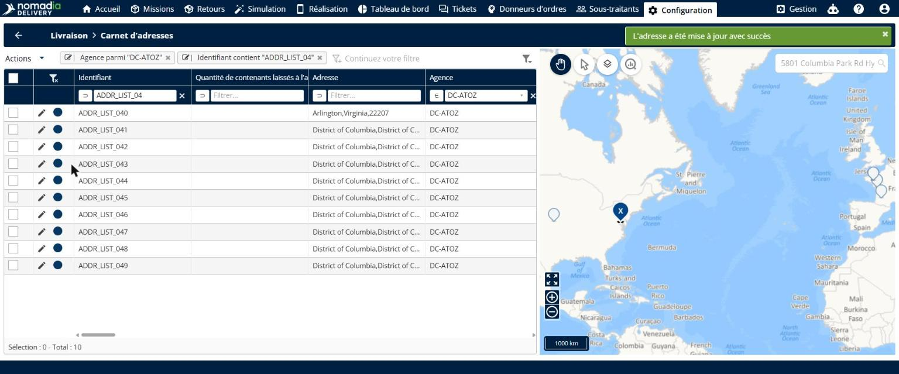

# Contrôler le partage des adresses avec les donneurs d’ordres

Le contrôle du partage des adresses avec les donneurs d’ordres vous permet de choisir quelles entrées de la liste générale d’adresses vos donneurs d’ordres peuvent voir. Vous pouvez garder une adresse sensible privée, vérifier d’un coup d’œil le statut de partage de chaque entrée, et partager ou arrêter de partager plusieurs adresses en une seule étape.

## Avant de commencer

* Connectez-vous à **Nomadia Delivery** en tant qu’administrateur ou utilisateur back-office ayant accès à l’onglet **Configuration**.
* Assurez-vous que les adresses que vous souhaitez gérer existent dans la liste générale d’adresses. Voir [Gérer la liste globale d’adresses](manage-global-address-list.md).

## Présentation de la fonctionnalité

* **Carnet d’adresses** : liste générale d’adresses utilisée dans toute votre organisation, accessible dans **Configuration**.
* **Colonne Partagé avec les donneurs d’ordres** : colonne qui indique, pour chaque adresse, si les donneurs d’ordres peuvent la voir (**Oui** ou **Non**). Vous pouvez filtrer cette colonne.
* **Interrupteur Partagé avec les donneurs d’ordres** : interrupteur présent dans chaque adresse qui active ou désactive le partage avec les donneurs d’ordres. Il est activé par défaut.
* **Menu Actions** : menu qui contient **Share with contractors** et **Stop sharing with contractors** pour les adresses sélectionnées.
* **Modifier** : bouton qui enregistre les modifications d’une adresse.

## Ouvrir le carnet d’adresses

1. En tant qu’administrateur ou utilisateur back-office, ouvrez l’onglet **Configuration**.

2. Dans la zone de recherche, saisissez **Adresse**, puis ouvrez **Carnet d’adresses**.

La page **Carnet d’adresses** s’ouvre. Il s’agit de votre liste générale d’adresses, utilisée dans toute votre organisation.

## Vérifier le statut de partage des adresses

1. Dans le **Carnet d’adresses**, consultez la colonne **Partagé avec les donneurs d’ordres**. Elle indique le statut de partage de chaque adresse.

2. Pour afficher uniquement les adresses que vos donneurs d’ordres peuvent actuellement voir, saisissez **Oui** dans le filtre de la colonne **Partagé avec les donneurs d’ordres**.

### Résultat

La liste affiche uniquement les adresses partagées avec les donneurs d’ordres.

## Arrêter de partager une adresse avec les donneurs d’ordres

1. Dans le **Carnet d’adresses**, cliquez sur l’**icône crayon** à côté de l’adresse pour l’ouvrir.
2. Repérez l’interrupteur **Partagé avec les donneurs d’ordres**. Il est activé par défaut : rien ne change tant que vous ne le désactivez pas.

3. Désactivez l’interrupteur pour qu’il affiche **Non**.

4. Cliquez sur **Modifier** pour enregistrer.

### Résultat

Une notification confirme que l’adresse a été mise à jour. Si la liste est filtrée sur **Oui**, l’adresse n’est plus partagée et disparaît donc de la liste.

## Partager ou arrêter de partager plusieurs adresses

1. Dans le **Carnet d’adresses**, cochez les cases des adresses que vous souhaitez mettre à jour.

2. Cliquez sur **Actions**, puis sur **Share with contractors** ou **Stop sharing with contractors**.

### Résultat

Toutes les adresses sélectionnées sont mises à jour en une seule étape, et une notification confirme la mise à jour.

## Conseils


**Ce que voient les donneurs d’ordres** : les adresses non partagées n’apparaissent plus dans les recherches d’adresses ni dans les sélecteurs d’adresses des donneurs d’ordres, que ce soit dans l’interface ou via l’API. Les missions déjà affectées à ces adresses ne sont pas modifiées.


## Rubriques connexes

* [Gérer la liste globale d’adresses](manage-global-address-list.md)
* [Gérer la liste d’adresses](contractors/manage-address-list.md)
* [Personnaliser la visibilité des adresses](contractors/customizetheaddresslistvisibility.md)
