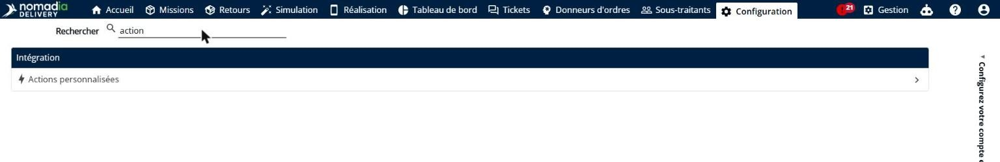
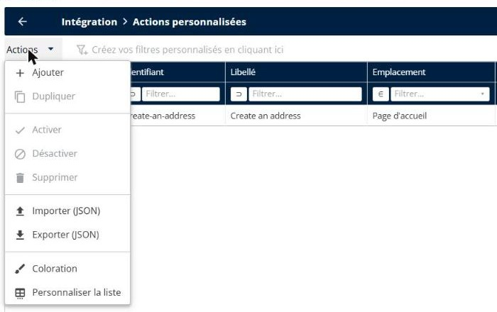
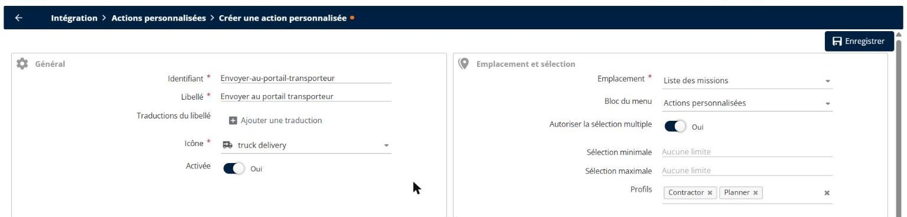
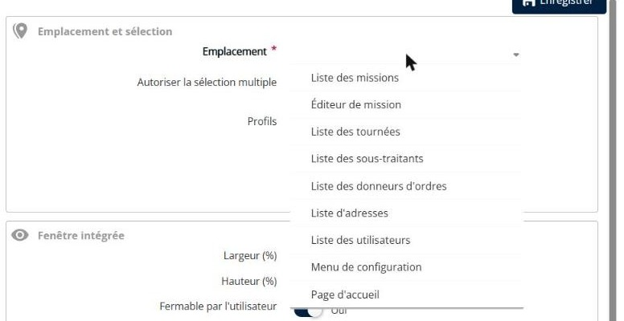
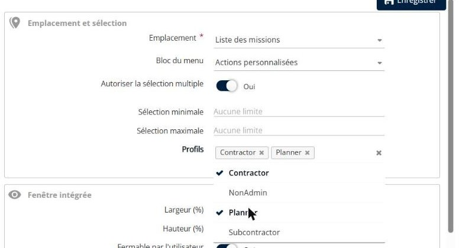
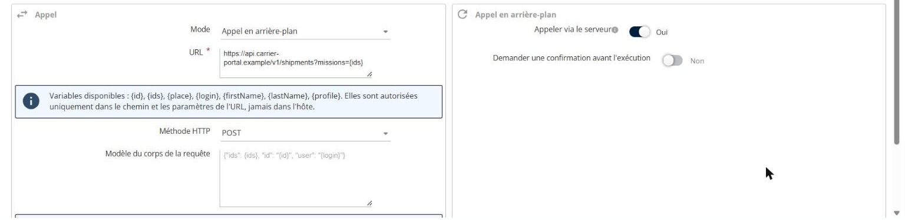
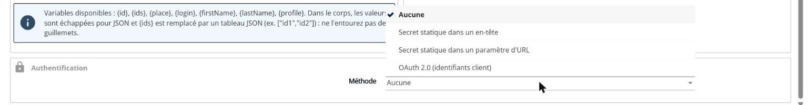
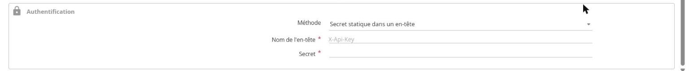
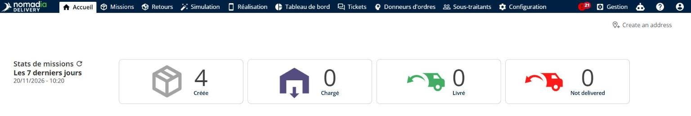

# Actions personnalisées

Les **actions personnalisées** permettent aux intégrateurs de connecter des outils et des processus externes au back-office de Nomadia Delivery, sans développement spécifique. Une action personnalisée ajoute un bouton à l’écran de votre choix, comme la liste des missions ou l’éditeur de mission. Lorsqu’un utilisateur clique dessus, Nomadia Delivery appelle l’URL de votre système externe, par exemple un portail transporteur, un ERP ou un CRM, et transmet les enregistrements sélectionnés.

## Avant de commencer

* Connectez-vous à **Nomadia Delivery** avec un profil utilisateur ayant accès à l’onglet **Configuration**.
* Munissez-vous de l’URL du système externe à appeler et, s’il en exige un, de son secret d’API.
* Sachez quels profils utilisateur doivent pouvoir exécuter l’action.

## Présentation de la fonctionnalité

* **Général** : l’**Identifiant**, le **Libellé** affiché aux utilisateurs, les **Traductions du libellé** (facultatives), l’**Icône** et le bouton **Activée**.
* **Emplacement et sélection** : l’endroit où l’action apparaît et les enregistrements sur lesquels elle s’exécute :
  * **Emplacement** : **Liste des missions**, **Éditeur de mission**, **Liste des tournées**, **Liste des sous-traitants**, **Liste des donneurs d’ordres**, **Liste d’adresses**, **Liste des utilisateurs**, **Menu de configuration** ou **Page d’accueil**.
  * **Bloc du menu** : le bloc du menu **Actions** dans lequel l’action apparaît sur une liste, par exemple **Actions personnalisées**.
  * **Autoriser la sélection multiple** : sur les listes, exécute l’action sur plusieurs éléments à la fois. Vous pouvez définir une **Sélection minimale** et une **Sélection maximale**.
  * **Profils** : limite l’action aux profils utilisateur sélectionnés. Par défaut, l’action est disponible pour tous les profils.
* **Appel** : la façon dont le système externe est appelé :
  * **Mode** : **Fenêtre intégrée** ouvre l’URL dans une fenêtre à l’intérieur de Nomadia Delivery. **Appel en arrière-plan** envoie la requête sans quitter l’écran.
  * **URL** : le point de terminaison à appeler. Des variables comme **{id}** et **{ids}** transmettent les enregistrements sélectionnés. Les variables disponibles sont {id}, {ids}, {place}, {login}, {firstName}, {lastName} et {profile}. Elles sont autorisées uniquement dans le chemin et les paramètres de l’URL, jamais dans l’hôte.
  * **Méthode HTTP** : **GET**, **POST**, **PUT**, **PATCH** ou **DELETE**. Avec **POST**, **PUT** et **PATCH**, vous pouvez aussi saisir un **Modèle du corps de la requête**.
* **Appel en arrière-plan** : **Appeler via le serveur** envoie la requête depuis le serveur de Nomadia Delivery, ce qui garde le secret hors du navigateur. **Demander une confirmation avant l’exécution** demande à l’utilisateur de confirmer avant l’appel.
* **Authentification** : la façon dont les identifiants sont transmis : **Aucune**, **Secret statique dans un en-tête**, **Secret statique dans un paramètre d’URL** ou **OAuth 2.0 (identifiants client)**.

## Créer une action personnalisée

1. Accédez à l’onglet **Configuration**, recherchez **action**, puis cliquez sur **Actions personnalisées** sous **Intégration**.

2. Cliquez sur **Actions** > **Ajouter**.

3. Dans **Général**, saisissez l’**Identifiant** et le **Libellé**, par exemple **Envoyer au portail transporteur**, puis choisissez une **Icône** pour que les utilisateurs repèrent l’action immédiatement. Laissez **Activée** sur **Oui**.

4. Dans **Emplacement et sélection**, choisissez l’**Emplacement** où l’action apparaît, par exemple **Liste des missions**.

5. Sur une liste, activez **Autoriser la sélection multiple** pour exécuter l’action sur plusieurs éléments à la fois. Si nécessaire, sélectionnez les **Profils** qui peuvent exécuter l’action.

6. Dans **Appel**, choisissez le **Mode**, saisissez l’**URL** du point de terminaison avec les variables nécessaires, par exemple **{ids}**, puis choisissez la **Méthode HTTP**. Pour un **Appel en arrière-plan**, activez **Appeler via le serveur** pour garder le secret hors du navigateur.

7. Dans **Authentification**, choisissez la **Méthode** attendue par votre système externe.

8. Pour un secret statique, saisissez le **Nom de l’en-tête** ou le nom du paramètre, et le **Secret**.

9. Cliquez sur **Enregistrer**.

### Résultat

L’action personnalisée apparaît exactement à l’endroit choisi, pour les profils sélectionnés. Dans l’exemple ci-dessous, une action personnalisée placée sur la **Page d’accueil** apparaît en haut à droite de l’écran. Son libellé reste en anglais, car aucune traduction française n’a été ajoutée dans **Traductions du libellé**.

## Exécuter une action personnalisée

1. Accédez à l’écran où l’action est placée, par exemple l’onglet **Missions**.
2. Sélectionnez les enregistrements, par exemple plusieurs missions.
3. Cliquez sur **Actions**, puis sur l’action personnalisée.

### Résultat

Nomadia Delivery appelle le système externe avec les enregistrements sélectionnés, et le système externe prend le relais.

## Conseils


**Utilisez des libellés et des icônes clairs** : donnez à chaque action un libellé court et une icône reconnaissable, et ajoutez des **Traductions du libellé** pour que les utilisateurs voient le libellé dans leur langue.



**Limitez les actions sensibles** : sélectionnez les **Profils** qui peuvent exécuter une action, afin que seules les bonnes équipes puissent la déclencher.



**Gardez les secrets hors du navigateur** : pour un appel en arrière-plan avec un secret, activez **Appeler via le serveur**. L’URL doit utiliser https, et les variables ne sont jamais autorisées dans l’hôte.


## Rubriques connexes

* [Gestion sécurisée des clés d’API](secure-api-key-management.md)
* [Personnaliser les onglets de navigation](customize-navigation-tabs.md)
* [Version d’automne 2026](fall-release-2026/fall-release-2026.md)
