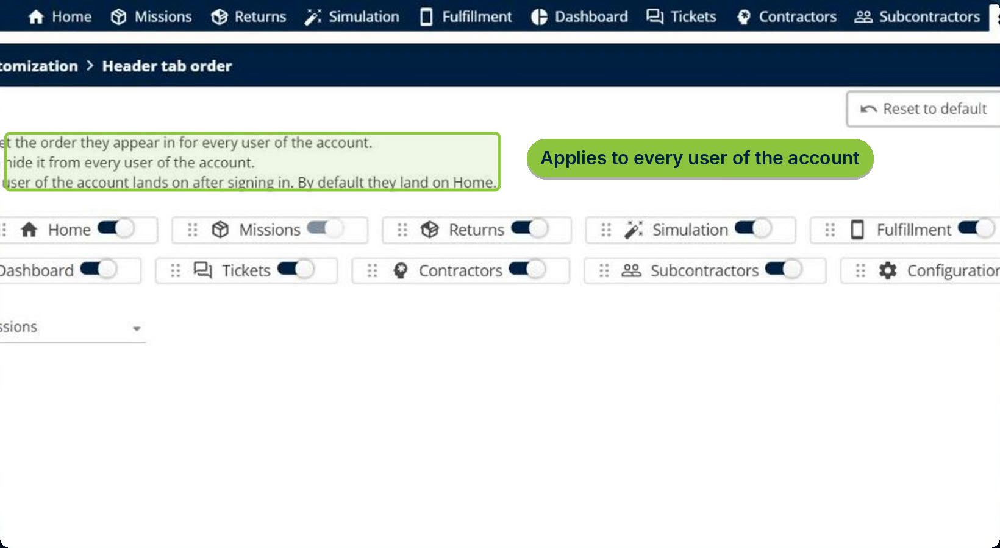
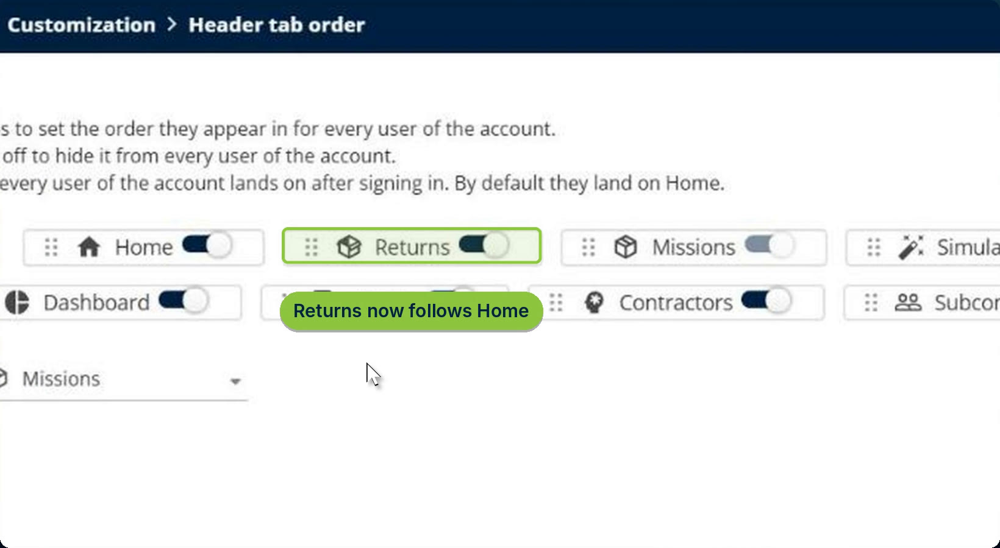
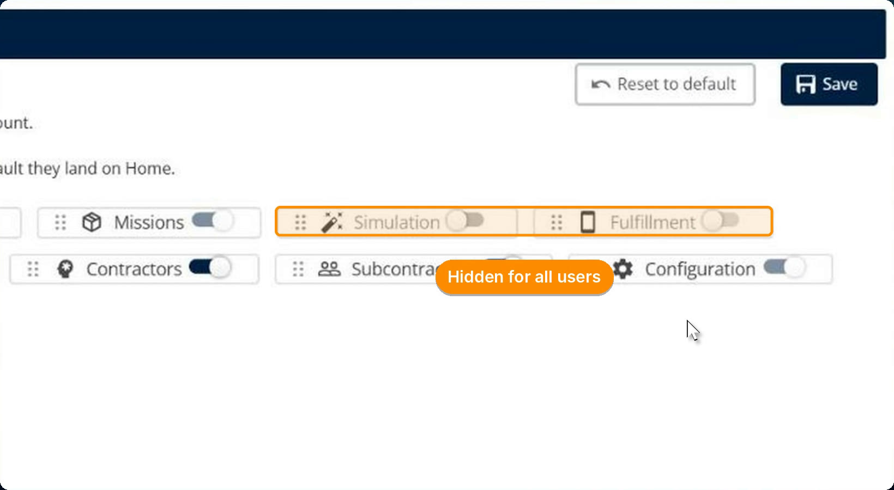
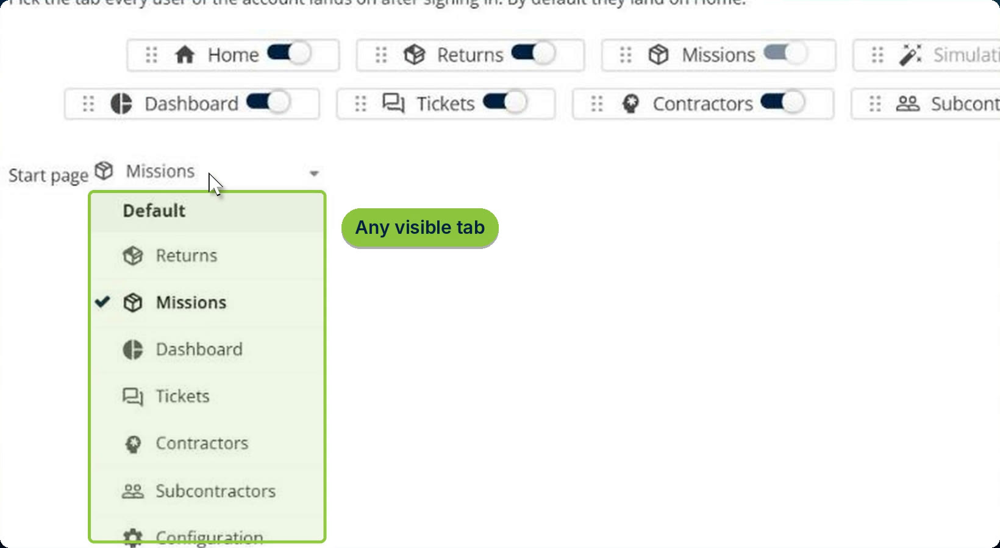
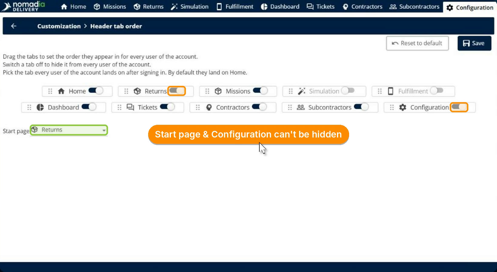
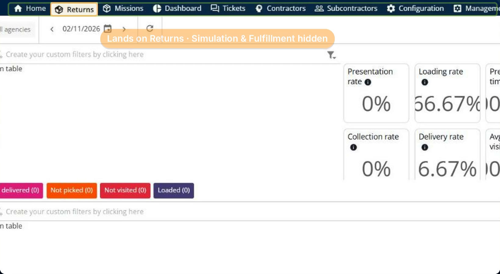
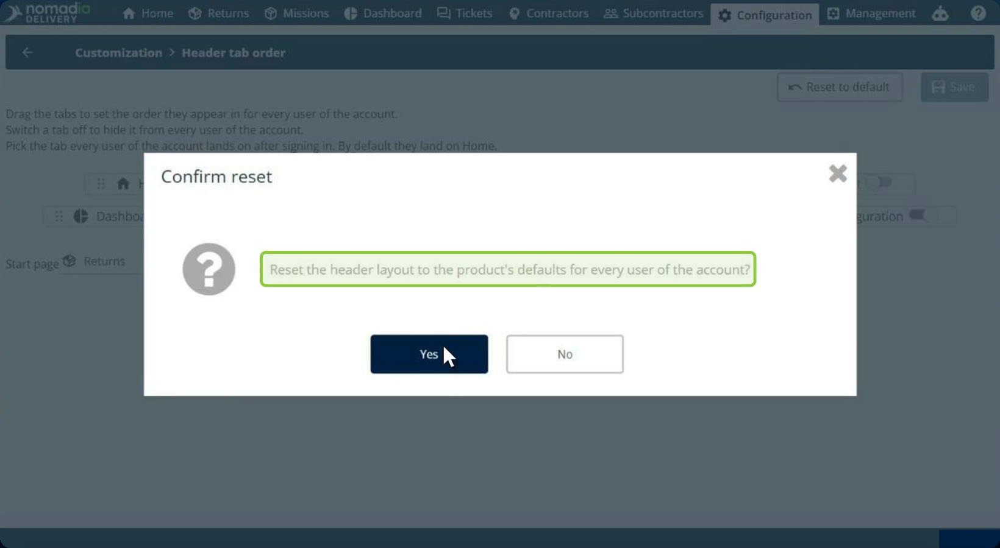
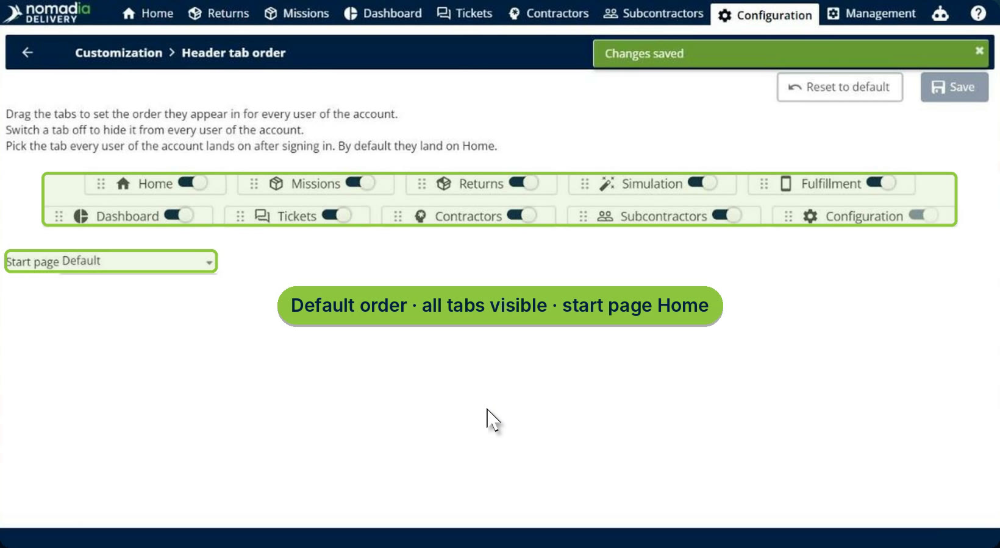

# Personnaliser les onglets de navigation

La page **Ordre des onglets du bandeau** permet à un administrateur de choisir comment les onglets du bandeau principal apparaissent pour tous les utilisateurs du compte. Vous pouvez faire glisser les onglets dans l’ordre de travail de votre équipe, masquer les onglets qu’elle n’utilise pas et choisir la page sur laquelle chaque utilisateur arrive après sa connexion. Un seul clic rétablit la disposition par défaut.

## Avant de commencer

* Connectez-vous à **Nomadia Delivery** en tant qu’administrateur ayant accès à **Configuration**.
* Gardez à l’esprit que la disposition s’applique à tous les utilisateurs du compte.

## Présentation de la fonctionnalité

* **Ordre des onglets du bandeau** : page de **Configuration** > **Personnalisation** qui liste chaque onglet du bandeau principal, comme **Accueil**, **Missions**, **Retours**, **Simulation**, **Réalisation**, **Tableau de bord**, **Tickets**, **Donneurs d’ordres**, **Sous-traitants** et **Configuration**.
* **Poignée de déplacement** : poignée en pointillés à gauche de chaque onglet. Faites glisser un onglet pour modifier sa position dans le bandeau.
* **Interrupteur de visibilité** : interrupteur à droite de chaque onglet. Désactivez un onglet pour le masquer à tous les utilisateurs du compte.
* **Page de démarrage** : onglet sur lequel tous les utilisateurs arrivent après leur connexion. Par défaut, ils arrivent sur **Accueil**. Vous pouvez choisir n’importe quel onglet visible.
* **Toujours affichés** : l’onglet choisi comme page de démarrage et l’onglet **Configuration** ne peuvent pas être masqués.
* **Réinitialiser par défaut** : rétablit l’ordre par défaut, réaffiche tous les onglets et remet la page de démarrage sur **Accueil**.
* **Nouveaux onglets** : les onglets ajoutés par les prochaines versions apparaissent automatiquement à la fin du bandeau.

## Ouvrir la page Ordre des onglets du bandeau

1. Allez dans **Configuration**. Dans la section **Personnalisation**, cliquez sur **Ordre des onglets du bandeau**.

La page affiche chaque onglet du bandeau principal, dans son ordre actuel, avec son interrupteur de visibilité.

## Réorganiser les onglets

1. Faites glisser un onglet par sa poignée et déposez-le à sa nouvelle position. Par exemple, faites glisser **Retours** à côté d’**Accueil**.

Les autres onglets se décalent pour lui faire de la place, et **Retours** suit désormais **Accueil**.

## Masquer des onglets

1. Désactivez les onglets que votre équipe n’utilise pas. Par exemple, désactivez **Simulation** et **Réalisation**.

Les onglets masqués sont grisés. Ils seront masqués pour tous les utilisateurs du compte.

## Choisir la page de démarrage

1. Ouvrez la liste **Page de démarrage**, puis choisissez l’onglet sur lequel tous les utilisateurs arrivent après leur connexion, par exemple **Retours**. Vous pouvez choisir n’importe quel onglet visible, ou **Par défaut** pour arriver sur **Accueil**.

L’onglet choisi comme page de démarrage et l’onglet **Configuration** ne peuvent pas être désactivés.

2. Cliquez sur **Enregistrer**.

### Résultat

La nouvelle disposition s’applique à tous les utilisateurs du compte. Après leur connexion, les utilisateurs arrivent sur la page de démarrage choisie, et les onglets masqués n’apparaissent plus dans le bandeau. Dans cet exemple, les utilisateurs arrivent sur **Retours**, et **Simulation** et **Réalisation** sont masqués.

## Rétablir la disposition par défaut

1. Sur la page **Ordre des onglets du bandeau**, cliquez sur **Réinitialiser par défaut**.
2. Dans la fenêtre de confirmation, cliquez sur **Oui**.

### Résultat

L’ordre par défaut est rétabli, tous les onglets sont de nouveau visibles et la page de démarrage revient sur **Par défaut** : les utilisateurs arrivent sur **Accueil**.

## Conseils


**Adaptez le bandeau à votre travail quotidien** : placez les onglets les plus utilisés par votre équipe au début du bandeau, et choisissez comme page de démarrage la page qu’elle ouvre en premier.



**Les nouveaux onglets ne sont jamais perdus** : les onglets ajoutés par les prochaines versions sont ajoutés automatiquement à la fin du bandeau, même si vous avez personnalisé l’ordre.


## Rubriques connexes

* [Configuration des raccourcis clavier](keyboard-shortcuts-configuration.md)
* [Gérer les utilisateurs](manage-users/README.md)
