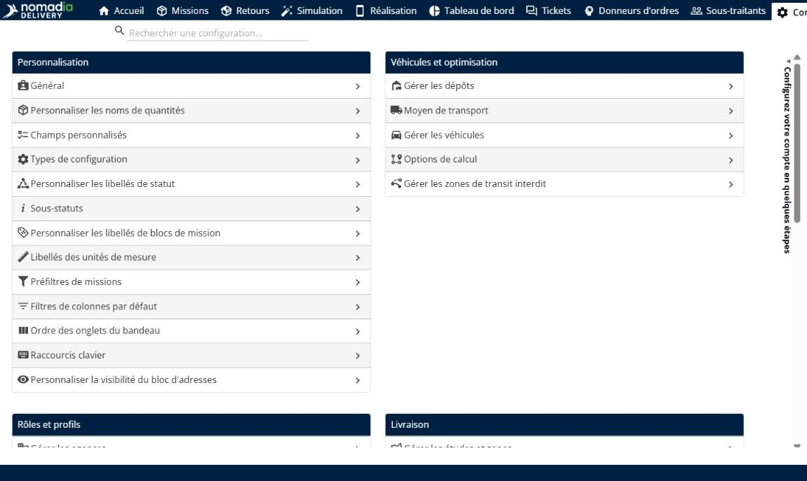
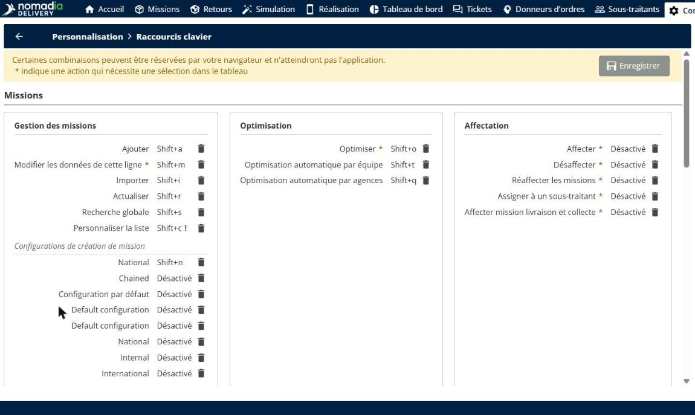
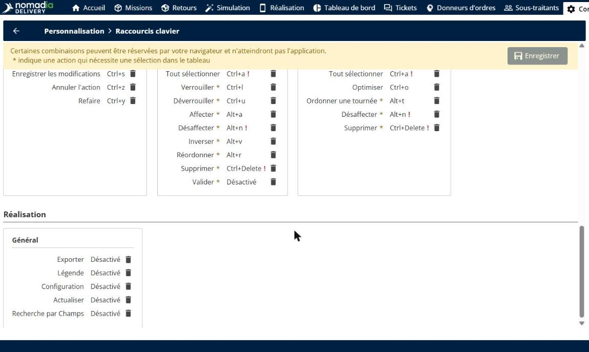
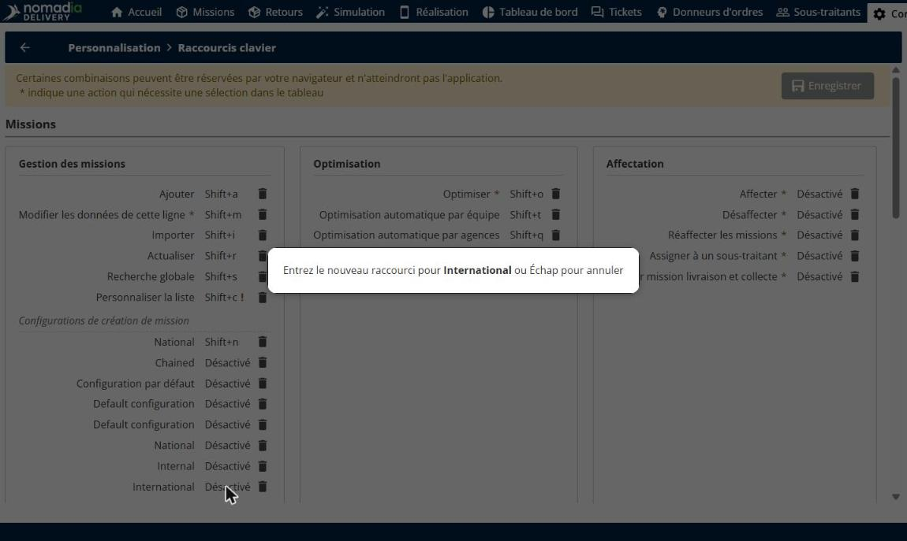
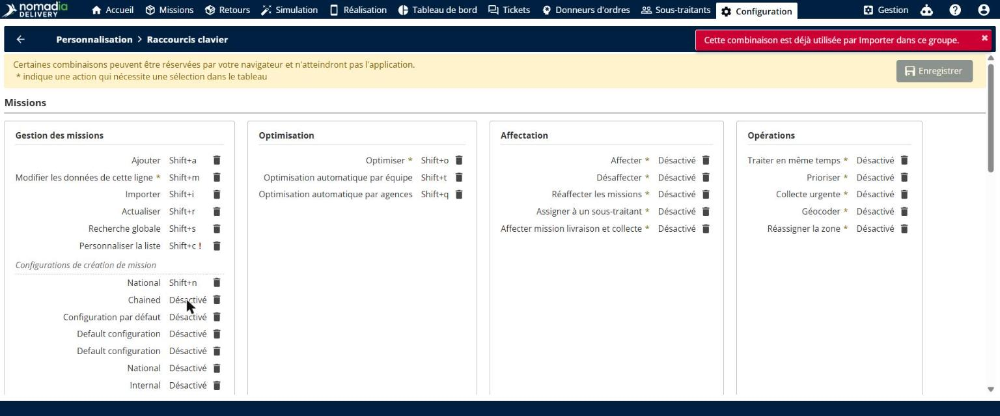
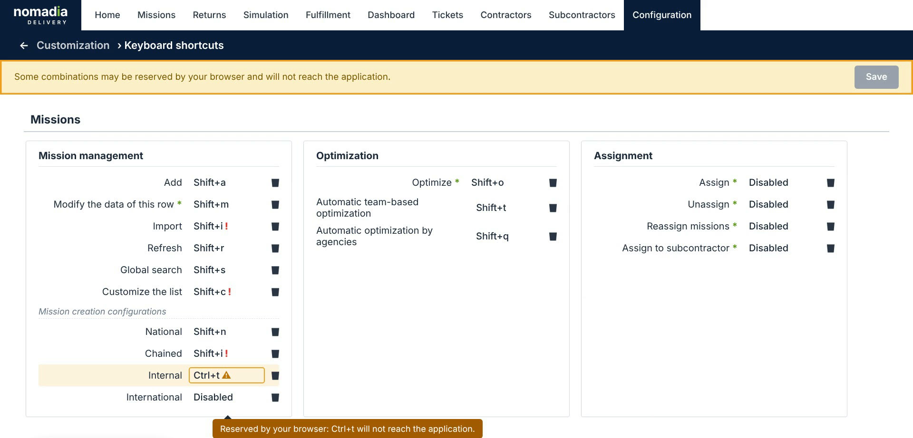
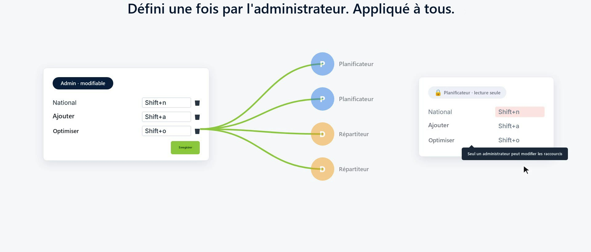

# Configuration des raccourcis clavier

La page **Raccourcis clavier** rassemble en un seul endroit tous les raccourcis clavier de Nomadia Delivery. Un administrateur définit un seul jeu de raccourcis pour tout le compte, et tous les planificateurs et répartiteurs utilisent les mêmes raccourcis. Vous pouvez affecter un raccourci aux principales actions des pages **Missions**, **Tableau des tournées**, **Simulation** et **Réalisation**, y compris un raccourci qui ouvre le formulaire de création de mission avec la bonne configuration de mission déjà chargée. Les conflits et les combinaisons réservées par le navigateur sont signalés avant l’enregistrement.

## Avant de commencer

* Connectez-vous à **Nomadia Delivery** en tant qu’administrateur. Seul un administrateur peut modifier les raccourcis. Les autres utilisateurs peuvent les consulter, mais pas les modifier.

## Présentation de la fonctionnalité

* **Page Raccourcis clavier** : page de **Configuration** > **Personnalisation** qui liste toutes les actions pouvant recevoir un raccourci, regroupées par page et par section, par exemple **Missions** > **Gestion des missions**, **Optimisation** et **Affectation**.
* **Raccourcis communs à tout le compte** : les raccourcis sont définis une seule fois par l’administrateur et s’appliquent à tous les utilisateurs du compte.
* **Configurations de création de mission** : un raccourci par configuration de mission, par exemple **National**, **Chained**, **Internal** ou **International**. Le raccourci ouvre la page **Ajouter une nouvelle mission**, préremplie avec les valeurs de cette configuration.
* **Actions nécessitant une sélection** : une action marquée d’un astérisque (**\***) nécessite de sélectionner des lignes dans le tableau au préalable, par exemple **Optimiser** ou **Affecter**.
* **Désactivé** : l’action n’a pas de raccourci. Cliquez sur l’icône corbeille à côté d’un raccourci pour le supprimer.
* **Détection des conflits** : une combinaison déjà utilisée par une autre action du même groupe est refusée, avec un message qui indique l’action concernée. Une combinaison réservée par le navigateur est signalée par un avertissement, car elle n’atteindra pas l’application.

## Ouvrir la page Raccourcis clavier

1. Allez dans **Configuration**. Dans la section **Personnalisation**, cliquez sur **Raccourcis clavier**.

2. Consultez les raccourcis actuels. Chaque page a ses propres sections. Par exemple, sous **Missions**, la section **Gestion des missions** liste **Ajouter** (**Shift+a**), **Importer** (**Shift+i**), **Actualiser** (**Shift+r**) et **Recherche globale** (**Shift+s**).

3. Faites défiler la page pour voir les raccourcis des autres pages, comme **Tableau des tournées**, **Simulation** et **Réalisation**.

## Affecter un raccourci

1. Sur la page **Raccourcis clavier**, cliquez sur le raccourci de l’action, par exemple **International** sous **Configurations de création de mission**. Le message **Entrez le nouveau raccourci pour International ou Échap pour annuler** s’affiche.

2. Appuyez sur la combinaison de touches à utiliser, par exemple **Shift+x**. Pour annuler, appuyez sur **Échap**.
3. Cliquez sur **Enregistrer**.

### Résultat

Le raccourci est enregistré pour tout le compte. Tous les utilisateurs peuvent désormais l’utiliser. Par exemple, sur la page **Missions**, appuyer sur **Shift+x** ouvre la page **Ajouter une nouvelle mission**, préremplie avec les valeurs de la configuration **International**. Dans l’exemple ci-dessous, le raccourci **Shift+n** de la configuration **National** a prérempli le **Type de mission**.

## Corriger les conflits avant d’enregistrer

1. Si la combinaison saisie est déjà utilisée par une autre action du même groupe, elle n’est pas affectée et un message l’indique, par exemple **Cette combinaison est déjà utilisée par Importer dans ce groupe.**

2. Si la combinaison est réservée par votre navigateur, par exemple **Ctrl+t**, un avertissement indique qu’elle n’atteindra pas l’application.

3. Saisissez une autre combinaison, ou cliquez sur l’icône corbeille pour supprimer le raccourci, puis cliquez sur **Enregistrer**.

## Qui peut modifier les raccourcis

Seul un administrateur peut modifier les raccourcis. Les planificateurs et les répartiteurs voient le même jeu de raccourcis en lecture seule. S’ils essaient de modifier un raccourci, un message leur indique que seul un administrateur peut modifier les raccourcis.

## Conseils


**Privilégiez les combinaisons avec Shift** : de nombreuses combinaisons avec **Ctrl** et **Alt** sont réservées par le navigateur et n’atteignent jamais l’application. Les combinaisons avec **Shift** sont un choix plus sûr.



**Sélectionnez d’abord les lignes** : pour une action marquée d’un astérisque (**\***), comme **Optimiser** ou **Affecter**, sélectionnez les missions dans le tableau avant d’appuyer sur le raccourci.


## Rubriques connexes

* [Missions](missions/README.md)
* [Modifier l’ordre des raccourcis de statut des missions](missions/understanding-the-missions-page/change-the-order-of-mission-status-shortcuts.md)
* [Gérer les utilisateurs](manage-users/README.md)
