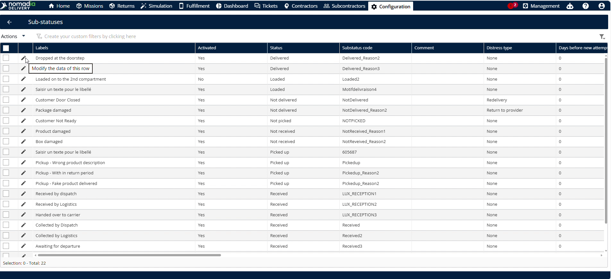
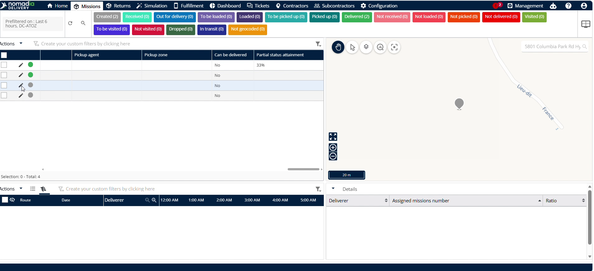
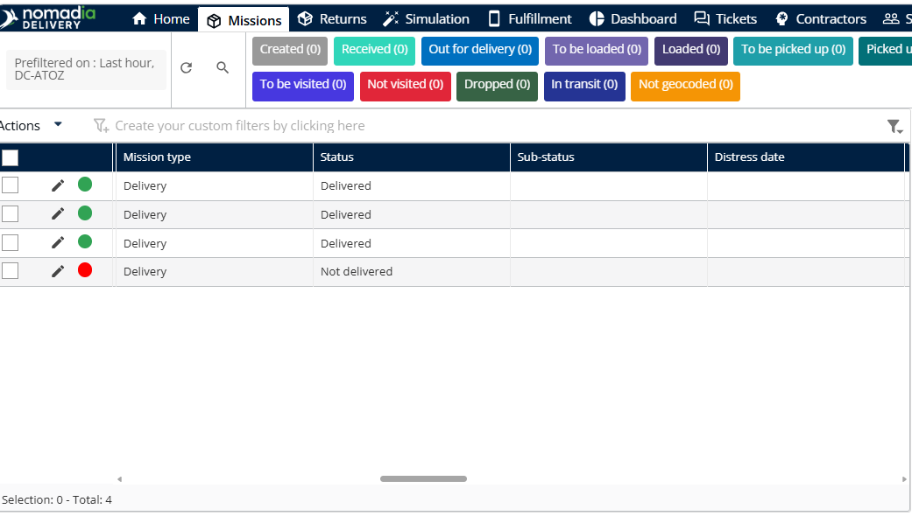
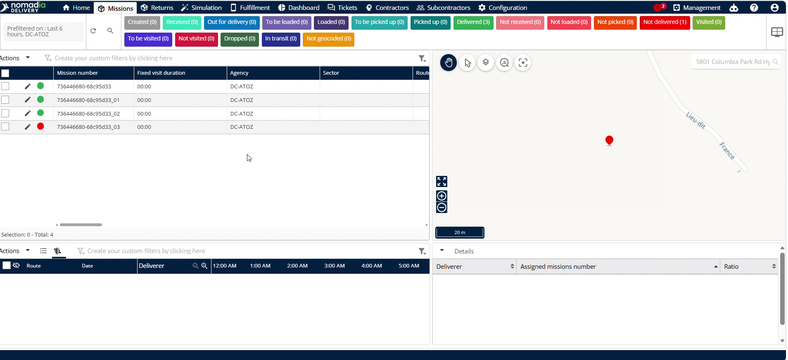
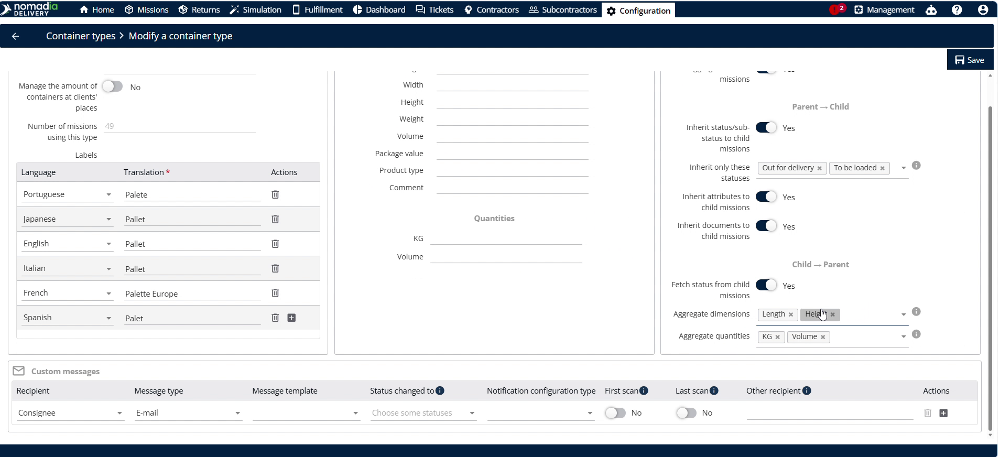
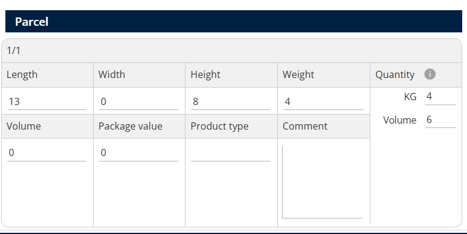

# Héritage de l’enfant vers le parent

L’héritage de l’enfant vers le parent synchronise automatiquement les données des conteneurs enfants vers les conteneurs parents. Cette fonctionnalité fait gagner du temps aux répartiteurs en supprimant la saisie manuelle. Vous bénéficiez d’une visibilité en temps réel sur les statuts consolidés des colis et sur les dimensions agrégées des marchandises.

## Avant de commencer

Avant d’utiliser cette fonctionnalité, assurez-vous de remplir les conditions suivantes :

* Un compte utilisateur actif pour **Nomadia Delivery** disposant de privilèges d’administration.
* Des profils de conteneurs parent et enfant préconfigurés.

## Présentation de la fonctionnalité

* **Récupérer le statut des missions enfants** : ce paramètre permet aux conteneurs parents d’hériter du statut d’avancement des conteneurs enfants. Il garantit des mises à jour automatiques.
* **Scanner tous les articles du conteneur** : ce bouton bascule oblige les opérateurs à scanner chaque article enfant avant de procéder à la livraison. Il garantit l’exactitude de la livraison.
* **Statut de la mission** : ce champ définit le statut opérationnel actuel de chaque mission enfant. Il met à jour les valeurs de statut héritées.
* **Atteinte partielle du statut** : la mission parent affiche le pourcentage de missions/colis enfants ayant atteint le statut.
* **Dimensions agrégées** : cette configuration définit les dimensions physiques cumulées des conteneurs enfants vers les conteneurs parents. Elle agrège les détails de taille.
* **Quantités agrégées** : cette configuration définit les mesures quantitatives cumulées vers le conteneur parent. Elle agrège le poids et le volume.

## Configurer l’héritage de l’enfant vers le parent

Configurez l’héritage de l’enfant vers le parent en suivant ces étapes :

1. Ouvrez la page **Configuration**.

2. Cliquez sur **Types de conteneurs**.

3. Faites défiler la page pour trouver l’identifiant correct.

4. Cliquez sur l’identifiant correct.

5. Repérez le bouton bascule **Récupérer le statut des missions enfants**.
6. Réglez le paramètre sur **Oui** s’il est désactivé.
7. Cliquez sur **Enregistrer**.

## Activer le scan de tous les articles du conteneur pour un sous-statut spécifique

1. Cliquez sur **Sous-statut**.

2. Modifiez le sous-statut pour lequel vous souhaitez autoriser l’utilisateur mobile à scanner tous les articles du conteneur.

3. Vérifiez si **Scanner tous les articles du conteneur** est activé.
4. Réglez l’option sur **Oui** si elle est désactivée.

5. Cliquez sur **Enregistrer**.

## Mettre à jour le statut de livraison du conteneur enfant

1. Cliquez sur **Missions** dans le panneau de navigation principal.

2. Cliquez sur le **conteneur enfant**.

3. Modifiez le **Statut de la mission** pour **Livrée**.

4. Cliquez sur **Enregistrer**.

5. La mise à jour du statut d’une mission enfant met également à jour le statut de sa mission parent.

## Personnaliser la liste pour afficher l’atteinte du statut des colis

1. Cliquez sur **Personnaliser la liste** dans le menu **Actions**.

2. Vérifiez que **Atteinte du statut des colis** figure dans la liste des champs affichés.
3. Cliquez sur **Enregistrer**.

4. Cliquez sur l’**icône crayon** pour modifier une autre mission enfant.

5. Modifiez le statut pour **Livrée**.

6. Cliquez sur **Enregistrer**.

7. Le pourcentage d’atteinte des colis affiché sur la mission parent change pour refléter la mise à jour.

## Suivre les articles endommagés et les motifs de non-livraison

1. Cliquez sur l’**icône crayon** du conteneur enfant endommagé pour le modifier.

2. Modifiez le statut pour **Non livrée**.

3. Saisissez le motif précis dans le champ **Motif**.

4. Cliquez sur **Enregistrer**.

### Résultat

Le statut est reflété dans le conteneur parent. Notez que seuls les statuts positifs sont mis à jour dans le conteneur parent.

L’atteinte partielle du statut est mise à jour en fonction du nombre de missions enfants ayant un statut positif.

<figure><figcaption></figcaption></figure>

## Configurer et afficher les dimensions et quantités agrégées

1. Ouvrez la page **Configuration**.

2. Modifiez n’importe quel type de conteneur de la liste.
3. Choisissez les mesures de taille souhaitées dans **Dimensions agrégées**, telles que la longueur ou la hauteur.

4. Choisissez les mesures de quantité souhaitées dans **Quantités agrégées**, telles que les kg ou le volume.

5. Cliquez sur **Enregistrer**.

6. Cliquez sur **Missions**.

<figure><figcaption></figcaption></figure>

7. Saisissez les valeurs de **longueur, hauteur, quantité, poids (kg)** et **volume** pour le premier conteneur enfant.

8. Cliquez sur **Enregistrer**.

9. Sélectionnez le deuxième conteneur enfant et saisissez ses mesures.

10. Cliquez sur **Enregistrer**.

11. Ouvrez le conteneur parent pour afficher les totaux calculés.

<figure><figcaption></figcaption></figure>

## Conseils


**Synchronisation mobile** : utilisez l’application mobile pour bénéficier du même héritage automatique des données de l’enfant vers le parent en déplacement.



**Suivi détaillé** : saisissez des motifs précis lorsque vous marquez des conteneurs comme non livrés afin de garantir des rapports de flotte exacts.



**Affichage sur le parent uniquement** : le statut global de la mission n’est mis à jour que sur la mission parent. Les sous-statuts ne sont pas transmis des missions enfants au parent, car chaque mission enfant peut avoir un sous-statut différent.


## Rubriques connexes

* [Héritage du parent vers l’enfant](parenttochildinheritance.md)
* [Modifier un type de conteneur](edit-a-container-type.md)
