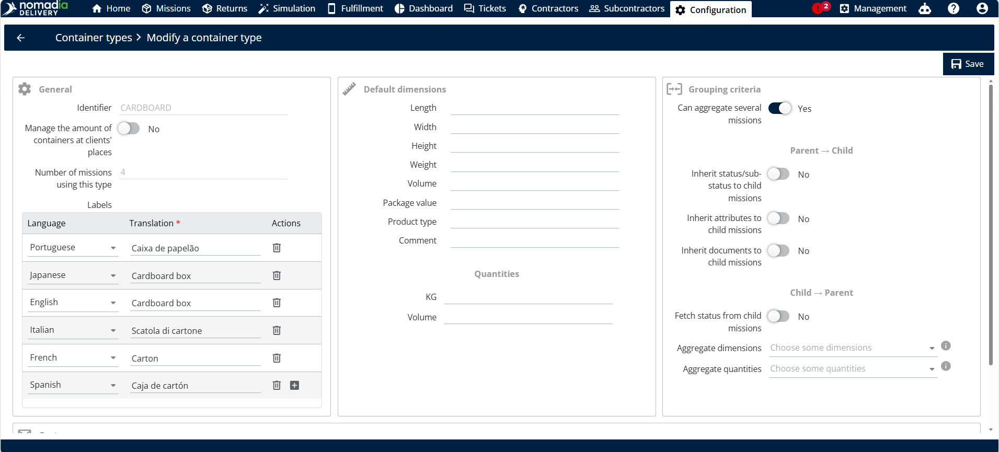

# Modifier un type de conteneur

Utilisez cette procédure pour modifier les paramètres d’un type de conteneur existant, comme les options qui contrôlent la manière dont le statut, les attributs et les documents sont hérités entre les missions parentes et enfants.

## Étapes

1. Ouvrez la page **Configuration**.
2. Dans la section **Livraison**, cliquez sur **Types de conteneurs**.
3. Cliquez sur l’icône en forme de crayon du type de conteneur choisi.
4. Modifiez les informations selon vos besoins.
5. Cliquez sur **Enregistrer**.

<figure><figcaption></figcaption></figure>

### Résultat

Le type de conteneur est mis à jour avec vos modifications.

## Rubriques associées

* [Héritage du parent vers l’enfant](parenttochildinheritance.md)
* [Héritage de l’enfant vers le parent](childtoparentinheritance.md)
