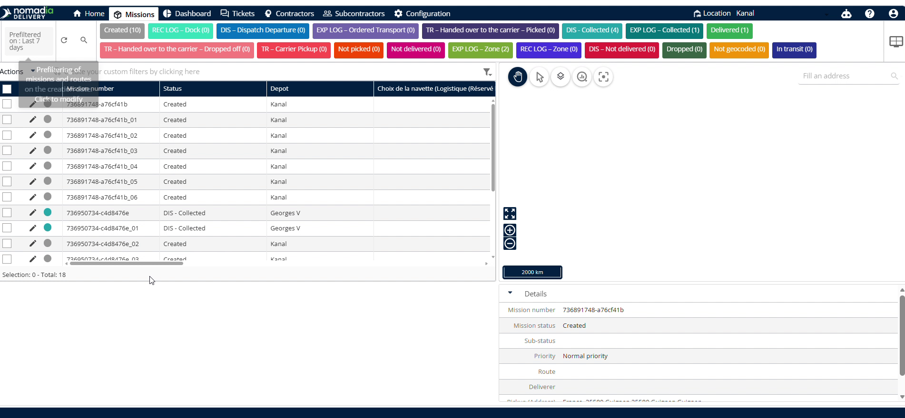
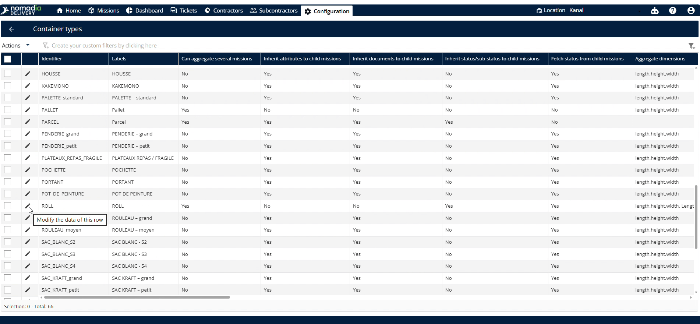
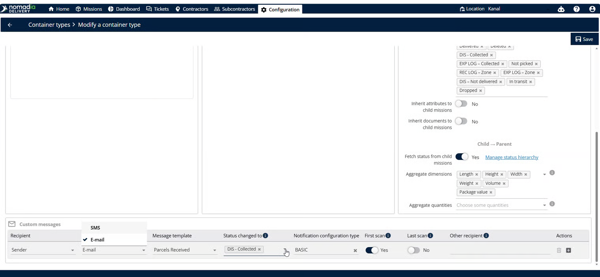
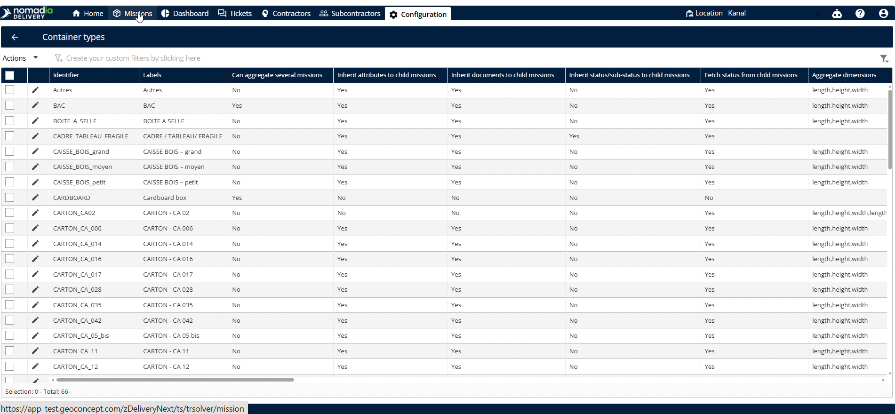
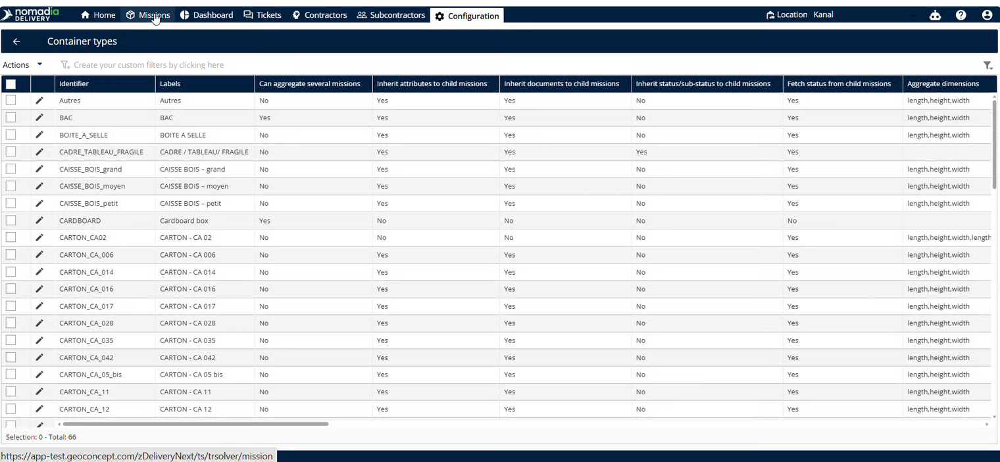
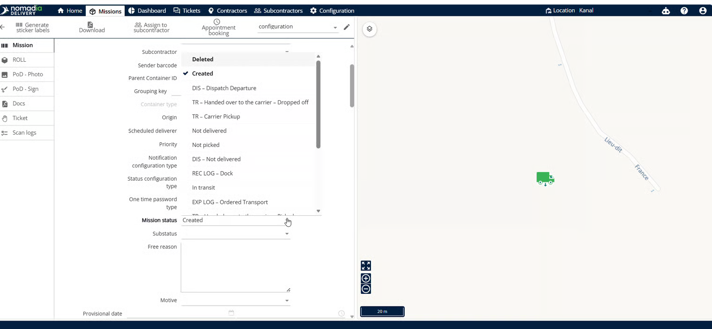
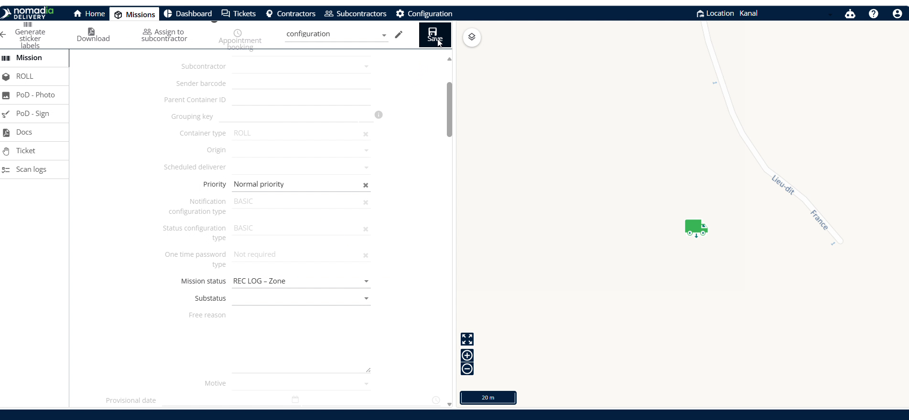
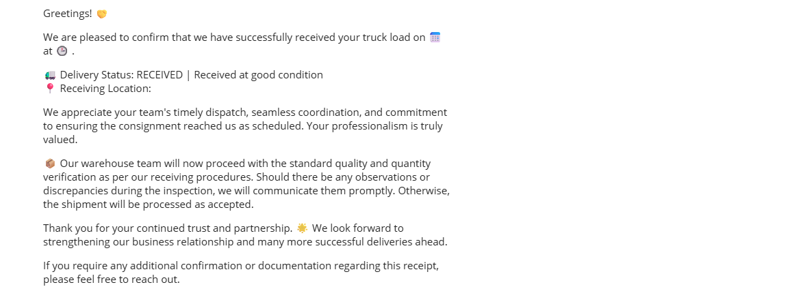

# Notifications groupées pour les missions de conteneur

Les notifications groupées pour les missions de conteneur regroupent les alertes de plusieurs missions simultanément. Les répartiteurs utilisent cette fonctionnalité pour simplifier les communications avec les sous-traitants ou d’autres destinataires pendant les missions. Cette configuration garantit l’envoi de mises à jour de statut automatisées et fiables directement aux parties prenantes, en fonction des étapes de scan.

## Avant de commencer

Pour utiliser cette fonctionnalité, assurez-vous que les exigences suivantes sont remplies :

* Activez ce paramètre pour que le parent hérite de son statut depuis ses éléments enfants.
* Assurez-vous qu’un sous-traitant est affecté à chaque mission.

Suivez ces étapes initiales pour accéder aux paramètres :

1. Ouvrez la page **Configuration**.

2. Sélectionnez **Types de conteneurs**.

3. Faites défiler la page vers le bas pour trouver le bon identifiant.

4. Activez l’interrupteur **Peut agréger plusieurs missions**, et assurez-vous que l’héritage du statut de l’enfant vers le parent est activé.

## Présentation de la fonctionnalité

* **Peut agréger plusieurs missions** : Transforme une mission en conteneur parent pouvant contenir plusieurs autres missions.
* **Messages client** : Section contenant les configurations des destinataires et des messages. Elle contrôle vos préférences de notification.
* **Destinataire** : Sélectionne le destinataire des notifications. Cela définit qui reçoit les alertes.
* **Type de message** : Sélectionne le canal de notification. Vous pouvez choisir SMS ou e-mail.
* **Modèle de message** : Sélectionne une mise en page de message préalablement créée. Elle met en forme le texte de votre notification.
* **Statut** : Champ permettant de sélectionner le statut cible qui déclenche le message. Cela définit la transition de statut.
* **Type de configuration de notification** : Sélectionnez le modèle correspondant au type de configuration de notification de la mission ou à son sous-traitant.
* **Autre e-mail du destinataire** : Champ de saisie permettant d’ajouter des adresses e-mail supplémentaires. Les notifications sont ainsi envoyées à d’autres parties prenantes.
* **Premier scan :** Déclenche le message lorsque la première mission du conteneur est scannée.
* **Dernier scan :** Déclenche le message lorsque la dernière mission du conteneur est scannée.

## Configurer les notifications groupées

1. Faites défiler la page vers le bas jusqu’à la section **Messages client**.

2. Sélectionnez un **Destinataire**.

3. Choisissez SMS ou e-mail dans **Type de message**.

<figure><figcaption></figcaption></figure>

4. Sélectionnez votre **Modèle de message** préalablement créé.
5. Choisissez le statut cible vers lequel basculer dans **Statut**.
6. Sélectionnez le **Type de configuration de notification**.
7. Saisissez les e-mails supplémentaires dans **Autre e-mail du destinataire**.

8. Cliquez sur **Enregistrer** pour terminer la configuration.

## Déclencher les notifications groupées

1. Ouvrez la page **Configuration** et cliquez sur **Types de conteneurs**.
2. Cliquez sur l’**icône en forme de crayon** située à côté de votre type de conteneur.

<figure><figcaption></figcaption></figure>

3. Changez le statut de **Créé** vers un autre statut.

<figure><figcaption></figcaption></figure>

4. Cliquez sur **Enregistrer** pour envoyer la notification.

### Résultat

Le sous-traitant reçoit l’e-mail de notification.

<figure><figcaption></figcaption></figure>

## Conseils


**Relations enfant-parent** : Le préparamétrage des relations enfant-parent garantit le bon fonctionnement des notifications groupées.



**Choix du moment du scan** : Le choix de l’envoi au premier ou au dernier scan optimise le moment de la notification en fonction des besoins du client.


## Rubriques connexes

* [Modifier un type de conteneur](edit-a-container-type.md)
* [Héritage de l’enfant vers le parent](childtoparentinheritance.md)
* [Modèles personnalisés](../manage-notifications/customtemplates.md)
