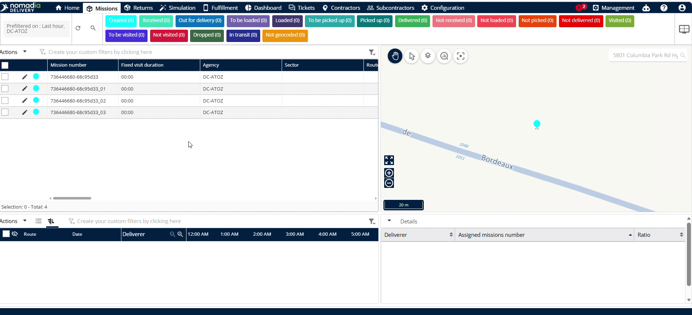
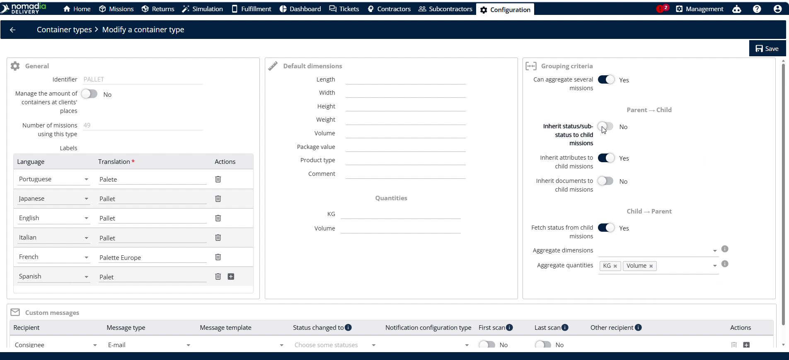
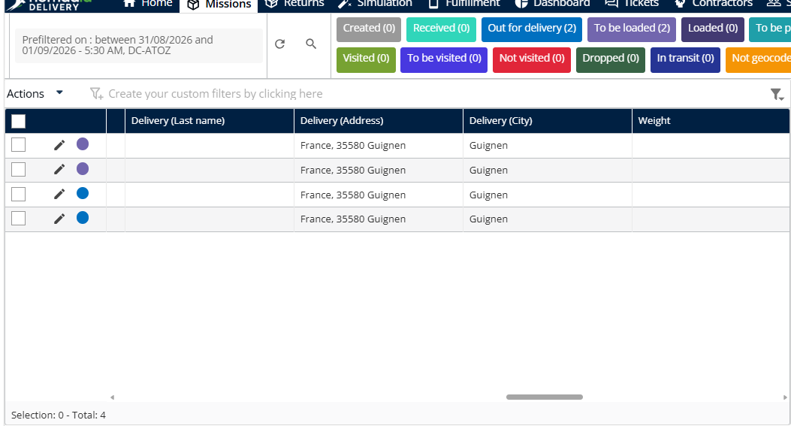
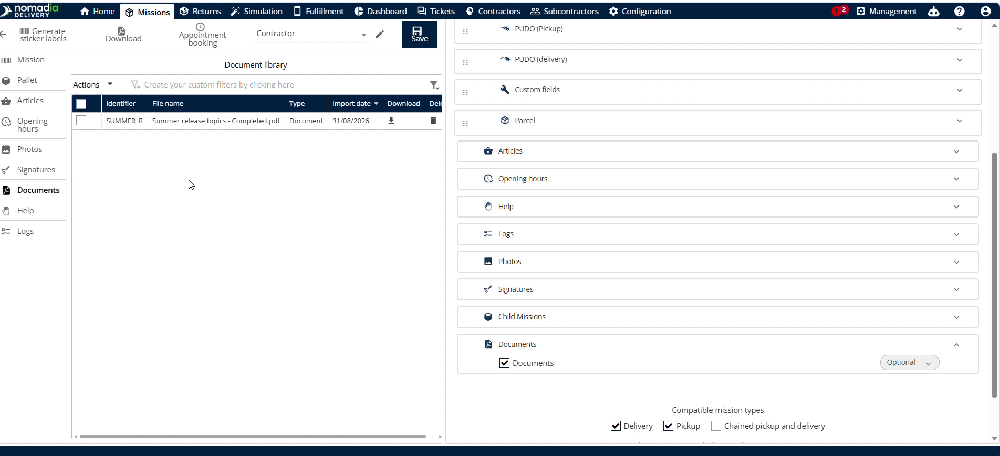
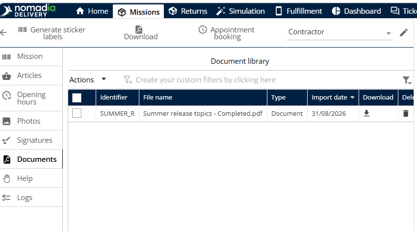

# Héritage du parent vers l’enfant

La fonctionnalité **Héritage du parent vers l’enfant** synchronise automatiquement les paramètres d’un conteneur parent vers ses conteneurs enfants. Vous n’avez ainsi plus besoin de mettre à jour manuellement chaque conteneur enfant. Activez-la pour gagner du temps et garantir la cohérence des données dans toute votre flotte.

## Avant de commencer

Prérequis et configuration système :

* Conteneurs parent et enfant configurés avec les identifiants corrects.

Étapes :

1. Ouvrez la page **Configuration**.
2. Cliquez sur **Types de conteneurs**.

## Aperçu de la fonctionnalité

* **Hériter du sous-statut vers les missions enfants :** ce bouton bascule transmet automatiquement le statut du conteneur parent aux conteneurs enfants.
* **Héritage des sous-statuts :** les sous-statuts peuvent être hérités par les conteneurs enfants de la même manière que les statuts.
* **Icônes Palette et Crayon :** l’icône palette ouvre les options de configuration d’un type de conteneur spécifique, et l’icône crayon ouvre le mode de configuration d’une mission.
* **Hériter des attributs vers les missions enfants :** ce paramètre copie automatiquement les informations du parent vers les conteneurs enfants.
* **Hériter des documents vers les missions enfants** : cette option partage automatiquement les documents du parent avec les conteneurs enfants.

## Hériter du statut et du sous-statut

1. Ouvrez la page **Configuration**.

2. Cliquez sur **Types de conteneurs**.
3. Faites défiler la page pour trouver l’identifiant correct.
4. Modifiez n’importe quel type de conteneur de la liste.
5. Réglez **Hériter du sous-statut vers les missions enfants** sur **Oui**.
6. Sélectionnez le statut à hériter, tel que **En cours de livraison** et **À charger**.

7. Cliquez sur le bouton **Enregistrer**.

8. Accédez à **Missions**.
9. Cliquez sur l’**icône crayon** à côté de la mission du conteneur parent.
10. Modifiez le **Statut de la mission** pour le statut configuré dans les types de conteneurs, tel que **En cours de livraison**.

11. Cliquez sur **Enregistrer**.

### Résultat

Le statut a été mis à jour pour toutes les missions enfants.

## Hériter des attributs vers les conteneurs enfants

1. Ouvrez la page **Configuration**.
2. Cliquez sur **Types de conteneurs**.
3. Activez **Hériter des attributs vers les missions enfants**.
4. Cliquez sur **Enregistrer**.

5. Accédez à **Missions**.
6. Cliquez sur le **conteneur parent**.
7. Corrigez l’**adresse** si elle est erronée.
8. Cliquez sur **Enregistrer**.

### Résultat

Seule l’adresse a été mise à jour pour toutes les missions enfants. Le statut n’est pas mis à jour lorsque les attributs sont hérités.

<figure><figcaption></figcaption></figure>

## Hériter des documents vers les conteneurs enfants

1. Ouvrez la page **Configuration**.
2. Cliquez sur **Types de conteneurs**.
3. Activez **Hériter des documents vers les missions enfants**.

4. Cliquez sur **Enregistrer**.

5. Accédez à **Missions**.
6. Cliquez sur le **conteneur parent**.

7. Cliquez sur **Parcourir l’ordinateur**.
8. Sélectionnez le fichier **PDF**.

9. Cliquez sur **Enregistrer** pour terminer le téléversement.

### Résultat

Le document apparaît dans le conteneur enfant.

<figure><figcaption></figcaption></figure>

## Conseils


**Synchronisation automatique** : la mise à jour du statut, du sous-statut, de l’adresse ou des documents du conteneur parent met automatiquement à jour les conteneurs enfants.


## Rubriques connexes

* [Héritage de l’enfant vers le parent](childtoparentinheritance.md)
* [Modifier un type de conteneur](edit-a-container-type.md)
* [Regrouper les notifications des missions de conteneur](groupnotificationsforthecontainermissions.md)
