# Suivre chaque conteneur par son identifiant unique

Le suivi des conteneurs vous permet de suivre chaque conteneur par son identifiant unique tout au long de son parcours. Vous enregistrez chaque conteneur une seule fois, vous le liez aux missions qui le transportent, et chaque scan, changement de statut et changement d’état est enregistré dans l’historique du conteneur. Les superviseurs disposent d’une vue en temps réel de l’ensemble du parc et peuvent retrouver rapidement les conteneurs perdus ou endommagés.

## Avant de commencer

* Connectez-vous à **Nomadia Delivery** avec un profil utilisateur ayant accès à **Configuration**.
* Ayez à disposition le code unique de chaque conteneur. Il s’agit du code imprimé sur le code-barres ou l’étiquette QR du conteneur.
* Assurez-vous que les types de conteneurs dont vous avez besoin existent. Voir [Gérer les types de conteneurs](README.md).

## Présentation de la fonctionnalité

* **Liste des contenants** : liste disponible dans **Configuration** qui affiche chaque conteneur enregistré avec son code, son type de conteneur, son coût, sa date d’achat, son état, son statut, sa dernière position connue, sa date de dernière détection, son état actif et son véhicule de rattachement.
* **Code** : code unique du conteneur, tel qu’imprimé sur son code-barres ou son étiquette QR.
* **Enregistré dans l’historique à la sauvegarde** : l’**État** (par exemple **Bon** ou **Endommagé**) et le **Statut** (par exemple **Reçu**, **À collecter** ou **Perdu**) du conteneur. Ils sont inscrits dans l’historique du conteneur dès que vous enregistrez.
* **Maintien dans le véhicule** : lorsque cette option est activée, le statut ne peut être modifié que manuellement (**Reçu** ou **Perdu**), et les changements de statut déclenchés par les missions sont ignorés.
* **Véhicule porteur** et **Dernière position connue** : champs en lecture seule mis à jour depuis le terrain lorsque les chauffeurs scannent le conteneur.
* **Conteneur suivi** : champ du formulaire de mission qui lie la mission à un conteneur enregistré. Le champ **Code conteneur à scanner** situé au-dessus est un texte libre et n’est pas vérifié par rapport au registre.
* **Historique** : section d’un conteneur qui répertorie chaque événement de sa vie, avec ce qui a changé, qui l’a enregistré et quand.

## Enregistrer un conteneur

1. Dans **Configuration**, ouvrez la **Liste des contenants**. Elle affiche chaque conteneur enregistré.

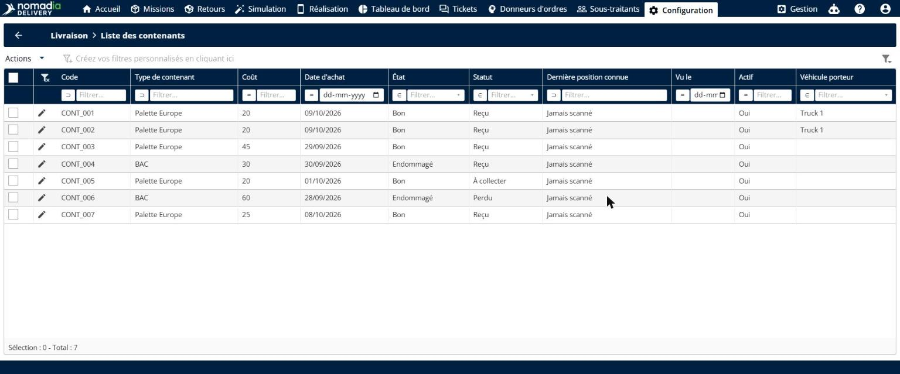

2. Cliquez sur **Actions**, puis sur **Ajouter**.

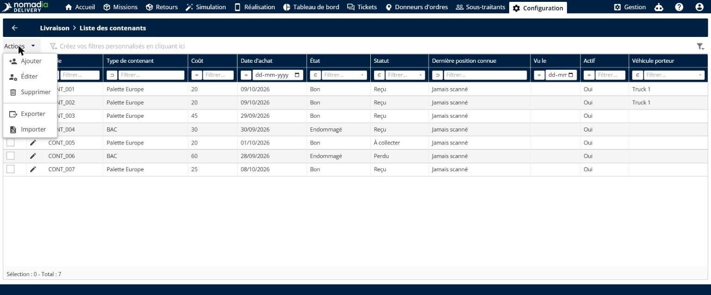

3. Saisissez le **Code** unique du conteneur, celui imprimé sur son code-barres ou son étiquette QR, puis choisissez le **Type de contenant**.

4. Saisissez le **Coût** et la **Date d’achat**, puis choisissez l’**État** et le **Statut** sous **Enregistré dans l’historique à la sauvegarde**.

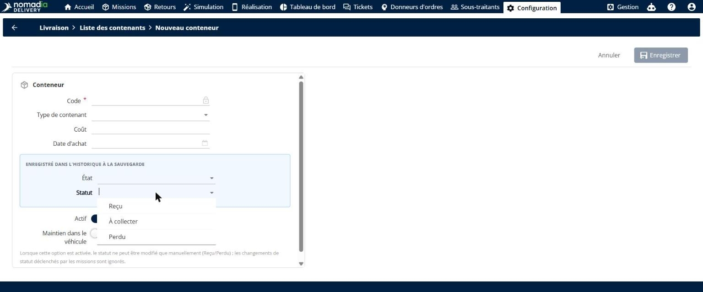

5. Cliquez sur **Enregistrer**.

### Résultat

Une notification confirme que le conteneur a été ajouté. Le conteneur apparaît dans la **Liste des contenants**, prêt à être suivi, et son état et son statut sont inscrits dans son historique.

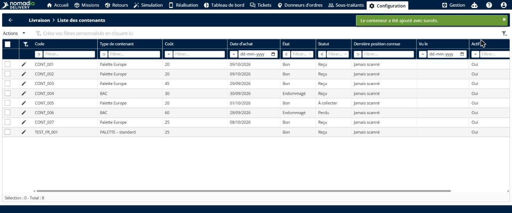

## Affecter un conteneur à une mission

1. Ouvrez le formulaire de mission et repérez le champ **Conteneur suivi**.

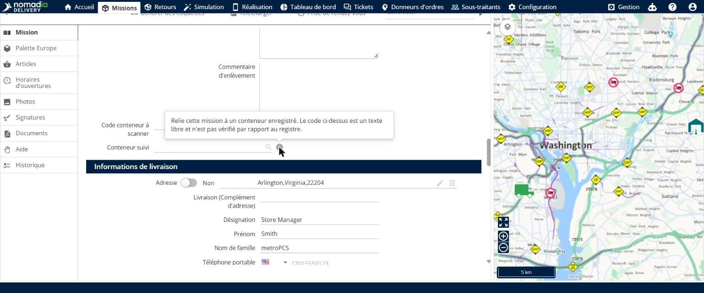

2. Scannez ou saisissez le code du conteneur. Les conteneurs correspondants s’affichent avec leur type et leur état, ce qui permet de repérer facilement un conteneur endommagé.

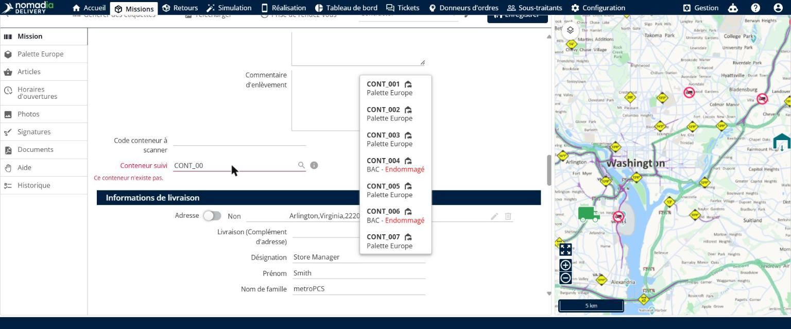

3. Sélectionnez le conteneur, puis enregistrez la mission.

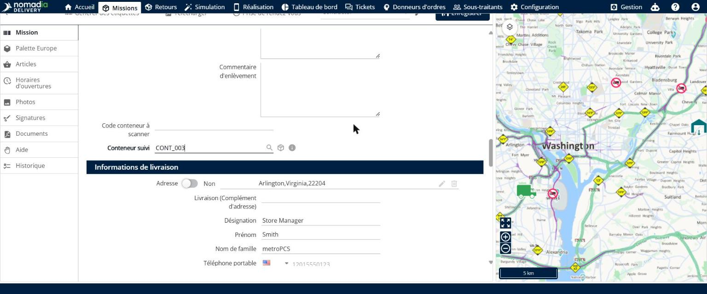

### Résultat

Le lien est enregistré immédiatement. L’**Historique** du conteneur affiche la mission, l’auteur de la modification et la date.

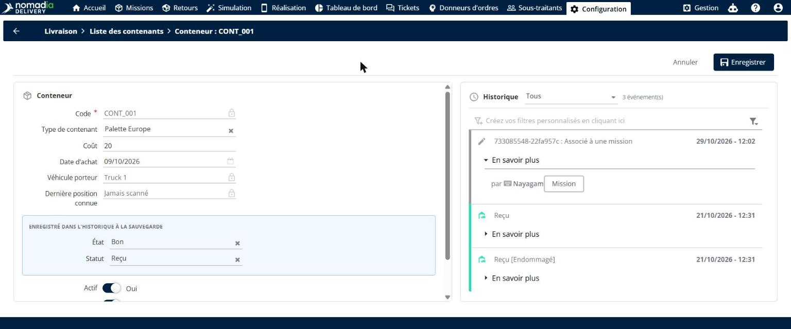

## Consulter l’historique d’un conteneur

1. Dans la **Liste des contenants**, cliquez sur l’**icône crayon** à côté d’un conteneur pour l’ouvrir.

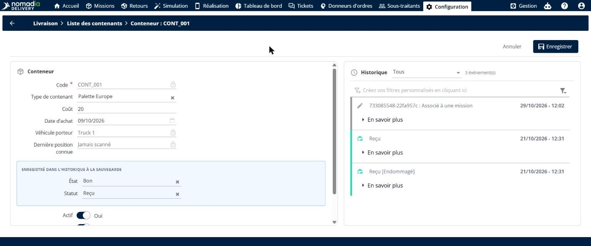

2. Consultez les champs **Véhicule porteur** et **Dernière position connue** pour savoir où se trouve le conteneur en ce moment. Ils sont mis à jour depuis le terrain.
3. Consultez le panneau **Historique**, à droite. Si besoin, choisissez une période plus longue dans la liste, par exemple **Tous**. Le panneau répertorie chaque événement de la vie du conteneur. Chaque scan du chauffeur, à la réception, à la livraison et au retrait, y est ajouté automatiquement.

4. Cliquez sur **En savoir plus** sur un événement pour voir exactement ce qui a changé, l’utilisateur qui l’a enregistré et l’horodatage.

## Superviser le parc de conteneurs

1. Dans la **Liste des contenants**, consultez les colonnes **Statut**, **Dernière position connue**, **Vu le** et **Véhicule porteur**. Elles offrent une vue en temps réel de l’ensemble du parc.

2. Pour retrouver un conteneur manquant, ouvrez le filtre de la colonne **Statut** et choisissez **Perdu**.

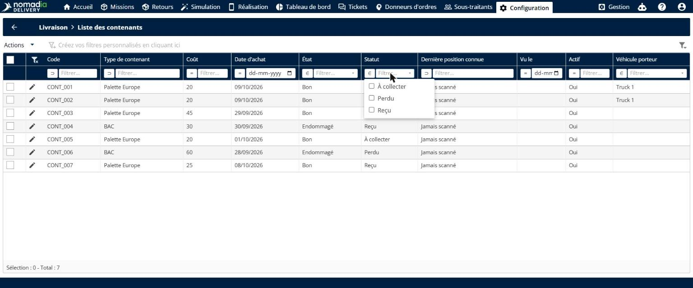

La liste affiche uniquement les conteneurs perdus, avec leur historique complet à portée de clic.

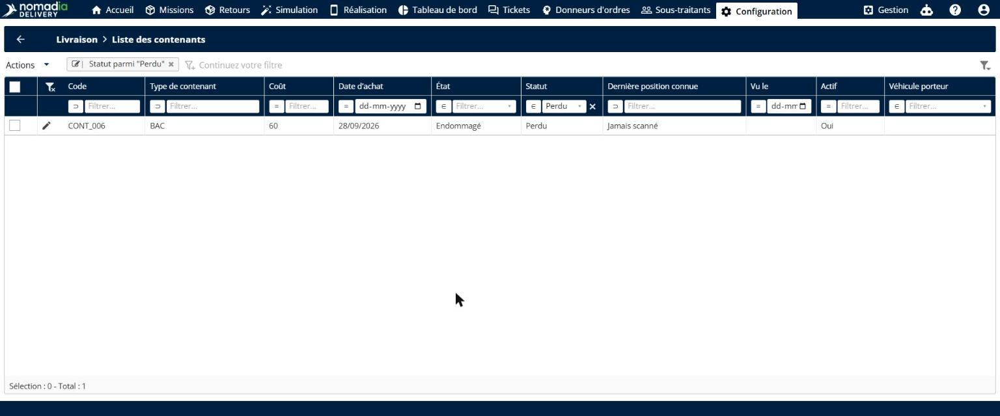

3. Pour lister tous les conteneurs endommagés qui nécessitent une intervention, filtrez la colonne **État** sur **Endommagé**.

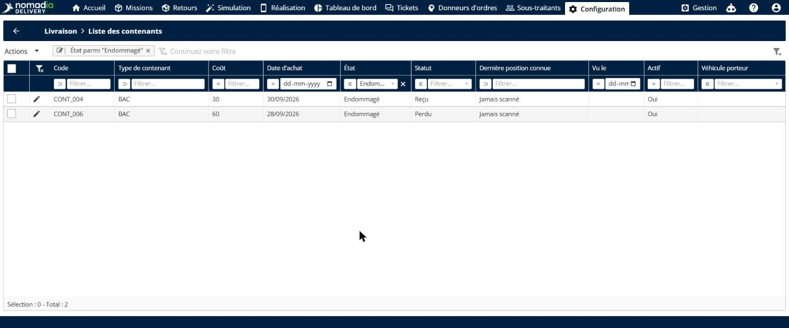

## Conseils


**Utilisez le champ Conteneur suivi** : seul le champ **Conteneur suivi** lie une mission à un conteneur enregistré. Le champ **Code conteneur à scanner** est un texte libre et n’est pas vérifié par rapport au registre.


## Rubriques connexes

* [Gérer les types de conteneurs](README.md)
* [Ajout d’une mission](../missions/adding-a-mission.md)
* [Missions enfants de conteneur](container-child-missions.md)
