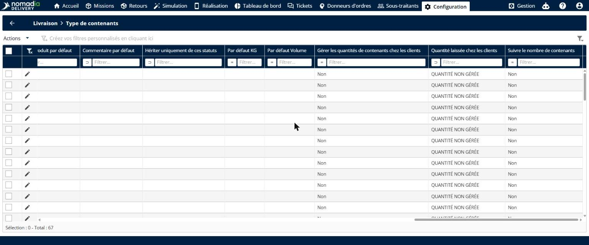
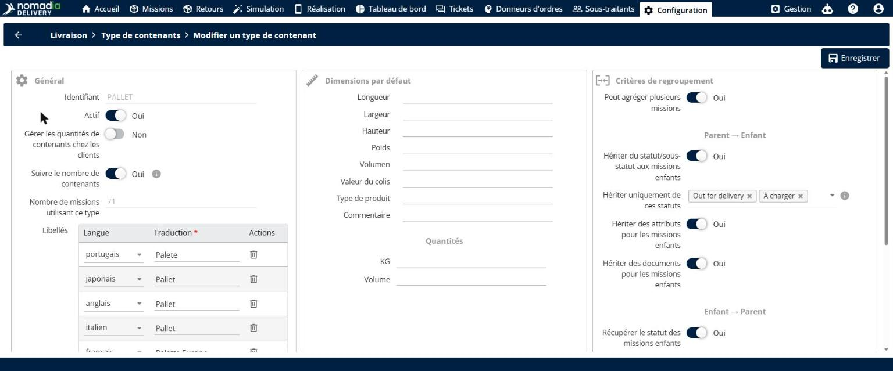
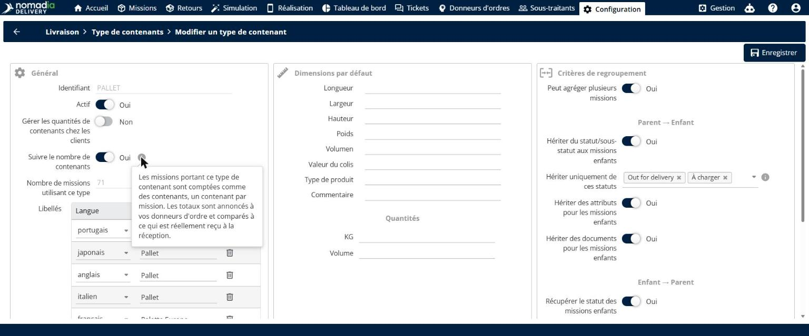
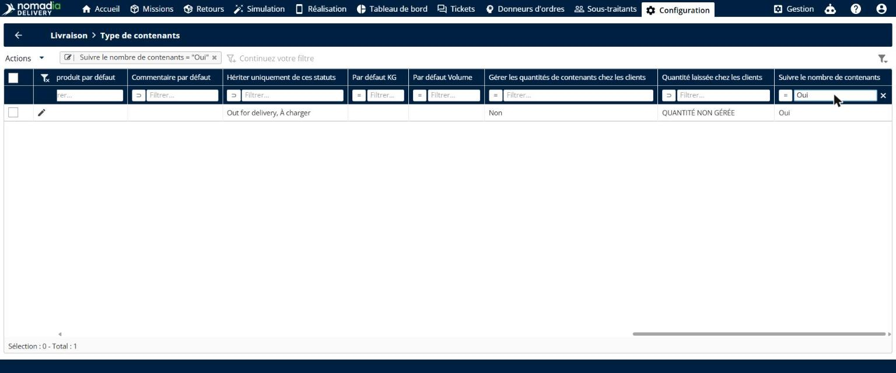
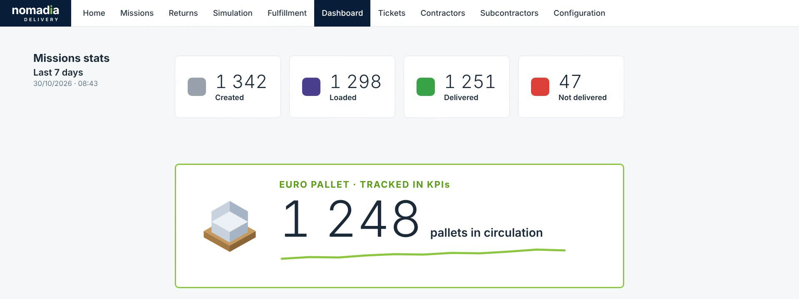
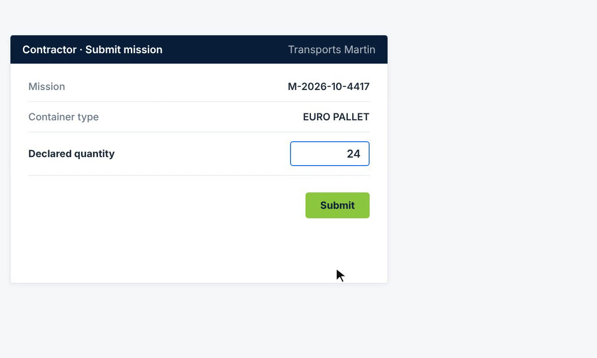
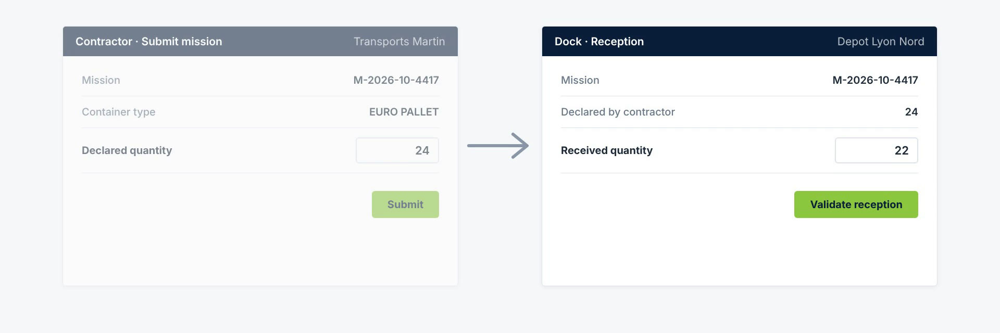
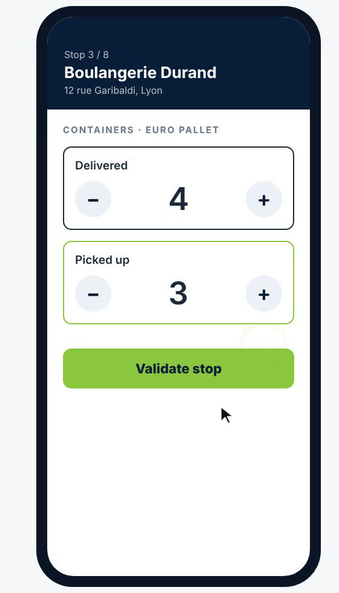
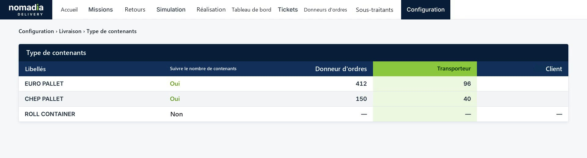
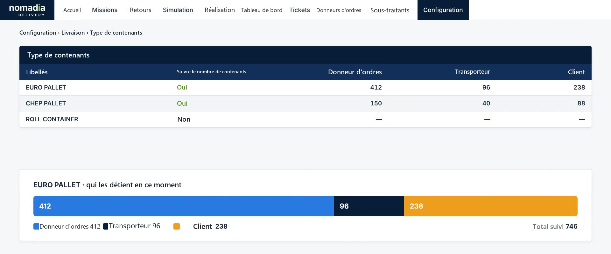

# Suivre le nombre de palettes tout au long du cycle de livraison

Le suivi des palettes vous permet de suivre le nombre de palettes d’un type de conteneur tout au long du cycle de livraison. Le donneur d’ordres déclare une quantité, le quai enregistre ce qu’il reçoit, le chauffeur enregistre les palettes livrées et reprises chez chaque client, et le client détient les palettes entre-temps. Nomadia Delivery compare les quantités à chaque étape : vous repérez les pertes au plus tôt et savez toujours qui détient vos contenants.

## Avant de commencer

* Connectez-vous à **Nomadia Delivery** avec un profil utilisateur ayant accès à **Configuration** et au **Tableau de bord**.
* Assurez-vous que les types de conteneurs que vous souhaitez suivre existent, par exemple **EURO PALLET** ou **CHEP PALLET**. Voir [Gérer les types de conteneurs](README.md).

## Présentation de la fonctionnalité

* **Suivre le nombre de contenants** : option du type de conteneur. Lorsqu’elle est activée, le nombre de palettes de ce type de conteneur est suivi tout au long du cycle de livraison et affiché dans un KPI dédié du tableau de bord.
* **KPI dédié aux palettes** : vignette du **Tableau de bord** qui affiche le nombre de palettes en circulation pour un type de conteneur suivi, avec son évolution.
* **Déclaré / reçu** : le donneur d’ordres déclare la quantité envoyée avec la mission. Le quai saisit la quantité réellement reçue. Tout écart apparaît dans le **Rapport de réception**, qui est envoyé au donneur d’ordres.
* **Saisie par le chauffeur** : dans l’application mobile, le chauffeur enregistre à chaque arrêt le nombre de palettes **Livrées** au client et **Reprises** (retours).
* **Champs de détention** : colonnes **Donneur d’ordres**, **Transporteur** et **Client** de la liste des types de conteneurs. Elles indiquent combien de palettes de chaque type suivi chaque partie détient en ce moment.

## Activer le suivi des palettes pour un type de conteneur

1. Allez dans **Configuration** > **Livraison** > **Type de contenants**. La liste affiche chaque type de conteneur avec sa colonne **Suivre le nombre de contenants**.

2. Cliquez sur l’**icône crayon** du type de conteneur à suivre, par exemple **Palette Europe**. La page **Modifier un type de contenant** s’ouvre.

3. Dans la section **Général**, activez **Suivre le nombre de contenants**. Survolez l’icône d’information : les missions portant ce type de contenant sont comptées comme des contenants, un contenant par mission, et les totaux sont annoncés à vos donneurs d’ordres et comparés à ce qui est réellement reçu à la réception.

4. Cliquez sur **Enregistrer**.

### Résultat

Dans la liste **Type de contenants**, la colonne **Suivre le nombre de contenants** affiche **Oui** pour le type de conteneur. Répétez ces étapes pour chaque type de conteneur à suivre, par exemple **CHEP PALLET**.

## Suivre le KPI des palettes sur le tableau de bord

1. Ouvrez le **Tableau de bord**.
2. Sous les **Statistiques des missions**, repérez le KPI dédié de chaque type de conteneur suivi. Il affiche le nombre de **palettes en circulation** et une courbe d’évolution.

## Comparer les quantités déclarées et reçues

1. Lorsque le donneur d’ordres soumet une mission, il saisit la **Quantité déclarée** du type de conteneur suivi, puis clique sur **Soumettre**.

2. À la réception, le quai voit la quantité **Déclarée par le donneur d’ordres**. Le quai saisit la **Quantité reçue**, puis clique sur **Valider la réception**.

### Résultat

Un **Rapport de réception** est créé pour la mission et envoyé au donneur d’ordres. Il affiche les valeurs **Déclaré**, **Reçu** et **Écart** pour chaque type de conteneur. Un écart est mis en évidence en rouge : une perte est ainsi détectée au quai, et non des semaines plus tard.

## Enregistrer les palettes à chaque arrêt dans l’application mobile

1. À un arrêt, le chauffeur ouvre la section **Contenants** du type de conteneur suivi.
2. Le chauffeur utilise les boutons **+** et **–** pour indiquer le nombre de palettes **Livrées** au client et **Reprises** chez le client.
3. Le chauffeur appuie sur **Valider l’arrêt**.

### Résultat

Les quantités livrées et reprises mettent à jour la détention des palettes : les palettes livrées passent au client, et les palettes reprises reviennent au transporteur.

## Savoir qui détient vos palettes

1. Allez dans **Configuration** > **Livraison** > **Type de contenants**.
2. Consultez les colonnes **Donneur d’ordres**, **Transporteur** et **Client**. Pour chaque type de conteneur suivi, elles indiquent combien de palettes chaque partie détient en ce moment. Les types de conteneurs non suivis affichent un tiret.

3. Consultez la barre de répartition sous la liste. Pour un type de conteneur suivi, elle indique qui détient les palettes en ce moment, ainsi que le **Total suivi**.

## Conseils


**Ne suivez que l’essentiel** : activez **Suivre le nombre de contenants** uniquement pour les types de conteneurs que vous souhaitez suivre, comme les palettes consignées. Les autres types fonctionnent comme avant et affichent un tiret dans les champs de détention.



**Traitez les écarts rapidement** : le rapport de réception est envoyé au donneur d’ordres dès que le quai valide la réception. Vous pouvez ainsi régler une palette manquante avec le donneur d’ordres tant que la mission est récente.


## Rubriques connexes

* [Gérer les types de conteneurs](README.md)
* [Modifier un type de conteneur](edit-a-container-type.md)
* [Suivre chaque conteneur par son identifiant unique](track-individual-containers-by-unique-id.md)
