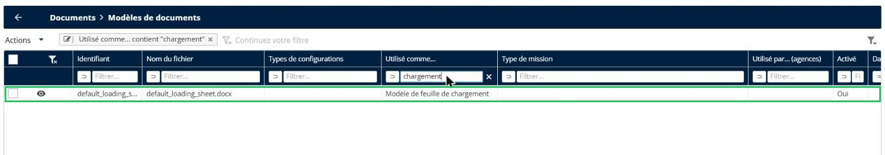
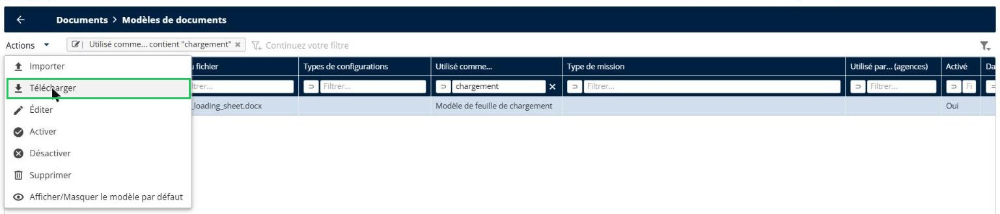

# Agrégation des articles dans les feuilles de chargement

**L’agrégation des articles dans les feuilles de chargement** permet aux feuilles de chargement des tournées d’afficher la quantité prévue de chaque article pour chaque mission, ainsi que son total pour toute la tournée. Les livreurs ne vérifient plus les missions une par une en additionnant les quantités à la main, ce qui prend du temps et provoque des erreurs de chargement. Ils chargent le véhicule correctement en un seul passage.

## Avant de commencer

* Connectez-vous à **Nomadia Delivery** avec un profil utilisateur ayant accès à l’onglet **Configuration**.
* Sachez télécharger, modifier et importer un modèle Word. Pour plus d’informations, consultez [Personnalisation des modèles Word](customizing-word-templates.md).
* Connaissez les codes des articles à afficher sur la feuille de chargement. Pour plus d’informations, consultez [Gérer les articles](../manage-articles/README.md).

## Présentation de la fonctionnalité

* **Champ article de mission** : un champ que vous ajoutez à un modèle de feuille de chargement avec un code article. Pour chaque mission de la tournée, il renvoie la quantité prévue de cet article.
* **Total article de la tournée** : un champ qui additionne les quantités prévues d’un article sur les missions de la tournée et imprime un total par article pour la tournée.
* **Plusieurs articles par mission** : lorsqu’une mission transporte plusieurs articles, chaque article a sa propre quantité prévue, et chaque quantité compte dans son propre total de tournée.
* **Missions prises en compte** : les missions de livraison et de drop shipping sont comptées. Les missions de collecte et les points de passage restent sur la feuille, mais ne sont pas inclus dans les totaux.
* **Article non transporté** : si aucune mission de la feuille ne transporte le code article, le champ renvoie **0** au niveau de la mission et de la tournée, sans erreur.
* **Plusieurs tournées** : lorsque vous imprimez les feuilles de chargement de plusieurs tournées à la fois, chaque feuille n’affiche que les totaux de sa propre tournée. Rien n’est reporté d’une tournée à l’autre.
* **Aucun changement pour les feuilles existantes** : la feuille de chargement par défaut, et tout modèle personnalisé qui n’utilise pas les nouveaux champs, s’affichent exactement comme avant.

Retrouvez le nom exact des nouveaux champs dans le document **FieldsMaster\_DocumentTemplate**, qui liste tous les champs utilisables dans un modèle.

## Ajouter les quantités d’articles à un modèle de feuille de chargement

1. Accédez à l’onglet **Configuration**. Sous **Documents**, cliquez sur **Modèles de documents**.
2. Sélectionnez votre modèle de feuille de chargement. Pour partir du modèle intégré, cliquez sur **Actions** > **Afficher/Masquer le modèle par défaut**, puis filtrez **Utilisé comme...** sur **Modèle de feuille de chargement**.

3. Cliquez sur **Actions** > **Télécharger**.

4. Ouvrez le modèle téléchargé dans Microsoft Word.
5. Dans le tableau des missions, insérez le **champ article de mission** avec le code article, par exemple **WAT-06**, dans la colonne où la quantité de l’article doit être imprimée. Ajoutez une colonne par article.
6. Dans la ligne de total du tableau, insérez le champ **total article de la tournée** avec le même code article.

   Pour savoir comment insérer un champ de fusion, consultez [Personnalisation des modèles Word](customizing-word-templates.md).
7. Enregistrez le modèle, puis importez-le dans **Modèles de documents** avec **Actions** > **Importer**.
8. Vérifiez que **Utilisé comme...** est **Modèle de feuille de chargement**, puis cliquez sur **Enregistrer**.
9. Activez le modèle avec **Actions** > **Activer**.

### Résultat

Les prochaines feuilles de chargement générées à partir de ce modèle affichent la quantité prévue de chaque article pour chaque mission, ainsi que le total de chaque article pour la tournée. Par exemple, si trois missions transportent 12, 8 et 20 unités de **WAT-06**, le total de la tournée est de **40**.

## Imprimer la feuille de chargement

1. Sélectionnez une ou plusieurs tournées.
2. Cliquez sur **Feuille de chargement** pour générer le document. Pour plus d’informations, consultez [Éditeur d’itinéraire](../routes/routeeditor.md).

### Résultat

Chaque feuille de chargement affiche les quantités et les totaux d’articles de sa propre tournée. Le livreur charge le véhicule en un seul passage.

## Conseils


**Une colonne par article** : ajoutez une colonne pour chaque article que vos livreurs chargent le plus souvent, afin que tout le chargement soit visible sur une seule feuille.



**Vérifiez les totaux une fois** : après l’import du modèle, imprimez la feuille de chargement d’une tournée que vous connaissez et comparez les totaux avec les missions.



**Insérez des champs de fusion, pas du texte brut** : un champ saisi en texte brut n’est pas remplacé lors de la génération du PDF. Insérez-le comme champ de fusion.


## Rubriques connexes

* [Gérer les modèles de documents](README.md)
* [Personnalisation des modèles Word](customizing-word-templates.md)
* [Ajouter des articles à une mission](../manage-articles/add-articles-to-mission.md)
* [Éditeur d’itinéraire](../routes/routeeditor.md)
