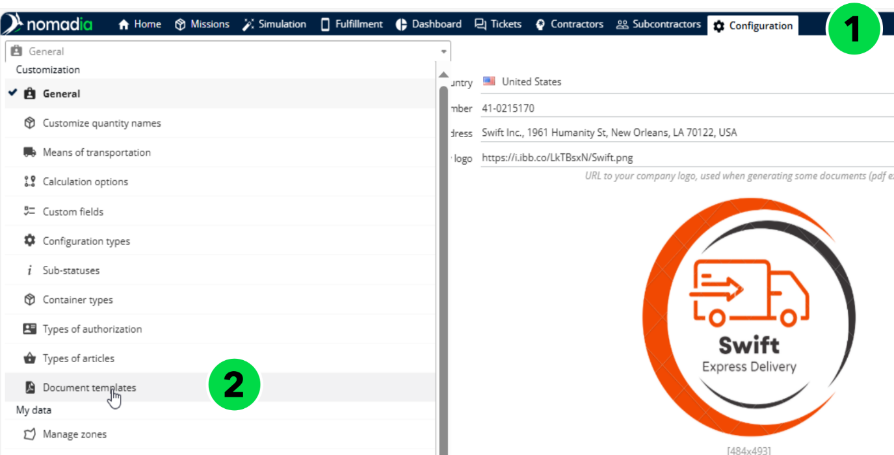

# Personnalisation des modèles Word

Ce guide fournit des instructions étape par étape pour personnaliser votre modèle Word utilisé dans la fonctionnalité d’export PDF, vous permettant de télécharger des documents liés à la livraison tels que les feuilles de tournée, les feuilles de chargement, les eCMR, les rapports de mission, les feuilles d’autocollants et les rapports de visite.

## Avant de commencer

Ouvrez la liste des modèles de documents.

1. Ouvrez l’application Nomadia Delivery et accédez à l’onglet **Configuration**.
2. Dans le menu déroulant, sélectionnez **Modèles de documents**.

La page affiche tous les modèles par défaut que Nomadia Delivery utilise pour générer des PDF, notamment les feuilles de tournée, les feuilles de chargement, les eCMR, les rapports de mission, les feuilles d’autocollants et les rapports de visite.

.png>)

Les modèles par défaut de Nomadia Delivery sont activés par défaut et ne peuvent ni être désactivés, ni modifiés, ni supprimés. Toutefois, si vous souhaitez personnaliser un modèle, vous pouvez télécharger l’existant et apporter les modifications nécessaires afin qu’il réponde à vos besoins.

## Présentation de la fonctionnalité

* **Modèles de documents** : la page **Configuration** qui liste les modèles par défaut utilisés pour générer des PDF, tels que les feuilles de tournée, les feuilles de chargement, les eCMR, les rapports de mission, les feuilles d’autocollants et les rapports de visite.
* **FieldsMaster\_DocumentTemplate** : le document d’accompagnement qui répertorie tous les champs disponibles pouvant être utilisés dans un modèle.
* **Champ fusionné** : un champ inséré sous forme de champ de fusion plutôt qu’en texte brut, ce qui évite des problèmes lors de la génération du PDF.
* Menu **Actions** : vous permet de télécharger, d’importer, d’activer ou de désactiver et de supprimer des modèles.
* **Types de configuration** : affectation automatique basée sur des règles des types de sous-statut et de notification en fonction des paramètres de mission.

## Télécharger un modèle existant

1. Sélectionnez le ou les **modèles** que vous souhaitez télécharger.

.png>)

2. Ouvrez le menu **Actions** et choisissez **Télécharger**.

.png>)

3. Ouvrez le fichier ZIP généré, qui contient tous les modèles sélectionnés.

.png>)

## Modifier un modèle existant

1. Ouvrez le modèle téléchargé dans Microsoft Word.

.png>)

2. Référez-vous au document d’accompagnement FieldsMaster\_DocumentTemplate, qui répertorie tous les champs disponibles pouvant être utilisés dans le modèle.
3. Personnalisez le modèle pour répondre à vos besoins en ajoutant ou en supprimant des champs du document maître des champs selon les besoins. Lors de l’ajout de champs, veillez à les insérer sous forme de champs fusionnés plutôt qu’en texte brut afin d’éviter des problèmes lors de la génération du PDF. Les champs fusionnés (par ex., «${ (contractor.name)!}») sont mis en évidence par un fond gris lorsqu’ils sont sélectionnés, alors que les champs en texte brut ne le sont pas.

<table data-header-hidden><thead><tr><th valign="top"></th><th valign="top"></th></tr></thead><tbody><tr><td valign="top">Texte brut</td><td valign="top">Champ fusionné</td></tr><tr><td valign="top">${(contractor.name)!}</td><td valign="top">«${(contractor.name)!}»</td></tr></tbody></table>

## Convertir du texte brut en champ de fusion

1. Copiez le texte brut du champ, par exemple : ${(contractor.name)!}.
2. Allez à **Insertion → Quick Parts → Champ**.

.png>)

3. Dans la liste déroulante **Catégories**, sélectionnez **Fusion de courrier**, puis choisissez **Champ de fusion** sous **Noms de champs**.
4. Collez le **nom du champ** que vous avez copié dans la zone de texte **Nom du champ** et cliquez sur **OK**.

### Résultat

Le texte brut est converti en champ de fusion, apparaissant sous la forme : «${(contractor.name)!}»

.png>)

## Activer un nouveau modèle

1. Une fois le nouveau modèle prêt, rendez-vous dans la section Modèles de documents pour le téléverser.
2. Allez dans le module Configuration et sélectionnez **Modèles de documents** dans le menu.
3. Cliquez sur le menu **Actions** et choisissez **Importer**.

.png>)

4. Parcourez votre ordinateur et sélectionnez le **modèle** que vous venez de créer.

.png>)

5. Si nécessaire, mettez à jour l’identifiant ou le nom du fichier.

.png>)

6. Choisissez le **type de modèle** dans le menu déroulant (par exemple, modèle de bon de livraison).

.png>)

7. Sélectionnez l’**agence** ou les agences où le modèle doit être disponible (par exemple, Louisiane).

.png>)

8. Cliquez sur **Enregistrer** pour téléverser le modèle.

.png>)

Le modèle nouvellement téléversé apparaît dans le tableau des modèles.

.png>)

Par défaut, les nouveaux modèles sont désactivés. Pour activer le modèle :

9. Sélectionnez le modèle téléversé et cliquez sur le menu **Actions**.
10. Choisissez **Activer/Désactiver** pour activer le modèle.

.png>)

### Résultat

Une notification confirme que le modèle a été mis à jour avec succès, et la colonne **Activé** affiche Oui.

.png>)

## Générer un PDF à l’aide du nouveau modèle activé

1. Accédez à l’onglet **Missions** et sélectionnez un itinéraire qui a été publié sur le livreur mobile.

.png>)

2. Cliquez sur le menu **Actions** et choisissez **Bon de livraison**.

.png>)

3. Cliquez sur le bouton **Télécharger** pour télécharger le bon de livraison.

.png>)

### Résultat

Le PDF téléchargé est généré à l’aide du nouveau modèle activé.

.png>)

## Supprimer un modèle

1. Ouvrez l’application Nomadia Delivery et accédez à l’onglet **Configuration**.
2. Dans le menu déroulant, sélectionnez **Modèles de documents**.

3. Dans le tableau, choisissez n’importe quel modèle non par défaut, puis cliquez sur le menu **Actions**.
4. Sélectionnez **Supprimer** pour retirer le modèle.

.png>)

5. Confirmez la suppression en cliquant sur **Oui**.

.png>)

### Résultat

Le modèle sélectionné est définitivement supprimé de l’application.

.png>)

## Modifier les paramètres du modèle

Les paramètres du modèle incluent le type de document auquel le modèle est associé — tel que Feuille de tournée, Feuille de chargement, Feuille d’autocollants, Bon de livraison, Rapport de visite ou Rapport de mission — ainsi que les agences pour lesquelles le modèle est disponible.

1. Cliquez sur le bouton **Modifier** à côté du nom du modèle.

.png>)

2. Mettez à jour le type de document et les agences associées au modèle.

.png>)

3. Cliquez sur **Enregistrer** pour appliquer et enregistrer les paramètres mis à jour.

.png>)

## Type de configuration personnalisé

Nomadia Delivery propose une affectation automatique basée sur des règles pour les types de configuration — couvrant à la fois le sous-statut et la notification — en fonction des paramètres de mission. Cette amélioration permet aux planificateurs de personnaliser le cycle de livraison selon les besoins opérationnels, d’automatiser les décisions récurrentes et de maintenir des workflows cohérents entre différents types de mission.

* **Type de configuration du sous-statut** : définit les étapes intermédiaires ou les conditions au sein du cycle de vie d’une mission. Alors qu’ils étaient auparavant limités à BASIC, INTERMEDIATE et ADVANCED, les planificateurs peuvent désormais créer un nombre illimité de types de sous-statut personnalisés, adaptés à des processus métier spécifiques.
* **Type de configuration de notification** : détermine comment et quand les clients sont informés pendant le cycle de vie de la mission. Au lieu de s’appuyer sur un seul modèle, les planificateurs peuvent désormais configurer plusieurs modèles de notification pour répondre à différents scénarios.

Les deux types de configuration peuvent être affectés automatiquement en fonction des attributs de la mission, tels que le type de client ou la valeur du colis.

## Configurer le type

1. Ouvrez l’application Nomadia Delivery et accédez à l’onglet **Configuration**.
2. Dans la liste déroulante, sélectionnez **Types de configuration**.
3. Utilisez les trois types de configuration que Nomadia Delivery fournit par défaut (BASIC, INTERMEDIATE et ADVANCED), ou créez-en un nouveau à partir de zéro.
4. Pour modifier un type de configuration existant, cliquez sur l’icône crayon à côté de celui-ci.

.png>)

5. Dans l’onglet **Général**, activez les interrupteurs en fonction de vos besoins :
   * Activez les deux interrupteurs si le type de configuration doit s’appliquer au sous-statut et à la notification.
   * Activez-les ou désactivez-les individuellement si vous souhaitez des configurations séparées pour le sous-statut et la notification.
6. Définissez des règles d’affectation automatique afin que les types de configuration soient appliqués sans intervention manuelle. Ces règles sont basées sur les champs de l’objet mission :
   * Si une condition est remplie, le type de configuration est automatiquement appliqué au sous-statut et/ou à la notification.
   * Plusieurs conditions peuvent être définies, et vous pouvez choisir si toutes les conditions doivent être remplies ou si une seule suffit en activant l’interrupteur **Suivre toutes les règles**.
7. Si plusieurs types de configuration répondent aux conditions, le système attribue celui ayant la priorité la plus élevée (1 étant la plus élevée).

.png>)

8. Utilisez le tableau ci-dessous pour voir comment différents types de configuration, conditions et règles influencent l’affectation automatique des valeurs dans l’objet mission.

<table data-header-hidden><thead><tr><th valign="top"></th><th valign="top"></th><th valign="top"></th><th valign="top"></th></tr></thead><tbody><tr><td valign="top">
Type de

configuration
</td><td valign="top">
Applicable

à
</td><td valign="top">Règles</td><td valign="top">
Affectation automatique sur

l’objet mission
</td></tr><tr><td valign="top">BASIC</td><td valign="top">Sous-statut et notification</td><td valign="top">
Valeur du colis &#x3C; 49 €

Priorité = 4

Suivre toutes les règles = NON
</td><td valign="top">
Si la valeur du colis

de la mission = 39 €

Type de configuration du statut = BASIC

Type de configuration de notification =

BASIC
</td></tr><tr><td valign="top">INTERMEDIATE</td><td valign="top">Sous-statut et notification</td><td valign="top">
Valeur du colis &#x3C; 100 € Valeur du colis > 50 € Priorité = 3

Suivre toutes les règles = OUI
</td><td valign="top">
Si la valeur du colis

de la mission = 99 €

Type de configuration du statut = INTERMEDIATE

Type de configuration de notification = INTERMEDIATE
</td></tr><tr><td valign="top">ADVANCED</td><td valign="top">Sous-statut et notification</td><td valign="top">
Valeur du colis &#x3C; 500 € Valeur du colis > 100 € Priorité = 2

Suivre toutes les règles = OUI
</td><td valign="top">
Si la valeur du colis

de la mission = 499 €

Type de configuration du statut = ADVANCED

Type de configuration de notification = ADVANCED
</td></tr><tr><td valign="top">LUXURY</td><td valign="top">Sous-statut et notification</td><td valign="top">
Valeur du colis > 500 €

Priorité = 1

Suivre toutes les règles = NON
</td><td valign="top">
Si la valeur du colis

de la mission = 500 €

Type de configuration du statut = LUXURY

Type de configuration de notification =

LUXURY
</td></tr></tbody></table>

9. Une fois les règles configurées, toute mission nouvellement créée ou importée hérite automatiquement des types de configuration correspondants, et les valeurs de mission sont renseignées en conséquence.

.png>)

10. Dans des cas exceptionnels, mettez à jour manuellement les types de configuration du sous-statut ou de la notification. Si ces modifications sont en conflit avec les affectations basées sur des règles, une fenêtre contextuelle de confirmation apparaît.
    * Si vous confirmez, les modifications manuelles sont conservées.
    * Si vous refusez, le système revient aux configurations attribuées automatiquement.

.png>)

## Conseils


**Priorité du type de configuration** : le type de configuration du sous-statut attribué à l’objet mission prend la priorité la plus élevée, sauf si une configuration de zone le remplace explicitement.


## Rubriques connexes

* [Gérer les modèles de documents](README.md)
* [Accès à eCMR](accessing-ecmr.md)
