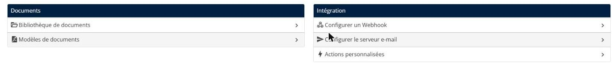
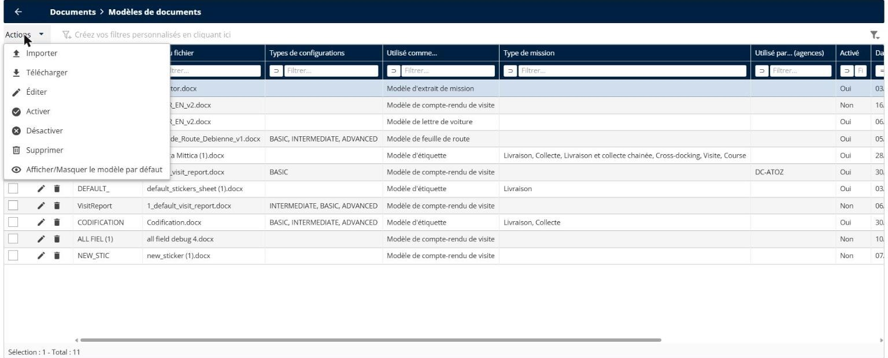
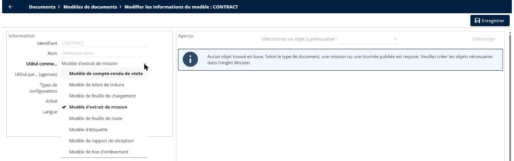

# QR codes sur les extraits de mission

Les **QR codes sur les extraits de mission** vous permettent d’imprimer des QR codes sur les documents que Nomadia Delivery génère à partir de vos modèles. Sur les étiquettes de mission compactes, un code-barres étroit est facile à rater : le PDA ne parvient pas à le lire, le chauffeur scanne à nouveau, et chaque arrêt prend plus de temps. Un QR code encode le même identifiant de mission ou de colis que le code-barres existant : la même donnée est lue du premier coup, même sur la plus petite étiquette.

## Avant de commencer

* Connectez-vous à **Nomadia Delivery** avec un profil utilisateur ayant accès à l’onglet **Configuration**.
* Sachez télécharger, modifier et importer un modèle Word. Pour en savoir plus, voir [Personnalisation des modèles Word](customizing-word-templates.md).

## Présentation de la fonctionnalité

* **Champs QR code** : deux champs dédiés que vous insérez dans un modèle Word, comme les autres champs du modèle :
  * **QR code de l’identifiant de mission** : encode l’identifiant de la mission.
  * **QR code du numéro de colis expéditeur** : encode le numéro de colis de l’expéditeur.

  Chaque champ encode son propre identifiant, indépendamment de l’autre. Retrouvez leur nom exact dans le document **FieldsMaster\_DocumentTemplate**, qui liste tous les champs utilisables dans un modèle.
* **Mode d’affichage** : vous choisissez, modèle par modèle, les codes imprimés, selon les champs que vous placez dans le modèle :
  * **Code-barres uniquement** : conservez le champ du code-barres existant.
  * **QR code uniquement** : remplacez le champ du code-barres par un champ QR code.
  * **Les deux** : placez le code-barres et le QR code côte à côte.
* **Types de modèles** : les champs QR code fonctionnent dans les six types de modèles : **Modèle d’extrait de mission**, **Modèle d’étiquette**, **Modèle de rapport de réception**, **Modèle de bon d’enlèvement**, **Modèle de feuille de route** et **Modèle de feuille de chargement**.
* **Un QR code par mission** : chaque mission enfant d’un extrait de mission imprime son propre QR code, tout comme chaque mission listée sur une feuille de route ou une feuille de chargement.
* **Disponible pour tous les clients** : la fonctionnalité est intégrée au moteur de modèles. Aucune configuration particulière n’est nécessaire.

## Ajouter un QR code à un modèle

1. Accédez à l’onglet **Configuration**. Sous **Documents**, cliquez sur **Modèles de documents**.

2. Sélectionnez le modèle à modifier, par exemple un **Modèle d’extrait de mission**, puis cliquez sur **Actions** > **Télécharger**.

3. Ouvrez le modèle téléchargé dans Microsoft Word.
4. Insérez le champ QR code à l’endroit où le code doit être imprimé, sous forme de champ de fusion :
   * Pour imprimer l’identifiant de mission en QR code, insérez le champ **QR code de l’identifiant de mission**.
   * Pour imprimer le numéro de colis expéditeur en QR code, insérez le champ **QR code du numéro de colis expéditeur**.
   * Pour imprimer **les deux**, conservez le champ du code-barres existant et placez le champ QR code à côté. Pour imprimer **le QR code uniquement**, supprimez le champ du code-barres.

   Pour savoir comment insérer un champ de fusion, voir [Convertir du texte brut en champ de fusion](customizing-word-templates.md#convertir-du-texte-brut-en-champ-de-fusion).
5. Enregistrez le modèle, puis importez-le dans **Modèles de documents** avec **Actions** > **Importer**.
6. Vérifiez que **Utilisé comme...** correspond au type de document, par exemple **Modèle d’extrait de mission**, puis cliquez sur **Enregistrer**.

7. Activez le modèle avec **Actions** > **Activer**.

### Résultat

Les prochains documents générés à partir de ce modèle impriment les QR codes que vous avez placés. Dans un extrait de mission, chaque mission enfant a son propre QR code. Sur une feuille de route ou une feuille de chargement, chaque mission listée a son propre QR code.

## Scanner le QR code sur le terrain

1. Imprimez les documents comme d’habitude, par exemple les étiquettes de mission.
2. Scannez le QR code avec le PDA.

### Résultat

Le PDA lit le QR code du premier coup, même sur une étiquette compacte. Les échecs de lecture diminuent, et la collecte et la livraison sont plus rapides.

## Conseils


**Commencez par les deux** : imprimez le code-barres et le QR code côte à côte pendant la transition, afin que tous les lecteurs continuent de fonctionner pendant que vos équipes passent aux QR codes.



**Utilisez le QR code sur les petites étiquettes** : le QR code est surtout utile sur les étiquettes compactes, où un code-barres étroit est le plus difficile à lire.



**Insérez des champs de fusion, pas du texte brut** : un champ QR code saisi en texte brut n’est pas remplacé lors de la génération du PDF. Insérez-le sous forme de champ de fusion.


## Rubriques connexes

* [Gérer les modèles de documents](README.md)
* [Personnalisation des modèles Word](customizing-word-templates.md)
* [Accès à eCMR](accessing-ecmr.md)
