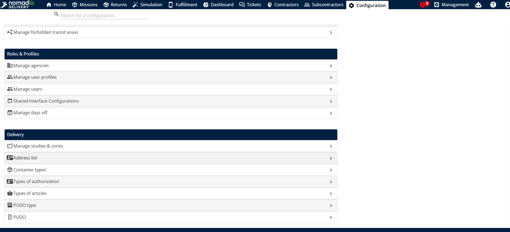
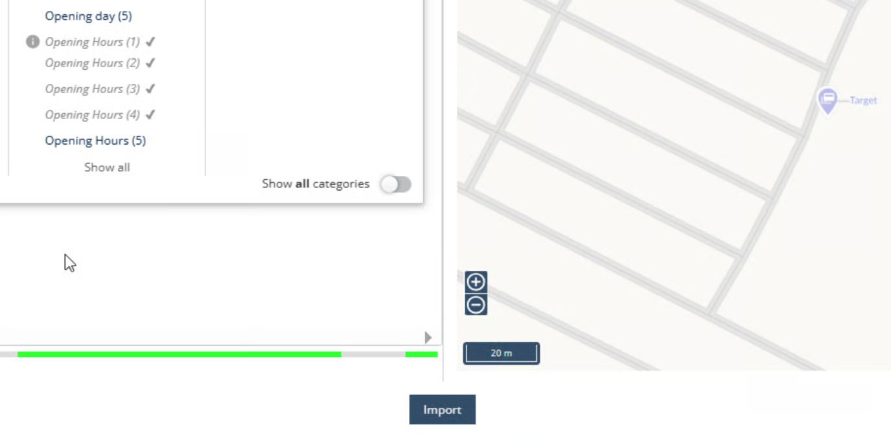

# Gérer la liste globale d’adresses

Nomadia Delivery vous permet de gérer une liste d’adresses qui sert de référentiel principal des informations clients. Cela contribue à améliorer à la fois la rapidité et la précision de la création des missions. Pour créer une liste globale d’adresses, suivez ces étapes :

## Avant de commencer

* Pour un import, un fichier Excel contenant les adresses.

## Étapes

1. Ouvrez la page **Configuration**.
2. Cliquez sur **Liste d’adresses**.

<figure><figcaption></figcaption></figure>

3. Pour créer une nouvelle liste d’adresses, cliquez sur le bouton **Actions**, puis sélectionnez **Ajouter**.
4. Vous pouvez également importer une liste d’adresses depuis un fichier Excel en cliquant sur le bouton **Importer** et en sélectionnant le fichier souhaité.

<figure><figcaption></figcaption></figure>

5. Lors de l’importation, assurez-vous de faire correspondre les champs d’adresse ou les coordonnées X et Y.
6. Cliquez sur **Valider** pour faire correspondre les données restantes dans la liste d’adresses.

<figure><figcaption></figcaption></figure>

7. Un aperçu de tous les emplacements à importer sera affiché pendant le processus d’importation.

8. Faites correspondre les champs de données supplémentaires dans la liste d’adresses, tels que Prénom, Nom, Fonction, E-mail, etc.

<figure><figcaption></figcaption></figure>

9. Après avoir fait correspondre tous les champs requis, cliquez sur **Importer** pour téléverser la liste d’adresses dans Nomadia Delivery.

<figure><figcaption></figcaption></figure>

### Résultat

La liste d’adresses affiche tous les clients sur une carte en fonction de leur localisation géographique.

## Définir le type d’adresse

1. Ouvrez la page **Configuration**.
2. Cliquez sur **Liste d’adresses**.
3. Cliquez sur l’**icône en forme de crayon** en regard de l’adresse que vous souhaitez modifier.
4. Sous **Contact**, sélectionnez le **Type d’adresse**.

<figure><figcaption></figcaption></figure>

**Remarque :** si vous sélectionnez **Retrait et livraison**, l’adresse apparaît à la fois dans les listes d’adresses de retrait et de livraison. Si vous sélectionnez uniquement **Retrait** ou uniquement **Livraison**, l’adresse apparaît seulement dans la liste correspondante lorsque vous saisissez une adresse.

<figure><figcaption></figcaption></figure>

## Rubriques connexes

* [Gérer la liste d’adresses](contractors/manage-address-list.md)
* [Personnaliser la visibilité des adresses](contractors/customizetheaddresslistvisibility.md)
* [Mapper les champs d’adresse depuis la liste globale d’adresses](missions/map-the-addresses-fields-from-the-global-address-list.md)
