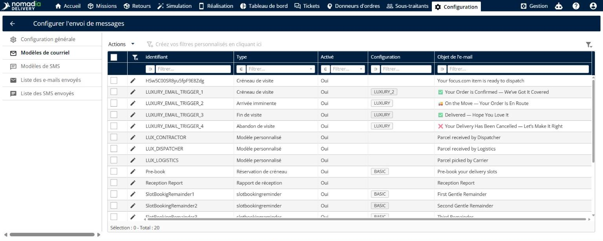
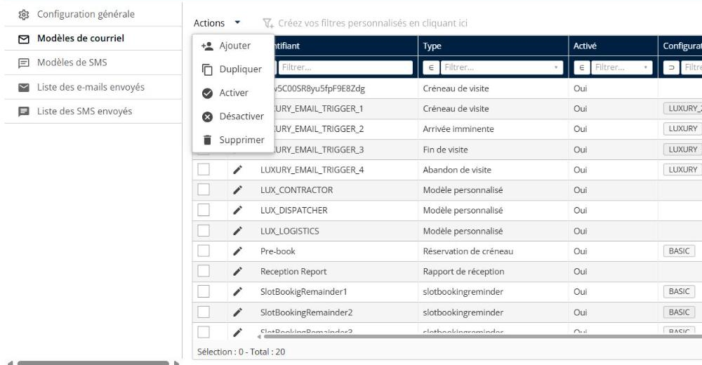
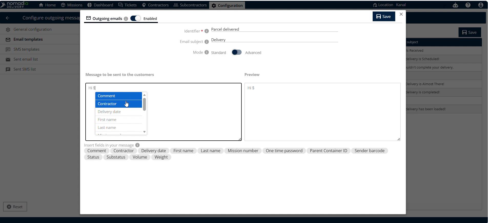

# Modèles personnalisés

**Modèles personnalisés** est une fonctionnalité de **Nomadia Delivery** qui vous permet de personnaliser les e-mails de notification envoyés à vos clients. Les modèles personnalisés offrent à vos clients des mises à jour claires et à votre image, directement dans leur boîte de réception. Cela améliore la communication avec vos clients et simplifie vos opérations de livraison.

## Avant de commencer

Prérequis et configuration système :

* Compte répartiteur ou planificateur actif dans **Nomadia Delivery**.
* Navigateur Web avec une connexion Internet active.

Étapes de configuration initiale :

1. Ouvrez la page **Configuration**.
2. Faites défiler la page vers le bas et cliquez sur **Configurer les messages sortants**.

3. Cliquez sur **Modèles d’e-mail** sur le côté gauche de l’écran.

## Présentation de la fonctionnalité

* **Modèles d’e-mail** : Menu de gauche où sont listés tous vos modèles configurés.
* **Actions** : Bouton déroulant qui ouvre les commandes permettant de gérer vos modèles d’e-mail.
* **Ajouter** : Option de menu pour commencer la création d’un nouveau modèle d’e-mail.
* **Modèle personnalisé** : Zone de sélection utilisée pour choisir le type de modèle.
* **Identifiant** : Champ de saisie de texte où vous définissez un nom de modèle unique.
* **Objet de l’e-mail** : Champ de texte où vous saisissez l’objet de l’e-mail.
* **Mode standard vers avancé** : Interrupteur qui bascule l’interface de l’éditeur entre l’édition standard et avancée.
* **Message** : Éditeur de texte où vous saisissez le corps de l’e-mail.

## Configurer un modèle d’e-mail client personnalisé

1. Ouvrez la page **Configuration**.
2. Faites défiler la page vers le bas et cliquez sur **Configurer les messages sortants**.

3. Cliquez sur **Modèles d’e-mail** sur le côté gauche de l’écran.

4. Cliquez sur **Actions**.

5. Cliquez sur **Ajouter**.

6. Cliquez sur **Modèle personnalisé** pour sélectionner votre modèle personnalisé.

7. Saisissez un nom de modèle unique dans le champ **Identifiant**.

8. Saisissez votre objet dans le champ **Objet de l’e-mail**.
9. Basculez l’interrupteur de mode de **Mode standard** vers **Mode avancé** si vous le souhaitez.

10. Saisissez le texte de votre modèle dans le champ **Message**.

Utilisez le mot-clé **$** pour ajouter les champs appropriés.

11. Cliquez sur **Enregistrer** dans le coin supérieur droit pour enregistrer vos modifications.

## Conseils


**Basculement de mode** : Basculez de **Mode standard** vers **Mode avancé** si vous souhaitez utiliser les options d’édition avancées.


## Rubriques connexes

* [E-mail](email.md)
* [SMS](sms.md)
* [Notifications groupées pour les missions de conteneur](../manage-container-types/groupnotificationsforthecontainermissions.md)
