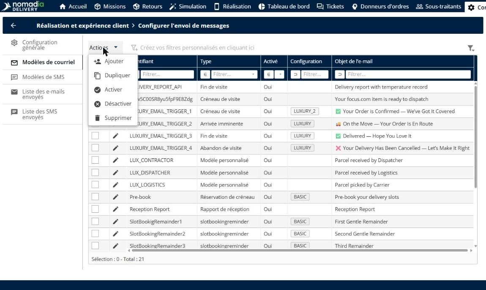
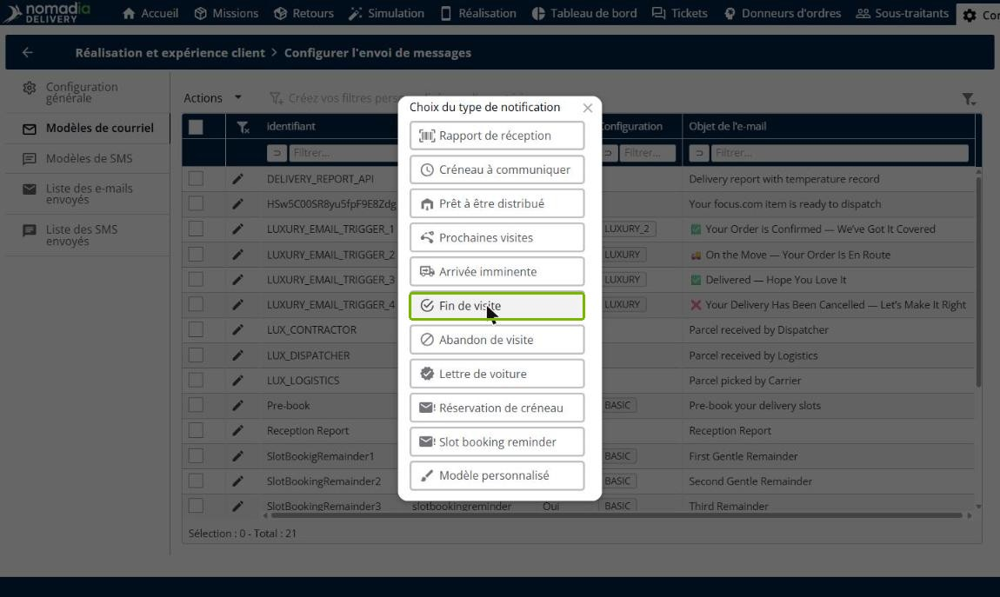
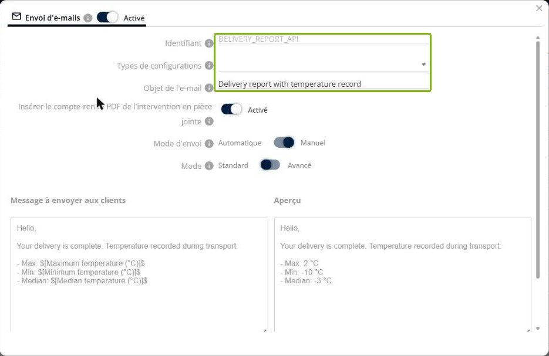
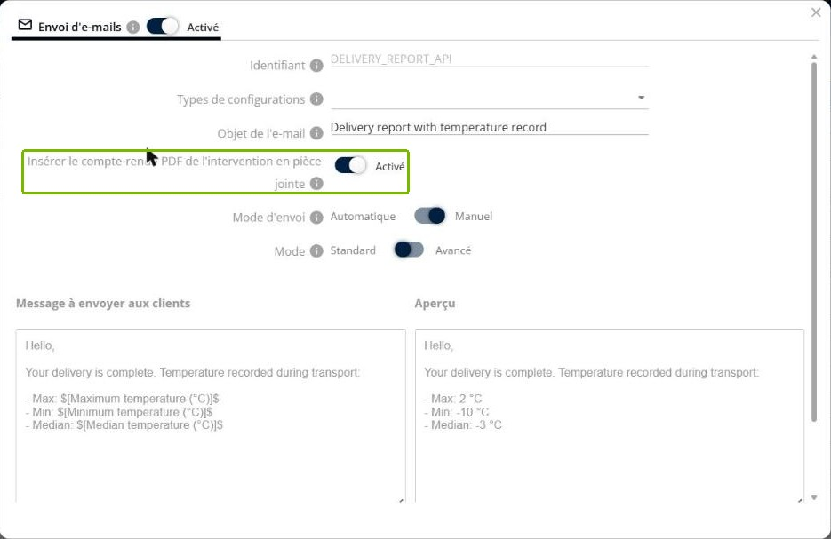
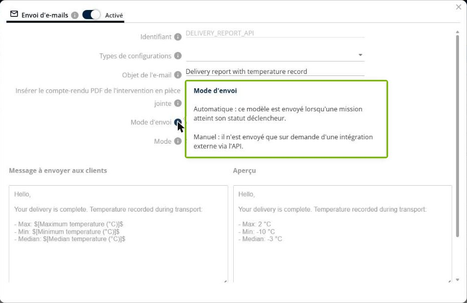
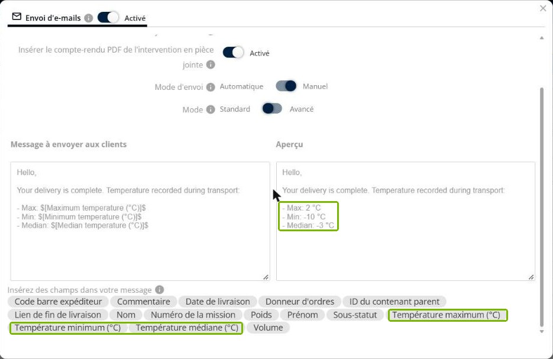
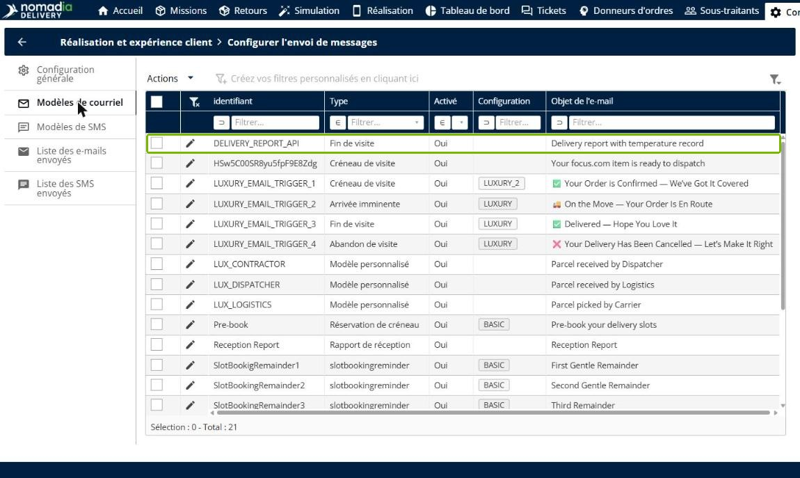
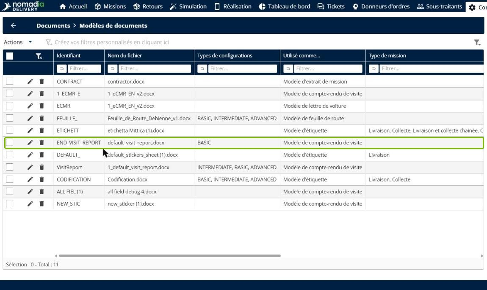
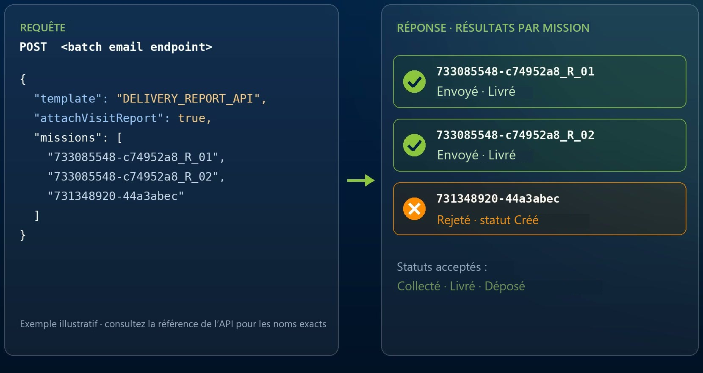
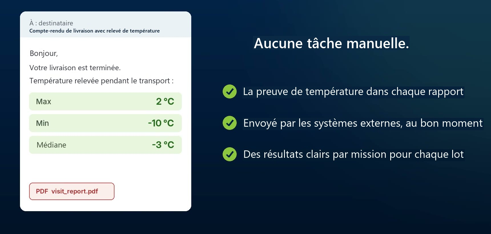

# Envoyer des comptes-rendus par e-mail via l’API

**Envoyer des comptes-rendus par e-mail via l’API** permet à un système externe, comme un ERP, un WMS ou un TMS, d’envoyer aux destinataires des e-mails de compte-rendu de livraison via l’API Nomadia. Vous préparez un modèle de courriel en mode d’envoi **Manuel**, vous y ajoutez la température relevée pendant le transport et vous joignez le compte-rendu PDF de fin de visite. Le système externe appelle ensuite l’endpoint d’envoi groupé d’e-mails pour une liste de missions terminées, et l’API renvoie un résultat pour chaque mission.

## Avant de commencer

* Connectez-vous à **Nomadia Delivery** avec un accès à **Configuration**.
* Assurez-vous que le système externe qui appellera l’API dispose d’une clé d’API valide. Pour en savoir plus, consultez [Gestion sécurisée des clés d’API](../secure-api-key-management.md).
* Assurez-vous que vos missions enregistrent les données de température pendant le transport.

## Présentation de la fonctionnalité

* **Mode d’envoi Manuel** : un modèle en mode **Manuel** n’est jamais envoyé automatiquement lorsqu’une mission change de statut. Il n’est envoyé que sur demande d’une intégration externe via l’API.
* **Variables de température** : les champs **Température maximum (°C)**, **Température minimum (°C)** et **Température médiane (°C)** insèrent dans l’e-mail la température relevée pendant le transport.
* **PDF de fin de visite** : l’interrupteur **Insérer le compte-rendu PDF de l’intervention en pièce jointe** joint le compte-rendu de visite à l’e-mail.
* **Endpoint d’envoi groupé d’e-mails** : endpoint de l’API que le système externe appelle avec l’identifiant du modèle et une liste de missions.
* **Résultats par mission** : la réponse de l’API indique, pour chaque mission, si l’e-mail a été envoyé ou rejeté.
* **Statuts acceptés** : un e-mail n’est envoyé que pour les missions au statut **Collecté**, **Livré** ou **Déposé**.

## Ajouter un modèle de courriel

1. Allez dans **Configuration** > **Réalisation et expérience client** > **Configurer l’envoi de messages**, puis cliquez sur **Modèles de courriel**.
2. Cliquez sur **Actions**, puis sur **Ajouter**.

3. Dans la fenêtre **Choix du type de notification**, cliquez sur **Fin de visite**.

## Nommer le modèle et joindre le PDF de fin de visite

1. Dans le champ **Identifiant**, saisissez un nom unique pour le modèle, par exemple **DELIVERY\_REPORT\_API**. Le système externe utilise cet identifiant pour appeler le modèle.
2. Dans le champ **Objet de l’e-mail**, saisissez l’objet de l’e-mail, par exemple **Delivery report with temperature record** (compte-rendu de livraison avec relevé de température).

3. Activez **Insérer le compte-rendu PDF de l’intervention en pièce jointe**.

## Régler le mode d’envoi sur Manuel

1. Réglez **Mode d’envoi** sur **Manuel**.


**Automatique** : le modèle est envoyé lorsqu’une mission atteint son statut déclencheur.\
**Manuel** : le modèle n’est envoyé que sur demande d’une intégration externe via l’API.


## Insérer les variables de température

1. Dans le champ **Message à envoyer aux clients**, saisissez votre message.
2. Sous **Insérez des champs dans votre message**, cliquez sur **Température maximum (°C)**, **Température minimum (°C)** et **Température médiane (°C)** pour ajouter la température relevée pendant le transport.

L’**Aperçu** affiche le message avec des valeurs d’exemple, comme **2 °C**, **-10 °C** et **-3 °C**.

3. Cliquez sur **Enregistrer**.

### Résultat

Le modèle apparaît dans la liste **Modèles de courriel** avec le type **Fin de visite**.

Les mêmes variables de température sont aussi disponibles dans les modèles de documents : vous pouvez ainsi ajouter les températures maximum, minimum et médiane à vos comptes-rendus de visite. Pour en savoir plus, consultez [Gérer les modèles de documents](../manage-document-templates/README.md).

## Envoyer les comptes-rendus depuis un système externe

Le système externe appelle l’endpoint d’envoi groupé d’e-mails avec :

* l’identifiant du modèle, par exemple **DELIVERY\_REPORT\_API** ;
* l’indication de joindre ou non le compte-rendu de visite ;
* la liste des missions concernées.

L’API renvoie un résultat pour chaque mission. Les e-mails des missions au statut **Collecté**, **Livré** ou **Déposé** sont envoyés. Les autres missions, par exemple une mission encore au statut **Créé**, sont rejetées.


La requête ci-dessus est un exemple illustratif. Consultez la référence de l’API pour connaître l’endpoint et les noms de champs exacts.


### Résultat

Chaque destinataire reçoit l’e-mail de compte-rendu de livraison avec les températures maximum, minimum et médiane relevées pendant le transport, ainsi que le compte-rendu PDF de fin de visite en pièce jointe.

## Conseils


**Vérifiez les résultats par mission** : lisez la réponse de l’API après chaque lot pour repérer les missions rejetées, et renvoyez-les dès qu’elles atteignent un statut accepté.



**Gardez un identifiant stable** : le système externe appelle le modèle par son identifiant. Si vous renommez le modèle, mettez aussi à jour l’intégration.


## Rubriques connexes

* [Modèles personnalisés](customtemplates.md)
* [E-mail](email.md)
* [Gérer les modèles de documents](../manage-document-templates/README.md)
* [Gestion sécurisée des clés d’API](../secure-api-key-management.md)
